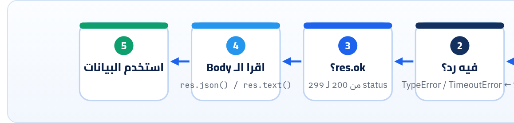

<small>المرحلة 3 · تتكلم مع API</small>

في كورس Jonas هتكتب fetch و async/await. بس أغلب الكود اللي بتشوفه بيقع في نفس الفخ: fetch مبيرميش Error لما الـ API يرجّع 404 أو 500. الفصل ده بيشرح fetch من ناحية الـ API: الـ Response وفيه إيه، و res.ok، والـ Body اللي بيتقري مرة واحدة، و POST بـ JSON، والـ Timeouts، وبعدين نبني Helper صغير تستخدمه في كل مشروع، ونمشي بيه ورا Pagination حقيقية.

:::note[بعد الفصل ده هتكون عارف]
- fetch بيرجّع Promise لـ Response، ومبيقعش على 4xx/5xx
- res.status و res.ok و res.headers.get و res.json() و res.text()
- POST بـ JSON: method و headers و body=JSON.stringify
- أنواع الفشل التلاتة: الشبكة، والـ Timeout، والـ HTTP
- AbortSignal.timeout و URLSearchParams
- Helper اسمه api() بيجمع كل ده، ولوب بيمشي ورا next
- fetch في Node 24 وفي المتصفح: الفرق (CORS)
:::

:::note[محتاج تفتكر async/await؟]
كل كود الفصل ده فيه `await`. لو مش فاكر هي بتعمل إيه: `fetch` بترجّع Promise (وعد إن الرد جاي)، و `await` = "استنى الوعد ده يتحقق وهات النتيجة"، ومكانها جوه دالة `async` أو في أول ملف `.mjs`. الشرح بالتشبيه في كتاب الإنترنت (فصل 7)، وتشغيل ملفات `.mjs` في صندوق فصل 3 هنا.
:::

<a id="s10-1"></a>

## 10.1 الفخ الأشهر: fetch مبيقعش على 404

جرّب ده في Node 24 (أو Console المتصفح):

```js title="f1.mjs"
const r404 = await fetch("https://api.github.com/repos/nope-xx/nope");
console.log(r404.status, r404.ok);
console.log(await r404.json());
```

```sh title="Terminal"
$ node f1.mjs
404 false
{
  message: 'Not Found',
  documentation_url: 'https://docs.github.com/rest/repos/repos#get-a-repository',
  status: '404'
}
```

مفيش Error! الـ `fetch` بيعتبر إن "السيرفر رد" يبقى نجاح، حتى لو الرد "مش لاقي". وده مقصود في المواصفة: الـ Promise بتتـ Reject بس لو **مفيش رد خالص** (الشبكة وقعت، أو الـ DNS فشل، أو اتلغى). فلو كتبت `const data = await (await fetch(url)).json()` من غير ما تبص على الـ Status، كودك هيكمّل بـ `{message: "Not Found"}` كأنه البيانات، ويقع بعدها بـ 10 سطور في حتة ملهاش علاقة.



*فيه مرحلتين فشل منفصلين: الأولى fetch بترميها لوحدها (مفيش رد). والتانية انت اللي لازم تشيكها بـ res.ok (فيه رد بس مش نجاح). ومعظم الـ Bugs من نسيان التانية.*

<a id="s10-2"></a>

## 10.2 الـ Response فيه إيه

```js
const res = await fetch("https://api.github.com/repos/expressjs/express", {
  headers: { Accept: "application/vnd.github+json", "User-Agent": "apis-json-book" },
});
console.log(res.status, res.ok, res.statusText);
console.log(res.headers.get("content-type"));
console.log(res.headers.get("x-ratelimit-remaining"));
const repo = await res.json();
console.log(repo.full_name, repo.stargazers_count);
```

```sh title="Terminal"
200 true OK
application/json; charset=utf-8
52
expressjs/express 69577
```

| الأمر | بيعمل إيه |
|---|---|
| `fetch(url, options)` | بترجّع **Promise** لـ `Response`، فلازم `await`. والـ `options` Object فيه `method` و`headers` و`body` و`signal`… |
| `headers: { … }` | Object عادي: الـ Key اسم الـ Header. واللي فيه شرطة لازم بين `"…"`: `"User-Agent"`. |
| `res.status` | الرقم (200). و`res.statusText` الكلمة (`"OK"`)، وفي HTTP/2 ممكن تبقى فاضية، فاعتمد على الرقم. |
| `res.ok` | `true` لو الـ Status من 200 لـ 299. ده الشيك اللي لازم تعمله. |
| `res.headers.get("…")` | قيمة Header. ومش فارق Capital ولا Small. ولو مش موجود: `null`. |
| `await res.json()` | اقرا الـ Body كله واعمله `JSON.parse`. Promise برضه، لأن الـ Body ممكن يكون لسه بيوصل. |

:::danger[مشكلة: TypeError: Body is unusable: Body has already been read]
**العَرَض**: ناديت `res.json()` مرتين، أو `res.text()` وبعدين `res.json()`.

**السبب**: الـ Body Stream بيتقري **مرة واحدة بس**. وده الخطأ الحقيقي اللي طلع في Node 24.

**الحل**: اقراه مرة في متغير: `const text = await res.text()` وبعدين `JSON.parse(text)` لو محتاج الاتنين. أو `res.clone()` قبل القراية.
:::

**طرق قراية الـ Body**

| الـ Method | بترجّع | إمتى |
|---|---|---|
| `res.json()` | Object / Array | الـ `content-type` فيه json |
| `res.text()` | String | HTML أو نص، أو لما مش متأكد (Debug) |
| `res.blob()` / `res.arrayBuffer()` | بايتات | صور وملفات |
| `res.body` | Stream | Streaming (زي ردود الـ AI) |

**المصادر الرسمية:** [MDN · Using the Fetch API](https://developer.mozilla.org/en-US/docs/Web/API/Fetch_API/Using_Fetch) · [MDN · Response](https://developer.mozilla.org/en-US/docs/Web/API/Response) · [MDN · Response.ok](https://developer.mozilla.org/en-US/docs/Web/API/Response/ok)

<a id="s10-3"></a>

## 10.3 POST بـ JSON

```js
const created = await fetch("https://jsonplaceholder.typicode.com/posts", {
  method: "POST",
  headers: { "Content-Type": "application/json" },
  body: JSON.stringify({ title: "Hello", userId: 1 }),
});
console.log(created.status, created.headers.get("location"), await created.json());
// 201 https://jsonplaceholder.typicode.com/posts/101 { title: 'Hello', userId: 1, id: 101 }
```

| الأمر | بيعمل إيه |
|---|---|
| `method: "POST"` | الافتراضي `"GET"`. ومينفعش GET يبقى فيه `body` (fetch بيرمي TypeError). |
| `"Content-Type": "application/json"` | نفس درس `curl -d` في فصل 8: من غيره، الـ `body` اللي هو String هيتبعت `text/plain;charset=UTF-8`، وسيرفر Express بـ `express.json()` **هيتجاهله** ويبقى `req.body` فاضي. |
| `body: JSON.stringify({ … })` | لازم String. لو حطيت الـ Object نفسه، هيتحوّل للنص `"[object Object]"`! |

<a id="s10-4"></a>

## 10.4 أنواع الفشل التلاتة

```js
try {
  await fetch("https://httpbin.org/delay/5", { signal: AbortSignal.timeout(2000) });
} catch (e) {
  console.log(e.name, e.message);   // TimeoutError The operation was aborted due to timeout
}

try {
  await fetch("https://does-not-exist.example.invalid/");
} catch (e) {
  console.log(e.name, e.message, e.cause?.code);   // TypeError fetch failed …
}
```

**إزاي تعرف إيه اللي حصل**

| الحالة | بيظهر إزاي | تعمل إيه |
|---|---|---|
| مفيش شبكة، أو Domain غلط، أو السيرفر قافل | `TypeError: fetch failed`، والتفاصيل في `e.cause.code` (زي `ENOTFOUND` أو `ECONNREFUSED` في Node). وفي المتصفح: `TypeError: Failed to fetch` من غير تفاصيل | Retry بعد شوية، أو بلّغ المستخدم إنه Offline |
| السيرفر أبطأ من الحد | `TimeoutError` (مع `AbortSignal.timeout`) | Retry محدود |
| السيرفر رد بغلط | **مفيش Error**: `res.ok === false` | اقرا الـ Body: 4xx صلّح الطلب، 429/5xx Retry (كتاب Python for AI فصل 25 فيه الـ Backoff) |

| الأمر | بيعمل إيه |
|---|---|
| `AbortSignal.timeout(2000)` | Signal بيلغي الطلب بعد 2000 ميلّي ثانية. **fetch معندوش Timeout افتراضي** تتحكم فيه من الكود، فحط واحد دايماً في الكود اللي بيشتغل لوحده. |
| `e.cause?.code` | في Node، الـ Error الحقيقي جوه `cause`. والـ `?.` علشان لو `cause` مش موجود ميقعش. |

:::note[الـ Error اللي طلع عندنا]
في بيئة الكتابة، الـ Domain الغلط طلّع `TypeError fetch failed` و`cause.code` = `ECONNRESET` بسبب الـ Network بتاع البيئة. على الماك عندك المتوقع `ENOTFOUND` (الـ DNS ملقاش الاسم). الفكرة واحدة: `TypeError` = مفيش رد.
:::

<a id="s10-5"></a>

## 10.5 URLSearchParams: Query string صح

```js
const params = new URLSearchParams({ q: "APIs و JSON", limit: 2 });
params.toString();                      // 'q=APIs+%D9%88+JSON&limit=2'
await fetch(`https://httpbin.org/get?${params}`).then((r) => r.json());
// args: { limit: '2', q: 'APIs و JSON' }
```

نفس فكرة `--data-urlencode`: بيعمل الـ Encoding للمسافات والعربي والـ `&` لوحده. ومتركّبش `?q=${q}` بإيدك: لو `q` فيها `&` هتقسم الـ Query لاتنين. ولاحظ إن الأرقام بتوصل String (`'2'`): الـ Query string كله نص، والسيرفر هو اللي يحوّل (فصل 22).

**المصادر الرسمية:** [MDN · AbortSignal.timeout()](https://developer.mozilla.org/en-US/docs/Web/API/AbortSignal/timeout_static) · [MDN · URLSearchParams](https://developer.mozilla.org/en-US/docs/Web/API/URLSearchParams) · [Node.js 24 · fetch](https://nodejs.org/docs/latest-v24.x/api/globals.html#fetch)

<a id="s10-6"></a>

## 10.6 Helper واحد لكل مشروع

بدل ما تكرر الشيكات دي في كل حتة، اعمل Function واحدة. ودي اللي هتستخدمها في المشروع (فصل 23):

```js title="api.mjs"
export class ApiError extends Error {
  constructor(status, body, url) {
    super(`HTTP ${status} for ${url}`);
    this.name = "ApiError";
    this.status = status;
    this.body = body;
  }
}

export async function api(url, { method = "GET", body, token, timeout = 10_000 } = {}) {
  const headers = { Accept: "application/json" };
  if (body !== undefined) headers["Content-Type"] = "application/json";
  if (token) headers.Authorization = `Bearer ${token}`;

  const res = await fetch(url, {
    method,
    headers,
    body: body === undefined ? undefined : JSON.stringify(body),
    signal: AbortSignal.timeout(timeout),
  });

  const type = res.headers.get("content-type") ?? "";
  const data = res.status === 204 ? null
    : type.includes("json") ? await res.json()
    : await res.text();

  if (!res.ok) throw new ApiError(res.status, data, url);
  return data;
}
```

```js title="سطر سطر"
class ApiError extends Error
{ method = "GET", body, token, timeout = 10_000 } = {}
if (body !== undefined) headers["Content-Type"] = …
headers.Authorization = `Bearer ${token}`
res.status === 204 ? null : …
type.includes("json") ? await res.json() : await res.text()
if (!res.ok) throw new ApiError(…)
```

1. `class ApiError extends Error`: Error خاص بينا شايل الـ `status` والـ `body`، علشان اللي بينادي يقدر يقرر (يعيد على 429، يعرض رسالة على 422…). وبـ `instanceof ApiError` يفرّق بينه وبين غلطة شبكة.
2. `{ method = "GET", body, token, timeout = 10_000 } = {}`: Destructuring بقيم افتراضية (كورس Jonas). والـ `= {}` في الآخر علشان لو ناديت `api(url)` من غير Options ميقعش. و`10_000` = 10000 (الـ `_` للقراية).
3. `if (body !== undefined) headers["Content-Type"] = …`: نحط `Content-Type` بس لو فيه Body فعلاً. والـ Bracket notation لأن الاسم فيه شرطة.
4. `` headers.Authorization = `Bearer ${token}` ``: شكل الـ Bearer token (فصل 12). كلمة `Bearer` ومسافة وبعدين الـ Token.
5. `res.status === 204 ? null : …`: **204 No Content** مفيهوش Body، و`res.json()` عليه بيقع بـ <em>Unexpected end of JSON input</em> (فصل 5).
6. `type.includes("json") ? await res.json() : await res.text()`: بيغطي `application/json` و`application/problem+json` و`…+json`. وأي حاجة تانية (زي صفحة HTML غلط) نقراها نص بدل ما `json()` يقع بـ `Unexpected token '<'`.
7. `if (!res.ok) throw new ApiError(…)`: هنا بنحوّل "رد غلط" لـ Exception، فبقى سلوكه زي غلطة الشبكة: لازم حد يمسكه.

```js title="use.mjs"
import { api, ApiError } from "./api.mjs";

try {
  await api("https://api.github.com/repos/nope-xx/nope");
} catch (err) {
  if (err instanceof ApiError) console.log(err.message, "|", err.body.message);
  else throw err;
}

let url = "https://rickandmortyapi.com/api/character?status=dead";
let dead = 0, pages = 0;
while (url) {
  const page = await api(url);
  dead += page.results.length;
  pages++;
  url = page.info.next;
}
console.log({ pages, dead });
```

```sh title="Terminal"
$ node use.mjs
HTTP 404 for https://api.github.com/repos/nope-xx/nope | Not Found
{ pages: 15, dead: 287 }
```

| الأمر | بيعمل إيه |
|---|---|
| `else throw err` | أي Error مش بتاعنا (شبكة أو Bug) نرميه تاني زي ما هو. متبلعش الأخطاء. |
| `while (url) { … url = page.info.next }` | امشي ورا `next` لحد ما يبقى `null` (اللوب يقف لوحده). 15 طلب جابوا 287 شخصية `dead` وقت الكتابة. وفي API حقيقي حط `await` صغير بين الطلبات أو حد أقصى للصفحات علشان الـ Rate limit. |

<a id="s10-7"></a>

## 10.7 Node ضد المتصفح

#### fetch في Node 24

- موجود جاهز (من Node 18)، من غير `npm install`.
- مفيش CORS: أي سيرفر تقدر تكلّمه.
- بيبعت `User-Agent: node` لوحده.
- الأسرار (Tokens) آمنة لأنها على جهازك أو السيرفر.

#### fetch في المتصفح

- نفس الـ API بالظبط.
- **CORS**: الـ Response بيتقري بس لو السيرفر سمح (فصل 13، وكتاب الإنترنت فصل 14).
- بعض الـ Headers ممنوعة (زي `User-Agent` و `Cookie`).
- **أي Token في الكود ظاهر لأي حد**: افتح DevTools وهتلاقيه.

:::tip[حاجة مشتركة: نفس الـ Helper في Python]
في كتاب Python for AI (فصل 11) عملنا نفس الفكرة بـ `requests`: `r = requests.get(url, timeout=10)` وبعدين `r.raise_for_status()` اللي بترمي Error لو الـ Status ≥ 400. يعني `raise_for_status()` = `if (!res.ok) throw …`. والـ `timeout=10` = `AbortSignal.timeout(10_000)`. ونفس القاعدة: من غير Timeout، الاسكريبت ممكن يستنى للأبد.
:::

:::tip[ملخص الفصل]
- `fetch` مبيرميش Error على 4xx/5xx. شيك `res.ok` دايماً.
- `res.status` و`res.headers.get` و`res.json()`/`res.text()`، والـ Body بيتقري مرة واحدة.
- POST: `method` + `Content-Type: application/json` + `body: JSON.stringify(…)`.
- تلات أنواع فشل: `TypeError` (مفيش رد)، و`TimeoutError`، و`!res.ok`.
- `AbortSignal.timeout(ms)` دايماً، و`URLSearchParams` للـ Query.
- Helper واحد بيرجّع البيانات أو يرمي `ApiError` فيه الـ Status والـ Body.
:::

### صح ولا غلط؟

1. `await fetch(url)` بيرمي Error لو الـ API رجّع 500.
2. `body: { title: "x" }` من غير stringify بيتبعت JSON صح.
3. تقدر تنادي `res.json()` مرتين على نفس الـ Response.

### أسئلة مراجعة

1. إمتى الـ Promise بتاعة fetch بتتـ Reject؟ وإمتى لأ؟
2. ليه الـ Helper بيشيك على 204 قبل `res.json()`؟
3. إيه اللي هيحصل في سيرفر Express لو نسيت `Content-Type: application/json`؟
4. ليه متحطش API key سري في كود Frontend؟

### تحديات الفصل

<small>جرّبها بإيدك، والحلول في ملحق الإجابات.</small>

1. **[سهل]** اكتب `fetch` لـ `https://httpbin.org/status/503` واطبع `status` و`ok`، واتأكد إن مفيش Error.
2. **[متوسط]** زوّد على الـ Helper: لو الـ Status 429 أو 503 وفيه `Retry-After`، استنى الثواني دي وأعد مرة واحدة بس.
3. **[صعب]** اكتب `paginate(url)` كـ `async function*` (Async generator) بيعمل `yield` لكل عنصر، وتستخدمه بـ `for await (const c of paginate(url))`.
