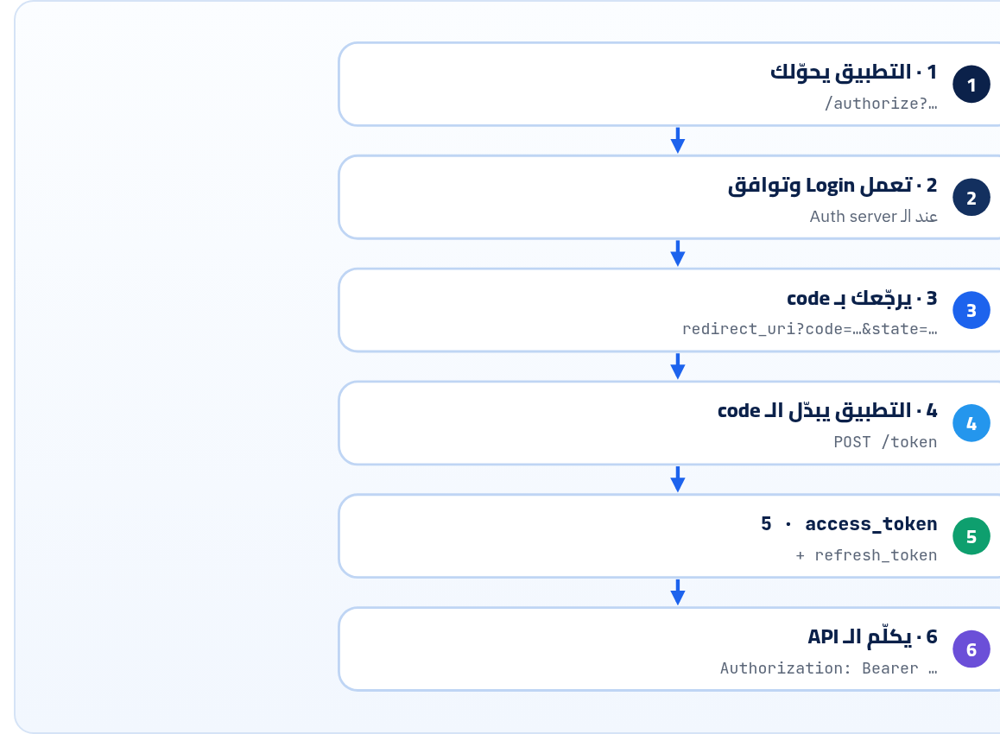

<small>المرحلة 4 · الـ Auth</small>

زمان، علشان تطبيق يجيب أصحابك من Gmail، كان بيطلب منك باسورد Gmail نفسه! OAuth اتعمل علشان يحل المصيبة دي: تدّي التطبيق مفتاح محدود ومؤقت بدل المفتاح الرئيسي. هنمشي على الـ Flows الأربعة اللي هتقابلها خطوة بخطوة بالـ URLs والـ Parameters، وبعدين نلبس طاقية السيرفر ونفهم الـ CORS: إيه الـ Headers اللي الـ API بتاعك لازم يرجّعها علشان موقعك يقدر يكلّمه.

:::note[بعد الفصل ده هتكون عارف]
- المشكلة: Password anti-pattern، والحل: مفتاح الـ Valet
- الأدوار الأربعة: Resource owner و Client و Authorization server و Resource server
- Authorization Code + PKCE خطوة بخطوة، وكل Parameter
- Client Credentials و Device flow و Refresh
- ليه Implicit و Password اتشالوا (RFC 9700 و OAuth 2.1)
- OpenID Connect و id\_token في سطرين
- CORS من ناحية الـ API: Allow-Origin و Methods و Headers و Credentials و Expose و Max-Age
- الـ Preflight بيحصل إمتى، وتجربة حقيقية على Express
:::

<a id="s13-1"></a>

## 13.1 الحكاية: التطبيقات اللي كانت بتطلب باسوردك

حوالي 2007، مواقع كتير كان فيها زرار "اعزم أصحابك من Gmail". وكانت بتعمل كده إزاي؟ **بتطلب منك إيميلك وباسورد Gmail**، وتدخل بيهم بالنيابة عنك وتسحب الـ Contacts. **وهنا كانت المشكلة**: الموقع ده بقى معاه مفتاح بيتك كله: يقرا إيميلاتك، ويبعت باسمك، ويغيّر الباسورد. ولو عايز تلغي ده، لازم تغيّر باسوردك نفسه في كل حتة. والاسم اللي الناس سمّته للحكاية دي: **Password anti-pattern**.

**فاتطور حل**: زي "مفتاح الـ Valet" في العربيات الغالية: مفتاح بيشغّل العربية ويسوقها مسافة صغيرة، بس مبيفتحش الشنطة ولا الدرج. **OAuth 2.0** (RFC 6749، سنة 2012) بيخلّي Google نفسها تسألك: "التطبيق ده عايز يقرا الـ Contacts بس. موافق؟". ولو وافقت، Google تدّي التطبيق **Access token** محدود (Scopes) ومؤقت، وتقدر تلغيه في أي وقت من غير ما تغيّر باسوردك. والتطبيق **عمره ما يشوف الباسورد**.

<a id="s13-2"></a>

## 13.2 الأدوار الأربعة

**مين مين في OAuth**

| الدور | يعني | في مثال "Login with GitHub" لموقع مقالات |
|---|---|---|
| Resource owner | صاحب البيانات | انت |
| Client | التطبيق اللي عايز يوصل | موقع المقالات |
| Authorization server | اللي بيسألك ويدّي التوكن | `github.com/login/oauth/…` |
| Resource server | الـ API اللي فيه البيانات | `api.github.com` |

<a id="s13-3"></a>

## 13.3 Authorization Code + PKCE: الـ Flow الأساسي

ده اللي بيحصل لما تدوس "Sign in with Google" أو "Login with GitHub" في أي موقع أو تطبيق. 6 خطوات:



*الـ code اللي بيعدّي في المتصفح (خطوة 3) لوحده مالوش قيمة: لازم يتبدّل في خطوة 4 من التطبيق نفسه، ومعاه إثبات إنه نفس اللي بدأ الطلب (PKCE). والـ access\_token عمره ما بيظهر في شريط العنوان.*

### خطوة 1: الـ Redirect للـ Authorization server

```http
GET https://auth.example.com/authorize
  ?response_type=code
  &client_id=articles-web
  &redirect_uri=https%3A%2F%2Farticles.example.com%2Fcallback
  &scope=articles%3Aread%20profile
  &state=x7Fq2kLp
  &code_challenge=E9Melhoa2OwvFrEMTJguCHaoeK1t8URWbuGJSstw-cM
  &code_challenge_method=S256
```

| الأمر | بيعمل إيه |
|---|---|
| `response_type=code` | "عايز Authorization code" (مش توكن على طول). |
| `client_id` | ID التطبيق، بتاخده لما تسجّل التطبيق عند الـ Provider. **مش سر**. |
| `redirect_uri` | يرجّعك فين بعد الموافقة. ولازم يطابق **بالظبط** واحد من اللي مسجّلين مسبقاً، وإلا أي حد يقدر يخلّي الـ code يروحله. واتعمله Percent-encoding لأنه URL جوه URL. |
| `scope=articles:read profile` | الصلاحيات المطلوبة، مفصولة بمسافة (`%20`). ودي اللي بتظهرلك في شاشة الموافقة. والـ `:` بقت `%3A`. |
| `state` | رقم عشوائي التطبيق بيحفظه، وبيرجع زي ما هو في خطوة 3. لو مرجعش نفسه = حد بيحاول يدخّلك في Login مش بتاعك (CSRF)، فارفض. |
| `code_challenge` | الـ **PKCE** (بتتنطق "Pixy"، RFC 7636): التطبيق بيعمل سر عشوائي اسمه `code_verifier`، ويبعت هنا **بصمته** بس: `base64url(sha256(verifier))`. جربناها على المثال الرسمي في RFC 7636: `dBjftJeZ4CVP-mB92K27uhbUJU1p1r_wW1gFWFOEjXk` بصمته `E9Melhoa2OwvFrEMTJguCHaoeK1t8URWbuGJSstw-cM` بالظبط. |
| `code_challenge_method=S256` | البصمة معمولة بـ SHA-256. (في `plain` بس متستخدمهاش.) |

### خطوة 3 و 4: الـ code ويتبدّل

```http
GET https://articles.example.com/callback?code=SplxlOBeZQQYbYS6WxSbIA&state=x7Fq2kLp

POST /token HTTP/1.1
Host: auth.example.com
Content-Type: application/x-www-form-urlencoded

grant_type=authorization_code&code=SplxlOBeZQQYbYS6WxSbIA&redirect_uri=https%3A%2F%2Farticles.example.com%2Fcallback&client_id=articles-web&code_verifier=dBjftJeZ4CVP-mB92K27uhbUJU1p1r_wW1gFWFOEjXk
```

| الأمر | بيعمل إيه |
|---|---|
| `code=…` | قصير العمر (دقايق) ويستخدم مرة واحدة. |
| `Content-Type: application/x-www-form-urlencoded` | طلب الـ Token في OAuth بيتبعت **Form** مش JSON، حسب المواصفة. (اللي اتعلمناه في فصل 8 عن `-d` بيبان هنا: ده المكان اللي `-d` العادية صح فيه.) |
| `grant_type=authorization_code` | نوع الطلب. وكل Flow ليه `grant_type`. |
| `code_verifier` | السر الأصلي. الـ Server يحسب بصمته ويقارنها بالـ `code_challenge` من خطوة 1. فلو حد سرق الـ code من المتصفح، ميقدرش يبدّله لأنه معندوش الـ verifier. |

```json title="خطوة 5: الرد"
{
  "access_token": "eyJhbGciOiJSUzI1NiIsInR5cCI6ImF0K2p3dCJ9…",
  "token_type": "Bearer",
  "expires_in": 900,
  "refresh_token": "tGzv3JOkF0XG5Qx2TlKWIA",
  "scope": "articles:read profile"
}
```

| الأمر | بيعمل إيه |
|---|---|
| `access_token` | التوكن اللي هيتبعت للـ API. ممكن JWT (زي هنا، و RFC 9068 بيحدد شكله) أو Opaque. |
| `token_type: "Bearer"` | يعني يتبعت `Authorization: Bearer …` (فصل 12). |
| `expires_in: 900` | صالح 900 ثانية = 15 دقيقة. **بالثواني من دلوقتي**، مش Unix time زي `exp`. |
| `refresh_token` | يجيب Access token جديد من غير ما المستخدم يعمل Login تاني: `grant_type=refresh_token&refresh_token=…`. ويتحفظ كويس جداً. |
| `scope` | الصلاحيات اللي اتدّت فعلاً. ممكن تبقى أقل من اللي طلبتها لو المستخدم رفض حاجة. |

**المصادر الرسمية:** [RFC 6749 · §4.1 Authorization Code Grant](https://www.rfc-editor.org/rfc/rfc6749#section-4.1) · [RFC 7636 · PKCE](https://www.rfc-editor.org/rfc/rfc7636) · [oauth.net/2](https://oauth.net/2/)

<a id="s13-4"></a>

## 13.4 باقي الـ Flows

**تختار أنهي Flow**

| Flow | لمين | بيشتغل إزاي |
|---|---|---|
| **Authorization Code + PKCE** | أي تطبيق فيه مستخدم: ويب و SPA و Mobile | اللي فوق |
| **Client Credentials** | سيرفر بيكلّم سيرفر، **مفيش مستخدم** | `POST /token` بـ `grant_type=client_credentials` و `client_id` و `client_secret`، ويرجع Access token على طول |
| **Device Authorization** (RFC 8628) | أجهزة من غير متصفح أو كيبورد كويس: TV و CLI | الجهاز ياخد `user_code` قصير زي `WDJB-MJHT`، ويقولك "افتح `github.com/login/device` واكتبه"، ويفضل يسأل كل `interval` ثواني لحد ما توافق. ده اللي `gh auth login` بيعمله |
| **Refresh Token** | تجديد Access token | `grant_type=refresh_token` |

:::caution[خلي بالك: Flows اتشالت]
هتلاقي في مقالات قديمة **Implicit flow** (التوكن بيرجع في الـ URL على طول، كان للـ SPAs) و**Password grant** (التطبيق ياخد اليوزر والباسورد ويبدّلهم بتوكن). الاتنين **متستخدمهمش**: **RFC 9700** (Best practices لأمان OAuth، يناير 2025) بيقول Implicit "SHOULD NOT" والـ Password "MUST NOT". ومسودة **OAuth 2.1** (لسه Draft، آخر نسخة -16 في سبتمبر 2026) شالتهم خالص، وخلّت PKCE إجباري لكل الـ Authorization Code flows.
:::

:::note[OpenID Connect: OAuth للـ Login]
OAuth لوحده بيقول "التطبيق ده مسموحله يوصل لـ API". مبيقولش "المستخدم ده مين". فاتعمل فوقه <strong>OpenID Connect (OIDC)</strong>: بتضيف `openid` في الـ `scope`، فيرجعلك جنب الـ `access_token` واحد كمان اسمه `id_token`: JWT فيه `sub` و`email` و`name`. ده اللي ورا "Sign in with Google". وفي Express مش هتكتب الـ Flow بإيدك: هتستخدم مكتبة (زي `openid-client` أو Passport) أو خدمة (Auth0 و Clerk و Supabase Auth…).
:::

**المصادر الرسمية:** [RFC 9700 · OAuth 2.0 Security BCP](https://www.rfc-editor.org/rfc/rfc9700) · [OAuth 2.1 (draft)](https://datatracker.ietf.org/doc/draft-ietf-oauth-v2-1/) · [RFC 8628 · Device Grant](https://www.rfc-editor.org/rfc/rfc8628) · [GitHub · Authorizing OAuth apps](https://docs.github.com/en/apps/oauth-apps/building-oauth-apps/authorizing-oauth-apps) · [OpenID · How Connect works](https://openid.net/developers/how-connect-works/)

<a id="s13-5"></a>

## 13.5 CORS من ناحية الـ API

في كتاب الإنترنت (فصل 14) شفنا CORS من ناحية المتصفح: موقع على `http://localhost:5173` بيعمل `fetch` لـ API على `http://localhost:3000` (Port مختلف = Origin مختلف)، فالمتصفح بيمنع الـ JS يقرا الرد **إلا لو السيرفر قال إنه موافق**. ولما تبني الـ API في Express (وهتعمل React على Port تاني)، انت اللي هتقول "موافق". يعني الحل **دايماً على السيرفر**، مش في كود الـ Frontend.

:::caution[CORS مش حماية للـ API بتاعك]
curl و Postman و أي سيرفر **مبيهتموش بـ CORS خالص**. CORS بيحمي **المستخدم** من إن موقع شرير مفتوح في المتصفح يقرا بياناته من موقع تاني بالكوكيز بتاعته. فالـ API بتاعك لازم يكون محمي بالـ Auth، و CORS مجرد "مين من المتصفحات يقدر يقرا".
:::

### الـ Preflight: بيحصل إمتى

لو الطلب "بسيط" (GET أو POST بـ Content-Type من نوع Form أو text/plain، ومن غير Headers خاصة)، المتصفح بيبعته على طول ويشيك على الرد. أما لو فيه أي حاجة من دول، بيبعت قبله طلب `OPTIONS` يسأل الأول (الـ **Preflight**):

- Method غير `GET` و`HEAD` و`POST` (زي `PATCH` و`DELETE` و`PUT`).
- `Content-Type: application/json`. يعني **أي POST بـ JSON بيعمل Preflight**.
- أي Header زي `Authorization` أو `X-Api-Key`.

جربنا الـ Preflight حقيقي على سيرفر Express 5.3 فيه `cors({ origin: "http://localhost:5173" })` (هنبنيه في فصل 22):

```sh title="Terminal"
$ curl -si -X OPTIONS http://localhost:3000/v1/articles \
    -H 'Origin: http://localhost:5173' \
    -H 'Access-Control-Request-Method: POST' \
    -H 'Access-Control-Request-Headers: content-type'
HTTP/1.1 204 No Content
X-Powered-By: Express
Access-Control-Allow-Origin: http://localhost:5173
Vary: Origin, Access-Control-Request-Headers
Access-Control-Allow-Methods: GET,HEAD,PUT,PATCH,POST,DELETE
Access-Control-Allow-Headers: content-type
Content-Length: 0
```

**Headers الـ CORS اللي الـ API بيرجّعها**

| Header | معناه | ملاحظات المصمّم |
|---|---|---|
| `Access-Control-Allow-Origin` | مين يقرا: Origin واحد بالظبط أو `*` | `*` للـ APIs العامة من غير كوكيز (زي GitHub). غير كده حدد Origins بعينها من قايمة |
| `Vary: Origin` | الرد بيختلف حسب الـ Origin | لازم لو بترجّع Origin مختلف لكل طلب، علشان الـ Cache ميدّيش رد Origin لـ Origin تاني |
| `Access-Control-Allow-Methods` | الـ Methods المسموحة (في الـ Preflight) | مكتبة `cors` بتحط الكل افتراضياً |
| `Access-Control-Allow-Headers` | الـ Headers المسموحة (في الـ Preflight) | لازم يبقى فيه `authorization` لو بتبعت Bearer token. والمكتبة بترجّع اللي اتطلب |
| `Access-Control-Allow-Credentials: true` | مسموح بالكوكيز | <strong>مينفعش مع `Allow-Origin: *`</strong>. لازم Origin محدد |
| `Access-Control-Expose-Headers` | Headers الرد اللي الـ JS يقدر يقراها | افتراضياً الـ JS مبيشوفش غير Headers أساسية. GitHub بيعمل Expose لـ `ETag` و`Link` و`X-RateLimit-*` و`Retry-After` (فصل 3)، علشان الـ Frontend يعرف يعمل Pagination ويحترم الحد |
| `Access-Control-Max-Age` | الـ Preflight يتخزّن كام ثانية | بيقلل طلبات الـ OPTIONS |

:::tip[Best Practice: قايمة Origins، مش مراية]
غلطة خطيرة ومشهورة: سيرفر بياخد أي `Origin` جاي في الطلب ويرجّعه زي ما هو في `Access-Control-Allow-Origin` مع `Allow-Credentials: true`. ده معناه إن **أي موقع في الدنيا** يقدر يقرا بيانات المستخدم بالكوكيز بتاعته. اعمل قايمة ثابتة: `cors({ origin: ["http://localhost:5173", "https://articles.example.com"], credentials: true })`.
:::

**المصادر الرسمية:** [MDN · CORS](https://developer.mozilla.org/en-US/docs/Web/HTTP/Guides/CORS) · [Fetch Standard · CORS protocol](https://fetch.spec.whatwg.org/#http-cors-protocol) · [Express · cors middleware](https://expressjs.com/en/resources/middleware/cors.html)

:::tip[ملخص الفصل]
- OAuth = مفتاح محدود ومؤقت بدل الباسورد، والتطبيق عمره ما يشوف باسوردك.
- 4 أدوار: Resource owner و Client و Authorization server و Resource server.
- Authorization Code + PKCE: `/authorize` بـ `state` و`code_challenge` ← `code` ← `POST /token` بـ `code_verifier` ← `access_token` + `refresh_token`.
- Client Credentials لسيرفر-سيرفر، و Device flow للـ CLI والـ TV. و Implicit و Password ممنوعين.
- OIDC فوق OAuth: `scope=openid` ← `id_token`.
- CORS قرار السيرفر، ومش حماية للـ API. والـ JSON والـ Authorization بيعملوا Preflight.
- `Allow-Origin` من قايمة + `Vary: Origin`، ومفيش `*` مع Credentials، و`Expose-Headers` للـ Link والـ Rate limit.
:::

### صح ولا غلط؟

1. في OAuth الـ `client_id` سر لازم يتخبّى.
2. POST بـ `Content-Type: application/json` من المتصفح بيعمل Preflight.
3. لو الـ API مش راجع Headers الـ CORS، curl مش هيقدر يكلّمه.

### أسئلة مراجعة

1. إيه المشكلة اللي `state` بيحلّها؟ وإيه اللي PKCE بيحلّه؟
2. ليه الـ code بيتبدّل بتوكن في طلب منفصل بدل ما التوكن يرجع على طول في الـ URL؟
3. عندك Cron job على سيرفر بيكلّم API كل ساعة. أنهي Flow؟ وليه؟
4. ليه `Access-Control-Expose-Headers` مهم لـ API فيه Pagination بالـ `Link` header؟

### تحديات الفصل

<small>جرّبها بإيدك، والحلول في ملحق الإجابات.</small>

1. **[سهل]** في Node، اعمل `code_verifier` عشوائي بـ `crypto.randomBytes(32).toString("base64url")` واحسب الـ `code_challenge` بتاعه.
2. **[متوسط]** افتح أي موقع فيه "Login with Google" أو GitHub، وراقب تابة Network وانت بتعمل Login: لاقي طلب `/authorize` واقرا الـ Parameters بتاعته (`scope` و`state` و`code_challenge`).
3. **[صعب]** من Console صفحة `https://example.com`، اعمل `fetch("https://api.github.com/users/octocat")` واقرا `res.headers.get("x-ratelimit-remaining")`. اشتغل؟ ليه؟ وجرّب نفس الكلام مع `https://httpbin.org/get` بـ Header `Authorization`، وراقب الـ Preflight في Network.
