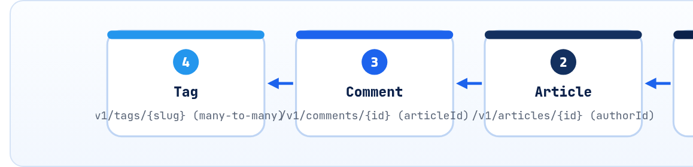

<small>المرحلة 5 · تصميم REST</small>

من هنا بتلبس طاقية المصمّم. أول قرار في أي API: الـ URLs شكلها إيه. هنبدأ بـ API متصمم بالأفعال وبيوجع، وبعدين نفهم REST من مصدره (رسالة Fielding)، ونطلّع قواعد تسمية واضحة: جمع ولا مفرد، و Nesting لحد فين، والـ IDs، والعمليات اللي مش CRUD. وفي الآخر نصمم الـ Resources بتاعة الـ API اللي هيمشي معانا لآخر الكتاب.

:::note[بعد الفصل ده هتكون عارف]
- المشكلة: API بالأفعال (/getArticles و /deleteArticle)
- قيود REST الست من رسالة Fielding بلغة بسيطة
- Resource ضد Representation
- Richardson Maturity Model: المستويات من 0 لـ 3
- قواعد التسمية: جمع، حروف صغيرة، شرطة، من غير أفعال
- الـ Nesting: /articles/42/comments لحد مستوى واحد
- العمليات اللي مش CRUD: publish و archive
- الـ IDs: أرقام ولا UUID، وليه
- تصميم Resources الـ Content Library API
:::

<a id="s14-1"></a>

## 14.1 API بالأفعال: الوجع

تخيل إنك ورثت API لموقع مقالات، واللي عمله كان بيضيف Endpoint لكل حاجة بيحتاجها:

```http
GET  /getArticles
GET  /getArticleById?id=42
POST /createArticle
POST /updateArticle
GET  /deleteArticle?id=42
POST /articles/publishArticle
GET  /fetchCommentsForArticle?articleId=42
POST /Article/Comment/Add
```

كل Endpoint جديد لازم تفتح الدوكيومنتيشن علشان تعرف اسمه. ومفيش قاعدة: مرة `get` ومرة `fetch`، ومرة `Article` ومرة `articles`. وأخطر حاجة: `GET /deleteArticle?id=42`. ليه خطر؟ لأن `GET` المفروض "Safe" (فصل 15)، فأي برنامج بيعمل Prefetch للينكات، أو Crawler، أو Cache، ممكن **يمسح مقالات** وهو بيتفرج! وده حصل فعلاً لمواقع زمان.

<a id="s14-2"></a>

## 14.2 REST من المصدر: 6 قيود

في الفصل الخامس من رسالة Fielding (2000)، REST مش "API بـ JSON". هو **مجموعة قيود** (Constraints)، ولو التزمت بيها السيستم بتاعك بيكسب نفس المميزات اللي خلّت الويب يكبر: يتوسّع، ويتخزّن، ويتغير من غير ما يكسر حد. بلغة بسيطة:

**قيود REST**

| القيد | يعني | بيدّيك إيه |
|---|---|---|
| Client-Server | الواجهة منفصلة عن البيانات | React و Mobile و CLI على نفس الـ API |
| **Stateless** | كل طلب فيه كل اللي السيرفر محتاجه (التوكن، والصفحة…). السيرفر مبيفتكرش "انت كنت فين" | أي سيرفر من 10 يقدر يرد، فتكبّر بسهولة |
| Cacheable | الرد بيقول يتخزّن ولا لأ | `Cache-Control` و `ETag` (فصل 3 و 19) |
| **Uniform interface** | نفس الطريقة لكل حاجة: Resources ليها URLs، وبتتعامل معاها بـ Representations، والرسايل بتشرح نفسها، واللينكات بتوديك للخطوة الجاية | تتعلم مرة وتستخدم في كل حتة |
| Layered system | الـ Client ميعرفش في Proxy ولا CDN في النص | تحط Cache و Load balancer من غير ما تغيّر حاجة |
| Code on demand (اختياري) | السيرفر ممكن يبعت كود يتنفذ | الـ JS في صفحات الويب |

#### Resource

"الحاجة" نفسها كفكرة: المقالة رقم 42. ليها **عنوان واحد**: `/articles/42`. ممكن تكون في Database أو ملف، مش فارق.

#### Representation

"شكل" الحاجة اللي بيتبعت: JSON، أو HTML، أو CSV. نفس المقالة ممكن ليها أكتر من Representation حسب `Accept`. وده الـ **R** في REST: <em>Representational</em> State Transfer.

:::note[لو حابب تتعمق: Richardson Maturity Model]
طريقة مشهورة (من Leonard Richardson، وشرحها Martin Fowler) تقيس بيها "الـ API ده REST قد إيه":<br>**المستوى 0**: URL واحد و POST لكل حاجة (SOAP، و JSON-RPC).<br>**المستوى 1**: Resources: كل حاجة ليها URL (`/articles/42`) بس لسه كله POST.<br>**المستوى 2**: HTTP Methods و Status codes صح (`GET` و `DELETE` و 201 و 404). <strong>أغلب الـ APIs الكويسة هنا، وده هدفنا.</strong><br>**المستوى 3**: **Hypermedia** (اسمها HATEOAS): الرد فيه لينكات للخطوات الجاية، زي `next` في PokeAPI، أو `"_links": {"publish": "/articles/42:publish"}`. ده اللي Fielding بيسميه REST بجد، وقليل اللي بيوصله كامل.
:::

**المصادر الرسمية:** [Fielding · Chapter 5: REST](https://ics.uci.edu/~fielding/pubs/dissertation/rest_arch_style.htm) · [Martin Fowler · Richardson Maturity Model](https://martinfowler.com/articles/richardsonMaturityModel.html)

<a id="s14-3"></a>

## 14.3 قواعد التسمية

نفس الـ API بتاع فوق بعد ما نطبّق القواعد:

```http
GET    /v1/articles                 ← القايمة
POST   /v1/articles                 ← مقالة جديدة
GET    /v1/articles/42              ← مقالة واحدة
PATCH  /v1/articles/42              ← تعديل جزء
DELETE /v1/articles/42              ← مسح
POST   /v1/articles/42:publish      ← عملية مش CRUD (تحت)
GET    /v1/articles/42/comments     ← تعليقات المقالة
POST   /v1/articles/42/comments     ← تعليق جديد عليها
```

**القواعد وسبب كل واحدة**

| القاعدة | صح | غلط | ليه |
|---|---|---|---|
| أسماء مش أفعال | `/articles` | `/getArticles` | الفعل هو الـ Method. الـ URL = "إيه"، والـ Method = "تعمل إيه" |
| جمع للـ Collections | `/articles/42` | `/article/42` | "المقالة 42 من مجموعة المقالات". وثابت: متخلطش جمع ومفرد |
| حروف صغيرة | `/articles` | `/Articles` | الـ Path حساس للحروف (بعكس الـ Domain)، فـ `/Articles` و `/articles` ممكن يبقوا حاجتين |
| شرطة بين الكلمات | `/reading-lists` | `/readingLists` أو `/reading_lists` | عُرف الـ URLs (Kebab-case). والـ `_` بتستخبى تحت خط اللينك |
| من غير امتداد | `/articles/42` | `/articles/42.json` | الشكل بيتحدد بـ `Accept` و`Content-Type` |
| من غير `/` في الآخر | `/articles` | `/articles/` | عند سيرفرات كتير دول URLين مختلفين. اختار واحد وحوّل التاني |
| Nesting مستوى واحد | `/articles/42/comments` | `/authors/7/articles/42/comments/9` | التعليق 9 ليه ID لوحده: `/comments/9`. المسارات الطويلة بتكسر لو العلاقة اتغيرت |
| الفلترة في الـ Query | `/articles?status=draft` | `/articles/drafts` | الـ Drafts مش Resource تاني، هي نفس المقالات بفلتر (فصل 18) |

:::note[مفيش Standard رسمي للأسماء]
مفيش RFC بيقول "لازم جمع" أو "لازم Kebab-case". دي أعراف اتفقت عليها الصناعة ومكتوبة في Style guides كبيرة: **Google AIP** (aip.dev)، و**Microsoft REST API Guidelines**، و**Zalando RESTful API Guidelines**. والأهم من أي قاعدة: **الثبات**. API فيه قاعدة واحدة "مش مثالية" أحسن من API فيه 3 قواعد مثالية.
:::

<a id="s14-4"></a>

## 14.4 العمليات اللي مش CRUD

"انشر المقالة"، و"ابعت الإيميل تاني"، و"إلغي الطلب". دول مش Create ولا Update بالظبط. عندك 3 حلول:

**3 طرق للعمليات**

| الطريقة | شكلها | إمتى |
|---|---|---|
| تعديل Field | `PATCH /articles/42` بـ `{"status": "published"}` | لو العملية فعلاً مجرد تغيير حالة من غير آثار جانبية كبيرة |
| Custom method | `POST /articles/42:publish` | لو فيها شغل (إيميلات، Cache، Validation خاص). ده أسلوب Google AIP-136: `:` وبعدها الفعل، ودايماً `POST` |
| Resource للعملية | `POST /articles/42/publications` | لو العملية نفسها ليها تاريخ وحالة (اتعملت إمتى وبواسطة مين) |

والـ `:publish` ده بيبان غريب، بس ميزته إنه واضح إنه "فعل" مش Resource فرعي اسمه `publish`. وكتير من الـ APIs بتكتبه `/articles/42/publish` بـ `/`. الاتنين مقبولين، المهم تختار واحد.

**المصادر الرسمية:** [Google AIP-122 · Resource names](https://google.aip.dev/122) · [Google AIP-136 · Custom methods](https://google.aip.dev/136) · [Microsoft · API Guidelines](https://github.com/microsoft/api-guidelines/blob/vNext/azure/Guidelines.md) · [Zalando · RESTful API Guidelines](https://opensource.zalando.com/restful-api-guidelines/)

<a id="s14-5"></a>

## 14.5 الـ IDs

#### أرقام متسلسلة (1، 2، 3…)

- قصيرة وسهلة في الـ Debug.
- بس بتكشف حجمك (`id: 101` = عندك 100 مقالة).
- وبتسهّل التخمين: لو `/invoices/1043` بتاعتك، جرّب `1044`. (لازم Authorization على كل طلب في الحالتين، بس متسهلهاش.)

#### UUID / ULID / IDs بـ Prefix

- `"7f9c2a1e-…"`: مستحيل تخمّنه، وتقدر تعمله في الـ Client قبل ما تبعت.
- Stripe بيعمل IDs بـ Prefix: `cus_…` و`ch_…`، فتعرف النوع من شكله.
- أطول وأصعب في القراية.

:::tip[Best Practice: الـ ID في الـ JSON دايماً String]
حتى لو الـ ID رقم في الـ Database، ابعته `"42"`. ده بيحميك من حد الـ 2<sup>53</sup> (فصل 4)، وبيخليك تغيّر لـ UUID بعدين من غير ما تكسر الـ Clients (لأن النوع مش هيتغير). وفي Google AIP-122 أسماء الـ Resources كلها Strings. و GitHub نفسه بقى عنده `node_id` String (للـ GraphQL) جنب الـ `id` الرقمي اللي في `repo.json`.
:::

<a id="s14-6"></a>

## 14.6 نصمم: Content Library API

من هنا لآخر الكتاب، هنصمم API لمكتبة محتوى (الحاجة اللي بتشتغل فيها كـ Content Engineer): مقالات، وكتّاب، وتاجات، وتعليقات. وفي فصل 24 هنكتبه Spec كامل. أول خطوة: الـ Resources والعلاقات.

**الـ Resources**

| Resource | Collection | Item | ملاحظة |
|---|---|---|---|
| Article | `/v1/articles` | `/v1/articles/{articleId}` | الأساس. ليه `status`: draft/review/published |
| Author | `/v1/authors` | `/v1/authors/{authorId}` | مقالات كاتب: `/v1/articles?authorId=7` (فلتر، مش Nesting) |
| Comment | `/v1/articles/{articleId}/comments` | `/v1/comments/{commentId}` | الإنشاء والقايمة تحت المقالة، والتعديل والمسح بالـ ID لوحده |
| Tag | `/v1/tags` | `/v1/tags/{slug}` | الـ ID هنا Slug مقروء: `/v1/tags/node-js` |
| المستخدم الحالي | — | `/v1/me` | Singleton: "أنا" حسب التوكن |
| النشر | — | `POST /v1/articles/{articleId}:publish` | Custom method: بيتأكد إن المقالة كاملة، ويحط `publishedAt` |



*العلاقات في الـ Content Library API: كاتب ليه مقالات كتير، ومقالة ليها تعليقات كتير، ومقالة ليها تاجات كتير والعكس. والعلاقة بتتمثّل كـ ID جوه الـ JSON (authorId) مش كـ مسار طويل.*

:::tip[ملخص الفصل]
- API بالأفعال = Endpoint لكل حاجة ومفيش قاعدة، و`GET` بيمسح = كارثة.
- REST = قيود: Client-Server و Stateless و Cacheable و Uniform interface و Layered.
- Resource = الحاجة، و Representation = شكلها (JSON). وهدفنا مستوى 2 في Richardson، ولينكات زي `next` كبداية للمستوى 3.
- أسماء جمع بحروف صغيرة وشرطة، ومن غير أفعال ولا امتدادات، و Nesting مستوى واحد، والفلترة في الـ Query.
- العمليات: `PATCH` لحالة بسيطة، و`POST …:publish` لعملية فيها شغل.
- الـ IDs Strings، ومتسهّلش التخمين.
:::

### صح ولا غلط؟

1. في REST، الـ URL المفروض فيه الفعل: `/createArticle`.
2. Stateless معناها إن السيرفر مبيخزّنش بيانات في Database.
3. `/articles?status=draft` أحسن من `/articles/drafts`.

### أسئلة مراجعة

1. ليه `GET /deleteArticle?id=42` خطر حتى لو محدش بيدوس عليه بالغلط؟
2. اشرح الفرق بين Resource و Representation بمثال.
3. إمتى تستخدم `PATCH` بـ `status` وإمتى `POST …:publish`؟
4. ليه `/v1/comments/{id}` أحسن من `/v1/authors/7/articles/42/comments/9`؟

### تحديات الفصل

<small>جرّبها بإيدك، والحلول في ملحق الإجابات.</small>

1. **[سهل]** صلّح أسماء الـ 8 Endpoints اللي في أول الفصل من غير ما تبص على الحل.
2. **[متوسط]** صمّم Resources لـ API "قوايم قراية": مستخدم يعمل قوايم، ويحط فيها مقالات، ويرتّبهم.
3. **[صعب]** افتح GitHub REST docs وطلّع 5 Endpoints بتكسر قاعدة من القواعد اللي فوق، وفكّر ليه GitHub اختار كده.
