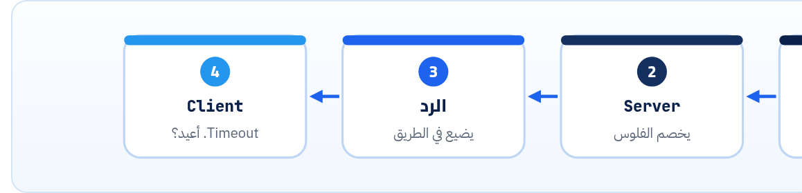

<small>المرحلة 5 · تصميم REST</small>

في كتاب الإنترنت (فصل 7) عرفت الـ Methods كمستخدم. هنا هتشوفها كمصمّم: إيه اللي Safe، وإيه اللي Idempotent، وليه ده مش كلام نظري (ده اللي بيحدد مين يقدر يعيد الطلب لو النت قطع). وهنشوف الفرق بين PUT و PATCH على سيرفر حقيقي، و Merge Patch ضد JSON Patch، و Idempotency-Key اللي بيحمي من الدفع مرتين، و QUERY الجديد.

:::note[بعد الفصل ده هتكون عارف]
- Safe و Idempotent من RFC 9110 بمثال
- ليه الـ Idempotency بتفرق لما النت يقطع
- PUT بيستبدل و PATCH بيعدّل: تجربة حقيقية
- JSON Merge Patch (RFC 7396) و null بيمسح
- JSON Patch (RFC 6902): العمليات op و path
- Idempotency-Key: نفس المفتاح = نفس النتيجة
- الـ Custom method: ‎:publish و 409
- DELETE مرتين = 204 و 204
- QUERY (RFC 10008): بحث بـ Body وهو Safe
:::

<a id="s15-1"></a>

## 15.1 الطلب اللي ضاع في النص

الـ Client بعت `POST /payments`. السيرفر استلم، وخصم الفلوس، وبدأ يبعت الرد… والنت قطع. الـ Client شايف Timeout. <strong>هل الدفع حصل؟</strong> مش عارف. يعيد؟ لو أعاد ممكن العميل يدفع مرتين. ميعيدش؟ ممكن الدفع ميكونش حصل. ودي مشكلة حقيقية في أي شبكة، وحلها بيبدأ من سؤال: <strong>"لو الطلب ده اتبعت مرتين، هيحصل إيه؟"</strong>



*Timeout مش معناه إن الطلب فشل. معناه إنك مش عارف.*

<a id="s15-2"></a>

## 15.2 Safe و Idempotent

#### Safe

الطلب **مبيغيرش** حاجة في السيرفر (من وجهة نظر الـ Client). قراية بس. فأي حد (Browser، أو Crawler، أو Prefetch) يقدر يبعته براحته. لو السيرفر عمل Log أو عدّاد، ده مش "تغيير" يهم الـ Client.

#### Idempotent

إنك تبعته **مرة أو عشرة** النتيجة في السيرفر واحدة. `DELETE /articles/7` عشر مرات = المقالة ممسوحة. فلو النت قطع، **تعيد وانت مطمّن**. وكل Safe هو Idempotent أوتوماتيك.

**الـ Methods (RFC 9110، و PATCH من RFC 5789، و QUERY من RFC 10008)**

| Method | Safe | Idempotent | Body في الطلب | استخدامه في API |
|---|---|---|---|---|
| `GET` | ✓ | ✓ | لأ (ملوش معنى) | اقرا Resource أو Collection |
| `HEAD` | ✓ | ✓ | لأ | زي GET من غير Body: موجود؟ حجمه؟ اتغير؟ |
| `OPTIONS` | ✓ | ✓ | نادراً | الـ Preflight بتاع CORS (فصل 13) |
| `QUERY` | ✓ | ✓ | أيوه | بحث معقد بـ Body (تحت) |
| `PUT` | ✗ | ✓ | أيوه | استبدل الـ Resource كله |
| `DELETE` | ✗ | ✓ | لأ | امسح |
| `POST` | ✗ | **✗** | أيوه | اعمل جديد، أو عملية (`:publish`) |
| `PATCH` | ✗ | **✗** (مش مضمون) | أيوه | عدّل جزء |

:::note[Idempotent مش معناه نفس الرد]
`DELETE` أول مرة على مقالة موجودة، والتانية على مقالة ممسوحة: الرد ممكن يختلف (204 ثم 404)، بس **حالة السيرفر** واحدة: المقالة مش موجودة. الـ Idempotency عن الأثر، مش عن الرد. وفي السيرفر بتاعنا اخترنا 204 في المرتين، والاتنين صح.
:::

```sh title="DELETE مرتين على library.js"
$ curl -si -X DELETE localhost:3001/v1/articles/7
HTTP/1.1 204 No Content
$ curl -si -X DELETE localhost:3001/v1/articles/7
HTTP/1.1 204 No Content
$ curl -s localhost:3001/v1/articles/7
{"type":"https://example.com/problems/article-not-found","title":"Article not found","status":404,"detail":"No article with id '7'"}
```

:::note[السيرفر اللي هنجرب عليه]
من الفصل ده لحد فصل 22 هنجرب على `library.js`: سيرفر Express 5 صغير (حوالي 200 سطر) لـ Content Library API اللي صممناه في فصل 14، بيشتغل على `localhost:3001`. الكود كامل في فصل 22. وكل الردود اللي في الكتاب طالعة منه فعلاً.
:::

**المصادر الرسمية:** [RFC 9110 §9.2 · Common Method Properties](https://www.rfc-editor.org/rfc/rfc9110.html#name-common-method-properties) · [RFC 5789 · PATCH](https://www.rfc-editor.org/rfc/rfc5789.html)

<a id="s15-3"></a>

## 15.3 PUT ضد PATCH: تجربة

JSONPlaceholder بيقلّد السلوك ده بالظبط. المقالة رقم 1 فيها `userId` و`id` و`title` و`body`. هنبعت `{"title":"New"}` بالطريقتين:

```sh title="Terminal"
$ curl -s -X PATCH https://jsonplaceholder.typicode.com/posts/1 --json '{"title":"New"}'
{
  "userId": 1,
  "id": 1,
  "title": "New",
  "body": "quia et suscipit\nsuscipit recusandae consequuntur ..."
}
$ curl -s -X PUT https://jsonplaceholder.typicode.com/posts/1 --json '{"title":"New"}'
{
  "title": "New",
  "id": 1
}
```

#### PATCH = "غيّر ده بس"

الـ `body` و`userId` فضلوا زي ما هما. بعتّ اللي عايز تغيره بس.

#### PUT = "ده الشكل الجديد كله"

اللي مبعتهوش **اتمسح**. الـ PUT بيقول "خلي الـ Resource ده يبقى بالظبط اللي معايا". وعلشان كده Idempotent: نفس الـ Body عشر مرات = نفس النتيجة.

وفي `library.js`، الـ PUT بيطلب كل الـ Fields الإجبارية، واللي ليه Default بيرجع للـ Default. المقالة 5 كانت `published`، وبعد PUT من غير `status`:

```sh title="Terminal"
$ curl -s -X PUT localhost:3001/v1/articles/5 --json '{"title":"Only title"}'
{"type":"https://example.com/problems/validation","title":"Validation failed","status":422,
 "errors":[{"pointer":"/authorId","detail":"Invalid input: expected string, received undefined"}]}
$ curl -s -X PUT localhost:3001/v1/articles/5 --json '{"title":"Only title","authorId":"2"}'
{"id":"5","title":"Only title","status":"draft","authorId":"2","tags":[],"createdAt":"2026-10-05T09:00:00.000Z"}
```

:::caution[الفخ: PUT من فورم ناقص]
لاحظ: `status` رجع `draft` و`tags` بقت فاضية. لو الواجهة بتاعتك بتبعت PUT من فورم فيه العنوان بس، **هتمسح بيانات من غير ما تاخد بالك**. علشان كده أغلب الـ APIs الحديثة بتستخدم `PATCH` للتعديل، و`PUT` بس لما الـ Client فعلاً معاه الـ Resource كله.
:::

<a id="s15-4"></a>

## 15.4 PATCH بإيه؟ Merge Patch ضد JSON Patch

PATCH بيقول "عدّل"، بس مبيقولش **إزاي** توصف التعديل. فيه Standardين:

### JSON Merge Patch (RFC 7396)

بتبعت JSON بشكل الـ Resource، فيه اللي عايز تغيره بس. وقاعدة واحدة غريبة: <strong>`null` معناها امسح الـ Field</strong>. والـ Content-Type: `application/merge-patch+json`.

```sh title="Terminal"
$ curl -si -X PATCH localhost:3001/v1/articles/4 \
    -H 'Content-Type: application/merge-patch+json' \
    -H 'If-Match: "39fqqzHpm_icenp6"' \
    -d '{"title":"Article four","tags":null}'
HTTP/1.1 200 OK
ETag: "kgfYo1GjspvVpE60"
Content-Type: application/json; charset=utf-8

{"id":"4","title":"Article four","status":"published","authorId":"1","tags":[],"createdAt":"2026-10-04T09:00:00.000Z"}
```

الـ `title` اتغير، و`tags: null` مسح الـ Field، وبعدين الـ Validation رجّعه للـ Default `[]`. (والـ `If-Match` ده هنشرحه في فصل 19.)

:::caution[حدود الـ Merge Patch]
(1) مينفعش تحط `null` كقيمة حقيقية، لأنها معناها "امسح". (2) الـ Arrays بتتبدل كلها: مينفعش تقول "زوّد تاج واحد"، لازم تبعت الـ Array كامل. ولو محتاج الحاجات دي، استخدم JSON Patch.
:::

### JSON Patch (RFC 6902)

بدل ما تبعت الشكل، بتبعت **قايمة عمليات**، وكل عملية بتشاور على مكان بـ JSON Pointer (RFC 6901، اللي شفناه في الـ Errors بتاعة فصل 7):

**تشريح الأمر**

```json
[
  { "op": "test",    "path": "/status",  "value": "draft" },
  { "op": "replace", "path": "/title",   "value": "Article four" },
  { "op": "add",     "path": "/tags/-",  "value": "rest" },
  { "op": "remove",  "path": "/summary" }
]
```

1. `op`: العملية: `add` و`remove` و`replace` و`move` و`copy` و`test`.
2. `path`: JSON Pointer: `/` بيفصل المستويات، و`/tags/0` أول عنصر.
3. `/tags/-`: الـ `-` معناها "آخر الـ Array": زوّد في الآخر.
4. `test`: اتأكد إن القيمة كده، ولو لأ **كل** العمليات تتلغي (Atomic).
5. `Content-Type`: `application/json-patch+json`

**تختار إيه؟**

|   | Merge Patch | JSON Patch |
|---|---|---|
| سهولة | سهل جداً، شبه الـ Resource | أصعب، لغة عمليات |
| Arrays | تبدّل كلها | تزوّد وتمسح عنصر |
| `null` | معناها امسح | قيمة عادية |
| شروط | لأ | `test` |
| الاستخدام | أغلب الـ APIs (وأي PATCH بـ JSON عادي هو تقريباً كده) | محررات، و Kubernetes، وحالات معقدة |

**المصادر الرسمية:** [RFC 7396 · JSON Merge Patch](https://www.rfc-editor.org/rfc/rfc7396.html) · [RFC 6902 · JSON Patch](https://www.rfc-editor.org/rfc/rfc6902.html) · [RFC 6901 · JSON Pointer](https://www.rfc-editor.org/rfc/rfc6901.html)

<a id="s15-5"></a>

## 15.5 Idempotency-Key: نخلّي POST آمن

نرجع لمشكلة الدفع. الحل اللي Stripe عمله (وبقى Draft في IETF): الـ Client يعمل **مفتاح عشوائي** (UUID) لكل عملية، ويبعته في هيدر. والسيرفر يحفظ "المفتاح ده نتيجته كانت إيه". لو نفس المفتاح جه تاني، يرجّع نفس النتيجة من غير ما ينفّذ تاني.

```sh title="Terminal"
# المرة الأولى: اتعملت مقالة 26
$ curl -si -X POST localhost:3001/v1/articles \
    -H 'Idempotency-Key: 8e03978e-40d5-43e8-bc93-6894a57f9324' \
    --json '{"title":"REST naming","authorId":"2"}'
HTTP/1.1 201 Created
Location: /v1/articles/26

{"id":"26","title":"REST naming","status":"draft","authorId":"2","tags":[],"createdAt":"2026-10-23T11:43:20.999Z"}

# إعادة بنفس المفتاح ونفس الـ Body: نفس المقالة، مفيش 27
$ curl -si -X POST localhost:3001/v1/articles \
    -H 'Idempotency-Key: 8e03978e-40d5-43e8-bc93-6894a57f9324' \
    --json '{"title":"REST naming","authorId":"2"}'
HTTP/1.1 201 Created
Idempotent-Replayed: true
Location: /v1/articles/26

{"id":"26","title":"REST naming",...,"createdAt":"2026-10-23T11:43:20.999Z"}

# نفس المفتاح بـ Body مختلف: غلط من الـ Client
$ curl -s -X POST localhost:3001/v1/articles \
    -H 'Idempotency-Key: 8e03978e-40d5-43e8-bc93-6894a57f9324' \
    --json '{"title":"Other","authorId":"2"}'
{"type":"https://example.com/problems/idempotency-key-reused","title":"Idempotency-Key reused","status":422,"detail":"Same key was used with a different body"}
```

**تشريح الأمر**

```http
Idempotency-Key: 8e03978e-40d5-43e8-bc93-6894a57f9324
```

1. `المفتاح`: الـ Client بيعمله (`crypto.randomUUID()`)، **مرة لكل عملية** مش لكل محاولة. الإعادة بنفس المفتاح.
2. `Idempotent-Replayed`: هيدر زيادة اخترناه في السيرفر بتاعنا علشان الـ Client يعرف إن ده رد محفوظ.
3. `Body مختلف`: الـ Draft بيقول 422. ولو المفتاح ناقص في Endpoint بيطلبه: 400. ولو الطلب الأول لسه شغال وجه التاني: 409.
4. `Stripe`: المفتاح لحد 255 حرف، وممكن يتمسح بعد 24 ساعة على الأقل، ولو نفس المفتاح جه بـ Parameters مختلفة بيرجّع Error.

:::tip[Best Practice]
كـ Client: أي POST فيه فلوس أو إيميلات أو حاجة متتعملش مرتين، ابعت `Idempotency-Key` لو الـ API بيدعمه، وأعد بنفس المفتاح. وكـ Provider: احفظ المفاتيح في Database أو Redis مش في الذاكرة زي `library.js` (لو السيرفر عمل Restart هتضيع)، وحط لها مدة صلاحية.
:::

**المصادر الرسمية:** [IETF Draft · The Idempotency-Key HTTP Header Field](https://datatracker.ietf.org/doc/draft-ietf-httpapi-idempotency-key-header/) · [Stripe · Idempotent requests](https://docs.stripe.com/api/idempotent_requests)

<a id="s15-6"></a>

## 15.6 الـ Custom method: ‎:publish

من فصل 14: النشر عملية فيها شغل، فعملناها `POST …:publish`. وهي مش Idempotent بطبيعتها (POST)، بس احنا نقدر نقرر سلوكها: المرة التانية بترجع **409 Conflict** لأن الحالة مش مناسبة.

```sh title="Terminal"
$ curl -s -X POST 'localhost:3001/v1/articles/3:publish'
{"id":"3","title":"Article 3","status":"published",...,"publishedAt":"2026-10-23T11:43:36.535Z"}
$ curl -s -X POST 'localhost:3001/v1/articles/3:publish'
{"type":"https://example.com/problems/already-published","title":"Already published","status":409,"detail":"Article '3' is already published"}
```

:::note[لو حابب تتعمق: الـ : في Express 5]
في Express، الـ `:` معناها Parameter (`:id`). فعلشان تكتب `:publish` حرفياً لازم تعمله Escape: `"/v1/articles/:id\\:publish"` (الـ `\\` في الـ JS String = `\` واحدة). جربناها في `library.js` واشتغلت. ودي حاجة صغيرة بس بتضيّع ساعة لو متعرفهاش.
:::

<a id="s15-7"></a>

## 15.7 QUERY: البحث اللي محتاج Body

قبل كده: عندك بحث معقد (فلاتر كتير، وشروط متداخلة). تحطه في `GET ?…`؟ الـ URL هيبقى طويل جداً وفيه حدود، وبيظهر في الـ Logs. تبعته `POST /search` بـ Body؟ كده خسرت الـ Safe والـ Idempotent: الـ Cache مش هيخزّنه، والأدوات مش هتعيده لوحدها. وكانت المشكلة إن مفيش Method "بيقرا بـ Body".

فاتطور حل: **RFC 10008** (يونيو 2026) عرّف `QUERY`: زي POST في إنه بياخد Body، بس **Safe و Idempotent** رسمياً، فينفع يتخزّن ويتعاد.

```http
QUERY /v1/articles HTTP/1.1
Host: api.example.com
Content-Type: application/json
Accept: application/json

{ "status": ["draft", "review"], "tags": { "any": ["api", "json"] }, "createdAfter": "2026-10-01T00:00:00Z" }
```

والسيرفر يقدر يعلن إنه بيدعمه وبأي صيغة بهيدر `Accept-Query`. و OpenAPI 3.2 فيه `query` كعملية جنب `get` و`post`.

:::caution[لسه جديد]
QUERY اتنشر في يونيو 2026، فالدعم في الـ Frameworks والـ Proxies والـ Browsers لسه بيتبني. اتأكد إن كل حاجة في السكة بتدعمه قبل ما تعتمد عليه. والحل الشائع لحد دلوقتي: `POST /v1/articles:search` وتوثّق إنه مبيغيرش حاجة.
:::

**المصادر الرسمية:** [RFC 10008 · The HTTP QUERY Method](https://www.rfc-editor.org/rfc/rfc10008.html)

:::tip[ملخص الفصل]
- Safe = مبيغيرش. Idempotent = مرة زي عشرة. GET و HEAD و OPTIONS و QUERY الاتنين، و PUT و DELETE Idempotent بس، و POST و PATCH ولا ده ولا ده.
- الـ Idempotency هي اللي بتقولك "تعيد وانت مطمّن" لما يحصل Timeout.
- PUT بيستبدل كله (اللي مبعتهوش بيضيع)، و PATCH بيعدّل جزء.
- Merge Patch: شكل الـ Resource و `null` = امسح. JSON Patch: قايمة `op` و`path` و`test`.
- `Idempotency-Key`: نفس المفتاح = نفس الرد، و Body مختلف = 422.
- `:publish` مرتين = 409، و QUERY = بحث بـ Body وهو Safe.
:::

### صح ولا غلط؟

1. DELETE مرتين لازم يرجّع نفس الـ Status code علشان يبقى Idempotent.
2. في JSON Merge Patch، `{"summary": null}` بيحط القيمة null في الـ Field.
3. الـ Idempotency-Key بيتعمل جديد مع كل إعادة للطلب.

### أسئلة مراجعة

1. ليه PUT Idempotent و POST لأ؟ وضّح بمثال "إنشاء مقالة".
2. عايز تزوّد تاج واحد لمقالة فيها 5 تاجات. هتعملها إزاي بـ Merge Patch، وإزاي بـ JSON Patch؟
3. السيرفر استلم Idempotency-Key وهو لسه بيعالج الطلب الأول، وجه طلب تاني بنفس المفتاح. يرد بإيه؟
4. إيه المشكلة اللي QUERY بيحلها وكانت موجودة في GET و POST؟

### تحديات الفصل

<small>جرّبها بإيدك، والحلول في ملحق الإجابات.</small>

1. **[سهل]** جرّب PATCH و PUT على `jsonplaceholder.typicode.com/users/1` وقارن الرد.
2. **[متوسط]** اكتب JSON Patch بيغيّر العنوان بس لو الـ `status` لسه `draft`، ويمسح أول تاج.
3. **[صعب]** في `library.js` المفاتيح في `Map`. اكتب على ورق: هتخزّنها فين في Production، ومدة صلاحيتها كام، وهتعمل إيه في حالة الـ 409.
