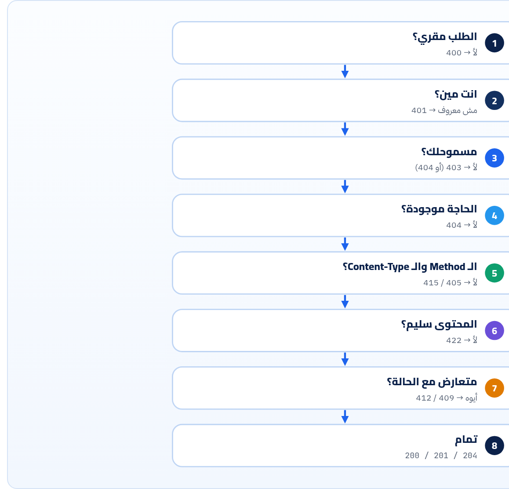

<small>المرحلة 5 · تصميم REST</small>

في كتاب الإنترنت (فصل 8) اتعلمت تقرا الـ Status codes. هنا هتختارها: أنهي كود لأنهي موقف، والفرق بين 400 و 422، و 401 و 403، و 404 و 410. وبعدين نصمم شكل الـ JSON نفسه: Envelope ولا لأ، وأسماء الـ Fields، والتواريخ، والفلوس، والـ null.

:::note[بعد الفصل ده هتكون عارف]
- القاعدة: الكود للآلة والـ Body للإنسان
- الأكواد اللي هتحتاجها في أي API وإمتى كل واحد
- 201 + Location، و 202 للشغل الطويل، و 204
- 400 ضد 422، و 401 ضد 403، و 404 ضد 403
- ليه 200 مع error جوه = غلط
- Envelope: {data} ولا Array على طول
- camelCase ولا snake\_case: اختار واحد
- التواريخ RFC 3339، والفلوس أعداد صحيحة
- null ضد مش موجود ضد فاضي
- الـ Enums كـ Strings
:::

<a id="s16-1"></a>

## 16.1 "200 OK" وجوه Error

API قديم كان بيرجّع كل حاجة 200:

```json
HTTP/1.1 200 OK

{ "success": false, "error": "User not found" }
```

وكانت المشكلة إن كل حاجة في السكة بتصدّق الكود مش الـ Body: `fetch` بيقول `res.ok === true`، والـ Cache بيخزّن الـ Error على إنه رد ناجح، والـ Monitoring بيقول "مفيش أخطاء"، والـ Retry مبيشتغلش. (وشفنا GraphQL بيعمل كده عن قصد في فصل 2، وده من عيوبه.) فالقاعدة:

:::tip[القاعدة]
<strong>الـ Status code للآلة، والـ Body للإنسان.</strong> الكود بيقول "إيه اللي حصل بشكل عام" علشان أي برنامج يتصرف صح من غير ما يفهم الـ Body. والـ Body بيقول التفاصيل (فصل 17).
:::

<a id="s16-2"></a>

## 16.2 الأكواد اللي هتحتاجها

**النجاح والتحويل**

| الكود | إمتى في API | معاه |
|---|---|---|
| **200** OK | GET ناجح، أو PATCH/PUT بيرجّع الـ Resource الجديد | الـ Resource |
| **201** Created | POST عمل حاجة جديدة | `Location: /v1/articles/26` والـ Resource |
| **202** Accepted | "استلمت وهشتغل بعدين": تصدير، أو فيديو، أو AI طويل | `Location` لـ Resource بيقول الحالة: `/v1/jobs/91` |
| **204** No Content | DELETE، أو عملية مفيش حاجة ترجعها | مفيش Body خالص |
| **304** Not Modified | الـ ETag زي ما هو (فصل 3 و 19) | مفيش Body |
| **308** Permanent Redirect | الـ Endpoint اتنقل، والـ Method والـ Body يفضلوا زي ما هم | `Location` |

**أخطاء الـ Client (4xx): "انت اللي غلطت، صلّح وابعت تاني"**

| الكود | إمتى | مثال حقيقي في الكتاب |
|---|---|---|
| **400** Bad Request | الطلب نفسه بايظ: JSON مكسور، أو Parameter مش مفهوم | `library.js`: JSON بفاصلة زيادة، و`sort=views` |
| **401** Unauthorized | مين انت؟ مفيش توكن أو التوكن بايظ أو منتهي | DummyJSON بعد ما التوكن خلص (فصل 12) |
| **403** Forbidden | عارف انت مين، بس مش مسموحلك | GitHub من غير User-Agent (فصل 3) |
| **404** Not Found | مش موجود (أو مش عايز أقولك إنه موجود) | `/v1/articles/999` |
| **405** Method Not Allowed | الـ URL موجود بس مش بالـ Method ده. لازم هيدر `Allow` | Express بيرجّع 404 هنا افتراضياً، لازم تعملها بإيدك |
| **406** / **415** | 406: مش هقدر أرجّع الشكل اللي طلبته في `Accept`. 415: مش فاهم الـ `Content-Type` اللي بعتّه | GitHub بـ `Accept: application/xml` رجّع 415، و`library.js` بـ `-d` رجّع 415 |
| **409** Conflict | الطلب سليم بس متعارض مع الحالة: موجود قبل كده، أو منشور فعلاً | `:publish` مرتين |
| **410** Gone | كان موجود واتشال نهائي (أوضح من 404) | GitHub: لو طلبت API version اتقفل (حسب الـ Docs بتاعته، فصل 19) |
| **412** / **428** | 412: الشرط في `If-Match` فشل. 428: لازم تبعت شرط (RFC 6585) | PATCH بـ ETag قديم (فصل 19) |
| **413** Content Too Large | الـ Body أكبر من المسموح | Express: الـ Default لـ `express.json()` هو 100kb |
| **422** Unprocessable Content | الـ JSON سليم، بس المحتوى مش مقبول: Validation | `{"title":"Hi"}` في `library.js` |
| **429** Too Many Requests | عدّيت الحد | مع `Retry-After` (فصل 19) |

**أخطاء السيرفر (5xx): "أنا اللي غلطت، ممكن تحاول تاني"**

| الكود | إمتى |
|---|---|
| **500** Internal Server Error | Bug. ومتطلّعش الـ Stack trace للـ Client أبداً. |
| **502** / **504** | الـ Proxy أو الـ Gateway معرفش يكلم السيرفر (502)، أو استنى ومحدش رد (504). |
| **503** Service Unavailable | واقف مؤقتاً (Maintenance، أو ضغط). معاه `Retry-After`. |

**المصادر الرسمية:** [RFC 9110 §15 · Status Codes](https://www.rfc-editor.org/rfc/rfc9110.html#name-status-codes) · [MDN · HTTP response status codes](https://developer.mozilla.org/en-US/docs/Web/HTTP/Reference/Status) · [RFC 6585 · 428 / 429](https://www.rfc-editor.org/rfc/rfc6585.html)

<a id="s16-3"></a>

## 16.3 الأزواج اللي بتلخبط

#### 400 ضد 422

**400**: "مش قادر أقرا اللي بعتّه" (JSON بايظ، أو نوع غلط في الـ Query). **422**: "قريته وفهمته، بس مش مقبول" (العنوان قصير، والـ status مش من الاختيارات). بعض الـ APIs بتستخدم 400 للاتنين، وده مقبول، بس **اثبت على قاعدة واحدة**. واحنا في `library.js` فصلناهم.

#### 401 ضد 403

**401** = "مش عارف انت مين" (Authentication). الحل: سجّل دخول أو جدّد التوكن. والمفروض معاه `WWW-Authenticate` (GitHub مبيبعتوش، شفناها في فصل 12). **403** = "عارفك، بس لأ" (Authorization). تسجيل الدخول تاني مش هيفرق.

#### 404 ضد 403

لو مستخدم بيحاول يفتح فاتورة واحد تاني، 403 بتقوله "الفاتورة دي **موجودة** بس مش بتاعتك". فكتير من الـ APIs (منها GitHub في الـ Private repos) بترجّع **404** علشان متكشفش إن الحاجة موجودة.

#### 404 ضد 200 بـ \[\]

`GET /v1/articles?status=archived` ومفيش نتايج = **200** و`{"data": []}`. القايمة موجودة بس فاضية. الـ 404 للـ Resource اللي مش موجود (`/v1/articles/999`) أو URL غلط.



*ترتيب منطقي للأسئلة اللي السيرفر بيسألها. أول «لأ» بتحدد الكود.*

<a id="s16-4"></a>

## 16.4 تصميم الـ Body

### Envelope ولا Array على طول؟

#### Array على طول

```json
[{"id": "1", ...}, {"id": "2", ...}]
```

GitHub بيعمل كده، والبيانات الإضافية (الصفحة الجاية) في الهيدرز (`Link`). بسيط، بس لو حبيت تزوّد حاجة جنب القايمة مش هتقدر من غير ما تكسر الـ Clients.

#### Envelope (غلاف)

```json
{"data": [...], "nextCursor": "MQ"}
```

اللي عملناه في `library.js`، وزي PokeAPI (`count` و`next` و`results`). تقدر تزوّد `meta` بعدين من غير ما تكسر حاجة. <strong>ده الأأمن للـ Collections.</strong>

وللـ Resource الواحد (`GET /v1/articles/4`) رجّعه على طول من غير غلاف، زي GitHub و Stripe و `library.js`.

### الأسماء

**camelCase ولا snake\_case؟**

| الأسلوب | مين بيستخدمه | مثال |
|---|---|---|
| snake\_case | GitHub، و Stripe، و Python عموماً | `"created_at"` في `repo.json` |
| camelCase | Google AIP، و Microsoft، و JS عموماً | `"createdAt"` في `library.js` |

مفيش صح وغلط. الـ Client بتاعك JS؟ `camelCase` هيوفر عليك تحويل. المهم **واحد بس في كل الـ API**، ومتغيرهوش بعد ما تنشر.

### القيم

**تشريح الأمر**

```json
{
  "id": "4",
  "title": "Article four",
  "status": "published",
  "wordCount": 1250,
  "price": { "amount": 4999, "currency": "EGP" },
  "isFeatured": false,
  "createdAt": "2026-10-04T09:00:00.000Z",
  "publishedAt": null,
  "tags": []
}
```

1. `"id": "4"`: String دايماً (فصل 14).
2. `"status"`: Enum كـ String مقروء، مش رقم (`2` معناها إيه؟). وقول في الـ Docs إن ممكن تتزود قيم جديدة بعدين، علشان الـ Client ميقعش لو شاف قيمة مش عارفها.
3. `"amount": 4999`: الفلوس **Integer بأصغر وحدة** (قروش). `49.99` كـ Number ممكن يبقى `49.989999…` في الحسابات. Stripe بيعمل كده بالظبط: `1000` = 10 دولار. ومعاها العملة دايماً.
4. `"isFeatured"`: Boolean حقيقي، مش `"yes"` ولا `1`.
5. `"createdAt"`: RFC 3339 بالـ UTC و `Z` في الآخر (فصل 4). مش `"04/10/2026"` (أكتوبر ولا أبريل؟) ومش Unix timestamp (مش مقروء).
6. `"publishedAt": null`: الـ Field موجود والقيمة "مفيش" = مش منشورة لسه.
7. `"tags": []`: Array فاضية، مش `null`: الـ Client يعمل `.map` على طول من غير ما يقلق.

:::note[null ضد مش موجود]
اتفق على معنى كل حالة وثبّته: **موجود بقيمة** = القيمة. <strong>`null`</strong> = "معروف إنه مفيش" (مش منشورة). **مش موجود خالص** = "مش متاح في الرد ده" (مثلاً طلبت `fields=id,title`، أو مش مسموحلك تشوفه). وفي الـ Merge Patch، `null` معناها امسح (فصل 15)، فخلّي بالك من التعارض ده لما تصمم.
:::

:::tip[Best Practice: Field جديد = مش كسر]
صمّم وانت فاكر إنك هتزوّد Fields بعدين. زوّد براحتك (الـ Clients الكويسة بتتجاهل اللي متعرفهوش)، بس **متشيلش** Field، و**متغيرش نوعه**، و**متغيرش معناه**. دول بيكسروا الناس (فصل 19).
:::

**المصادر الرسمية:** [Stripe · Currencies (minor units)](https://docs.stripe.com/currencies) · [RFC 3339 · Date and Time on the Internet](https://www.rfc-editor.org/rfc/rfc3339.html) · [Google AIP-140 · Field names](https://google.aip.dev/140)

:::tip[ملخص الفصل]
- الكود للآلة والـ Body للإنسان. و 200 بـ Error جوه بيبوّظ الـ Cache والـ Monitoring و`res.ok`.
- 201 + Location للإنشاء، و 202 للشغل الطويل، و 204 من غير Body.
- 400 = مش قادر أقرا، و 422 = قريت ومش مقبول. 401 = مين انت، و 403 = عارفك بس لأ، و 404 ممكن تخبّي 403.
- قايمة فاضية = 200 و `[]` مش 404.
- Envelope للـ Collections، والـ Resource لوحده من غير غلاف.
- أسلوب أسماء واحد، و IDs Strings، و Enums Strings، وفلوس Integer بالعملة، وتواريخ RFC 3339، و Arrays فاضية مش null.
:::

### صح ولا غلط؟

1. لو مستخدم بعت توكن سليم بس ملوش صلاحية، الرد 401.
2. البحث اللي ملوش نتايج المفروض يرجّع 404.
3. تخزين السعر `49.99` كـ JSON Number فكرة كويسة.

### أسئلة مراجعة

1. اكتب الكود المناسب: (أ) إيميل متسجل قبل كده. (ب) `Content-Type: text/plain`. (ج) طلب تصدير هيخلص بعد 5 دقايق. (د) الـ Body مش JSON سليم.
2. ليه 202 لازم يبقى معاه `Location`؟
3. إيه ميزة الـ Envelope لو حبيت تزوّد `totalCount` بعدين؟
4. اشرح الفرق بين `"publishedAt": null` وإن الـ Field مش موجود.

### تحديات الفصل

<small>جرّبها بإيدك، والحلول في ملحق الإجابات.</small>

1. **[سهل]** جرّب 5 طلبات غلط على `library.js` وسجّل الكود اللي رجع لكل واحد.
2. **[متوسط]** صمّم JSON لـ "كاتب" في الـ Content Library API فيه كل أنواع القيم اللي في الفصل.
3. **[صعب]** افتح `repo.json` بتاع GitHub وطلّع 3 قرارات تصميم (أسماء، و null، و Nested objects) واكتب هتعملها إزاي في API بتاعك.
