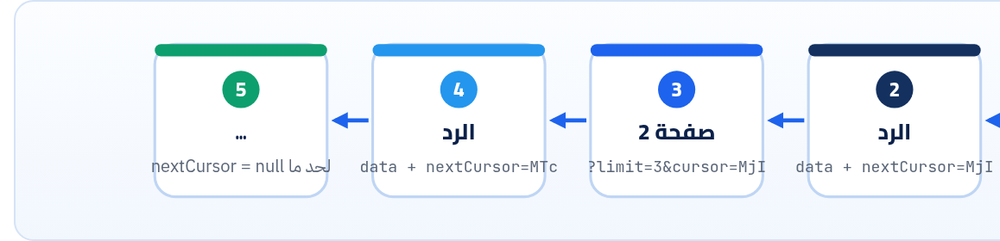

<small>المرحلة 5 · تصميم REST</small>

محدش بيرجّع 10 آلاف مقالة في رد واحد. هنا هنصمم الـ Query string: إزاي تفلتر وترتّب وتختار الـ Fields، وبعدين أهم قرار: Offset ولا Cursor. وهنشوف بتجربة حقيقية إزاي الـ Offset بيكرر عناصر لما حاجة جديدة تتزود، وإزاي GitHub و Stripe و PokeAPI حلوها، ونكتب Client بيمشي ورا Link header لحد الآخر.

:::note[بعد الفصل ده هتكون عارف]
- ليه لازم Pagination من أول يوم
- الفلترة: ?status=draft&authorId=7 وأشكالها
- الترتيب: ?sort=-createdAt,title
- اختيار الـ Fields: ?fields=id,title
- Offset/Limit و Page: البساطة والمشاكل
- تجربة: عنصر جديد بيكرر الصفحة في الـ Offset
- Cursor: معتم، وثابت، وسريع
- Link header (RFC 8288) و rel=next عند GitHub
- Client بيمشي ورا next لحد الآخر
:::

<a id="s18-1"></a>

## 18.1 ليه من أول يوم

أول نسخة من أي API بتبقى فيها 20 مقالة، فـ `GET /articles` بيرجّعهم كلهم وكله تمام. بعد سنة بقوا 40 ألف: الرد 30 ميجا، والـ Database بتتعب، والموبايل بيقفل. ولو جيت تزوّد Pagination دلوقتي، **هتكسر كل Client** كان متوقع إنه بياخد كله. علشان كده القاعدة: **أي Collection فيه Pagination من أول يوم**، و Default معقول (10 أو 20)، و Maximum (في `library.js`: 50).

<a id="s18-2"></a>

## 18.2 الفلترة والترتيب والـ Fields

```sh title="Terminal"
$ curl -si 'localhost:3001/v1/articles?status=published&sort=-createdAt&limit=3&fields=id,createdAt'
Link: </v1/articles?status=published&sort=-createdAt&limit=3&fields=id%2CcreatedAt&cursor=MjI>; rel="next"

{"data":[{"id":"25","createdAt":"2026-10-25T09:00:00.000Z"},
         {"id":"23","createdAt":"2026-10-23T09:00:00.000Z"},
         {"id":"22","createdAt":"2026-10-22T09:00:00.000Z"}],"nextCursor":"MjI"}
```

**تشريح الأمر**

```http
?status=published&sort=-createdAt&limit=3&fields=id,createdAt
```

1. `status=published`: فلتر بالمساواة: اسم الـ Field = القيمة. وأكتر من فلتر = AND.
2. `sort=-createdAt`: الترتيب. الـ `-` قبل الاسم = تنازلي (الأحدث الأول). وأكتر من Field بفاصلة: `sort=-createdAt,title`. ده نفس أسلوب JSON:API.
3. `limit=3`: حجم الصفحة. والسيرفر بيحط حد أقصى مهما طلبت.
4. `fields=id,createdAt`: رجّعلي الـ Fields دي بس (Sparse fieldsets): رد أصغر للموبايل. والـ `,` اتعملها Encoding لـ `%2C` في الـ Link.

**أشكال الفلترة الشائعة**

| المحتاج | شكل شائع | ملاحظة |
|---|---|---|
| يساوي | `?status=draft` | الأبسط والأشهر |
| أكتر من قيمة | `?status=draft,review` أو `?status=draft&status=review` | اختار واحد ووثّقه. (`URLSearchParams.getAll` بيقرا التاني) |
| مدى | `?createdAfter=2026-10-01T00:00:00Z` أو `?filter[createdAt][gte]=…` | الأول أوضح، والتاني أعم (أسلوب الأقواس) |
| بحث نصي | `?q=express` | زي GitHub Search |
| علاقة | `?authorId=7` | بدل `/authors/7/articles` (فصل 14) |

:::caution[الترتيب والفلترة على أي Field = خطر]
كل Field بتسمح بالترتيب أو الفلترة عليه محتاج Index في الـ Database، وإلا الطلب هيبقى بطيء جداً على بيانات كبيرة. علشان كده `library.js` بيسمح بـ `id` و`createdAt` و`title` بس، وأي حاجة تانية 400 واضحة:
:::

```sh title="Terminal"
$ curl -s 'localhost:3001/v1/articles?sort=views'
{"type":"https://example.com/problems/invalid-sort","title":"Invalid sort field","status":400,"detail":"Cannot sort by 'views'"}
```

**المصادر الرسمية:** [JSON:API · Sorting](https://jsonapi.org/format/#fetching-sorting) · [JSON:API · Sparse Fieldsets](https://jsonapi.org/format/#fetching-sparse-fieldsets)

<a id="s18-3"></a>

## 18.3 Offset/Limit و Page

الأبسط: "هات 20 بعد ما تعدّي 40". وشفناها في فصل 9: PokeAPI بيستخدم `offset` و`limit`، و Rick and Morty بيستخدم `page`:

```sh title="Terminal"
$ curl -s 'https://pokeapi.co/api/v2/pokemon?limit=1'
{"count":1351,"next":"https://pokeapi.co/api/v2/pokemon?offset=1&limit=1","previous":null,"results":[{"name":"bulbasaur","url":"https://pokeapi.co/api/v2/pokemon/1/"}]}
```

#### مميزات

- سهل تفهمه وتعمله.
- تقدر تنط لأي صفحة: "صفحة 37".
- تعرف العدد الكلي (`count`) وتعمل "صفحة 3 من 68".

#### مشاكل

- **بطيء في الآخر**: الـ Database لازم تعدّ وترمي كل اللي قبل الـ Offset. `offset=900000` = تقرا 900 ألف صف علشان ترمّيهم.
- **بيكرر ويفوّت** لو البيانات اتغيرت بين الصفحات (التجربة تحت).
- `count` نفسه مكلف على جداول كبيرة.

### التجربة: عنصر جديد في النص

قايمة بالأحدث الأول (5، 4، 3، 2، 1). خدنا صفحة 1 (عنصرين)، وبعدين حد نشر بوست جديد رقم 6، وطلبنا صفحة 2:

```js title="drift.mjs (الجزء المهم)"
const byOffset = (offset, limit) => items.slice(offset, offset + limit).map((x) => x.id);
const byCursor = (afterId, limit) => {
  const start = afterId == null ? 0 : items.findIndex((x) => x.id === afterId) + 1;
  return items.slice(start, start + limit).map((x) => x.id);
};
```

```sh title="Terminal"
$ node drift.mjs
page 1   offset: [ 5, 4 ]  cursor: [ 5, 4 ]
-- new post 6 arrives --
page 2   offset: [ 4, 3 ]  cursor: [ 3, 2 ]
```

الـ Offset رجّع **4 تاني**: لأن 6 دخل في الأول فكل حاجة اتزحلقت خطوة. ولو كان عنصر **اتمسح**، كان هيحصل العكس: عنصر **يتفوّت** ومحدش يشوفه. والـ Cursor مكمّل صح من بعد 4، لأنه بيقول "**بعد العنصر ده**" مش "بعد 2 عنصر".

<a id="s18-4"></a>

## 18.4 الـ Cursor



*الـ Cursor بيشاور على «آخر عنصر شفته»، فالصفحة الجاية بتبدأ من بعده بالظبط مهما اتزود قبله.*

الـ Cursor في `library.js` هو الـ ID بتاع آخر عنصر، متعمله Base64url: `MjI` = `"22"`. والـ Database بتعمل `WHERE id < 22 ORDER BY id DESC LIMIT 3`، وده سريع بالـ Index مهما كنت بعيد.

:::note[الـ Cursor معتم (Opaque)]
الـ Client **ميفكّش** الـ Cursor ولا يألّفه، ياخده زي ما هو ويرجّعه. ليه؟ علشان السيرفر يقدر يغيّر جواه (يزوّد Field للترتيب، أو يشفّره) من غير ما يكسر حد. وده اللي GitHub بيعمله: الـ `after=Y3Vyc29yOnYyOpLP…` لو فكّيته أوله `cursor:v2:` وبعده Bytes. يعني حتى هو عامله Versions.
:::

**Offset ضد Cursor**

|   | Offset / Page | Cursor |
|---|---|---|
| تنط لصفحة 37 | ✓ | ✗ (التالي والسابق بس) |
| البيانات بتتغير | بيكرر ويفوّت | ثابت |
| السرعة في الآخر | بيبطأ | ثابت |
| مناسب لـ | جداول Admin صغيرة، ونتايج بحث بأرقام صفحات | Feeds، و Infinite scroll، و Sync، و APIs كبيرة |
| مين | PokeAPI، و Rick and Morty | Stripe (`starting_after` و`has_more`)، و GitHub (`after`)، و `library.js` |

**المصادر الرسمية:** [Stripe · Pagination](https://docs.stripe.com/api/pagination) · [GitHub · Using pagination in the REST API](https://docs.github.com/en/rest/using-the-rest-api/using-pagination-in-the-rest-api)

<a id="s18-5"></a>

## 18.5 الـ Link header (RFC 8288)

فين تحط لينك الصفحة الجاية؟ في الـ Body (`next` عند PokeAPI، و`nextCursor` عندنا) أو في هيدر `Link` اللي معرّف في RFC 8288. GitHub بيرجّع الـ Body Array على طول، فاللينكات في الهيدر (فصل 3):

**تشريح الأمر**

```http
link: <https://api.github.com/repositories/237159/issues?per_page=2&page=3&after=Y3Vy…>; rel="next",
      <https://api.github.com/repositories/237159/issues?per_page=2&page=1&before=Y3Vy…>; rel="prev"
```

1. `<…>`: الـ URL بين أقواس زاوية. وكامل جاهز: متركّبش URLs بإيدك.
2. `rel="next"`: نوع العلاقة: `next` و`prev` و`first` و`last`. (مش كلهم بييجوا دايماً، مثلاً مفيش `prev` في أول صفحة.)
3. `,`: أكتر من لينك بفاصلة.
4. `after= و page=`: لاحظ إن GitHub في الـ Issues بيرجّع Cursor (`after`) مع `page`. والـ Docs بتاعته بتقول: امشي ورا اللينكات ومتركبهاش بنفسك.

وده Client بيمشي ورا `rel="next"` لحد الآخر على `library.js` (اللي بيبعت الاتنين: `Link` و`nextCursor`):

```js title="walk.mjs"
function nextLink(header) {
  if (!header) return null;
  for (const part of header.split(",")) {
    const m = part.match(/<([^>]+)>;\s*rel="next"/);
    if (m) return m[1];
  }
  return null;
}
let url = "/v1/articles?status=draft&limit=3&fields=id";
while (url) {
  const res = await fetch(BASE + url);
  const body = await res.json();
  ids.push(...body.data.map((a) => a.id));
  pages++;
  url = nextLink(res.headers.get("link"));
}
```

```sh title="Terminal"
$ node walk.mjs
{
  pages: 3,
  ids: [ '9', '12', '15', '18', '21', '24', '26' ]
}
```

:::caution[الـ Parser البسيط ده]
تقسيم بالـ `,` شغال هنا، بس الـ URL نفسه ممكن يبقى فيه `,` (زي `fields=id,title` لو مكانتش اتعملها Encoding). في كود حقيقي استخدم مكتبة Parser للـ Link header، أو اعتمد على `next` اللي في الـ Body لو الـ API بيبعته.
:::

**المصادر الرسمية:** [RFC 8288 · Web Linking](https://www.rfc-editor.org/rfc/rfc8288.html)

:::tip[ملخص الفصل]
- Pagination من أول يوم، بـ Default و Maximum.
- فلترة بـ `?field=value`، وترتيب بـ `?sort=-createdAt`، و Fields بـ `?fields=`. ومسموح بس على Fields ليها Index.
- Offset: سهل وبينط، بس بيبطأ وبيكرر لما البيانات تتغير (شفناها بعينينا).
- Cursor: "بعد العنصر ده"، ثابت وسريع، ومعتم للـ Client.
- Link header (RFC 8288) بـ `rel="next"`، وامشي وراه متركبش URLs.
:::

### صح ولا غلط؟

1. `sort=-title` معناها ترتيب تنازلي بالعنوان.
2. الـ Client المفروض يفك الـ Cursor ويعدّل فيه علشان ينط صفحات.
3. الـ Cursor pagination بتخليك تروح لصفحة 37 على طول.

### أسئلة مراجعة

1. اشرح بالأرقام ليه الـ Offset كرر العنصر 4 في التجربة.
2. إمتى تختار Offset رغم عيوبه؟
3. إيه فايدة الـ Maximum على `limit`؟
4. فين ممكن تحط لينك الصفحة الجاية؟ ومين بيستخدم أنهي طريقة؟

### تحديات الفصل

<small>جرّبها بإيدك، والحلول في ملحق الإجابات.</small>

1. **[سهل]** هات كل الـ Pokémon بتوع الـ Generation الأولى (151) بـ 4 طلبات بالـ `offset`.
2. **[متوسط]** عدّل `drift.mjs` بحيث عنصر **يتمسح** بين الصفحتين، وشوف الـ Offset فوّت إيه.
3. **[صعب]** الـ Cursor في `library.js` بيعتمد على الـ `id` بس. لو الترتيب `-createdAt` وفيه مقالتين بنفس الوقت، إيه اللي ممكن يبوظ؟ وإزاي تصلّحه؟ (تلميح: Cursor فيه قيمتين)
