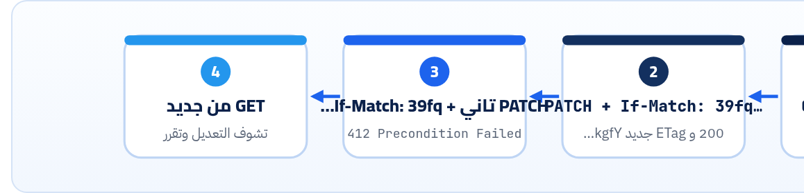

<small>المرحلة 5 · تصميم REST</small>

الـ API بعد ما يتنشر بيبقى وعد. الفصل ده عن 3 حاجات بتحمي الوعد ده: إزاي تغيّر من غير ما تكسر الناس (Versioning و Deprecation و Sunset)، وإزاي تحمي السيرفر من الضغط (Rate limits و 429)، وإزاي تمنع اتنين يمسحوا شغل بعض (ETag و If-Match و 412). وكله بردود حقيقية من GitHub ومن library.js.

:::note[بعد الفصل ده هتكون عارف]
- إيه اللي بيكسر الـ Clients وإيه اللي لأ
- 3 طرق للـ Versioning: URL و Header و Date
- GitHub: X-GitHub-Api-Version والـ 400 والـ 410
- Deprecation (RFC 9745) و Sunset (RFC 8594)
- درس REST Countries من تاني بعين المصمم
- Rate limits: x-ratelimit-\* و RateLimit draft و 429 + Retry-After
- Lost update: اتنين بيعدّلوا نفس المقالة
- ETag و If-Match و 412 بتجربة حقيقية
:::

<a id="s19-1"></a>

## 19.1 إيه اللي بيكسر؟

أول ما حد يبني على الـ API بتاعك، أي تغيير ممكن يوقّع App شغال عند ناس انت متعرفهمش. فلازم تفرّق:

**Breaking ولا لأ**

| آمن (Non-breaking) | بيكسر (Breaking) |
|---|---|
| تزوّد Endpoint جديد | تشيل Endpoint أو تغيّر الـ URL |
| تزوّد Field جديد في الرد | تشيل Field، أو تغيّر اسمه، أو نوعه (`"id": 4` لـ `"4"`) |
| تزوّد Parameter اختياري | تخلي Parameter إجباري، أو تضيّق القيم المقبولة |
| تزوّد قيمة Enum (لو قلت ده في الـ Docs) | تغيّر معنى Field أو Default (`limit` من 20 لـ 10) |
| رسالة `detail` أوضح | تغيّر `type` أو الـ Status code |

:::tip[الحل الأول: متكسرش]
أغلب التغييرات ممكن تتعمل بطريقة آمنة: Field جديد جنب القديم (`authorId` و`author`)، و Endpoint جديد جنب القديم. الـ Versioning هو آخر حل لما مفيش مفر.
:::

<a id="s19-2"></a>

## 19.2 3 طرق للـ Versioning

**فين تحط النسخة**

| الطريقة | شكلها | مين | الرأي |
|---|---|---|---|
| في الـ URL | `/v1/articles` | Frankfurter (`/v2`)، و REST Countries، و `library.js` | واضحة جداً وسهلة في المتصفح والـ Logs. بس النسخة الجديدة = كل الـ URLs اتغيرت |
| في Header بتاريخ | `X-GitHub-Api-Version: 2026-03-10` | GitHub، و Stripe (`Stripe-Version`) | الـ URLs ثابتة، والتغييرات صغيرة ومتواريخ. أصعب تشوفها من المتصفح |
| في الـ Accept | `Accept: application/vnd.example.v2+json` | أقل انتشاراً | "صحيح" من ناحية HTTP، بس متعب للكل |

### GitHub على الطبيعة

```sh title="Terminal"
# من غير هيدر: الـ Default
$ curl -si https://api.github.com/zen -H 'User-Agent: book' | grep -i x-github-api-version
x-github-api-version-selected: 2022-11-28

# بالنسخة الجديدة
$ curl -s -D - -o /dev/null https://api.github.com/repos/expressjs/express \
    -H 'User-Agent: book' -H 'X-GitHub-Api-Version: 2026-03-10' | grep -i version
x-github-api-version-selected: 2026-03-10

# نسخة عمرها ما كانت موجودة
$ curl -s https://api.github.com/repos/expressjs/express -H 'User-Agent: book' -H 'X-GitHub-Api-Version: 2019-01-01'
{"message":"Bad Request","errors":"The version you specified in the \"X-GitHub-API-Version\" request header,
 \"2019-01-01\", is not a supported version. The following versions are currently supported:
 \"2026-03-10\" (most recent) and \"2022-11-28\".","documentation_url":"https://docs.github.com/rest","status":"400"}
```

**تشريح الأمر**

```http
x-github-api-version-selected: 2026-03-10
```

1. `Default`: من غير هيدر = `2022-11-28`. يعني الكود القديم مبيتكسرش لوحده.
2. `-selected`: السيرفر بيقولك "اشتغلت بأنهي نسخة"، فتتأكد في الـ Logs.
3. `400`: نسخة غلط خالص = 400، ورسالة بتقولك النسخ المتاحة. (وحسب الـ Docs، نسخة **اتقفلت** بعد فترة الدعم = **410 Gone**.)
4. `24 شهر`: الـ Docs بتقول إن كل نسخة مدعومة 24 شهر بعد ما تنزل اللي بعدها، وقبل القفل بيبعت `Deprecation` و`Sunset`.

**المصادر الرسمية:** [GitHub · API Versions](https://docs.github.com/en/rest/about-the-rest-api/api-versions) · [Stripe · Versioning](https://docs.stripe.com/api/versioning)

<a id="s19-3"></a>

## 19.3 Deprecation و Sunset: تقفل بأدب

في فصل 9 الكود القديم بتاع REST Countries وقف فجأة، والرد كان:

```json
{ "success": false, "data": null,
  "errors": [{ "message": "This API version has been deprecated. Please visit https://restcountries.com/docs/countries/legacy-api-deprecation to migrate to our new version (v5)." }] }
```

والنهارده بقى بيعمل `301` لملف تاني. الرسالة كويسة، بس جت **بعد** ما الكود وقف، و Status code مش واضح. الطريقة الـ Standard إنك تحذّر **قبلها بفترة** بهيدرز، وأي أداة أو Middleware تقدر تقراها وتنبّه المطوّر. جربناها على `/v1/posts` (اسم قديم لـ `/v1/articles`):

```http title="curl -si localhost:3001/v1/posts"
Deprecation: @1790812800
Sunset: Fri, 01 Jan 2027 00:00:00 GMT
Link: </v1/articles>; rel="successor-version"
      <https://example.com/docs/deprecations/posts>; rel="deprecation"; type="text/html"
```

1. `Deprecation: @1790812800`: **RFC 9745**: "الحاجة دي Deprecated من التاريخ ده". الشكل `@` + Unix timestamp (Structured field). 1790812800 = 1 أكتوبر 2026 الساعة 00:00 UTC. لسه شغال، بس ابدأ تنقل.
2. `Sunset: Fri, 01 Jan 2027 00:00:00 GMT`: **RFC 8594**: "هتقف خالص في التاريخ ده". بصيغة HTTP-date (مش @). بعدها المفروض 410.
3. `Link: </v1/articles>; rel="successor-version"`: البديل فين.
4. `<https://example.com/docs/deprecations/posts>; rel="deprecation"; type="text/html"`: صفحة بتشرح الـ Migration (الـ `rel="deprecation"` معرّف في RFC 9745).

1. أعلن في الـ Changelog والإيميل، وابدأ تبعت `Deprecation` و`Link`.
2. حدد `Sunset` بمهلة كفاية (GitHub بيدّي 24 شهر للنسخ).
3. راقب مين لسه بيستخدم القديم (Logs بالـ API key) وكلّمهم.
4. بعد الـ Sunset: **410 Gone** و Problem فيه لينك الـ Migration، مش 404 ولا 200 بـ Error.

**المصادر الرسمية:** [RFC 9745 · Deprecation Header](https://www.rfc-editor.org/rfc/rfc9745.html) · [RFC 8594 · Sunset Header](https://www.rfc-editor.org/rfc/rfc8594.html)

<a id="s19-4"></a>

## 19.4 الـ Rate limits

من غير حد، Client واحد فيه Bug (Loop) أو Scraper ممكن يوقّع السيرفر على الكل. فكل API عام بيحط حد، والمهم إنه **يقولك** الحد وفاضل كام. GitHub (فصل 3) بيستخدم هيدرز `x-` خاصة بيه:

```http
x-ratelimit-limit: 60
x-ratelimit-remaining: 49
x-ratelimit-used: 11
x-ratelimit-resource: core
x-ratelimit-reset: 1792758101
```

وكل API بأسماء مختلفة شوية (NASA: `x-ratelimit-limit` و`x-ratelimit-remaining` بس). فـ IETF شغالة على Standard (لسه Draft، النسخة 11)، وطبقناه في `library.js` بحد 3 طلبات في الدقيقة علشان نشوف الـ 429:

```sh title="Terminal"
$ for i in 1 2 3 4; do curl -s -o /dev/null -D - localhost:3002/v1/articles/1 | grep -iE '^(HTTP|RateLimit|Retry)'; done
HTTP/1.1 200 OK
RateLimit-Policy: "default";q=3;w=60
RateLimit: "default";r=2;t=60
HTTP/1.1 200 OK
RateLimit-Policy: "default";q=3;w=60
RateLimit: "default";r=1;t=60
HTTP/1.1 200 OK
RateLimit-Policy: "default";q=3;w=60
RateLimit: "default";r=0;t=60
HTTP/1.1 429 Too Many Requests
RateLimit-Policy: "default";q=3;w=60
RateLimit: "default";r=0;t=60
Retry-After: 60

$ curl -s localhost:3002/v1/articles/1
{"type":"about:blank","title":"Too Many Requests","status":429,"detail":"Limit is 3 requests per 60 seconds"}
```

**تشريح الأمر**

```http
RateLimit-Policy: "default";q=3;w=60
RateLimit: "default";r=0;t=60
Retry-After: 60
```

1. `"default"`: اسم السياسة (ممكن يبقى في أكتر من حد: في الدقيقة وفي اليوم).
2. `q=3`: Quota: الحد (3 طلبات).
3. `w=60`: Window: في 60 ثانية.
4. `r=0`: Remaining: فاضل كام.
5. `t=60`: بعد كام ثانية العدّاد يرجع (ثواني من دلوقتي، مش Timestamp زي GitHub).
6. `Retry-After`: هيدر Standard من RFC 9110: استنى 60 ثانية قبل ما تجرب تاني.

:::tip[كـ Client]
اقرا `remaining` وهدّي قبل ما توصل للصفر. ولو جالك 429: استنى `Retry-After` (لو موجود) أو Backoff متزايد مع Jitter، زي ما عملنا في كتاب Python (فصل 25). ومتعيدش فوراً في Loop، ده بيخليك تتحظر.
:::

:::caution[كـ Provider]
الـ Rate limiter اللي في `library.js` (Map في الذاكرة) للتعلم بس. لو عندك أكتر من سيرفر، كل واحد هيعدّ لوحده. في Production بيتعمل في Redis أو في الـ API Gateway أو مكتبة زي `express-rate-limit`. وحطه **قبل** الـ Body parser (زي ما عملنا) علشان حتى الطلبات البايظة تتعد.
:::

**المصادر الرسمية:** [IETF Draft · RateLimit header fields for HTTP](https://datatracker.ietf.org/doc/draft-ietf-httpapi-ratelimit-headers/) · [GitHub · Rate limits](https://docs.github.com/en/rest/using-the-rest-api/rate-limits-for-the-rest-api) · [MDN · Retry-After](https://developer.mozilla.org/en-US/docs/Web/HTTP/Reference/Headers/Retry-After)

<a id="s19-5"></a>

## 19.5 الـ Lost update: ETag و If-Match

انت وزميلك فتحتوا نفس المقالة الساعة 10. انت غيرت العنوان وحفظت الساعة 10:05. هو غيّر الـ Status وحفظ الساعة 10:07، والفورم بتاعه فيه العنوان **القديم**. النتيجة: تعديلك اتمسح ومحدش خد باله. ودي اسمها **Lost update**.

الحل في HTTP نفسه: كل نسخة من الـ Resource ليها `ETag` (بصمة)، والتعديل بيقول "عدّل **بشرط** إن النسخة لسه دي" بـ `If-Match`. ولو حد عدّل قبلك، السيرفر يرفض بـ **412**:



*نفس الـ ETag اللي بيوفّر Bandwidth في الـ Cache (304) هو اللي بيحمي من الـ Lost update.*

```sh title="Terminal"
$ curl -si localhost:3001/v1/articles/4
HTTP/1.1 200 OK
ETag: "39fqqzHpm_icenp6"
{"id":"4","title":"Article 4","status":"published","authorId":"1","tags":["json"],...}

# الأولى: بنفس الـ ETag ← نجح، و ETag جديد
$ curl -si -X PATCH localhost:3001/v1/articles/4 -H 'Content-Type: application/merge-patch+json' \
    -H 'If-Match: "39fqqzHpm_icenp6"' -d '{"title":"Article four","tags":null}'
HTTP/1.1 200 OK
ETag: "kgfYo1GjspvVpE60"

# التاني: لسه معاه الـ ETag القديم ← اترفض
$ curl -si -X PATCH localhost:3001/v1/articles/4 -H 'Content-Type: application/merge-patch+json' \
    -H 'If-Match: "39fqqzHpm_icenp6"' -d '{"status":"review"}'
HTTP/1.1 412 Precondition Failed
Content-Type: application/problem+json; charset=utf-8

{"type":"about:blank","title":"Precondition Failed","status":412,"detail":"The article changed since you read it"}

# وبنفس الـ ETag مع GET ← 304 (Cache، فصل 3)
$ curl -si localhost:3001/v1/articles/4 -H 'If-None-Match: "39fqqzHpm_icenp6"'
HTTP/1.1 304 Not Modified
```

#### If-None-Match (مع GET)

"ابعتلي بس لو **اتغير**". لو زي ما هو = 304 من غير Body. للـ Cache.

#### If-Match (مع PATCH/PUT/DELETE)

"نفّذ بس لو **متغيرش**". لو اتغير = 412. للـ Concurrency. ولو عايز تجبر الـ Clients يبعتوه: 428 Precondition Required.

:::note[ETag قوي ولا ضعيف]
`"39fq…"` = Strong: البايتات نفسها. `W/"113-…"` = Weak: "تقريباً نفس المحتوى". Express بيحط Weak ETag أوتوماتيك على الردود (شفناه قبل ما نقفله في `library.js`)، وده كويس للـ 304 بس **مينفعش** مع `If-Match` (RFC 9110 بيقول المقارنة هناك Strong). علشان كده عملنا ETag بإيدنا من Hash للمحتوى.
:::

**المصادر الرسمية:** [RFC 9110 · If-Match](https://www.rfc-editor.org/rfc/rfc9110.html#name-if-match) · [MDN · 412 Precondition Failed](https://developer.mozilla.org/en-US/docs/Web/HTTP/Reference/Status/412)

:::tip[ملخص الفصل]
- زوّد براحتك، بس متشيلش ومتغيرش نوع أو معنى. الـ Versioning آخر حل.
- Versioning في الـ URL (`/v1`) أو Header بتاريخ (GitHub و Stripe). GitHub: Default قديم، و 400 لنسخة مش موجودة، و 410 لنسخة اتقفلت.
- اقفل بأدب: `Deprecation` (‎@timestamp) و`Sunset` (HTTP-date) و`Link`، وبعدها 410.
- Rate limits: قول الحد والفاضل، و 429 + `Retry-After`. والـ Client يهدّي ويعمل Backoff.
- ETag + `If-Match` = 412 بدل ما تعديل حد يضيع.
:::

### صح ولا غلط؟

1. إنك تزوّد Field جديد في الرد Breaking change.
2. في هيدر RateLimit، `t=30` معناها Unix timestamp.
3. 412 معناها إن الـ Resource اتغير بعد ما انت قريته.

### أسئلة مراجعة

1. إيه الفرق بين `Deprecation` و`Sunset`؟ وكل واحد بصيغة إيه؟
2. ليه GitHub عامل Default قديم بدل أحدث نسخة؟
3. اشرح الـ Lost update بمثال، وإزاي `If-Match` بيحله.
4. ليه الـ Rate limiter في الذاكرة مش كفاية لو عندك 3 سيرفرات؟

### تحديات الفصل

<small>جرّبها بإيدك، والحلول في ملحق الإجابات.</small>

1. **[سهل]** ابعت طلب لـ GitHub واحسب الـ `x-ratelimit-reset` بتوقيت القاهرة بـ `date -r`.
2. **[متوسط]** اكتب Client بيعمل GET، وبعدين PATCH بـ `If-Match`، ولو جاله 412 يعمل GET تاني ويعرض الفرق.
3. **[صعب]** عايز تغيّر `authorId` لـ `author: {id, name}` في الـ Content Library API. اكتب خطة من غير ما تكسر حد: إيه اللي يتزود إمتى، وإمتى تبعت Deprecation، وإمتى Sunset.
