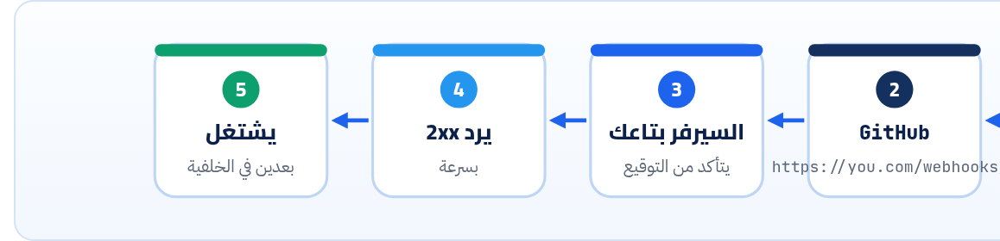

<small>المرحلة 6 · Webhooks و OpenAPI</small>

في فصل 2 عرفنا الـ Webhook كفكرة: بدل ما تسأل كل شوية، السيرفر التاني يبعتلك. هنا هنبني واحد بجد: Express بيستقبل Webhook شبه GitHub، ويتأكد من التوقيع بـ HMAC على الـ Raw body، ويرفض المزوّر، ويتجاهل المكرر، ويرد بسرعة. وهنشوف بعينينا ليه express.json() هنا بيبوّظ التوقيع.

:::note[بعد الفصل ده هتكون عارف]
- الـ Polling ضد الـ Webhook: الحسبة
- شكل الـ Webhook: POST فيه Event و Delivery ID و Signature
- HMAC-SHA256 حرف بحرف، و test vector بتاع GitHub
- ليه لازم Raw body: تجربة بتفشل
- timingSafeEqual وليه مش ===
- الـ Duplicate والـ Retry: GitHub مبيعيدش لوحده و Stripe بيعيد 3 أيام
- رد في أقل من 10 ثواني والشغل في Queue
- إزاي تجرّب على جهازك: smee.io و stripe listen
:::

<a id="s20-1"></a>

## 20.1 السؤال كل 5 ثواني

عايز تعرف لما حد يفتح Issue في الـ Repo بتاعك. الحل الأول (Polling): تسأل GitHub كل دقيقة "في جديد؟". يعني 1440 طلب في اليوم، وأغلبها إجابته "لأ"، وكمان بتاكل من الـ Rate limit (60 في الساعة من غير توكن!)، والخبر بيوصلك متأخر لحد دقيقة. فاتطور حل: **انت تدّي GitHub عنوان**، وهو يبعتلك `POST` أول ما الحاجة تحصل. ده الـ Webhook: API بالعكس، وانت هنا السيرفر.



*الـ Webhook = HTTP request عادي، بس اللي بيبعته هو الـ Provider واللي بيستقبله انت.*

<a id="s20-2"></a>

## 20.2 شكل الـ Delivery

```http title="Webhook شبه GitHub"
POST /webhooks/github HTTP/1.1
Content-Type: application/json
X-GitHub-Event: issues
X-GitHub-Delivery: 72d3162e-cc78-11e3-81ab-4c9367dc0958
X-Hub-Signature-256: sha256=d3a7e3c6…ee68
{"action": "opened", "issue": {...}}
```

1. `POST /webhooks/github HTTP/1.1`: طلب عادي، الـ Body JSON.
2. `X-GitHub-Event: issues`: نوع الحدث، علشان تعرف تتعامل إزاي قبل ما تقرا الـ Body.
3. `X-GitHub-Delivery: 72d3162e-cc78-11e3-81ab-4c9367dc0958`: ID فريد لكل Delivery. هو اللي هتمنع بيه التكرار.
4. `X-Hub-Signature-256: sha256=d3a7e3c6…ee68`: التوقيع: `sha256=` + HMAC-SHA256 للـ Body بالـ Secret اللي انت وGitHub بس عارفينه.
5. `{"action": "opened", "issue": {...}}`: الـ Payload. و`action` بيحدد التفاصيل (opened و closed و edited).

<a id="s20-3"></a>

## 20.3 التوقيع: ليه وإزاي

الـ URL بتاعك عام. أي حد يقدر يبعتله `POST` بـ `{"action": "opened"}` مزوّر. فلازم تتأكد إن الطلب جاي من GitHub **ومحدش غيّر فيه**. الحل: **HMAC**. GitHub بياخد الـ Body بايت بايت، ويعمله Hash مع الـ Secret، ويبعت النتيجة. وانت تعمل نفس الحسبة: لو طلعت نفس النتيجة يبقى الـ Body ده بالظبط واللي بعته عارف الـ Secret.

```js title="hmac.mjs بالـ test vector اللي في Docs بتاعة GitHub"
import { createHmac, timingSafeEqual } from "node:crypto";

function verify(secret, rawBody, header) {
  const expected = "sha256=" + createHmac("sha256", secret).update(rawBody).digest("hex");
  const a = Buffer.from(expected);
  const b = Buffer.from(header ?? "");
  return a.length === b.length && timingSafeEqual(a, b);
}
const secret = "It's a Secret to Everybody";
const body = "Hello, World!";
const header = "sha256=757107ea0eb2509fc211221cce984b8a37570b6d7586c22c46f4379c8b043e17";
console.log(verify(secret, body, header));        // الصح
console.log(verify(secret, body + " ", header));  // مسافة زيادة في الـ Body
console.log(verify("wrong", body, header));       // Secret غلط
```

```sh title="Terminal"
$ node hmac.mjs
true
false
false
```

**تشريح الأمر**

```js
createHmac("sha256", secret).update(rawBody).digest("hex")
```

1. `createHmac`: من `node:crypto` (مدمج، مفيش npm).
2. `"sha256"`: الخوارزمية. GitHub بيبعت كمان `X-Hub-Signature` القديم بـ SHA-1 للتوافق، والـ Docs بتقول استخدم الـ 256.
3. `.update(rawBody)`: البايتات **زي ما وصلت بالظبط**.
4. `.digest("hex")`: النتيجة Hex (64 حرف)، وبعدين نزوّد `sha256=` قبلها.
5. `timingSafeEqual`: مقارنة بتاخد نفس الوقت مهما كان أول اختلاف فين. الـ `===` بتقف عند أول حرف مختلف، فالـ Attacker يقدر يقيس الوقت ويخمّن التوقيع حرف حرف (Timing attack). ولازم الطولين يبقوا متساويين قبلها وإلا بترمي Error.

**المصادر الرسمية:** [GitHub · Validating webhook deliveries](https://docs.github.com/en/webhooks/using-webhooks/validating-webhook-deliveries) · [Node.js · crypto.timingSafeEqual](https://nodejs.org/api/crypto.html#cryptotimingsafeequala-b)

<a id="s20-4"></a>

## 20.4 نبني الـ Receiver

```js title="hook.js (الجزء المهم)"
// express.raw keeps the exact bytes as a Buffer in req.body
app.post("/webhooks/github", express.raw({ type: "application/json" }), (req, res) => {
  if (!validSignature(req.body, req.get("X-Hub-Signature-256")))
    return res.status(401).json({ error: "bad signature" });

  const id = req.get("X-GitHub-Delivery");
  if (seen.has(id)) return res.status(200).json({ ok: true, duplicate: true });
  seen.add(id);

  const event = req.get("X-GitHub-Event");
  const payload = JSON.parse(req.body); // parse only AFTER verifying
  res.status(202).json({ ok: true });   // answer first...
  setImmediate(() => {                  // ...then do the slow work (a queue in production)
    console.log(`handled ${event} #${id}: ${payload.action} ${payload.issue?.title ?? ""}`);
  });
});
```

ونجرّب بـ curl: نعمل التوقيع بـ `openssl` (موجود على الـ Mac) زي ما GitHub بيعمله بالظبط:

```sh title="Terminal"
$ SIG="sha256=$(openssl dgst -sha256 -hmac 'dev-secret' -hex < payload.json | awk '{print $NF}')"
$ echo "$SIG"
sha256=d3a7e3c6a80e15960db92f0cdf3368051d3504e870ced58c15275e4daa82ee68

# 1) Delivery سليم
$ curl -s -X POST localhost:4000/webhooks/github -H 'Content-Type: application/json' \
    -H 'X-GitHub-Event: issues' -H 'X-GitHub-Delivery: 72d3162e-cc78-11e3-81ab-4c9367dc0958' \
    -H "X-Hub-Signature-256: $SIG" --data-binary @payload.json -w '\n%{http_code}\n'
{"ok":true}
202

# 2) نفس الـ Delivery تاني (إعادة)
{"ok":true,"duplicate":true}
200

# 3) Body تاني بنفس التوقيع (تزوير)
$ curl -s ... -H "X-Hub-Signature-256: $SIG" --data-binary '{"action":"deleted"}'
{"error":"bad signature"}
401
```

```sh title="Log السيرفر"
> handled issues #72d3162e-cc78-11e3-81ab-4c9367dc0958: opened Docs typo
```

**تشريح الأمر**

```sh
openssl dgst -sha256 -hmac 'dev-secret' -hex < payload.json | awk '{print $NF}'
```

1. `dgst -sha256`: اعمل Hash بـ SHA-256.
2. `-hmac 'dev-secret'`: اعمله HMAC بالـ Secret ده.
3. `-hex`: النتيجة Hex.
4. `< payload.json`: اقرا الملف كـ Input.
5. `awk '{print $NF}'`: الـ openssl هنا كتب `SHA2-256(stdin)= d3a7…` (والشكل ممكن يختلف شوية في LibreSSL اللي على الـ Mac)، فبناخد آخر كلمة بس، وده شغال في الحالتين.
6. `--data-binary`: ابعت الملف **زي ما هو**. الـ `-d` بيشيل الـ Newlines، فالتوقيع هيبوظ!

<a id="s20-5"></a>

## 20.5 ليه الـ Raw body؟ التجربة

عملنا Route تاني بالطريقة "الطبيعية": `express.json()` وبعدين نوقّع `JSON.stringify(req.body)`. نفس الـ Payload ونفس التوقيع:

```sh title="Terminal"
$ curl -s -X POST localhost:4000/webhooks/wrong -H 'Content-Type: application/json' \
    -H "X-Hub-Signature-256: $SIG" --data-binary @payload.json -w '\n%{http_code}\n'
{"ok":false}
401
```

ليه؟ الملف كان متنسّق بمسافات وسطور. الـ `JSON.parse` ثم `JSON.stringify` طلّعوا `{"action":"opened","issue":{"number":7,"title":"Docs typo"}}`: نفس البيانات بس **بايتات مختلفة**، والـ HMAC بيشتغل على البايتات. وده أشهر Bug في الـ Webhooks، و Stripe بيقول نفس الكلام: لازم الـ Raw body.

:::caution[الترتيب في Express]
لو عامل `app.use(express.json())` على الـ App كله، هيقرا الـ Body قبل الـ Webhook route ويضيّع البايتات. الحل: `express.raw()` على الـ Route ده بالذات (زي `hook.js`)، أو حط الـ Webhook route **قبل** `app.use(express.json())`.
:::

<a id="s20-6"></a>

## 20.6 التكرار والإعادة والسرعة

**GitHub ضد Stripe (من الـ Docs)**

|   | GitHub | Stripe |
|---|---|---|
| التوقيع | `X-Hub-Signature-256: sha256=…` | `Stripe-Signature: t=…,v1=…` (فيه Timestamp) |
| وقت الرد | 2xx خلال 10 ثواني، وإلا فشل | 2xx بسرعة قبل أي شغل معقد |
| لو فشل | **مبيعيدش لوحده**. انت تعمل Redeliver (من الـ UI أو الـ API) | بيعيد لحد 3 أيام بـ Exponential backoff (Live mode) |
| التكرار | استخدم `X-GitHub-Delivery` | سجّل الـ Event IDs اللي اتعالجت |
| Replay قديم | — | الـ `t=` جوه التوقيع، والمكتبة بترفض الأقدم من 5 دقايق افتراضياً |

:::tip[Best Practice: الـ Receiver]
1. اتأكد من التوقيع على الـ Raw body بـ `timingSafeEqual`، **قبل** أي Parse.
2. اتجاهل المكرر بالـ Delivery/Event ID (في Database، مش `Set` في الذاكرة).
3. رد 2xx فوراً، وحط الشغل التقيل في Queue.
4. متعتمدش على الترتيب: ممكن "closed" يوصل قبل "opened". ولو محتاج الحالة الحقيقية، اسأل الـ API.
5. Endpoint بـ HTTPS، والـ Secret في Environment variable.
:::

**المصادر الرسمية:** [GitHub · Best practices for webhooks](https://docs.github.com/en/webhooks/using-webhooks/best-practices-for-using-webhooks) · [GitHub · Redelivering webhooks](https://docs.github.com/en/webhooks/testing-and-troubleshooting-webhooks/redelivering-webhooks) · [Stripe · Webhooks](https://docs.stripe.com/webhooks) · [Stripe · Signature verification](https://docs.stripe.com/webhooks/signature)

<a id="s20-7"></a>

## 20.7 تجرّب على جهازك إزاي؟

المشكلة: GitHub مش هيقدر يوصل لـ `localhost:4000` على الـ Mac بتاعك. الحل: خدمة في النص بتستقبل وتحوّل لجهازك:

**أدوات**

| الأداة | بتعمل إيه |
|---|---|
| smee.io | اللي Docs بتاعة GitHub بتستخدمه: URL عام، و`smee-client` على جهازك بيحوّل لـ `localhost` |
| Stripe CLI | `stripe listen --forward-to localhost:4242/webhook`، و`stripe trigger` يبعت Events تجريبية |
| curl + openssl | اللي عملناه فوق: تجرّب التوقيع والتكرار من غير أي خدمة |
| Redeliver في GitHub | من صفحة الـ Webhook: "Recent Deliveries" تشوف كل طلب ورده وتعيده |

**المصادر الرسمية:** [GitHub · Handling webhook deliveries (smee)](https://docs.github.com/en/webhooks/using-webhooks/handling-webhook-deliveries) · [Stripe CLI](https://docs.stripe.com/stripe-cli/use-cli)

:::tip[ملخص الفصل]
- Webhook = الـ Provider بيبعتلك POST بدل ما تسأل كل شوية.
- التوقيع HMAC-SHA256 على **البايتات**، والمقارنة بـ `timingSafeEqual`.
- `express.json()` قبل التوقيع = فشل (شفناه)، فاستخدم `express.raw()`.
- اتجاهل المكرر بالـ ID، ورد بسرعة، والشغل في Queue.
- GitHub مبيعيدش لوحده، و Stripe بيعيد لحد 3 أيام.
:::

### صح ولا غلط؟

1. لو الـ JSON بعد Parse ثم Stringify هو نفس البيانات، التوقيع هيطلع صح.
2. استخدام `===` لمقارنة التوقيعات آمن تماماً.
3. الـ Webhook endpoint المفروض يخلّص كل الشغل قبل ما يرد.

### أسئلة مراجعة

1. احسب: Polling كل 30 ثانية لـ 5 Repos = كام طلب في الساعة؟ وقارنه بحد GitHub من غير توكن.
2. ليه الـ Secret لازم يفضل سر؟ إيه اللي يحصل لو اتسرب؟
3. إزاي الـ Timestamp في توقيع Stripe بيحمي من الـ Replay؟
4. ليه `--data-binary` مش `-d` في التجربة؟

### تحديات الفصل

<small>جرّبها بإيدك، والحلول في ملحق الإجابات.</small>

1. **[سهل]** شغّل `hmac.mjs` وغيّر حرف واحد في الـ Body وشوف النتيجة.
2. **[متوسط]** زوّد على `hook.js` إنه يتعامل بس مع `issues` و`action === "opened"` ويتجاهل الباقي بـ 204.
3. **[صعب]** اعمل Repo تجريبي على GitHub، وحط Webhook بـ smee.io، وخلّي `hook.js` يستقبل Delivery حقيقي.
