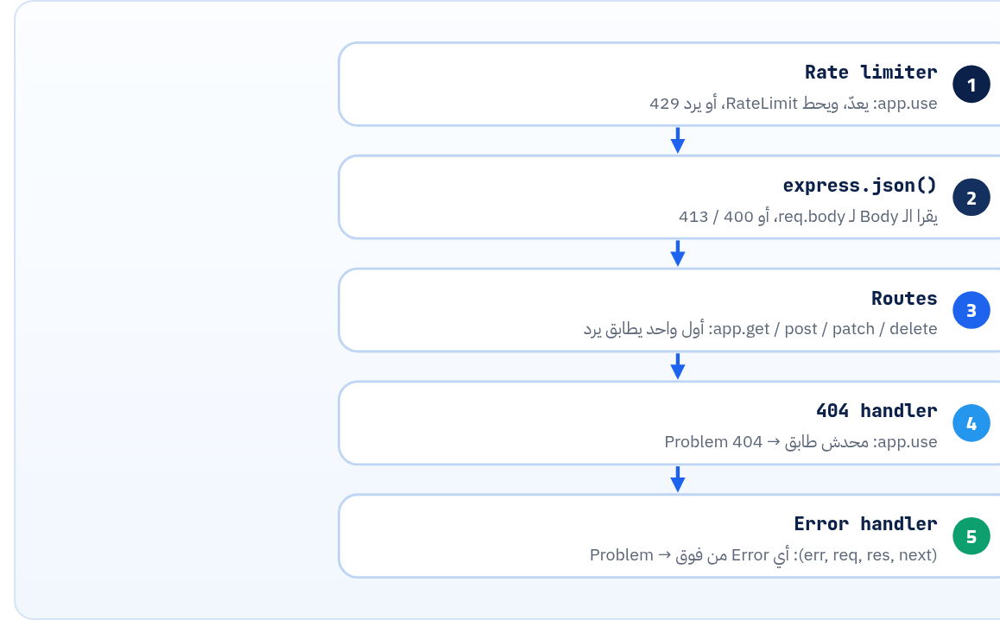

<small>المرحلة 7 · الجسر والمشروع</small>

كورس Maximilian هيعلّمك Node و Express بالتفصيل. الفصل ده مش بديل عنه، ده خريطة: كل مفهوم اتعلمته في الكتاب ده (Status codes، و Problem details، و Pagination، و ETag، و Idempotency، و Rate limits) بيتعمل فين في Express، بالإشارة لـ library.js سطر بسطر. ولما توصل للكورس، هتعرف كل سطر بيعمل إيه وليه.

:::note[بعد الفصل ده هتكون عارف]
- الصورة الكبيرة: Request بيعدّي على سلسلة Middleware
- ترتيب library.js وليه الترتيب ده بالظبط
- req: params و query و body و get و is
- res: status و json و set و location و type و end
- Express 5: الـ async errors، و req.body undefined، والـ Path syntax
- الـ Error middleware بـ 4 Arguments
- خريطة: كل مفهوم في الكتاب ← فين في الكود
- إيه اللي ناقص علشان يبقى Production
- الكود كامل
:::

<a id="s22-1"></a>

## 22.1 الصورة الكبيرة

Express في الأساس حاجة واحدة: **Request بيعدّي على سلسلة Functions بالترتيب** (Middleware). كل واحدة يا إما ترد وتقفل، يا إما تنادي `next()` علشان اللي بعدها. والـ Route نفسه Middleware بيشتغل بس لو الـ Method والـ Path ماشيين.



*ترتيب library.js. الترتيب هو المنطق: الـ Rate limiter قبل الـ Parser علشان الطلبات البايظة تتعد، والـ 404 بعد كل الـ Routes، والـ Error handler في الآخر خالص.*

```js title="أصغر Express app"
import express from "express";
const app = express();
app.use(express.json());                       // middleware: parse JSON bodies
app.get("/v1/ping", (req, res) => {             // route: method + path + handler
  res.json({ ok: true });                       // send JSON (status 200 by default)
});
app.listen(3001);
```

<a id="s22-2"></a>

## 22.2 الـ req والـ res

**اللي استخدمناه في library.js**

| الكود | بيعمل إيه | المفهوم في الكتاب |
|---|---|---|
| `req.params.id` | من الـ Path: `/v1/articles/:id` | Resources (فصل 14) |
| `req.query.status` | من الـ Query string، ودايماً String | Filtering (فصل 18) |
| `req.body` | الـ JSON بعد `express.json()`. من غيره = `undefined` في Express 5 | Bodies (فصل 16) |
| `req.get("If-Match")` | أي Header (مش حساس للحروف) | ETag (فصل 19) |
| `req.is("application/json")` | هل الـ Content-Type كده؟ | 415 (فصل 16) |
| `res.status(201)` | الـ Status code (وبيرجّع `res` علشان تكمّل) | فصل 16 |
| `res.json(obj)` | `JSON.stringify` + `Content-Type` + يبعت | فصل 5 |
| `res.type("application/problem+json")` | يغيّر الـ Content-Type | RFC 9457 (فصل 17) |
| `res.set("ETag", tag)` | يحط Header | فصل 19 |
| `res.location(url)` | هيدر `Location` | 201 (فصل 16) |
| `res.status(204).end()` | يرد من غير Body | DELETE (فصل 15) |

:::caution[req.query دايماً Strings]
`?limit=5` بتوصل `"5"` مش `5`. علشان كده في `library.js`: `Number(req.query.limit) || 10` و`Math.min(…, 50)`. وأي Input من برّه (Query، أو Body، أو Headers) **متثقش فيه**: Validate بـ zod أو Schema.
:::

**المصادر الرسمية:** [Express 5 · API reference](https://expressjs.com/en/5x/api/) · [Express · Using middleware](https://expressjs.com/en/guide/using-middleware/)

<a id="s22-3"></a>

## 22.3 Express 5: اللي اتغير

Express 5 نزل رسمي بعد سنين على 4، والنسخة دلوقتي 5.3.0 (9 أكتوبر 2026). أغلب الفيديوهات القديمة Express 4، فخلّي بالك من الفروق دي:

**Express 4 ← 5**

| الحاجة | Express 4 | Express 5 |
|---|---|---|
| Error في `async` handler | لازم `try/catch` و`next(err)` بإيدك، وإلا الطلب بيعلّق | بيتمسك لوحده ويروح للـ Error handler (جربناه بـ `/v1/debug/crash`) |
| `req.body` من غير Parser | `{}` | `undefined` (علشان كده `req.body ?? {}` في `server.js`) |
| الـ Wildcard | `/*` | لازم اسم: `/*splat` |
| Optional param | `/:ext?` | `{/:ext}` بأقواس |
| حروف محجوزة | — | `( ) [ ] ? + !` محتاجة `\`. والـ `:` بتاعة `:publish` كمان (فصل 15) |
| `app.del()` و `req.param()` | موجودين | اتشالوا |

**المصادر الرسمية:** [Express · Migrating to Express 5](https://expressjs.com/en/guide/migrating-5/) · [Express · Error handling](https://expressjs.com/en/guide/error-handling/)

<a id="s22-4"></a>

## 22.4 الـ Error middleware

```js
app.use((err, req, res, next) => {
  const status = err.status ?? 500;
  if (status >= 500) {
    const id = crypto.randomUUID();
    console.error(id, err); // full details in the server log only
    return problem(res, 500, "Internal Server Error", { instance: `urn:uuid:${id}` });
  }
  // about:blank => title is the standard status phrase (RFC 9457 §4.2.1)
  const titles = { 400: "Bad Request", 413: "Content Too Large" };
  problem(res, status, titles[status] ?? "Bad Request", { detail: err.message });
});
```

**تشريح الأمر**

```js
(err, req, res, next) => { ... }
```

1. `4 Arguments`: دي الطريقة الوحيدة اللي Express يعرف بيها إن ده Error handler. حتى لو مش هتستخدم `next`، لازم تكتبه.
2. `err.status`: الـ Errors اللي جاية من `express.json()` فيها `status` (400 للـ JSON البايظ، 413 للكبير). أي حاجة تانية = Bug = 500.
3. `>= 500`: الـ Log فيه كل حاجة، والـ Client ياخد ID بس (فصل 17).

<a id="s22-5"></a>

## 22.5 الخريطة: الكتاب ← الكود

**كل مفهوم فين في library.js**

| المفهوم | الفصل | فين في الكود |
|---|---|---|
| Resource names و IDs Strings | 14 | `/v1/articles/:id`، و`id: String(i)` |
| Custom method | 14، 15 | `"/v1/articles/:id\\:publish"` |
| PUT ضد PATCH، و Merge Patch | 15 | `app.put`، و`mergePatch()`، و`express.json({ type: [..., "application/merge-patch+json"] })` |
| Idempotency-Key | 15 | `idem` Map و`hash` للـ Body |
| 201 + Location، و 204، و 409، و 415، و 422 | 16 | `res.status(201).location(…)` وغيرها |
| Problem details | 17 | `problem()` و`P + "validation"` |
| Validation بـ pointer | 17 | `ArticleIn` (zod) و`validate()` |
| Filter و Sort و Fields و Cursor و Link | 18 | `app.get("/v1/articles")` |
| Rate limit و 429 | 19 | أول `app.use` |
| ETag و 304 و If-Match و 412 | 19 | `etagOf()`، و GET و PATCH |
| Deprecation و Sunset | 19 | `app.get("/v1/posts")` |
| CORS | 13 | `server.js`: `cors({ origin })` |
| Webhooks و Raw body | 20 | `hook.js`: `express.raw()` |

<a id="s22-6"></a>

## 22.6 إيه اللي ناقص علشان Production؟

`library.js` معمول علشان تتعلم منه، مش علشان ينزل. ودي الحاجات اللي هتتعلمها في الكورس أو بعده:

1. **Database** بدل الـ Arrays (PostgreSQL أو MongoDB)، فالبيانات متضيعش مع الـ Restart.
2. **Auth**: JWT أو Sessions (فصل 12)، و 401 و 403 على كل Route.
3. **تقسيم الملفات**: `express.Router()` لكل Resource (`routes/articles.js`)، و Controllers، و Services.
4. **Idempotency و Rate limit** في Redis مش في الذاكرة، أو مكتبة زي `express-rate-limit`.
5. **Security headers**: `helmet`، و`app.disable("x-powered-by")` (عملناها)، و Limit للـ Body (الـ Default 100kb).
6. **Logging** منظم (JSON logs بـ Request ID)، و Health check endpoint.
7. **Tests**: Contract test زي `contract.mjs` (فصل 21) في الـ CI.
8. **Config** من Environment variables (`PORT` و Secrets)، زي `LIMIT` و`PORT` اللي جربناهم.

**المصادر الرسمية:** [Express · Security best practices](https://expressjs.com/en/advanced/best-practice-security/) · [Express · Routing (express.Router)](https://expressjs.com/en/guide/routing/)

<a id="s22-7"></a>

## 22.7 الكود كامل: library.js

220 سطر، Express 5.3.0 و zod 4 على Node 24. كل رد في فصول 15 لـ 21 طالع منه. (اتعدّل خلال الفصول: الـ Problem types في 17، والـ Deprecation link في 19. والردود اللي في الكتاب من النسخة اللي كانت شغالة وقتها.)

```js title="lab/library.js"
// Content Library API — lab server for chapters 15-22
import express from "express";
import crypto from "node:crypto";
import { z } from "zod";

const app = express();
app.disable("x-powered-by");
app.set("etag", false); // we set our own ETags below

// ---------- helpers ----------
function problem(res, status, title, extra = {}) {
  return res.status(status).type("application/problem+json").json({
    type: extra.type ?? "about:blank", title, status, ...extra,
  });
}
const etagOf = (obj) =>
  '"' + crypto.createHash("sha256").update(JSON.stringify(obj)).digest("base64url").slice(0, 16) + '"';

const P = "https://example.com/problems/"; // our problem type URIs

// ---------- data ----------
const articles = [];
for (let i = 1; i <= 25; i++) {
  articles.push({
    id: String(i),
    title: `Article ${i}`,
    status: i % 3 === 0 ? "draft" : "published",
    authorId: String((i % 4) + 1),
    tags: i % 2 ? ["api"] : ["json"],
    createdAt: new Date(Date.UTC(2026, 9, i, 9, 0, 0)).toISOString(),
  });
}
let nextId = 26;

// ---------- rate limit: fixed window per IP ----------
const LIMIT = Number(process.env.LIMIT ?? 100);
const WINDOW = 60; // seconds
const hits = new Map();
app.use((req, res, next) => {
  const now = Math.floor(Date.now() / 1000);
  let w = hits.get(req.ip);
  if (!w || now >= w.reset) w = { count: 0, reset: now + WINDOW };
  w.count++;
  hits.set(req.ip, w);
  const remaining = Math.max(0, LIMIT - w.count);
  res.set("RateLimit-Policy", `"default";q=${LIMIT};w=${WINDOW}`);
  res.set("RateLimit", `"default";r=${remaining};t=${w.reset - now}`);
  if (w.count > LIMIT) {
    res.set("Retry-After", String(w.reset - now));
    return problem(res, 429, "Too Many Requests", {
      detail: `Limit is ${LIMIT} requests per ${WINDOW} seconds`,
    });
  }
  next();
});

// body parser AFTER the rate limiter, so even bad JSON is counted
app.use(express.json({ type: ["application/json", "application/merge-patch+json"] }));

// ---------- validation ----------
const ArticleIn = z.object({
  title: z.string().min(3),
  status: z.enum(["draft", "review", "published"]).default("draft"),
  authorId: z.string(),
  tags: z.array(z.string()).default([]),
});
function validate(body, res) {
  const r = ArticleIn.safeParse(body);
  if (r.success) return r.data;
  problem(res, 422, "Validation failed", {
    type: P + "validation",
    errors: r.error.issues.map((i) => ({ pointer: "/" + i.path.join("/"), detail: i.message })),
  });
  return null;
}

// ---------- list: filter, sort, cursor pagination, fields ----------
app.get("/v1/articles", (req, res) => {
  const { status, authorId, sort = "id", cursor, fields } = req.query;
  const limit = Math.min(Number(req.query.limit) || 10, 50);
  let list = articles.filter(
    (a) => (!status || a.status === status) && (!authorId || a.authorId === authorId));
  const desc = sort.startsWith("-");
  const key = desc ? sort.slice(1) : sort;
  if (!["id", "createdAt", "title"].includes(key))
    return problem(res, 400, "Invalid sort field", { type: P + "invalid-sort", detail: `Cannot sort by '${key}'` });
  const val = (a) => (key === "id" ? Number(a.id) : a[key]);
  list = [...list].sort((a, b) => (val(a) > val(b) ? 1 : -1) * (desc ? -1 : 1));
  let start = 0;
  if (cursor) {
    const lastId = Buffer.from(cursor, "base64url").toString();
    start = list.findIndex((a) => a.id === lastId) + 1;
  }
  const page = list.slice(start, start + limit);
  const hasMore = start + limit < list.length;
  const nextCursor = hasMore ? Buffer.from(page.at(-1).id).toString("base64url") : null;
  if (nextCursor) {
    const u = new URL(req.originalUrl, "http://localhost:3001");
    u.searchParams.set("cursor", nextCursor);
    res.set("Link", `<${u.pathname}${u.search}>; rel="next"`);
  }
  const pick = fields ? fields.split(",") : null;
  const data = pick ? page.map((a) => Object.fromEntries(pick.map((f) => [f, a[f]]))) : page;
  res.json({ data, nextCursor });
});

// ---------- read one: ETag + 304 ----------
app.get("/v1/articles/:id", (req, res) => {
  const a = articles.find((x) => x.id === req.params.id);
  if (!a) return problem(res, 404, "Article not found", { type: P + "article-not-found", detail: `No article with id '${req.params.id}'` });
  const tag = etagOf(a);
  res.set("ETag", tag);
  if (req.get("If-None-Match") === tag) return res.status(304).end();
  res.json(a);
});

// ---------- create: Idempotency-Key ----------
const idem = new Map(); // key -> { hash, status, body, location }
app.post("/v1/articles", (req, res) => {
  if (!req.is("application/json"))
    return problem(res, 415, "Unsupported Media Type", { detail: "Use Content-Type: application/json" });
  const key = req.get("Idempotency-Key");
  const hash = crypto.createHash("sha256").update(JSON.stringify(req.body)).digest("hex");
  if (key && idem.has(key)) {
    const saved = idem.get(key);
    if (saved.hash !== hash)
      return problem(res, 422, "Idempotency-Key reused", { type: P + "idempotency-key-reused", detail: "Same key was used with a different body" });
    res.set("Idempotent-Replayed", "true");
    return res.status(saved.status).location(saved.location).json(saved.body);
  }
  const data = validate(req.body, res);
  if (!data) return;
  const a = { id: String(nextId++), ...data, createdAt: new Date().toISOString() };
  articles.push(a);
  const location = `/v1/articles/${a.id}`;
  if (key) idem.set(key, { hash, status: 201, body: a, location });
  res.status(201).location(location).json(a);
});

// ---------- full replace: PUT ----------
app.put("/v1/articles/:id", (req, res) => {
  const i = articles.findIndex((x) => x.id === req.params.id);
  if (i === -1) return problem(res, 404, "Article not found", { type: P + "article-not-found" });
  const data = validate(req.body, res);
  if (!data) return;
  articles[i] = { id: articles[i].id, ...data, createdAt: articles[i].createdAt };
  res.json(articles[i]);
});

// ---------- partial update: JSON Merge Patch + If-Match ----------
function mergePatch(target, patch) {
  if (patch === null || typeof patch !== "object" || Array.isArray(patch)) return patch;
  const out = { ...target };
  for (const [k, v] of Object.entries(patch)) {
    if (v === null) delete out[k];
    else out[k] = mergePatch(out[k], v);
  }
  return out;
}
app.patch("/v1/articles/:id", (req, res) => {
  const i = articles.findIndex((x) => x.id === req.params.id);
  if (i === -1) return problem(res, 404, "Article not found", { type: P + "article-not-found" });
  const ifMatch = req.get("If-Match");
  if (ifMatch && ifMatch !== etagOf(articles[i]))
    return problem(res, 412, "Precondition Failed", { detail: "The article changed since you read it" });
  const { id, createdAt, ...rest } = articles[i];
  const data = validate(mergePatch(rest, req.body), res);
  if (!data) return;
  articles[i] = { id, ...data, createdAt };
  res.set("ETag", etagOf(articles[i])).json(articles[i]);
});

// ---------- custom method: publish ----------
app.post("/v1/articles/:id\\:publish", (req, res) => {
  const a = articles.find((x) => x.id === req.params.id);
  if (!a) return problem(res, 404, "Article not found", { type: P + "article-not-found" });
  if (a.status === "published")
    return problem(res, 409, "Already published", { type: P + "already-published", detail: `Article '${a.id}' is already published` });
  a.status = "published";
  a.publishedAt = new Date().toISOString();
  res.json(a);
});

// ---------- delete ----------
app.delete("/v1/articles/:id", (req, res) => {
  const i = articles.findIndex((x) => x.id === req.params.id);
  if (i !== -1) articles.splice(i, 1);
  res.status(204).end();
});

// ---------- deprecated alias ----------
app.get("/v1/posts", (req, res) => {
  res.set("Deprecation", "@1790812800"); // 2026-10-01T00:00:00Z
  res.set("Sunset", "Fri, 01 Jan 2027 00:00:00 GMT");
  res.set("Link", '</v1/articles>; rel="successor-version", ' +
    '<https://example.com/docs/deprecations/posts>; rel="deprecation"; type="text/html"');
  res.json({ data: articles.slice(0, 2) });
});

// ---------- a route that crashes (to see the 500 handler) ----------
app.get("/v1/debug/crash", async () => {
  throw new Error("DB password=hunter2 rejected"); // secret must NOT reach the client
});

// ---------- 404 + errors ----------
app.use((req, res) => problem(res, 404, "Not Found", { detail: `No route for ${req.method} ${req.path}` }));
app.use((err, req, res, next) => {
  const status = err.status ?? 500;
  if (status >= 500) {
    const id = crypto.randomUUID();
    console.error(id, err); // full details in the server log only
    return problem(res, 500, "Internal Server Error", { instance: `urn:uuid:${id}` });
  }
  // about:blank => title is the standard status phrase (RFC 9457 §4.2.1)
  const titles = { 400: "Bad Request", 413: "Content Too Large" };
  problem(res, status, titles[status] ?? "Bad Request", { detail: err.message });
});

const PORT = Number(process.env.PORT ?? 3001);
app.listen(PORT, () => console.log(`Library API on http://localhost:${PORT}`));
```

:::tip[ملخص الفصل]
- Express = سلسلة Middleware بالترتيب، والترتيب جزء من المنطق.
- `req.params` و`req.query` (Strings) و`req.body` و`req.get`، و`res.status().json()` و`res.set` و`res.location`.
- Express 5: الـ async errors بتتمسك لوحدها، و`req.body` ممكن يبقى `undefined`، و Paths أدق.
- Error handler = 4 Arguments، وفي الآخر خالص.
- كل مفهوم في الكتاب ليه سطر في `library.js`، والناقص للـ Production: DB و Auth و Router و Redis و Security و Tests.
:::

### صح ولا غلط؟

1. `req.query.limit` بييجي Number لو بعت `?limit=5`.
2. الـ Error handler في Express ممكن يبقى بـ 3 Arguments.
3. في Express 5، Error في `async` handler بيروح للـ Error handler لوحده.

### أسئلة مراجعة

1. ليه الـ 404 handler لازم يبقى بعد كل الـ Routes؟
2. إيه اللي هيحصل لو حطيت `app.use(express.json())` قبل Webhook route؟
3. ليه `library.js` قفل الـ ETag الأوتوماتيك بتاع Express؟
4. اختار 3 حاجات من قايمة الـ Production ورتّبها حسب الأهمية.

### تحديات الفصل

<small>جرّبها بإيدك، والحلول في ملحق الإجابات.</small>

1. **[سهل]** شغّل `library.js` وجرّب كل الـ Endpoints بـ HTTPie (فصل 8).
2. **[متوسط]** انقل الـ Routes بتاعة المقالات لـ `express.Router()` في ملف لوحده.
3. **[صعب]** زوّد `GET /v1/authors` و`GET /v1/authors/:id` بنفس المعايير (Problem، و Pagination، و ETag)، وحدّث الـ Spec، وخلّي `contract.mjs` يختبرهم.
