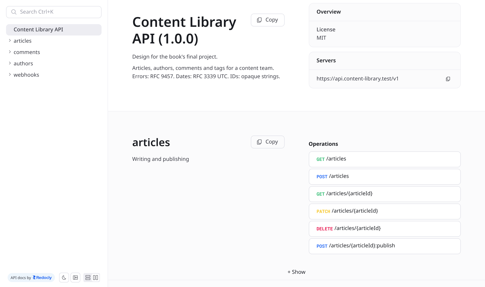

<small>المرحلة 7 · الجسر والمشروع</small>

آخر خطوة: تلبس طاقية الـ Provider كاملة. هتصمم API لمكتبة محتوى، من قرارات الـ Resources والأدوار لحد Spec بـ OpenAPI 3.2 فيه Auth و Webhook، وتعدّيه من الـ Lint، وتطلّع منه Docs. عملنا نسخة كاملة كمثال (317 سطر، 10 Operations، Webhook واحد)، وفي الآخر Checklist بـ 30 نقطة تراجع بيها أي API تصممه بعد كده.

:::note[بعد الفصل ده هتكون عارف]
- الـ Brief: مين بيستخدم الـ API وعايز يعمل إيه
- الأدوار: viewer و author و editor وصلاحيات كل واحد
- جدول الـ Endpoints بالـ Methods والأكواد
- القرارات الصعبة ولماذا: IDs و PATCH و If-Match إجباري
- Webhook في OpenAPI: article.published
- Lint: 4 تحذيرات وتصليحها، و Docs HTML
- Checklist من 30 نقطة لأي API
- طريقة التسليم والتقييم
:::

<a id="s24-1"></a>

## 24.1 الـ Brief

فريق محتوى (كتّاب ومحررين) بيكتب مقالات. محتاجين API واحد يخدم 3 Clients: لوحة تحرير بـ React، وموقع عام بيعرض المنشور بس، وأداة خارجية (Slack bot مثلاً) عايزة تعرف لما مقالة تتنشر. ده بالظبط نوع الشغل اللي هتعمله بعد Maximilian و React.

**الأدوار (Authorization، فصل 12)**

| الدور | يقدر | ميقدرش |
|---|---|---|
| viewer | يقرا المنشور، ويعلّق | يكتب مقالات |
| author | يعمل Draft، ويعدّل مقالاته هو | ينشر، أو يعدّل مقالات غيره، أو يمسح |
| editor | كل حاجة: ينشر، ويمسح، ويمسح أي تعليق | — |

والدور جاي من الـ JWT (Bearer). مستخدم مش مسجل = **401**. author بيحاول ينشر = **403**. author بيحاول يفتح Draft بتاع حد تاني = **404** (متكشفش إنه موجود، فصل 16).

<a id="s24-2"></a>

## 24.2 الـ Endpoints

**Content Library API v1**

| Operation | Request | نجاح | أخطاء مهمة |
|---|---|---|---|
| listArticles | `GET /articles?status&authorId&tag&sort&limit&cursor` | 200 + `{data, nextCursor}` | 400، 401، 429 |
| createArticle | `POST /articles` + `Idempotency-Key` | 201 + Location | 401، 403، 422 |
| getArticle | `GET /articles/{id}` | 200 + ETag (أو 304) | 404 |
| updateArticle | `PATCH /articles/{id}` Merge Patch + `If-Match` **إجباري** | 200 + ETag جديد | 404، 412، 422، 428 |
| deleteArticle | `DELETE /articles/{id}` | 204 | 403 |
| publishArticle | `POST /articles/{id}:publish` | 200 | 403، 409 |
| listComments | `GET /articles/{id}/comments` | 200 | 404 |
| createComment | `POST /articles/{id}/comments` | 201 | 422 |
| deleteComment | `DELETE /comments/{id}` | 204 | 403 |
| getMe | `GET /me` | 200 | 401 |
| Webhook | `POST` لـ URL المشترك: `article.published` | 2xx خلال 10 ثواني | — |

<a id="s24-3"></a>

## 24.3 القرارات الصعبة

**تشريح الأمر**

```text
Design decisions — Content Library API v1
```

1. `IDs`: Strings معتمة بـ Prefix (`art_01JB8Z3K`) زي Stripe: مش بتتخمن، والنوع باين من الشكل (فصل 14).
2. `If-Match إجباري`: المحررين بيشتغلوا على نفس المقالة، فالـ Lost update متوقع (فصل 19). من غير الهيدر = **428**، و ETag قديم = **412**.
3. `PATCH مش PUT`: اللوحة بتبعت الـ Fields اللي اتغيرت بس، ومفيش خطر مسح بيانات (فصل 15). و`summary: null` = امسح الملخص.
4. `النشر Custom method`: بيعمل Validation خاص (لازم `body`)، ويحط `publishedAt`، ويبعت Webhook. أكبر من `PATCH status`.
5. `Cursor`: الموقع العام Infinite scroll، والمقالات بتتنشر طول الوقت، فالـ Offset هيكرر (فصل 18).
6. `Envelope للقوايم`: `{data, nextCursor}` علشان نزوّد بعدين من غير كسر.
7. `Errors`: RFC 9457 و`errors[]` بـ `pointer`، و`type` لكل مشكلة متوثّق.
8. `Versioning`: `/v1` في الـ URL (بسيط للفريق)، و Deprecation/Sunset قبل أي قفل بـ 12 شهر على الأقل.
9. `camelCase`: كل الـ Clients JavaScript.

<a id="s24-4"></a>

## 24.4 الـ Spec

الملف الكامل `lab/spec/design.yaml`. أهم جزء جديد مقارنة بفصل 21: الـ Auth، والـ Webhook (OpenAPI من 3.1 فيه `webhooks` على أعلى مستوى، جنب `paths`):

```text title="design.yaml (الـ Auth والـ Webhook)"
security:
  - bearerAuth: []
...
webhooks:
  articlePublished:
    post:
      operationId: onArticlePublished
      summary: Sent to subscribers when an article is published
      parameters:
        - name: X-Library-Signature
          in: header
          required: true
          description: "sha256=<hex HMAC of the raw body with your webhook secret>"
          schema: { type: string }
        - name: X-Library-Delivery
          in: header
          required: true
          description: Unique delivery ID. Use it to ignore duplicates.
          schema: { type: string }
      requestBody:
        content:
          application/json:
            schema:
              type: object
              required: [event, article]
              properties:
                event: { type: string, const: article.published }
                article: { $ref: "#/components/schemas/Article" }
      responses:
        "2XX": { description: Received. Answer within 10 seconds. }
components:
  securitySchemes:
    bearerAuth:
      type: http
      scheme: bearer
      bearerFormat: JWT
      description: "Roles in the token: viewer, author, editor"
```

**تشريح الأمر**

```text
webhooks / "2XX" / const / securitySchemes
```

1. `webhooks`: نفس شكل الـ Operation، بس انت اللي بتبعت والـ Client هو السيرفر (فصل 20).
2. `"2XX"`: أي كود في الـ 200s. الـ OpenAPI بيسمح بالـ Ranges دي.
3. `const`: JSON Schema: القيمة دي بالظبط.
4. `security على الـ Root`: كل Operation محتاج Bearer إلا لو قال غير كده.

```sh title="Terminal"
$ npx -y @redocly/cli@latest lint design.yaml
[1] design.yaml:2:1 at #/info
Info object should contain `license` field.
[2] design.yaml:14:5 at #/tags/0/description
Tag object should contain `description` field.
...
You have 4 warnings.

# بعد ما زوّدنا license و description لكل Tag:
$ npx -y @redocly/cli@latest lint design.yaml
Woohoo! Your API description is valid. 🎉
$ npx -y @redocly/cli@latest stats design.yaml
📈 Schemas: 9
🔀 Path Items: 6
🎣 Webhooks: 1
👷 Operations: 10
$ npx -y @redocly/cli@latest build-docs design.yaml -o design.html
🎉 bundled successfully in: design.html (268 KiB) [⏱ 120ms].
```



*الـ Docs اللي اتعملت من design.yaml (لقطة حقيقية من design.html في المتصفح). كل Operation وكل Webhook ليه صفحة لوحده.*

<a id="s24-5"></a>

## 24.5 الـ Checklist: 30 نقطة لأي API

**راجع بيها أي تصميم (بتاعك أو بتاع غيرك)**

| # | المحور | السؤال | فصل |
|---|---|---|---|
| 1 | Resources | أسماء جمع، من غير أفعال، بحروف صغيرة وشرطة؟ | 14 |
| 2 | Resources | Nesting مستوى واحد بس؟ | 14 |
| 3 | Resources | العمليات اللي مش CRUD واضحة (`:publish`)؟ | 14 |
| 4 | Resources | IDs Strings ومش بتتخمن؟ | 14 |
| 5 | Methods | GET مبيغيرش حاجة أبداً؟ | 15 |
| 6 | Methods | PATCH للتعديل، و Merge Patch موثّق؟ | 15 |
| 7 | Methods | POST الحساس بيقبل Idempotency-Key؟ | 15 |
| 8 | Status | 201 + Location، و 204 من غير Body؟ | 16 |
| 9 | Status | 400 و 422 متفرقين بقاعدة ثابتة؟ | 16 |
| 10 | Status | 401 و 403 صح، و 404 لما متكشفش؟ | 16 |
| 11 | Status | مفيش 200 فيها Error؟ | 16 |
| 12 | Body | أسلوب أسماء واحد؟ | 16 |
| 13 | Body | تواريخ RFC 3339 UTC، وفلوس Integer + عملة؟ | 16 |
| 14 | Body | null ضد مش موجود ليهم معنى موثّق؟ | 16 |
| 15 | Body | Envelope للقوايم؟ | 16 |
| 16 | Errors | problem+json بـ type ثابت؟ | 17 |
| 17 | Errors | Validation بكل الأخطاء مرة واحدة بـ pointer؟ | 17 |
| 18 | Errors | الـ 500 من غير أسرار، وبـ ID؟ | 17 |
| 19 | Lists | Pagination من أول يوم بـ Default و Max؟ | 18 |
| 20 | Lists | Cursor لو البيانات بتتغير؟ ومعتم؟ | 18 |
| 21 | Lists | Sort و Filter على Fields محددة بس؟ | 18 |
| 22 | Evolve | Versioning واضح، وقايمة Breaking changes؟ | 19 |
| 23 | Evolve | خطة Deprecation و Sunset؟ | 19 |
| 24 | Limits | Rate limit معلن في هيدرز، و 429 + Retry-After؟ | 19 |
| 25 | Concurrency | ETag و If-Match للتعديل المتزامن؟ | 19 |
| 26 | Auth | Bearer على HTTPS، والأدوار واضحة لكل Operation؟ | 12، 13 |
| 27 | Auth | CORS بقايمة Origins مش `*` مع Credentials؟ | 13 |
| 28 | Webhooks | توقيع HMAC، و Delivery ID، وسياسة إعادة؟ | 20 |
| 29 | Docs | OpenAPI بيعدّي الـ Lint، وفيه Examples؟ | 21 |
| 30 | Docs | Contract test بيتأكد إن السيرفر ملتزم؟ | 21 |

<a id="s24-6"></a>

## 24.6 التسليم

1. `design.yaml` بيعدّي `redocly lint` من غير Errors.
2. `decisions.md`: كل قرار صعب وسببه (زي الجدول فوق) بكلامك انت.
3. `design.html` من `build-docs`.
4. Checklist الـ 30 نقطة: ✓ أو ✗ مع سبب لكل ✗.
5. **Bonus**: نفّذ 3 Operations في Express (ابدأ من `library.js`) واعمل لهم Contract test.

:::tip[الخطوة الجاية]
لما تخلص كورس Maximilian، ارجع للمشروع ده ونفّذه كامل بـ Database و Auth حقيقي. ولما تبدأ React، اعمل لوحة التحرير على الـ API بتاعك بالـ Types اللي `openapi-typescript` بيطلّعها. كده هتكون عملت Full stack من التصميم للواجهة.
:::

:::tip[ملخص الفصل]
- ابدأ من الـ Clients والأدوار، مش من الـ Database.
- جدول Endpoints فيه الأكواد قبل أي كود.
- كل قرار صعب مكتوب بسببه: IDs، و If-Match إجباري، و PATCH، و Cursor، و Custom method.
- الـ Spec فيه Auth و Webhooks، وبيعدّي الـ Lint، وبيطلّع Docs.
- Checklist الـ 30 نقطة = الكتاب كله في صفحة.
:::

### صح ولا غلط؟

1. author بيحاول ينشر مقالة: الرد 401.
2. OpenAPI 3.1+ يقدر يوصف Webhooks.
3. PATCH من غير If-Match في التصميم ده يرجّع 428.

### أسئلة مراجعة

1. ليه author بيشوف 404 مش 403 على Draft حد تاني؟
2. ليه النشر مش مجرد `PATCH {"status": "published"}` هنا؟
3. إيه اللي هيتغير في التصميم لو ضفنا تطبيق موبايل؟
4. اختار 3 نقاط من الـ Checklist شايفها الأهم واشرح ليه.

### تحديات الفصل

<small>جرّبها بإيدك، والحلول في ملحق الإجابات.</small>

1. **[سهل]** زوّد Tags للـ Spec: `GET /tags` و`GET /tags/{slug}`.
2. **[متوسط]** زوّد Webhook تاني `comment.created` وعدّي الـ Lint.
3. **[صعب]** طبّق الـ Checklist على GitHub REST API (من ملاحظات مشروع 1): كام ✓ وكام ✗؟
