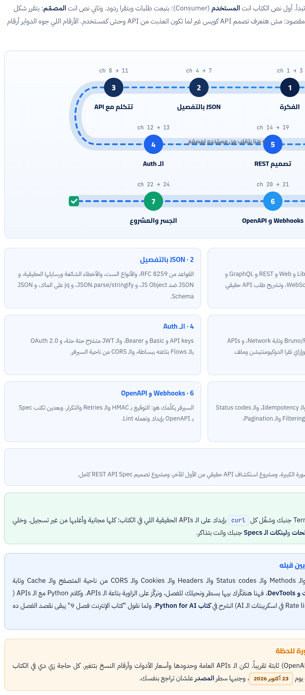

الكتاب ده ماشي معاك على 7 مراحل. الأول هنفهم الـ API يعني إيه وأنواعه، وهنشرّح طلب API حقيقي. بعدين JSON بالتفصيل: القواعد والأخطاء و jq و JSON Schema. وبعدها هتتكلم مع APIs حقيقية كمستخدم بكل الأدوات، وتقرا الدوكيومنتيشن، وتفهم الـ Auth من API keys لحد OAuth. وفي النص التاني هتلبس طاقية اللي بيبني الـ API: تصميم REST كامل، والـ Webhooks، و OpenAPI. وفي الآخر جسر لـ Express ومشروعين: تستكشف API حقيقي من الأول للآخر، وتصمم Spec لـ API بتاعك.

:::tip[تحميل]
- [الكتاب كامل PDF](/biginner-journey/downloads/05-apis-book.pdf)
- [الـ Cheat Sheet PDF](/biginner-journey/downloads/05-apis-cheatsheet.pdf)
:::

## خريطة الكتاب

- **1 · الفكرة**: الـ API اتعمل ليه (الحكاية)، وأنواعه: Library و Web و REST و GraphQL و Webhooks، ولمحة عن gRPC و WebSockets، وتشريح طلب API حقيقي Header بـ Header.
- **2 · JSON بالتفصيل**: القواعد من RFC 8259، والأنواع الست، والأخطاء الشائعة ورسايلها الحقيقية، و JSON ضد JS Object، و JSON.parse/stringify، و jq على الماك، و JSON Schema.
- **3 · تتكلم مع API**: curl و HTTPie و Bruno/Postman/Insomnia وتابة Network، و APIs مجانية حقيقية للتمرين، و fetch من JS، وإزاي تقرا الدوكيومنتيشن وملف OpenAPI.
- **4 · الـ Auth**: API keys و Basic و Bearer، والـ JWT متشرّح حتة حتة، و OAuth 2.0 بالـ Flows بتاعته ببساطة، والـ CORS من ناحية السيرفر.
- **5 · تصميم REST**: الـ Resources والأسماء، والـ Methods والـ Idempotency، والـ Status codes والـ Bodies، والأخطاء بـ RFC 9457، والـ Filtering والـ Pagination، والـ Versioning والـ Rate limits.
- **6 · Webhooks و OpenAPI**: السيرفر يكلّمك هو: التوقيع بـ HMAC والـ Retries والتكرار. وبعدين تكتب Spec بـ OpenAPI بإيدك وتعمله Lint.
- **7 · الجسر والمشروع**: نفس الأفكار في Express على مستوى الصورة الكبيرة، ومشروع استكشاف API حقيقي من الأول للآخر، ومشروع تصميم REST API Spec كامل.

## الفصول

**المرحلة 1 · الفكرة**

- [الفصل 1: الحكاية من الأول: الـ API اتعمل ليه أصلاً؟](./ch01/)
- [الفصل 2: أنواع الـ APIs: REST و GraphQL و Webhooks وأصحابهم](./ch02/)
- [الفصل 3: تشريح طلب API حقيقي: كل سطر رايح وكل سطر جاي](./ch03/)

**المرحلة 2 · JSON بالتفصيل**

- [الفصل 4: JSON: الحكاية والقواعد من المواصفة نفسها](./ch04/)
- [الفصل 5: JSON ضد JS Object، و JSON.parse و stringify، والأخطاء الشائعة](./ch05/)
- [الفصل 6: jq على الماك: تفصّص أي JSON من الـ Terminal](./ch06/)
- [الفصل 7: JSON Schema: العقد مكتوب كـ JSON](./ch07/)

**المرحلة 3 · تتكلم مع API**

- [الفصل 8: الأدوات: curl للـ APIs و HTTPie و Bruno/Postman وتابة Network](./ch08/)
- [الفصل 9: APIs مجانية حقيقية تتمرّن عليها (واتجرّبت كلها)](./ch09/)
- [الفصل 10: الـ API من JavaScript: fetch صح من أول مرة](./ch10/)
- [الفصل 11: تقرا أي API Docs، وتفهم ملف OpenAPI كمستخدم](./ch11/)

**المرحلة 4 · الـ Auth**

- [الفصل 12: الـ Auth الجزء 1: API keys و Basic و Bearer، والـ JWT متشرّح](./ch12/)
- [الفصل 13: الـ Auth الجزء 2: OAuth 2.0 ببساطة، والـ CORS من ناحية السيرفر](./ch13/)

**المرحلة 5 · تصميم REST**

- [الفصل 14: REST: الفكرة، والـ Resources، والـ Endpoints، والتسمية](./ch14/)
- [الفصل 15: الـ Methods والـ Idempotency](./ch15/)
- [الفصل 16: الـ Status codes وتصميم الـ Body](./ch16/)
- [الفصل 17: شكل الـ Errors: Problem Details (RFC 9457)](./ch17/)
- [الفصل 18: الفلترة والترتيب والـ Pagination](./ch18/)
- [الفصل 19: الـ Versioning والـ Rate limits والـ Concurrency](./ch19/)

**المرحلة 6 · Webhooks و OpenAPI**

- [الفصل 20: الـ Webhooks: لما الـ API هو اللي يكلمك](./ch20/)
- [الفصل 21: تكتب OpenAPI بإيدك](./ch21/)

**المرحلة 7 · الجسر والمشروع**

- [الفصل 22: الجسر لـ Express: كل اللي فات في كود](./ch22/)
- [الفصل 23: المشروع 1: تستكشف API حقيقي من الأول للآخر](./ch23/)
- [الفصل 24: المشروع 2: تصمم Content Library API](./ch24/)

**الملاحق**

- [ملحق أ: Cheat Sheet وجدول الـ Flags وجدول الرموز](./appendix-1/)
- [ملحق ب: قاموس المصطلحات](./appendix-2/)
- [ملحق ج: ملحق الروابط الرسمية](./appendix-3/)
- [ملحق د: المصادر ومنهجية التحقق](./appendix-4/)
- [ملحق ه: الإجابات والحلول](./appendix-5/)
