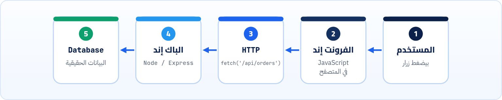
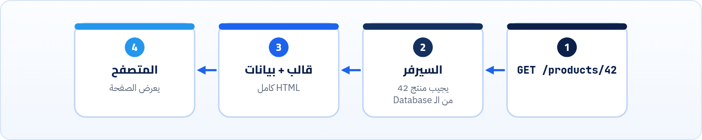
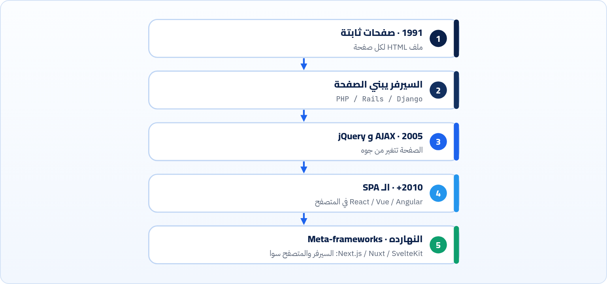

<small>المرحلة 1 · الصورة الكبيرة</small>

قبل ما تسمع كلمة Vite أو Next.js، لازم تعرف المشكلة اللي كل أداة اتعملت علشان تحلها. الفصل ده بيحكي حكاية الويب من أول صفحة ثابتة سنة 1991، لـ jQuery، للـ SPA، لحد الـ Meta-frameworks النهارده. وكل مرحلة هتشوف فيها المشكلة الأول وبعدين الحل، علشان لما تقابل أي أداة جديدة تسأل نفسك: دي بتحل أنهي مشكلة؟

:::note[بعد الفصل ده هتكون عارف]
- الفرق بين الفرونت إند والباك إند، ومين بيشتغل فين
- الصفحات الثابتة، وبعدين الصفحات اللي السيرفر بيبنيها
- AJAX و jQuery: الصفحة تتغير من غير Reload
- الـ SPA: التطبيق كله في المتصفح، ومشاكله
- الـ Meta-frameworks: رجوع ذكي للسيرفر
- انت فين في الحكاية دي، والكتاب هياخدك لفين
:::

<a id="s1-1"></a>

## 1.1 مطعم فيه صالة ومطبخ

افتكر أي مطعم. فيه **صالة**: الترابيزات والمنيو والجرسون والديكور، الحاجات اللي الزبون بيشوفها ويلمسها. وفيه **مطبخ**: المخزن والطباخين والوصفات، حاجات الزبون مبيشوفهاش بس من غيرها مفيش أكل.

الويب نفس الحكاية بالظبط:

#### الفرونت إند (الصالة)

- كل حاجة بتشتغل **في المتصفح** عند المستخدم.
- لغاته الأساسية تلاتة بس: **HTML** (الهيكل)، و**CSS** (الشكل)، و**JavaScript** (الحركة والتفاعل).
- شغلته: الشكل، والتفاعل، والسرعة اللي المستخدم **بيحسها**، وإن أي حد يقدر يستخدمه (Accessibility).
- الكود بتاعه **مكشوف**: أي حد يفتح DevTools يشوفه.

#### الباك إند (المطبخ)

- بيشتغل **على سيرفر** بعيد عن المستخدم.
- لغات كتير: JavaScript (بـ Node)، و Python، و Go، و Java، و PHP…
- شغلته: البيانات (Database)، والصلاحيات، والدفع، والأسرار، وأي حاجة لازم تتحمى.
- الكود بتاعه **مخفي**: المستخدم بيشوف النتيجة بس (غالباً JSON، زي ما شفنا في كتاب APIs و JSON).

والاتنين بيتكلموا مع بعض بـ **HTTP**: المتصفح يطلب، والسيرفر يرد. ده كله اتشرح سطر سطر في **كتاب الإنترنت و DevTools** (فصل 7 و 8)، فهنا هنفترض إنك عارفه.



*الصالة والمطبخ. المسار ده هتعيشه في كورس Maximilian من ناحية السيرفر، وفي كورس React من ناحية المتصفح. والكتاب ده عن النص الشمال.*

:::note[وفين الـ Full-stack؟]
الـ **Full-stack** = حد بيشتغل في الاتنين. وطريقك (JavaScript ← Node ← React) هو بالظبط طريق Full-stack بلغة واحدة. بس متخليش الكلمة تخدعك: حتى الـ Full-stack بيفكر في الصالة بعقلية، وفي المطبخ بعقلية تانية. والكتاب ده بيبني عقلية الصالة.
:::

<a id="s1-2"></a>

## 1.2 المرحلة 1 (1991): صفحات ثابتة، ورق على حيطة

أول موقع على الويب نزل سنة 1991 من CERN. كان عبارة عن **ملف HTML** على سيرفر: نص، وعناوين، ولينكات. مفيش ألوان تقريباً، ومفيش تفاعل. تطلب الصفحة، السيرفر يبعتلك الملف زي ما هو، خلاص.

```html title="index.html · ويب التسعينات"
<h1>World Wide Web</h1>
<p>The WorldWideWeb (W3) is a wide-area hypermedia information retrieval initiative.</p>
<a href="people.html">People</a>
```

وبعدين جات الإضافات بسرعة: **JavaScript** سنة 1995 في Netscape (اتكتبت أول نسخة منها في أيام معدودة)، و**CSS** سنة 1996 علشان تفصل الشكل عن المحتوى بدل ما يبقى كل لون جوه الـ HTML.

**المشكلة**: كل صفحة ملف منفصل. عايز تعرض 1000 منتج؟ اكتب 1000 ملف بإيدك.

<a id="s1-3"></a>

## 1.3 المرحلة 2: السيرفر هو اللي يبني الصفحة

الحل كان إن السيرفر **يبني الـ HTML وقت الطلب**: ياخد قالب واحد، ويملاه من الـ Database. ده اللي عملته لغات زي PHP و Perl وبعدين Ruby on Rails و Django. ولسه بيتعمل لحد النهارده.



*Server-rendered: كل ضغطة لينك = طلب جديد = صفحة HTML جديدة كاملة. والفكرة دي هترجعلنا في فصل 22 باسم SSR.*

**المشكلة**: كل حاجة صغيرة محتاجة صفحة جديدة. ضغطت "لايك"؟ الصفحة كلها تختفي وترجع. كتبت حرف في البحث؟ مفيش اقتراحات. التجربة كانت "ورق"، مش "تطبيق".

<a id="s1-4"></a>

## 1.4 المرحلة 3 (2004–2006): AJAX و jQuery، الصفحة تتغير من جوه

سنة 2004 و 2005 ظهر **Gmail** و**Google Maps**، والناس اتصدمت: الإيميلات بتظهر، والخريطة بتتسحب، **من غير ما الصفحة تعمل Reload**. السر كان إن JavaScript بتبعت طلب HTTP في الخلفية، وتغيّر **حتة** من الصفحة بس بالرد. الفكرة دي اتسمت **AJAX** سنة 2005. والنهارده بنعملها بـ `fetch` (كتاب APIs و JSON فصل 10).

بس كان فيه مشكلة تانية: كل متصفح (Internet Explorer و Firefox و Safari) كان بيتصرف بطريقة مختلفة. نفس الكود يشتغل هنا ويبوظ هناك. فسنة 2006 نزلت **jQuery**: مكتبة بتديك طريقة واحدة قصيرة تشتغل في كل المتصفحات.

#### jQuery زمان

```js
$('#like').on('click', function () {
  $.post('/api/like', { id: 42 }, function (res) {
    $('#count').text(res.likes)
  })
})
```

#### نفس الكلام في JS النهارده

```js
const like = document.querySelector('#like')
const count = document.querySelector('#count')
like.addEventListener('click', async () => {
  const res = await fetch('/api/like', {
    method: 'POST',
  })
  const data = await res.json()
  count.textContent = data.likes
})
```

المتصفحات اتعلمت من jQuery: `querySelector` و`fetch` و`classList` كلها بقت جوه اللغة. فـ jQuery لسه موجودة (آخر نسخة على npm وقت الكتابة 4.0.0، ومواقع قديمة كتير شغالة بيها)، بس مشروع جديد مش محتاجها.

**المشكلة الجديدة**: الصفحات بقت تطبيقات كبيرة، والكود بقى كوم `$('#x').text(...)` في كل حتة. مين غيّر العنصر ده؟ وليه الرقم اللي فوق مش زي اللي تحت؟ دي مشكلة **مزامنة الـ DOM مع البيانات**، وهي بطلة فصل 11.

<a id="s1-5"></a>

## 1.5 المرحلة 4 (2010–2016): الـ SPA، التطبيق كله في المتصفح

الخطوة اللي بعدها كانت جريئة: ليه السيرفر يبني HTML خالص؟ خلّيه يبعت **صفحة واحدة فاضية + ملف JavaScript كبير**، والـ JavaScript هي اللي تبني كل الشاشات، وتكلم السيرفر بـ JSON بس. ده الـ **SPA** (Single-Page Application). وعلشان تكتب تطبيق بالحجم ده، ظهرت الـ **Frameworks**: AngularJS و Backbone سنة 2010، و**React** سنة 2013 من Facebook، و Vue سنة 2014، و Angular الجديدة 2016، و Svelte 2016.

```html title="index.html · شكل SPA نموذجي"
<body>
  <div id="root"></div>
  <script type="module" src="/src/main.jsx"></script>
</body>
```

الـ HTML ده حقيقي: هو اللي `create-vite` بيعمله لمشروع React (هنشرحه في فصل 18). لاحظ إن الـ `body` فاضي تقريباً. كل اللي هتشوفه على الشاشة JavaScript هي اللي بتعمله.

وفي نفس الوقت، سنة 2009 ظهر **Node.js** (JavaScript برة المتصفح)، وسنة 2010 ظهر **npm**. والاتنين دول غيّروا شغل الفرونت إند نفسه: بقى عندك أدوات مكتوبة بـ JavaScript تشتغل على جهازك علشان **تجهّز** الكود قبل ما يروح للمتصفح. ودي مرحلة 5 و 6 من الكتاب.

:::caution[مشاكل الـ SPA اللي خلّت الناس ترجع تفكر]
**أول تحميل بطيء**: المستخدم بيستنى JavaScript كلها تنزل وتشتغل قبل ما يشوف أي حاجة. و**محركات البحث والمعاينات** (لما تبعت لينك في واتساب) ممكن تشوف صفحة فاضية. و**الموبايلات الضعيفة** بتتعب من الـ JavaScript الكتير. المشاكل دي هي سبب المرحلة الجاية.
:::

<a id="s1-6"></a>

## 1.6 المرحلة 5 (النهارده): الـ Meta-frameworks، رجوع ذكي للسيرفر

الحل ماكانش إننا نرمي React ونرجع لـ PHP. الحل كان إننا ناخد الأحسن من الاتنين: نكتب الـ Components بـ React (أو Vue أو Svelte)، بس نخلّي **السيرفر يبني أول HTML** علشان المستخدم يشوف حاجة فوراً، وبعدين JavaScript "تصحّي" الصفحة وتخليها تفاعلية (ده اسمه **Hydration**). والأدوات اللي بتعمل ده اسمها **Meta-frameworks**: Framework فوق Framework.

**أشهر الـ Meta-frameworks (للمعرفة، مش للمذاكرة دلوقتي)**

| الـ Meta-framework | مبني على | تسمع عنه فين |
|---|---|---|
| **Next.js** | React | الأشهر في عالم React، ومن شركة Vercel (فصل 22) |
| **React Router** (Framework mode) | React | Remix اندمج فيه من React Router 7 |
| **Nuxt** | Vue | المقابل لـ Next في عالم Vue |
| **SvelteKit** | Svelte | الطريقة الرسمية تبني تطبيق Svelte |
| **Astro** | أي Framework أو من غير | مواقع محتوى (مدونات ودوكيومنتيشن) بأقل JavaScript |

ودي الحكاية كلها في صورة واحدة:



*كل مرحلة حلّت مشكلة اللي قبلها، وجابت مشكلة جديدة. ولاحظ إن آخر مرحلة رجعت جزئياً لتاني مرحلة، بس بأدوات أذكى.*

:::tip[السؤال الذهبي لأي أداة جديدة]
كل شهر هتسمع عن أداة جديدة. متجريش وراها. اسأل نفسك: <strong>دي بتحل أنهي مشكلة؟ وأنا عندي المشكلة دي؟</strong> لو مش عارف المشكلة، يبقى لسه مش محتاج الأداة. والكتاب ده كله مبني على السؤال ده.
:::

<a id="s1-7"></a>

## 1.7 انت فين، والكتاب هياخدك لفين

انت دلوقتي في نص كورس Jonas بتتعلم **اللغة**. وبعدين Node مع Maximilian، وبعدين React مع Jonas. وأول ما تفتح كورس React، أول درس هيقولك: "اكتب `npm create vite@latest`". وفجأة هيظهرلك 15 ملف و 100 Package في `node_modules`، وكلمات زي "dev server" و"build" و"JSX" و"ESLint". الكتاب ده موجود علشان اللحظة دي: لما توصلها، تكون عارف كل ملف بيعمل إيه وليه.

**هتتعلم إيه فين**

| الموضوع | فين |
|---|---|
| لغة JavaScript: المتغيرات والـ Functions والـ Arrays والـ Objects والـ async | كورس Jonas (مش الكتاب ده) |
| HTML و CSS على مستوى أعمق | الكتاب ده، فصول 3 لـ 10 |
| ليه React موجودة أصلاً | الكتاب ده، فصول 11 و 12 |
| npm و package.json و Vite والـ Build | الكتاب ده، فصول 13 لـ 19 (وهتحتاجها في Node كمان) |
| Hooks و JSX و State بالتفصيل | كورس React |
| السيرفر و Express والـ Database | كورس Maximilian |

**المصادر الرسمية:** [MDN · How the web works](https://developer.mozilla.org/en-US/docs/Learn_web_development/Getting_started/Web_standards/How_the_web_works) · [MDN · SPA (Single-page application)](https://developer.mozilla.org/en-US/docs/Glossary/SPA) · [MDN · AJAX](https://developer.mozilla.org/en-US/docs/Glossary/AJAX) · [CERN · The birth of the web](https://info.cern.ch/)

:::tip[ملخص الفصل]
- الفرونت إند = اللي بيشتغل في المتصفح (HTML و CSS و JS). الباك إند = اللي على السيرفر. وبيتكلموا بـ HTTP.
- الويب عدّى بخمس مراحل: صفحات ثابتة، سيرفر يبني الصفحة، AJAX و jQuery، الـ SPA، الـ Meta-frameworks.
- كل مرحلة حلّت مشكلة اللي قبلها: كتابة الصفحات بإيدك، الـ Reload الكتير، المتصفحات المختلفة، الكود اللي بقى كوم، أول تحميل البطيء.
- Node و npm خلّوا JavaScript تشتغل على جهازك علشان تجهّز كود المتصفح، ودي أساس كل الأدوات الحديثة.
- قبل أي أداة: اسأل بتحل أنهي مشكلة.
:::

### صح ولا غلط؟

1. كود الفرونت إند ممكن يخبي سر (زي API key) لأن المستخدم مش بيشوفه.
2. الـ SPA بيبعت HTML جديد كامل من السيرفر مع كل ضغطة لينك.
3. Next.js مبني على React.

### أسئلة مراجعة

1. اشرح الفرق بين الفرونت والباك بمثال غير المطعم.
2. إيه المشكلة اللي AJAX حلّها؟ وإيه المشكلة اللي jQuery حلّها؟ (هما مش نفس المشكلة)
3. اذكر مشكلتين في الـ SPA خلّوا الناس تعمل Meta-frameworks.
4. ليه Node.js مهم للفرونت إند، رغم إنه مش بيشتغل في المتصفح؟

### تحديات الفصل

<small>جرّبها بإيدك، والحلول في ملحق الإجابات.</small>

1. **[سهل]** افتح `https://info.cern.ch/hypertext/WWW/TheProject.html` في Safari أو Chrome، واعمل View Source. عدّ كام Tag مختلف مستخدم.
2. **[متوسط]** افتح Gmail أو أي موقع كبير، وافتح تابة Network (كتاب الإنترنت فصل 18)، وفلتر على **Fetch/XHR**. اضغط على أي حاجة في الصفحة وشوف الطلبات اللي بتطلع من غير Reload: ده AJAX النهارده.
3. **[صعب]** اختار موقع بتستخدمه، وحاول تخمّن: ده Server-rendered ولا SPA ولا Meta-framework؟ دليلك: View Source (فيه محتوى حقيقي ولا `div` فاضي؟) وتابة Network. اكتب الأدلة اللي لقيتها.
