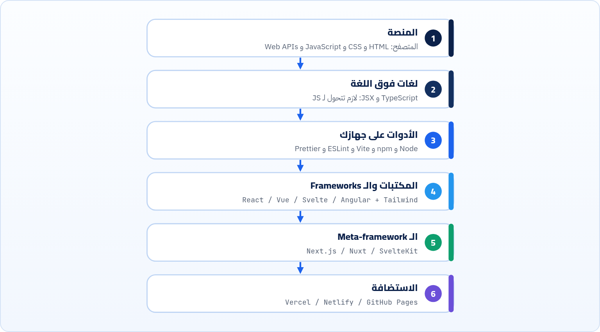
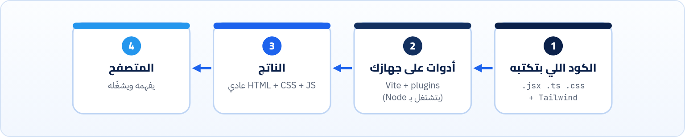

<small>المرحلة 1 · الصورة الكبيرة</small>

Node و npm و Vite و React و Next.js و Tailwind و TypeScript و ESLint و Prettier و Vercel… لو حاسس إن الأسامي دي كلها شبه بعض ومش عارف مين بيعمل إيه، الفصل ده علشانك. هنحط كل أداة في طبقة، ونعرف السؤال اللي كل واحدة بتجاوبه، والأهم: مين فيهم بيوصل للمتصفح فعلاً، ومين بيشتغل على جهازك بس.

:::note[بعد الفصل ده هتكون عارف]
- الطبقات: المنصة، واللغة، والأدوات، والمكتبات، والاستضافة
- الفرق بين Library و Framework و Meta-framework
- القاعدة الذهبية: المتصفح بيفهم HTML و CSS و JS بس
- أدوات وقت التطوير ضد كود وقت التشغيل
- تقرا package.json حقيقي وتعرف كل سطر تبع أنهي طبقة
- إيه اللي هتستخدمه مع React فعلاً
:::

<a id="s2-1"></a>

## 2.1 ليه الأسامي كتير كده؟

افتح أي إعلان وظيفة فرونت إند، هتلاقي: "React, TypeScript, Next.js, Tailwind, Vite, Jest, ESLint, Git, CI/CD". ده بيخوّف. بس الحقيقة إن الأسامي دي مش 9 حاجات من نفس النوع. دي **طبقات** مختلفة، كل طبقة بتجاوب سؤال واحد. ولما تعرف السؤال، الاسم بيبطّل يخوّف.



*ست طبقات. كل حاجة هتسمع عنها تبع طبقة منهم. والكتاب ماشي من فوق لتحت تقريباً.*

<a id="s2-2"></a>

## 2.2 القاعدة الذهبية: المتصفح بيفهم 3 لغات بس

ده أهم سطر في الفصل: **المتصفح مش بيفهم غير HTML و CSS و JavaScript** (ومعاهم صور وخطوط وحاجات زي كده). مش بيفهم TypeScript، ولا JSX، ولا Sass، ولا كلاسات Tailwind كـ"لغة"، ولا `import React from 'react'` لوحدها.

طب إزاي كل ده بيشتغل؟ فيه أدوات بتشتغل **على جهازك** قبل ما الكود يروح للمتصفح، وبتحوّل كل حاجة للتلات لغات دول. ده اسمه **Build**:



*كل الأدوات الحديثة بتعيش في الخطوة التانية. والمستخدم مش بيشوفها خالص: هو بيستلم الناتج بس. هنشوف ده بعينينا في فصل 18.*

:::note[يعني Node بيشتغل في المتصفح؟]
لأ. ودي أكتر حاجة بتلخبط. **Node** هو برنامج على الماك بتاعك بيشغّل JavaScript **برة** المتصفح. في الفرونت إند بنستخدمه علشان نشغّل **الأدوات** (Vite و ESLint…)، مش علشان نشغّل الموقع نفسه. وفي كورس Maximilian هتستخدمه لحاجة تانية خالص: تكتب السيرفر بيه.
:::

<a id="s2-3"></a>

## 2.3 الطبقات واحدة واحدة

**كل أداة بتجاوب على سؤال**

| الأداة | الطبقة | السؤال اللي بتجاوبه | فين في الكتاب |
|---|---|---|---|
| **HTML** / **CSS** / **JS** | المنصة | إيه اللي على الشاشة، وشكله، وبيتحرك إزاي؟ | فصول 3 لـ 10 |
| **Web APIs** (DOM و fetch و localStorage) | المنصة | إزاي JS تكلم المتصفح؟ | كورس Jonas وكتاب APIs |
| **TypeScript** | لغة فوق اللغة | إزاي أكتشف الأخطاء قبل ما أشغّل؟ | فصل 21 |
| **JSX** | لغة فوق اللغة | إزاي أكتب شكل الـ UI جوه JS؟ | فصل 12 وكورس React |
| **Node.js** | أدوات | إيه اللي هيشغّل أدوات JS على جهازي؟ | فصل 13 |
| **npm** (أو pnpm/yarn/bun) | أدوات | إزاي أنزّل مكتبات وأدوات وأتحكم في نسخها؟ | فصول 13 لـ 16 |
| **Vite** | أدوات | إزاي أشوف تعديلي فوراً وأنا بشتغل، وأطلّع نسخة سريعة للنشر؟ | فصول 17 لـ 19 |
| **ESLint** / **Prettier** | أدوات | الكود فيه غلطة محتملة؟ شكله موحّد؟ | فصل 23 |
| **React** / Vue / Svelte / Angular | Framework/Library | إزاي أبني UI كبير من غير ما الـ DOM يبوظ مني؟ | فصول 11 و 12 |
| **Tailwind** / CSS Modules / Sass | ستايل | إزاي أنظّم CSS في مشروع كبير؟ | فصل 20 |
| **Next.js** | Meta-framework | إزاي React يشتغل على السيرفر كمان، ومعاه Routing جاهز؟ | فصل 22 |
| **Lighthouse** | جودة | الموقع سريع ومتاح للكل؟ | فصل 24 |
| **Vercel** / Netlify / GitHub Pages | استضافة | أحط الموقع فين علشان الناس تفتحه؟ | فصل 25 |

<a id="s2-4"></a>

## 2.4 Library ولا Framework ولا Meta-framework؟

الكلمات دي بتتقال كأنها نفس الحاجة، بس فيه فرق مهم اسمه **مين بينادي مين**:

#### Library (مكتبة)

**انت** اللي بتناديها لما تحتاجها. زي علبة عدة: تمسك المفك وقت ما تحب. مثال: `date-fns` للتواريخ. وReact بتوصف نفسها على موقعها إنها **Library** للـ UI، لأنها بتعمل حاجة واحدة (الـ Components) وتسيبلك الباقي.

#### Framework (إطار)

**هو** اللي بينادي كودك. انت بتملا أماكن هو محددها، وهو بيقرر إمتى يشغّلها. زي بيت مبني وانت بتفرشه. Angular أوضح مثال: Routing و Forms و HTTP كلهم جوه. ودي الفكرة اللي اسمها **Inversion of control**.

و**الـ Meta-framework** = Framework مبني فوق Library أو Framework، وبيزوّد الحاجات اللي ناقصاه علشان يبقى تطبيق كامل: Routing (صفحات بعناوين)، وتشغيل على السيرفر، وطرق Rendering (فصل 22). فـ Next.js = React + كل ده.

:::tip[Best Practice]
في الكلام اليومي الناس بتقول "React framework" ومحدش هيصححلك. المهم تفهم الفرق العملي: React لوحدها مش هتقولك تعمل الصفحات إزاي، ولا تجيب البيانات منين. ودي حاجات بتختارلها أدوات (أو Meta-framework بيختارها عنك).
:::

<a id="s2-5"></a>

## 2.5 package.json حقيقي: مين بيروح للمتصفح؟

ده الـ `package.json` اللي `create-vite` عمله لما طلبنا قالب React مع ESLint (نسخة 9.3.1 من الأداة، يوم كتابة الكتاب). متقلقش من التفاصيل، فصل 14 هيشرحه مفتاح مفتاح. بص بس على القسمين:

```json title="react-app/package.json"
{
  "name": "react-app",
  "private": true,
  "version": "0.0.0",
  "type": "module",
  "scripts": {
    "dev": "vite",
    "build": "vite build",
    "lint": "eslint .",
    "preview": "vite preview"
  },
  "dependencies": {
    "react": "^19.3.1",
    "react-dom": "^19.3.1"
  },
  "devDependencies": {
    "@eslint/js": "^10.0.1",
    "@types/react": "^19.3.0",
    "@types/react-dom": "^19.3.0",
    "@vitejs/plugin-react": "^6.1.2",
    "eslint": "^10.13.0",
    "eslint-plugin-react-hooks": "^7.1.1",
    "eslint-plugin-react-refresh": "^0.5.7",
    "globals": "^17.13.0",
    "vite": "^8.3.4"
  }
}
```

```json title="كل سطر تبع أنهي طبقة"
"react", "react-dom"
"vite"
"@vitejs/plugin-react"
"eslint", "@eslint/js", "eslint-plugin-…", "globals"
"@types/react", "@types/react-dom"
```

1. `"react", "react-dom"`: **dependencies**: الكود ده **هيتبعت للمتصفح** جوه الـ Build. `react` = فكرة الـ Components والـ State، و`react-dom` = اللي بيحوّلها لعناصر DOM حقيقية في الصفحة.
2. `"vite"`: **devDependencies**: أداة على جهازك. الـ Dev server والـ Build. المستخدم عمره ما هيستلم كود Vite.
3. `"@vitejs/plugin-react"`: إضافة لـ Vite بتعلّمه يحوّل JSX لـ JS عادي، ويعمل Fast Refresh. أداة برضه.
4. `"eslint", "@eslint/js", "eslint-plugin-…", "globals"`: كلهم أدوات فحص الكود (فصل 23). بيشتغلوا على جهازك وبس.
5. `"@types/react", "@types/react-dom"`: أوصاف الأنواع لـ TypeScript (فصل 21). حتى لو مشروعك JS، المحرر بيستخدمها علشان يكمّلك الكود ويشرحلك الـ Functions.

يعني من 11 Package، اتنين بس هيوصلوا للمستخدم. والباقي "عدة الورشة". وده بيفسر رقم مخضّ هتشوفه: `node_modules` في المشروع ده طلع **90 ميجا** و**106** فولدر، بينما الـ JavaScript اللي طلعت من الـ Build للمتصفح كانت **222 كيلوبايت** بس (69 كيلو بعد الضغط). قسنا الاتنين فعلاً:

```sh title="Terminal"
$ du -sh node_modules
 90M	node_modules
$ npm run build
…
dist/assets/index-DykytF2W.css    4.10 kB │ gzip:  1.47 kB
dist/assets/index-DSXtc1GT.js   222.44 kB │ gzip: 69.28 kB
✓ built in 170ms
```

:::caution[متقلقش من حجم node_modules]
الـ 90 ميجا دي على جهازك بس، ومش بترفعها على Git (فيه سطر `node_modules` في `.gitignore`، كتاب Git فصل 5)، ومش بتروح للمستخدم. اللي يهمك هو حجم `dist/`. وده اللي هنقيسه ونحسّنه في فصل 24.
:::

<a id="s2-6"></a>

## 2.6 إيه اللي هتستخدمه فعلاً مع React؟

من كل الخريطة دي، دي التوليفة اللي غالباً هتقابلها في كورس React وفي أول شغل:

1. **Node + npm**: علشان تنزّل وتشغّل كل حاجة.
2. **Vite**: علشان تعمل المشروع وتشتغل عليه (`npm create vite@latest`).
3. **React**: الـ UI.
4. **CSS** عادي أو **Tailwind** أو **CSS Modules**: للشكل.
5. **ESLint** (جاي جاهز مع القالب) و**Prettier** في المحرر.
6. **Git + GitHub**، و**Vercel** أو **Netlify** للنشر.
7. وبعدها: **TypeScript**، و**Next.js** لما تحتاج سيرفر. دول مش لازم من أول يوم (فصل 27).

**المصادر الرسمية:** [React · react.dev](https://react.dev/) · [Vite · Getting Started](https://vite.dev/guide/) · [Node.js · Introduction](https://nodejs.org/en/learn/getting-started/introduction-to-nodejs) · [MDN · Introduction to client-side frameworks](https://developer.mozilla.org/en-US/docs/Learn_web_development/Core/Frameworks_libraries/Introduction)

:::tip[ملخص الفصل]
- الأدوات في 6 طبقات: المنصة، ولغات فوقها، وأدوات على جهازك، ومكتبات/Frameworks، و Meta-frameworks، واستضافة.
- المتصفح بيفهم HTML و CSS و JS بس. أي حاجة تانية لازم تتحول بالـ Build.
- Node بيشغّل الأدوات على جهازك، مش الموقع في المتصفح.
- Library: انت بتناديها. Framework: هو بينادي كودك. Meta-framework: Framework فوق Library بيزوّد Routing وسيرفر.
- `dependencies` بتروح للمتصفح غالباً، و`devDependencies` عدة الورشة.
- حجم `node_modules` مش مهم. حجم `dist/` هو اللي مهم.
:::

### صح ولا غلط؟

1. المتصفح يقدر يشغّل ملف TypeScript مباشرة.
2. Vite بيتبعت للمستخدم مع الموقع.
3. React بتوصف نفسها كـ Library للـ UI.

### أسئلة مراجعة

1. ارسم الطبقات الست من الذاكرة، وحط أداتين في كل طبقة.
2. إيه الفرق العملي بين Library و Framework؟ (فكّر في: مين بينادي مين)
3. ليه `node_modules` ممكن يبقى 90 ميجا والموقع نفسه 70 كيلو؟
4. Next.js بيحل مشاكل إيه React لوحدها مبتحلهاش؟

### تحديات الفصل

<small>جرّبها بإيدك، والحلول في ملحق الإجابات.</small>

1. **[سهل]** هات إعلان وظيفة Frontend حقيقي، وصنّف كل أداة فيه حسب الطبقات الست.
2. **[متوسط]** افتح `https://github.com/vitejs/vite/tree/main/packages/create-vite`، وادخل فولدر `template-react`، وقارن الـ `package.json` بتاعه باللي في الفصل. إيه اللي اتغير؟
3. **[صعب]** افتح موقع React مشهور، واعمل View Source ودوّر على أسماء ملفات الـ JS. تقدر تخمّن من الأسماء الأداة اللي عملت الـ Build؟ (تلميح: `/_next/` معناها إيه؟)
