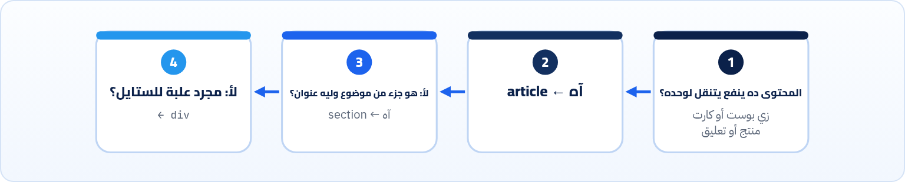

<small>المرحلة 2 · HTML بجد</small>

في الكورسات بتتعلم HTML في ساعة وتجري على CSS و JavaScript. بس الـ HTML هو الأساس اللي قارئ الشاشة ومحرك البحث ووضع القراءة والكيبورد بيعتمدوا عليه. الفصل ده بيوريك الفرق بعينك: نفس الصفحة مرة بـ div وبس، ومرة بالعناصر الصح، وهنطبع شجرة الـ Accessibility الحقيقية اللي Chrome بيبنيها للاتنين.

:::note[بعد الفصل ده هتكون عارف]
- يعني إيه Semantic، وليه div و span مش كفاية
- هيكل الصفحة: doctype و lang و dir و head
- الـ Landmarks: header و nav و main و aside و footer
- section ضد article ضد div
- العناوين h1 لـ h6 كفهرس للصفحة
- اللينك ضد الزرار: أهم قرار في HTML
- الصور والـ alt، والجداول للبيانات بس
- تشوف شجرة الـ Accessibility في DevTools
:::

<a id="s3-1"></a>

## 3.1 صفحتين شكلهم واحد

تخيّل صفحتين بنفس الـ CSS بالظبط، شكلهم على الشاشة متطابق. الأولى مكتوبة كلها `div` و`span` (الناس بتسميها **Div soup**، شوربة div). والتانية بالعناصر اللي ليها معنى:

#### soup.html

```html
<div class="header">
  <div class="logo">Shop</div>
  <div class="nav">
    <span onclick="go('/')">Home</span>
    <span onclick="go('/cart')">Cart</span>
  </div>
</div>
<div class="content">
  <div class="title">Shoes</div>
  <div class="btn" onclick="buy()">Buy</div>
  
</div>
```

#### semantic.html

```html
<header>
  <a href="/">Shop</a>
  <nav aria-label="Main">
    <a href="/">Home</a>
    <a href="/cart">Cart</a>
  </nav>
</header>
<main>
  <h1>Shoes</h1>
  <button type="button">Buy</button>
  
</main>
```

المتصفح، غير إنه بيرسم الصفحة، بيبني شجرة تانية اسمها **Accessibility tree**: نسخة مبسّطة فيها "كل عنصر ده **إيه** واسمه إيه". دي اللي قارئ الشاشة (VoiceOver على الماك) بيقراها، والأدوات الآلية بتفحصها. طبعنا الشجرة الحقيقية من Chrome للصفحتين:

#### شجرة soup.html

```text title="Accessibility tree"
RootWebArea "soup"
  StaticText "Shop"
  StaticText "Home"
  StaticText " "
  StaticText "Cart"
  StaticText "Shoes"
  StaticText "Buy"
```

#### شجرة semantic.html

```text title="Accessibility tree"
RootWebArea "semantic"
  banner
    link "Shop"
    navigation "Main"
      link "Home"
      link "Cart"
  main
    heading "Shoes" level=1
    button "Buy"
    image "Red running shoes"
```

شوف الفرق: في الأولى كله **نص**. مفيش لينك ولا زرار ولا عنوان ولا صورة. حد بيستخدم قارئ شاشة هيسمع "Shop Home Cart Shoes Buy" كأنها جملة، ومش هيعرف يضغط على حاجة. وفي التانية كل حاجة ليها **دور** (Role). وجرّبنا كمان زرار <kbd>Tab</kbd> (اللي بيستخدمه أي حد بالكيبورد):

```text title="Tab order (اتسجّل فعلاً)"
soup.html     : BODY → BODY → BODY …   (nothing gets focus)
semantic.html : Shop → Home → Cart → Buy
```

:::note[يعني إيه Semantic؟]
**Semantic** = "ليه معنى". العنصر الـ Semantic بيقول **ده إيه** (عنوان، لينك، قايمة تنقّل)، مش **شكله إيه**. والشكل ده شغلة CSS. والمكسب إنك بتاخد حاجات كتير ببلاش: الـ Focus بالكيبورد، والـ Enter والـ Space على الزرار، وفهم قارئ الشاشة، ومحركات البحث، و Reader mode في Safari.
:::

<a id="s3-2"></a>

## 3.2 هيكل أي صفحة

```html title="index.html"
<!doctype html>
<html lang="ar" dir="rtl">
  <head>
    <meta charset="UTF-8" />
    <meta name="viewport" content="width=device-width, initial-scale=1.0" />
    <title>My Links</title>
    <meta name="description" content="Links to my work" />
  </head>
  <body>
    …
  </body>
</html>
```

| الأمر | بيعمل إيه |
|---|---|
| `<!doctype html>` | مش Tag، ده إعلان: "اشتغل بالـ Standards mode الحديث". من غيره المتصفح بيدخل **Quirks mode** ويقلّد متصفحات التسعينات (والـ Box model بيتغير!). |
| `lang="ar"` | لغة الصفحة. قارئ الشاشة بيختار الصوت والنطق بيها، والمتصفح بيستخدمها في الترجمة والخطوط والتقسيم. Lighthouse بيعتبر غيابها مشكلة Accessibility (هنشوفها في فصل 24). |
| `dir="rtl"` | اتجاه الكتابة من اليمين لليسار. مهم جداً لينا: بيقلب ترتيب الـ Flexbox والـ Grid والنص. ومع الـ Logical properties (فصل 10) الـ CSS بيتقلب لوحده. |
| `meta charset` | الترميز. `UTF-8` دايماً، وإلا العربي يطلع رموز غريبة. ولازم يبقى في أول 1024 بايت من الملف. |
| `meta viewport` | من غيره الموبايل بيعرض الصفحة كأنها شاشة كمبيوتر ومصغّرة. ده أساس الـ Responsive (فصل 9). |
| `title` | اسم التابة، والعنوان في نتيجة جوجل، وأول حاجة قارئ الشاشة بيقولها. |
| `meta description` | الوصف اللي ممكن يظهر تحت العنوان في نتايج البحث. Lighthouse بيخصم نقط في SEO لو مش موجود (حصل معانا فعلاً في فصل 24). |

<a id="s3-3"></a>

## 3.3 الـ Landmarks: خريطة الصفحة

الـ **Landmarks** هي المناطق الكبيرة في الصفحة. قارئ الشاشة بيقدر يقفز بينهم مباشرة (زي ما انت بتبص بعينك على الهيدر أو المحتوى). وكل عنصر منهم بياخد Role في الشجرة:

**العناصر الـ Landmark والـ Role بتاعها**

| العنصر | الـ Role | استخدامه |
|---|---|---|
| `<header>` | banner | الهيدر بتاع الصفحة: اللوجو والتنقّل. (لو جوه `article` بيبقى هيدر المقال بس، مش banner) |
| `<nav>` | navigation | مجموعة لينكات تنقّل رئيسية. لو فيه أكتر من واحد، ميّزهم بـ `aria-label`. |
| `<main>` | main | المحتوى الأساسي. **واحد بس** ظاهر في الصفحة. |
| `<aside>` | complementary | حاجة جانبية مرتبطة: Sidebar، "مقالات ذات صلة". |
| `<footer>` | contentinfo | الفوتر: حقوق ولينكات ثانوية. |
| `<form>` / `<section>` | form / region | بيبقوا Landmark بس لو ليهم اسم (`aria-label` أو عنوان مربوط). |

### section ولا article ولا div؟



*سؤالين وخلاص. والـ div مش وحش: هو الاختيار الصح لما مفيش معنى، زي علبة بتعملها Flexbox.*

<a id="s3-4"></a>

## 3.4 العناوين: الفهرس اللي محدش بيشوفه

العناوين `h1` لـ `h6` مش "أحجام خط". دي **فهرس الصفحة**. وأكتر طريقة بيتنقل بيها مستخدمي قارئ الشاشة هي إنهم يقفزوا من عنوان لعنوان. فالقواعد:

1. `h1` واحد للصفحة، بيقول الصفحة عن إيه.
2. متنطّش مستويات: بعد `h2` يا `h2` يا `h3`، مش `h4`.
3. عايز خط كبير لحاجة مش عنوان؟ ده CSS، مش `h2`.
4. عايز عنوان بخط صغير؟ استخدم المستوى الصح وصغّره بالـ CSS.

:::note[جرّب: فهرس أي صفحة في ثانية]
افتح أي صفحة، وافتح Console (كتاب الإنترنت فصل 20) واكتب: `[...document.querySelectorAll('h1,h2,h3')].map(h => h.tagName + ' ' + h.textContent.trim())`. هتشوف الفهرس اللي قارئ الشاشة شايفه. لو طلع ملخبط، الصفحة ملخبطة لناس كتير.
:::

<a id="s3-5"></a>

## 3.5 اللينك ضد الزرار: أهم قرار

أشهر غلطة في الفرونت إند كله: `<div onclick>`. والقاعدة بسيطة جداً:

#### \<a href\>: بيوديك مكان

- بيغيّر الـ URL (صفحة تانية، أو `#section`).
- تقدر تفتحه في تابة جديدة بـ <kbd>⌘</kbd>+Click، وتنسخ عنوانه.
- بيشتغل بـ <kbd>Enter</kbd>.
- من غير `href` مبيبقاش لينك ولا بياخد Focus.

#### \<button\>: بيعمل حاجة

- بيعمل Action في نفس الصفحة: يفتح Menu، يضيف للسلة، يبعت Form.
- بيشتغل بـ <kbd>Enter</kbd> و<kbd>Space</kbd> لوحده.
- بياخد Focus لوحده.
- جوه `form` الـ `type` الافتراضي `submit` (اتأكدنا: `button.type` رجّعت `"submit"`)، فاكتب `type="button"` لو مش عايزه يبعت.

:::caution[ليه div onclick وحش؟]
علشان تخلّي `div` يتصرف زي زرار لازم تزوّد: `role="button"` و`tabindex="0"` و Listener لـ <kbd>Enter</kbd> و<kbd>Space</kbd> وستايل للـ Focus. ده كله الـ `button` بيديهولك ببلاش. والمشكلة هتتكرر معاك في React: `<div onClick={…}>` شغال بالماوس بس، و ESLint فيه Plugin مخصوص بيمسكها (`eslint-plugin-jsx-a11y`).
:::

<a id="s3-6"></a>

## 3.6 عناصر النص الصغيرة

**عناصر بيتلخبط فيها الناس**

| العنصر | معناه | متستخدموش لـ |
|---|---|---|
| `<strong>` | مهم أو خطير أو عاجل | تتقيل الخط وبس (استخدم CSS أو `<b>`) |
| `<b>` | لفت نظر من غير أهمية زيادة (كلمة مفتاحية، اسم منتج) | تحذير مهم |
| `<em>` | تأكيد بيغيّر معنى الجملة | المايل للزينة |
| `<time datetime="2026-10-23">` | تاريخ أو وقت تقدر الأجهزة تفهمه | — |
| `<code>` / `<kbd>` | كود / زرار كيبورد | — |
| `<ul>` / `<ol>` | قايمة (قارئ الشاشة بيقول "قايمة فيها 5 عناصر") | مسافات وإزاحة |
| `<br>` | سطر جديد جوه نفس الفقرة (عنوان بوستة، شعر) | مسافات بين العناصر (دي `margin`) |

<a id="s3-7"></a>

## 3.7 الصور والجداول

**تشريح الأمر**

```html
<figure>
  
  <figcaption>Sales 2026</figcaption>
</figure>
```

1. `alt="…"`: النص البديل: بيتقري بدل الصورة، وبيظهر لو الصورة مَحمّلتش. اكتب **المعلومة** اللي الصورة بتوصلها، مش "صورة لـ…". وفي التجربة فوق، الصورة اللي من غير `alt` في soup.html **اختفت من الشجرة خالص**.
2. `alt=""`: (فاضي، مش غايب) = "صورة للزينة، تجاهلها". ده مختلف تماماً عن إنك متكتبش `alt`.
3. `width / height`: بيخلّوا المتصفح يحجز مكان الصورة قبل ما تنزل، فالصفحة متتنططش. ده بيأثر على مقياس اسمه **CLS** (فصل 24).
4. `figure / figcaption`: صورة (أو كود أو رسمة) مع تعليق مربوط بيها.

والجداول (`<table>`) للـ **بيانات** اللي ليها صفوف وأعمدة بس، زي جدول أسعار. أيام زمان كانوا بيعملوا بيها تصميم الصفحة كله، ودي حاجة انتهت مع Flexbox و Grid. والجدول الصح فيه `<caption>` (عنوانه) و`<th>` للعناوين، و`scope="col"` أو `scope="row"` لو الجدول معقد.

<a id="s3-8"></a>

## 3.8 تشوف الشجرة بنفسك في DevTools

1. افتح الصفحة في Chrome، واعمل Inspect على أي عنصر (كتاب الإنترنت فصل 17).
2. في تابة **Elements**، جنب Styles، افتح تابة **Accessibility**.
3. هتلاقي الـ **Role** والـ **Name** للعنصر، وشجرة الـ Accessibility كلها لو فعّلت "Enable full-page accessibility tree".
4. وعلى الماك تقدر تجرّب بنفسك: <kbd>⌘</kbd>+<kbd>F5</kbd> بيشغّل ويقفل **VoiceOver**. جرّب صفحة من الاتنين.

:::note[VoiceOver على الماك]
أول مرة هتحس إنه مزعج، وده طبيعي. شغّله دقيقتين بس على موقعك، وامشي بـ <kbd>Tab</kbd>. هتفهم في الدقيقتين دول أكتر من أي شرح. ولو المفتاح ماشتغلش، فعّله من System Settings ← Accessibility ← VoiceOver.
:::

**المصادر الرسمية:** [MDN · Semantics](https://developer.mozilla.org/en-US/docs/Glossary/Semantics) · [MDN · HTML elements reference](https://developer.mozilla.org/en-US/docs/Web/HTML/Reference/Elements) · [MDN · HTML: A good basis for accessibility](https://developer.mozilla.org/en-US/docs/Learn_web_development/Core/Accessibility/HTML) · [Chrome DevTools · Accessibility features reference](https://developer.chrome.com/docs/devtools/accessibility/reference)

:::tip[ملخص الفصل]
- الـ Semantic HTML بيقول العنصر **إيه**، والـ CSS بيقول **شكله إيه**.
- المتصفح بيبني Accessibility tree. الـ div soup بيطلع فيها نص وبس.
- `lang` و`dir` و`charset` و`viewport` و`title` في كل صفحة.
- Landmarks: `header` و`nav` و`main` (واحد) و`aside` و`footer`.
- العناوين فهرس: `h1` واحد ومتنطّش مستويات.
- بيوديك مكان = `a href`. بيعمل حاجة = `button`. ومفيش `div onclick`.
- `alt` بالمعلومة، أو `alt=""` للزينة، و`width`/`height` للصور.
:::

### صح ولا غلط؟

1. `<h3>` مناسب لأي نص عايزه أكبر شوية من الفقرة.
2. `alt=""` زي إنك متكتبش `alt` خالص.
3. `<button>` جوه `<form>` من غير `type` هيبعت الـ Form لما تضغطه.

### أسئلة مراجعة

1. إيه الـ Accessibility tree؟ ومين بيستخدمها؟
2. إمتى تستخدم `article` وإمتى `section` وإمتى `div`؟
3. ليه `<div onclick>` مش زي `<button>`؟ اذكر 3 فروق.
4. إيه اللي بيحصل لو نسيت `<!doctype html>`؟

### تحديات الفصل

<small>جرّبها بإيدك، والحلول في ملحق الإجابات.</small>

1. **[سهل]** حوّل soup.html لـ semantic.html بإيدك من غير ما تبص، وبعدين قارن.
2. **[متوسط]** اعمل صفحة "بروفايل" فيها header و nav و main و article لكل مشروع و aside و footer، وافتح شجرة الـ Accessibility في DevTools واتأكد إن كل Landmark ظاهر.
3. **[صعب]** اختار موقع حقيقي بتستخدمه، وامشي فيه بـ <kbd>Tab</kbd> بس من غير ماوس، وبعدين بـ VoiceOver. اكتب 5 مشاكل لقيتها وإزاي كنت هتصلحها بالـ HTML.
