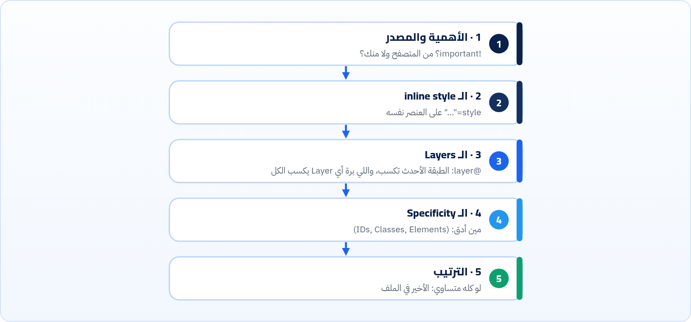
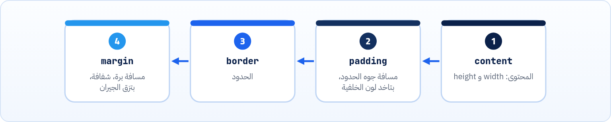

<small>المرحلة 3 · CSS بجد</small>

أشهر جملة في الفرونت إند: «أنا كاتب color: red والزرار لسه أزرق!». والحل اللي الناس بتلجأ له: !important في كل حتة، لحد ما الملف يبقى حرب. الفصل ده بيشرح القواعد اللي المتصفح بيستخدمها علشان يقرر مين يكسب، بالترتيب، وبنتيجة حقيقية من Chrome. وبعدين الـ Box model: ليه العنصر اللي عرضه 200px طلع 250px.

:::note[بعد الفصل ده هتكون عارف]
- الـ Cascade: المتصفح بيختار قيمة واحدة إزاي من كذا قاعدة
- الترتيب: الأهمية والمصدر، والـ Layers، والـ Specificity، والترتيب في الملف
- تحسب الـ Specificity كـ (IDs, Classes, Elements)
- الـ inline و !important ومتى (نادراً) تستخدمهم
- :where() و :is() وتأثيرهم على الـ Specificity
- الوراثة (Inheritance): مين بيتورث ومين لأ
- الـ Box model: content و padding و border و margin
- box-sizing: border-box وليه كل مشروع بيبدأ بيه
- تقرا تابة Styles و Computed في DevTools
:::

<a id="s6-1"></a>

## 6.1 مين يكسب؟

عندنا زرار واحد: `<button id="buy" class="btn">` جوه `<div class="card">`. وكتبنا له 3 قواعد بتقول ألوان مختلفة:

```css
button      { color: gray; }
.card .btn  { color: blue; }
.btn        { color: red; }
```

اللون النهائي إيه؟ ناس كتير هتقول **أحمر**، علشان هو الأخير في الملف. بس Chrome قال (سألناه بـ `getComputedStyle`):

```sh title="Terminal"
> getComputedStyle(document.querySelector('#buy')).color
'rgb(0, 0, 255)'
```

**أزرق**. ليه؟ علشان الترتيب في الملف هو **آخر** معيار المتصفح بيبص عليه، مش أوله. والعملية كلها اسمها **الـ Cascade** (الشلال): كل القيم اللي بتحاول تتحط على نفس الخاصية لنفس العنصر بتعدّي على مراحل، وكل مرحلة بتصفّي، لحد ما يفضل واحد.



*الشلال مبسّط بالترتيب اللي يهمك. أول مرحلة فيها فايز واضح بتنهي الموضوع، واللي بعدها ميتبصّش عليه. ده تبسيط للمواصفة، اللي فيها كمان الـ Shadow DOM والـ @scope.*

<a id="s6-2"></a>

## 6.2 الـ Specificity: تحسبها في 10 ثواني

الـ **Specificity** (الدقة) هي "قد إيه الـ Selector محدد". والمتصفح بيحسبها كـ **3 أرقام** (A, B, C):

**عدّ ده في الـ Selector**

| العمود | بيعد إيه | أمثلة |
|---|---|---|
| **A** | IDs | `#buy` |
| **B** | Classes و Attributes و Pseudo-classes | `.btn` و`[type="email"]` و`:hover` و`:focus-visible` |
| **C** | Elements و Pseudo-elements | `button` و`p` و`::before` |
| صفر | الـ Universal والـ Combinators | `*` و`>` و`+` و`~` والمسافة |

والمقارنة زي الأرقام بالظبط: العمود الشمال الأول. **ID واحد يكسب أي عدد من الـ Classes**. يعني (1,0,0) أكبر من (0,15,0).

**نحسب قواعد المثال**

| الـ Selector | (A, B, C) | النتيجة |
|---|---|---|
| `button` | (0, 0, 1) | خسر |
| `.btn` | (0, 1, 0) | خسر رغم إنه الأخير |
| `.card .btn` | (0, 2, 0) | **كسب**: أزرق |
| `#buy.btn` | (1, 1, 0) | كان هيكسب أي حاجة فوق |
| `nav ul li a:hover` | (0, 1, 4) | أقل من `.card .btn` رغم إنه طويل |

:::note[DevTools بيحسبها لك]
في Chrome، في تابة Styles، حط الماوس على أي Selector: هيظهرلك "Specificity: (0,2,0)". والقواعد اللي خسرت بتلاقيها **مشطوبة** بخط. ودي أسرع طريقة تجاوب "ليه الـ CSS بتاعي مش شغال": شوف هو مشطوب ولا مش موجود أصلاً (يبقى الـ Selector غلط أو الملف مش متحمّل).
:::

<a id="s6-3"></a>

## 6.3 الـ inline و !important

جرّبنا زرار تاني عليه `style="color: black"` مباشرة:

```sh title="Terminal"
> getComputedStyle(document.querySelector('.card:nth-child(2) .btn')).color
'rgb(0, 0, 0)'
```

الـ **inline style** كسب كل الـ Selectors، حتى اللي فيها IDs، لأنه مرحلة قبل الـ Specificity. ودي مشكلته: مش هتعرف تغيّره من ملف CSS غير بـ `!important`. وده بيفسّر حاجة هتشوفها في React: `style={{ color: 'black' }}` بيطلع inline، فاستخدمه للقيم اللي بتتحسب بالـ JS بس (زي مكان عنصر بيتسحب).

:::caution[!important: سلاح نووي]
`color: red !important` بتنقل القاعدة لمرحلة 1، فبتكسب كل اللي مش `!important`. ولو اتنين `!important` اتخانقوا، نرجع للـ Specificity بينهم. والنتيجة الطبيعية: كل واحد يحط `!important` علشان يكسب اللي قبله. استخدامها المقبول: Utility classes لازم تكسب دايماً، أو تتغلب على CSS من مكتبة مش بتاعتك، أو قاعدة الـ reduced-motion من فصل 5.
:::

<a id="s6-4"></a>

## 6.4 :is() و :where(): نفس الشكل، Specificity مختلفة

**تشريح الأمر**

```css
:is(header, footer) a { color: inherit; }
:where(header, footer) a { color: inherit; }
```

1. `:is(…)`: "أي واحد من دول". بتختصر `header a, footer a`. والـ Specificity بتاعتها = **أدق** Selector جواها. هنا (0,0,1) + `a` = (0,0,2).
2. `:where(…)`: نفس المعنى بالظبط، بس الـ Specificity بتاعتها **دايماً صفر**. فالقاعدة دي (0,0,1) بس. مفيدة جداً لـ CSS أساسي (Reset أو مكتبة) عايزه يتغيّر بسهولة.

<a id="s6-5"></a>

## 6.5 الـ @layer: ترتيب الطبقات بإيدك

الـ **Cascade layers** (من 2022 في كل المتصفحات) حلّت حرب الـ Specificity من جذورها: بتقسّم الـ CSS لطبقات، وترتيب الطبقات **أهم من** الـ Specificity. جرّبنا ده على نفس الزرار:

```css
@layer base, components;

@layer components { .btn { color: green; } }
@layer base       { #buy { color: orange; } }

button     { color: gray; }
.card .btn { color: blue; }
.btn       { color: red; }
```

اللون طلع **أزرق** برضه (`rgb(0, 0, 255)`). رغم إن `#buy` فيه ID! والسبب:

| الأمر | بيعمل إيه |
|---|---|
| `@layer base, components;` | بيعلن الترتيب: `base` الأول، وبعدها `components`. والطبقة **الأحدث تكسب**. فـ `.btn` الأخضر في components بيكسب `#buy` البرتقالي في base، **رغم** الـ ID. |
| `القواعد اللي برة أي @layer` | بتتعامل كأنها في طبقة أخيرة مخفية، فبتكسب **كل** الطبقات. علشان كده الأزرق كسب الاتنين. |

وده هيقابلك أول ما تستخدم Tailwind 4: الـ CSS بتاعه متقسّم في `@layer theme, base, components, utilities`. وده أول سطر حقيقي في `node_modules/tailwindcss/index.css`، وهنرجعله في فصل 20.

<a id="s6-6"></a>

## 6.6 الوراثة: مين بيتورث؟

كتبنا `p { color: navy; }` بس، وجوه الـ p فيه `span` و`a`:

```text title="getComputedStyle (Chrome)"
p color:                rgb(0, 0, 128)
span color (inherits):  rgb(0, 0, 128)
a color (UA style):     rgb(0, 0, 238)
```

| الأمر | بيعمل إيه |
|---|---|
| `span ورث navy` | خصايص النص (`color` و`font-*` و`line-height` و`text-align`) **بتتورث** من الأب. علشان كده بتحط الخط على `body` مرة واحدة. |
| `a مورثش` | لأن المتصفح نفسه عنده CSS افتراضي (**User-agent stylesheet**) بيدي اللينكات أزرق (`rgb(0, 0, 238)`). والقيمة الموروثة أضعف من **أي** قاعدة بتستهدف العنصر نفسه، حتى قاعدة المتصفح. والحل: `a { color: inherit; }`. |
| `مبتتورثش` | خصايص الصندوق: `margin` و`padding` و`border` و`width` و`background` و`display`. (تخيّل لو كل ابن ورث border أبوه!) |
| `inherit / initial / unset` | كلمات بتجبر الوراثة، أو ترجّع القيمة الافتراضية من المواصفة، أو "اتورث لو بيتورث، وإلا initial". |

<a id="s6-7"></a>

## 6.7 الـ Box model: ليه 200 طلع 250؟

كل عنصر في الصفحة **صندوق** من 4 طبقات من جوه لبرة:



*الأربع طبقات. في تابة Computed في DevTools هتلاقي رسمة الصندوق ده بالأرقام الحقيقية لأي عنصر.*

وجرّبنا عنصرين بنفس الـ CSS بالظبط: `width: 200px; padding: 20px; border: 5px solid; margin: 10px;`، والفرق الوحيد إن التاني عليه `box-sizing: border-box`:

```text title="offsetWidth (Chrome)"
#b1 offsetWidth: 250    (content-box, the default)
#b2 offsetWidth: 200    (border-box)
```

| الأمر | بيعمل إيه |
|---|---|
| `content-box (الافتراضي)` | الـ `width` = عرض المحتوى بس. والـ padding والـ border بيتزادوا عليه: 200 + 20×2 + 5×2 = **250**. فلو عملت عمودين كل واحد `width: 50%` وفيهم padding، مش هيكفّوا جنب بعض. |
| `border-box` | الـ `width` = لحد الـ border. والمتصفح بيصغّر المحتوى علشان يكفّي: **200** زي ما كتبت. والـ margin برة الحساب في الحالتين. |

علشان كده تقريباً كل مشروع (و Tailwind نفسه، شفناها في الـ CSS بتاعه: `*,:after,:before,::backdrop{box-sizing:border-box`) بيبدأ بالسطر ده:

```css
*,
*::before,
*::after {
  box-sizing: border-box;
}
```

:::note[لو حابب تتعمق: الـ margin collapse]
لو فقرتين فوق بعض، الأولى `margin-bottom: 20px` والتانية `margin-top: 30px`، المسافة بينهم **30** مش 50. الـ Margins الرأسية بين العناصر العادية بتتداخل وياخد الأكبر. ده مبيحصلش جوه Flexbox ولا Grid، وده سبب من أسباب إن الناس بقت تستخدم `gap` (الفصلين الجايين).
:::

<a id="s6-8"></a>

## 6.8 display: النوع اللي بيحدد كل حاجة

**أهم قيم display**

| القيمة | السلوك | أمثلة افتراضية |
|---|---|---|
| `block` | بياخد السطر كله، والـ width/height شغالين | `div` و`p` و`h1` و`section` |
| `inline` | جوه السطر مع النص، والـ width/height **مش** شغالين، والـ margin الرأسي مش بيزق | `span` و`a` و`strong` |
| `inline-block` | جوه السطر، بس الـ width/height شغالين | `button` تقريباً |
| `flex` / `grid` | العنصر نفسه block، وولاده بيترتبوا بنظام تاني | فصل 7 و 8 |
| `none` | مش موجود خالص، ولا حتى لقارئ الشاشة | — |

**المصادر الرسمية:** [MDN · Introduction to the CSS cascade](https://developer.mozilla.org/en-US/docs/Web/CSS/CSS_cascade/Cascade) · [MDN · Specificity](https://developer.mozilla.org/en-US/docs/Web/CSS/CSS_cascade/Specificity) · [MDN · @layer](https://developer.mozilla.org/en-US/docs/Web/CSS/@layer) · [MDN · Inheritance](https://developer.mozilla.org/en-US/docs/Web/CSS/CSS_cascade/Inheritance) · [MDN · The box model](https://developer.mozilla.org/en-US/docs/Learn_web_development/Core/Styling_basics/Box_model) · [web.dev · Learn CSS: The cascade](https://web.dev/learn/css/the-cascade)

:::tip[ملخص الفصل]
- الـ Cascade بالترتيب: الأهمية والمصدر، ثم الـ inline، ثم الـ Layers، ثم الـ Specificity، ثم الترتيب في الملف.
- الـ Specificity = (IDs, Classes, Elements)، والشمال يكسب. ID واحد بيكسب أي عدد Classes.
- `:where()` صفر، و`:is()` = أدق واحد جواها.
- الـ Layers أهم من الـ Specificity، واللي برة أي Layer بيكسبهم كلهم.
- خصايص النص بتتورث، وخصايص الصندوق لأ. والقيمة الموروثة أضعف من أي قاعدة مباشرة.
- `box-sizing: border-box` بيخلي الـ width يشمل الـ padding والـ border.
- DevTools: القاعدة المشطوبة خسرت، والـ Specificity بتظهر مع الماوس.
:::

### صح ولا غلط؟

1. `.a.b.c.d` (0,4,0) بيكسب `#x` (1,0,0).
2. قاعدة برة أي `@layer` بتكسب قاعدة جوه Layer حتى لو أقل Specificity.
3. الـ `margin` بيتورث من الأب.

### أسئلة مراجعة

1. رتّب مراحل الـ Cascade الخمسة من الذاكرة.
2. احسب Specificity: `ul#menu li.active > a:hover`.
3. ليه اللينك جوه `p` لونه أزرق رغم إن الـ p لونه navy؟
4. عنصر `width: 300px; padding: 10px; border: 2px`. عرضه كام في content-box وكام في border-box؟

### تحديات الفصل

<small>جرّبها بإيدك، والحلول في ملحق الإجابات.</small>

1. **[سهل]** افتح أي موقع، واعمل Inspect على زرار، ولاقي في Styles قاعدة مشطوبة، واعرف مين كسبها وليه.
2. **[متوسط]** اعمل ملف فيه 3 Layers (`reset, base, components`) واثبت بالتجربة إن `.btn` في components بيكسب `#id` في base.
3. **[صعب]** اكتب Selector واحد بـ `:where()` يعمل Reset للـ margin لكل العناوين والفقرات، واثبت إن أي Class بسيطة تقدر تغيّره من غير `!important`.
