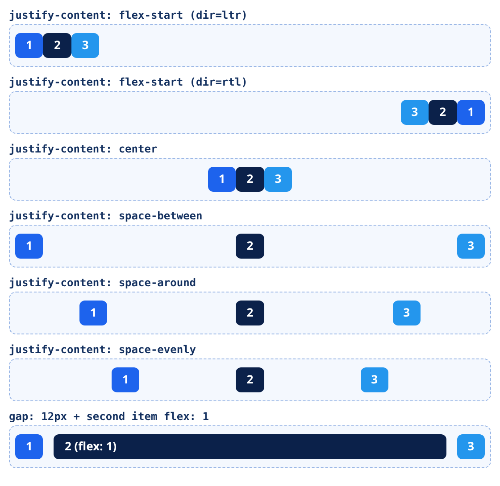

<small>المرحلة 3 · CSS بجد</small>

قبل 2012 تقريباً، علشان تحط عنصر في نص الصفحة بالظبط كنت محتاج حيل غريبة: float و clear و tables و margin سالب. Flexbox حلّت ده في سطرين. الفصل ده بيشرح الفكرة الأساسية (المحورين)، وكل خاصية على الأب وعلى الولاد، ومعنى flex: 1 بالظبط، وليه flex-start في الصفحات العربي بيروح يمين، ومعاه صورة حقيقية لكل قيمة.

:::note[بعد الفصل ده هتكون عارف]
- المشكلة اللي Flexbox حلّها
- المحورين: Main axis و Cross axis، و flex-direction
- على الأب: justify-content و align-items و gap و flex-wrap
- على الولد: flex-grow و flex-shrink و flex-basis، ومعنى flex: 1
- start و end مش left و right: Flexbox في RTL
- أنماط جاهزة: Navbar و توسيط و Footer لازق تحت
- تابة Flexbox في DevTools
:::

<a id="s7-1"></a>

## 7.1 المشكلة: توسيط حاجة في النص

كان فيه نكتة مشهورة بين مطوري الويب: "أصعب حاجة في CSS إنك تحط عنصر في النص بالظبط، أفقي ورأسي". وده كان حقيقي. دلوقتي:

```css
.center {
  display: flex;
  justify-content: center;
  align-items: center;
}
```

تلات سطور. والسر إن Flexbox بيتعامل مع العناصر كـ**صف** (أو عمود) بيوزّع المساحة بينهم بذكاء. وبيشتغل على مستوى **بُعد واحد**: صف واحد أو عمود واحد. (البعدين مع بعض ده Grid، الفصل الجاي.)

<a id="s7-2"></a>

## 7.2 الفكرة الوحيدة اللي لازم تفهمها: المحورين

أول ما تكتب `display: flex` على عنصر، بيبقى **Flex container**، وولاده المباشرين بس بيبقوا **Flex items**. وفيه محورين:

#### Main axis · المحور الرئيسي

الاتجاه اللي العناصر بتترص فيه. بيتحدد بـ `flex-direction`: الافتراضي `row` (أفقي). والتحكم فيه بـ <strong>`justify-content`</strong>.

#### Cross axis · المحور العرضي

العمودي على الرئيسي. لو الصف أفقي، العرضي رأسي. والتحكم فيه بـ <strong>`align-items`</strong>.

:::caution[الفخ الأشهر]
لو غيّرت `flex-direction: column`، المحاور **بتتبدّل**: `justify-content` بقى رأسي و`align-items` بقى أفقي. ودي سبب 90% من "ليه justify-content مش شغال". افتكر: **justify = الرئيسي، align = العرضي**، أياً كان الاتجاه.
:::

<a id="s7-3"></a>

## 7.3 على الأب (الـ Container)

دي كل قيم `justify-content` متصوّرة من Chrome فعلاً (نفس الـ 3 عناصر في كل صف):



*لقطة حقيقية من Chrome. لاحظ الصف التاني: نفس `flex-start` بالظبط، بس `dir="rtl"` خلّاه يبدأ من اليمين، وخلّى 1 على اليمين. والصف الأخير: `flex: 1` خلّى العنصر التاني ياكل كل المساحة الفاضية.*

| الأمر | بيعمل إيه |
|---|---|
| `display: flex` | بيحوّل العنصر لـ Flex container. والولاد المباشرين بس بيتأثروا (الأحفاد لأ). |
| `flex-direction` | `row` (الافتراضي) أو `column` أو `row-reverse` أو `column-reverse`. والـ reverse بيقلب الشكل بس، مش ترتيب الـ Tab (فصل 5). |
| `justify-content` | التوزيع على المحور الرئيسي: `flex-start` و`center` و`flex-end` و`space-between` (المسافة بينهم بس) و`space-around` (نص مسافة على الأطراف) و`space-evenly` (كل المسافات متساوية). |
| `align-items` | على المحور العرضي: `stretch` (الافتراضي: كلهم بطول أطول واحد) و`flex-start` و`center` و`flex-end` و`baseline` (على خط النص). |
| `gap: 12px` | مسافة **بين** العناصر بس، مش على الأطراف. أنضف بكتير من `margin` على كل عنصر. و`gap: 8px 16px` = صفوف ثم أعمدة. |
| `flex-wrap: wrap` | الافتراضي `nowrap`: كله في سطر واحد حتى لو هيتزنق. و`wrap` بيسمح بالنزول لسطر جديد. (ولما يبقى فيه أكتر من سطر، `align-content` بيوزّع السطور.) |

<a id="s7-4"></a>

## 7.4 على الولد (الـ Item): flex: 1 يعني إيه بالظبط؟

كل عنصر عنده 3 أرقام بتقرر حجمه:

| الأمر | بيعمل إيه |
|---|---|
| `flex-basis` | الحجم **المبدئي** قبل توزيع المساحة. الافتراضي `auto` (يعني حسب الـ width أو المحتوى). |
| `flex-grow` | لو فيه مساحة **فاضلة**، ياخد منها كام نصيب. الافتراضي `0` (مياخدش). لو عنصر `1` وعنصر `2`، التاني ياخد ضعف الأول من الفاضل. |
| `flex-shrink` | لو المساحة **مش مكفّية**، يصغر بنسبة كام. الافتراضي `1` (كلهم يصغروا). و`0` = "متصغرنيش" (مفيد للوجو أو صورة). |
| `flex: 1` | اختصار لـ `flex: 1 1 0%`: يكبر، ويصغر، ويبدأ من صفر. يعني "قسّموا المساحة بالتساوي بغض النظر عن المحتوى". وده اللي حصل للعنصر التاني في الصورة. |
| `flex: none` | `0 0 auto`: حجمك ثابت، متكبرش ومتصغرش. |
| `align-self` | زي `align-items` بس لعنصر واحد يخالف الباقيين. |
| `order` | يغيّر مكان العنصر في الشكل. **استخدمه بحذر**: الكيبورد وقارئ الشاشة لسه ماشيين بترتيب الـ HTML. |

:::tip[حاجة مشتركة: margin-inline-start: auto]
عايز اللوجو في جنب والـ Links في الجنب التاني؟ بدل `space-between`، حط على أول لينك `margin-inline-start: auto`. الـ `auto` margin في Flexbox بياكل كل المساحة الفاضية في الاتجاه ده. والكلمة `inline-start` (مش `left`) بتخليها تشتغل صح في العربي والإنجليزي (فصل 10).
:::

<a id="s7-5"></a>

## 7.5 start و end، مش left و right

شفت في الصورة: `flex-start` في `dir="rtl"` راح **يمين**. علشان Flexbox مبيفكرش في "شمال ويمين"، بيفكر في "**بداية ونهاية**" حسب اتجاه اللغة. وده هدية لينا: لو كتبت صح، الصفحة بتتقلب لوحدها لما تغيّر `dir`. ونفس الفكرة في Grid، وفي الـ Logical properties (فصل 10)، وفي Tailwind (`ms-4` و`me-4` بدل `ml-4` و`mr-4`).

<a id="s7-6"></a>

## 7.6 أنماط هتكتبها كل يوم

### Navbar

```css
.nav {
  display: flex;
  align-items: center;
  gap: 1rem;
}
.nav .logo {
  margin-inline-end: auto; /* يزق الباقي للناحية التانية */
}
```

### كروت بتلف لسطر جديد

```css
.cards {
  display: flex;
  flex-wrap: wrap;
  gap: 1rem;
}
.cards > * {
  flex: 1 1 220px; /* ابدأ من 220 وكبّر لو فيه مكان */
}
```

### الفوتر لازق تحت حتى لو الصفحة قصيرة

```css
body {
  min-height: 100svh;
  display: flex;
  flex-direction: column;
}
main {
  flex: 1;
}
```

الـ `100svh` = 100% من ارتفاع الشاشة "الصغير" على الموبايل (لما شريط العنوان ظاهر). قالب Vite نفسه بيستخدمها: `min-height: 100svh` على `#app`.

### Flexbox في قالب Vite الحقيقي

ده جزء من `style.css` اللي `create-vite` عمله لينا (هنشرح القالب كله في فصل 18):

```css title="vanilla-app/src/style.css"
#center {
  display: flex;
  flex-direction: column;
  gap: 25px;
  place-content: center;
  place-items: center;
  flex-grow: 1;
}
```

| الأمر | بيعمل إيه |
|---|---|
| `flex-direction: column` | العناصر فوق بعض. فالمحور الرئيسي بقى رأسي. |
| `place-content: center` | اختصار لـ `align-content` + `justify-content` مع بعض. |
| `place-items: center` | اختصار لـ `align-items` + `justify-items`. (والـ `justify-items` ملهاش تأثير في Flexbox، بس مفيدة لو العنصر اتحوّل لـ Grid.) |
| `flex-grow: 1` | الـ `#center` نفسه ولد لـ `#app` (اللي هو `display: flex` كمان)، فبياخد كل المساحة الرأسية الفاضية. Flexbox جوه Flexbox: عادي جداً. |

<a id="s7-7"></a>

## 7.7 تابة Flexbox في DevTools

في Chrome، أي عنصر `display: flex` بيظهر جنبه في تابة Elements علامة صغيرة مكتوب عليها **flex**. اضغطها، هيرسملك المحاور والمسافات على الصفحة. وفي تابة Styles، جنب `display: flex` فيه أيقونة بتفتح **Flexbox editor**: زراير تغيّر بيها `justify-content` و`align-items` وتشوف النتيجة فوراً. أسرع طريقة تتعلم بيها.

**المصادر الرسمية:** [MDN · Flexbox](https://developer.mozilla.org/en-US/docs/Learn_web_development/Core/CSS_layout/Flexbox) · [MDN · Basic concepts of flexbox](https://developer.mozilla.org/en-US/docs/Web/CSS/CSS_flexible_box_layout/Basic_concepts_of_flexbox) · [web.dev · Learn CSS: Flexbox](https://web.dev/learn/css/flexbox) · [Chrome DevTools · Inspect and debug CSS flexbox](https://developer.chrome.com/docs/devtools/css/flexbox)

:::tip[ملخص الفصل]
- Flexbox لبعد واحد: صف أو عمود.
- `justify-content` للمحور الرئيسي، و`align-items` للعرضي، وبيتبدّلوا مع `column`.
- `gap` للمسافات بين العناصر، و`flex-wrap: wrap` للنزول لسطر جديد.
- `flex: 1` = `1 1 0%`: قسّموا المساحة بالتساوي.
- `flex-shrink: 0` علشان عنصر ميصغرش.
- `start` و`end` بيتقلبوا مع `dir="rtl"`. فكّر "بداية ونهاية" مش "شمال ويمين".
- DevTools فيه Flexbox editor بيرسم المحاور.
:::

### صح ولا غلط؟

1. مع `flex-direction: column`، الـ `justify-content: center` بيوسّط رأسياً.
2. `display: flex` بيأثر على كل الأحفاد مش الولاد بس.
3. في صفحة `dir="rtl"`، `justify-content: flex-start` بيحط العناصر يمين.

### أسئلة مراجعة

1. إيه الفرق بين `space-between` و`space-evenly`؟
2. `flex: 1` اختصار لإيه؟ وإيه الفرق بينه وبين `flex: auto`؟
3. ليه `order` ممكن يعمل مشكلة Accessibility؟
4. إزاي تخلي الفوتر لازق تحت في صفحة قصيرة؟

### تحديات الفصل

<small>جرّبها بإيدك، والحلول في ملحق الإجابات.</small>

1. **[سهل]** اعمل Navbar: لوجو على البداية و3 لينكات على النهاية، وجرّبه بـ `dir="rtl"` و`dir="ltr"` من غير ما تغيّر ولا سطر CSS.
2. **[متوسط]** اعمل 6 كروت بـ `flex: 1 1 220px` و`flex-wrap`، وصغّر الشاشة وشوف بيلفّوا إزاي. إيه اللي بيحصل لآخر سطر لو فيه كارت واحد؟ (ده سبب إنك ممكن تفضّل Grid)
3. **[صعب]** العب [Flexbox Froggy](https://flexboxfroggy.com/) لحد آخر مستوى، واكتب في ورقة كل خاصية جديدة قابلتها.
