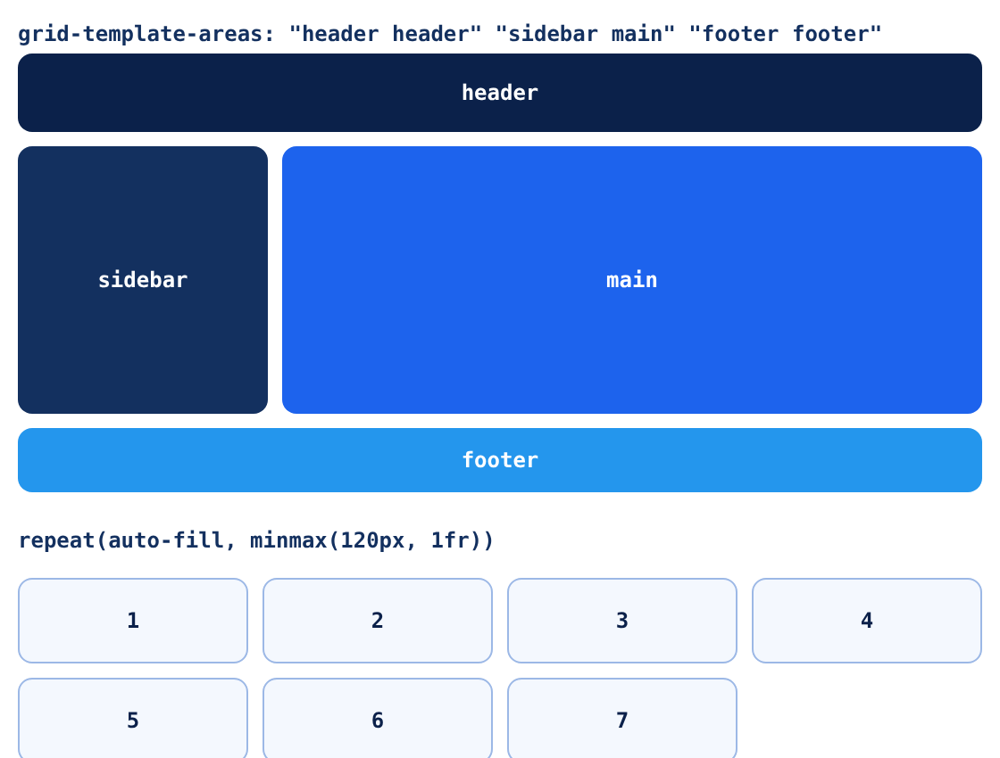

<small>المرحلة 3 · CSS بجد</small>

Flexbox ممتاز لصف واحد. بس لما تحتاج صفوف وأعمدة مع بعض، زي هيكل صفحة فيها هيدر وسايدبار ومحتوى وفوتر، أو كروت كلها نفس العرض بالظبط، Flexbox بيبتدي يتعبك. Grid بتخليك ترسم الشبكة الأول، وبعدين تحط العناصر فيها. الفصل ده بيشرح fr و repeat و minmax و auto-fill و grid-template-areas، ومعاه صورة حقيقية، وإمتى تختار Grid وإمتى Flexbox.

:::note[بعد الفصل ده هتكون عارف]
- الفرق بين Grid (بعدين) و Flexbox (بعد واحد)
- grid-template-columns و rows و gap
- الوحدة fr، و repeat()، و minmax()
- auto-fill و auto-fit: كروت Responsive من غير Media query
- grid-template-areas: ترسم الصفحة بالكلام
- تحط عنصر في مكان معين: grid-column و span
- الـ subgrid في سطر
- Grid ولا Flexbox؟ قاعدة بسيطة
:::

<a id="s8-1"></a>

## 8.1 ليه Flexbox مش كفاية؟

افتكر تحدي الفصل اللي فات: 6 كروت بـ `flex: 1 1 220px`. لو آخر سطر فيه كارت واحد، هيتمط ياخد السطر كله، وشكله يبقى غريب جنب الكروت اللي فوقه. ليه؟ لأن كل سطر في Flexbox **مستقل** عن اللي فوقه. مفيش "أعمدة". Grid بتحل ده لأنها بتفكر في **الصفوف والأعمدة مع بعض**.



*لقطة حقيقية من Chrome. فوق: هيكل صفحة بـ `grid-template-areas`. تحت: 7 كروت بـ `repeat(auto-fill, minmax(120px, 1fr))`، والكارت الأخير فضل بنفس عرض اللي فوقه بالظبط.*

<a id="s8-2"></a>

## 8.2 الأساسيات: ارسم الشبكة الأول

```css
.page {
  display: grid;
  grid-template-columns: 140px 1fr;
  grid-template-rows: 44px 150px 36px;
  gap: 8px;
}
```

| الأمر | بيعمل إيه |
|---|---|
| `display: grid` | العنصر بقى Grid container، وولاده المباشرين Grid items بيتحطوا في الخانات بالترتيب أوتوماتيك. |
| `grid-template-columns: 140px 1fr` | عمودين: الأول 140px ثابت، والتاني **1fr**. |
| `1fr` | **fraction**: نصيب من المساحة الفاضلة بعد الحاجات الثابتة. `1fr 2fr` = التاني ضعف الأول. ودي وحدة Grid بس. |
| `grid-template-rows` | نفس الفكرة للصفوف. ولو مكتبتهاش، الصفوف بتتعمل لوحدها بطول المحتوى (اسمها **Implicit grid**). |
| `gap: 8px` | زي Flexbox: مسافة بين الخانات. وتقدر تفصل: `row-gap` و`column-gap`. |

<a id="s8-3"></a>

## 8.3 grid-template-areas: ترسم الصفحة بالكلام

دي أجمل حاجة في Grid. بتكتب شكل الصفحة كأنك بترسمه بالحروف:

```css
.page {
  display: grid;
  grid-template-columns: 140px 1fr;
  grid-template-areas:
    "header  header"
    "sidebar main"
    "footer  footer";
}
.h { grid-area: header; }
.s { grid-area: sidebar; }
.m { grid-area: main; }
.f { grid-area: footer; }
```

| الأمر | بيعمل إيه |
|---|---|
| `"header header"` | كل String = صف، وكل كلمة = خانة. نفس الاسم مرتين جنب بعض = الخانة دي ممتدة على العمودين. |
| `grid-area: header` | على الولد: "حطني في المنطقة اللي اسمها header". ترتيب العناصر في الـ HTML مش مهم للشكل. |
| `.` | نقطة بدل اسم = خانة فاضية. |

والحلو إن الـ Responsive بقى سهل جداً: على الموبايل غيّر الرسمة بس:

```css
@media (max-width: 600px) {
  .page {
    grid-template-columns: 1fr;
    grid-template-areas: "header" "main" "sidebar" "footer";
  }
}
```

:::caution[بس افتكر الكيبورد]
زي `order` في Flexbox: لو حطيت الـ sidebar قبل الـ main في الشكل وبعده في الـ HTML، الـ Tab هيمشي بترتيب الـ HTML. خلّي ترتيب الـ HTML هو الترتيب المنطقي للقراية، والـ Grid يغيّر الشكل بس.
:::

<a id="s8-4"></a>

## 8.4 repeat و minmax و auto-fill: السطر السحري

```css
.cards {
  display: grid;
  grid-template-columns: repeat(auto-fill, minmax(120px, 1fr));
  gap: 8px;
}
```

السطر ده بيعمل كروت Responsive **من غير ولا Media query**. نفصّصه من جوه لبرة:

**تشريح الأمر**

```css
repeat(auto-fill, minmax(120px, 1fr))
```

1. `minmax(120px, 1fr)`: كل عمود عرضه **مش أقل من** 120px، و**مش أكتر من** 1fr (نصيب متساوي من الفاضل).
2. `repeat(N, …)`: كرّر العمود ده N مرة. `repeat(3, 1fr)` = `1fr 1fr 1fr`.
3. `auto-fill`: بدل رقم ثابت: "حط أكبر عدد أعمدة يكفّي". في صورتنا العرض كان كفاية لـ 4، فطلعوا 4 أعمدة، والكارت 7 نزل تحت بنفس العرض. صغّر الشاشة: يبقوا 3، ثم 2، ثم 1، لوحدهم.
4. `auto-fit`: زي `auto-fill`، بس لو العناصر قليلة (مثلاً 2 بس في شاشة واسعة)، بيلم الأعمدة الفاضية فالعنصرين يتمطوا ياخدوا العرض كله. و`auto-fill` بيسيب الأعمدة الفاضية موجودة.

<a id="s8-5"></a>

## 8.5 تحط عنصر في مكان معين

الخطوط بين الأعمدة ليها أرقام بتبدأ من 1. وتقدر تقول للعنصر يبدأ وينتهي فين:

```css
.featured {
  grid-column: 1 / -1;   /* من أول خط لآخر خط: العرض كله */
}
.wide {
  grid-column: span 2;   /* خد عمودين من مكانك */
}
.tall {
  grid-row: span 2;
}
```

| الأمر | بيعمل إيه |
|---|---|
| `1 / -1` | "من الخط 1 للخط الأخير". الرقم السالب بيعد من الآخر. وفي `dir="rtl"` الخط 1 على **اليمين** (نفس فكرة start و end). |
| `span 2` | "امتد على خانتين" من غير ما تحدد بالظبط فين. |

:::note[لو حابب تتعمق: subgrid]
لو جوه كل كارت عنوان وصورة وزرار، وعايز العناوين كلها على نفس الخط في كل الكروت حتى لو طولها مختلف: خلي الكارت نفسه `display: grid; grid-template-rows: subgrid; grid-row: span 3;`. كده صفوف الكارت بتتبع صفوف الـ Grid الكبيرة. والـ subgrid بقى مدعوم في كل المتصفحات الرئيسية من 2023.
:::

<a id="s8-6"></a>

## 8.6 Grid ولا Flexbox؟

**قاعدة بسيطة**

| السؤال | Flexbox | Grid |
|---|---|---|
| كام بعد؟ | واحد: صف **أو** عمود | اتنين: صفوف **و** أعمدة |
| مين بيقرر الحجم؟ | المحتوى (Content-out) | الشبكة (Layout-in) |
| أمثلة | Navbar، زراير جنب بعض، توسيط، عناصر جوه كارت | هيكل الصفحة، Gallery، Dashboard، كروت بنفس العرض |

وفي الحقيقة هتستخدم الاتنين مع بعض طول الوقت: Grid للهيكل الكبير، وجوه كل خانة Flexbox. وما تقلقش من "أنهي أصح": لو الشكل طلع صح والكود مقروء، يبقى صح.

:::note[DevTools: تابة Grid]
زي Flexbox: جنب أي عنصر `display: grid` في Elements فيه علامة **grid**. اضغطها، وهيرسم الخطوط بأرقامها وأسماء الـ Areas على الصفحة. ومن تابة **Layout** تقدر تشغّل الرسم ده لكل الـ Grids في الصفحة مرة واحدة.
:::

**المصادر الرسمية:** [MDN · CSS grid layout](https://developer.mozilla.org/en-US/docs/Learn_web_development/Core/CSS_layout/Grids) · [MDN · grid-template-areas](https://developer.mozilla.org/en-US/docs/Web/CSS/grid-template-areas) · [MDN · repeat()](https://developer.mozilla.org/en-US/docs/Web/CSS/repeat) · [MDN · Subgrid](https://developer.mozilla.org/en-US/docs/Web/CSS/CSS_grid_layout/Subgrid) · [web.dev · Learn CSS: Grid](https://web.dev/learn/css/grid) · [Chrome DevTools · Inspect CSS grid](https://developer.chrome.com/docs/devtools/css/grid)

:::tip[ملخص الفصل]
- Grid لبعدين، و Flexbox لبعد واحد، والاتنين مع بعض عادي.
- `grid-template-columns` و`rows` بيرسموا الشبكة، و`gap` للمسافات.
- `fr` نصيب من المساحة الفاضلة.
- `repeat(auto-fill, minmax(Xpx, 1fr))` = كروت Responsive من غير Media queries.
- `grid-template-areas` بترسم الصفحة بالكلام، و`grid-area` على الولد.
- `grid-column: 1 / -1` للعرض كله، و`span 2` لخانتين.
- ترتيب الـ HTML هو ترتيب القراية والكيبورد، مهما غيّرت الشكل.
:::

### صح ولا غلط؟

1. الوحدة `fr` بتشتغل في Flexbox كمان.
2. `repeat(auto-fill, minmax(200px, 1fr))` محتاجة Media query علشان تبقى Responsive.
3. `grid-column: 1 / -1` بيخلي العنصر ياخد عرض الشبكة كلها.

### أسئلة مراجعة

1. ليه آخر كارت في Flexbox بيتمط، وفي Grid لأ؟
2. اشرح `minmax(120px, 1fr)` بكلامك.
3. إيه الفرق بين `auto-fill` و`auto-fit`؟
4. اكتب `grid-template-areas` لصفحة فيها هيدر، ومحتوى في النص، وسايدبار على الجنبين، وفوتر.

### تحديات الفصل

<small>جرّبها بإيدك، والحلول في ملحق الإجابات.</small>

1. **[سهل]** اعمل Gallery صور بـ `repeat(auto-fill, minmax(150px, 1fr))` وغيّر عرض الشاشة.
2. **[متوسط]** اعمل هيكل الصفحة بـ `grid-template-areas`، وعلى الشاشات الصغيرة خليه عمود واحد بـ Media query واحدة.
3. **[صعب]** اعمل Dashboard فيه 4 كروت، واحد منهم `grid-column: span 2` و`grid-row: span 2`، والباقي يترصوا حواليه أوتوماتيك. جرّب `grid-auto-flow: dense` وشوف الفرق.
