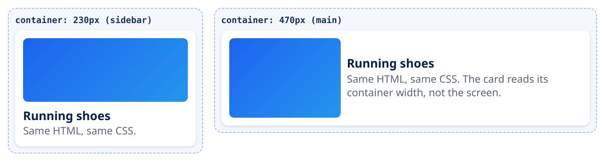

<small>المرحلة 3 · CSS بجد</small>

زمان الشركات كانت بتعمل موقعين: www للكمبيوتر و m. للموبايل. النهارده صفحة واحدة بتتأقلم مع أي عرض: من موبايل صغير لشاشة 32 بوصة. الفصل ده بيبدأ من سطر الـ viewport اللي من غيره مفيش حاجة هتشتغل، والوحدات (rem و vw و svh)، والـ Mobile-first، والـ Media queries بالصيغة الجديدة، وبعدين النجم الجديد: الـ Container queries، والصور اللي بتتأقلم.

:::note[بعد الفصل ده هتكون عارف]
- meta viewport وليه من غيره الموبايل بيصغّر الصفحة
- Mobile-first: ابدأ بالصغير وزوّد
- الوحدات: px و rem و em و % و vw و svh و ch
- Media queries: min-width وصيغة النطاقات الجديدة
- prefers-color-scheme و hover و pointer
- Container queries: الكومبوننت يقرا عرض علبته مش الشاشة
- clamp() للخطوط اللي بتكبر وتصغر بنعومة
- الصور: srcset و sizes و picture و loading=lazy
- تجرّب بـ Device mode في DevTools
:::

<a id="s9-1"></a>

## 9.1 السطر اللي من غيره مفيش Responsive

```html
<meta name="viewport" content="width=device-width, initial-scale=1.0" />
```

لما الـ iPhone نزل سنة 2007، كل المواقع كانت معمولة لشاشات كمبيوتر. فـ Safari على الموبايل عمل حيلة: يعرض الصفحة كأن عرض الشاشة **980px**، ويصغّرها علشان تكفّي. فالمستخدم يعمل Zoom بصوابعه. والحيلة دي لسه شغالة لحد النهارده لأي صفحة مفيهاش السطر ده. فحتى لو كتبت أحلى Media queries، الموبايل هيقول "أنا عرضي 980" ومش هتشتغل.

| الأمر | بيعمل إيه |
|---|---|
| `width=device-width` | "اعتبر عرض الصفحة = عرض الجهاز الحقيقي" (بالـ CSS pixels، مثلاً 390 في iPhone حديث، مش عدد البيكسلات الفعلي في الشاشة). |
| `initial-scale=1.0` | ابدأ من غير Zoom. ومتزودش `maximum-scale=1` أو `user-scalable=no`: دول بيمنعوا الناس اللي نظرها ضعيف من التكبير (مشكلة Accessibility). |

والسطر ده موجود جاهز في كل قوالب Vite (شفناه في `index.html`).

<a id="s9-2"></a>

## 9.2 Mobile-first: ابدأ بالصغير

فيه طريقتين تكتب بيهم Responsive:

#### Desktop-first (القديمة)

تكتب للشاشة الكبيرة، وبعدين `max-width` تلغي وتصغّر. النتيجة: الموبايل بينزّل CSS كتير وبيلغيه.

#### Mobile-first (المنصوح بيها)

تكتب للموبايل الأول (عمود واحد، أبسط حاجة)، وبعدين `min-width` تزوّد للشاشات الأكبر. الكود أبسط، لأن الشكل الأبسط هو الافتراضي.

```css
/* الموبايل: الافتراضي */
.layout {
  display: grid;
  gap: 1rem;
}

/* من 768px وأكبر: عمودين */
@media (width >= 768px) {
  .layout {
    grid-template-columns: 240px 1fr;
  }
}
```

و Tailwind مبني على نفس الفكرة: `md:grid-cols-2` معناها "من الـ md وأكبر"، والكلاس من غير بادئة للموبايل (فصل 20).

<a id="s9-3"></a>

## 9.3 الوحدات: إمتى تستخدم إيه

**الوحدات اللي هتستخدمها فعلاً**

| الوحدة | معناها | استخدمها لـ |
|---|---|---|
| `px` | CSS pixel ثابت | الحدود والظلال والحاجات الصغيرة الثابتة |
| `rem` | مضاعف حجم خط الـ `html` (افتراضياً 16px) | **الخطوط والمسافات**. لو المستخدم كبّر خط المتصفح من الإعدادات، كله يكبر معاه |
| `em` | مضاعف حجم خط العنصر نفسه | حاجة لازم تتناسب مع النص اللي جنبها (padding زرار، أيقونة) |
| `%` | نسبة من الأب | العروض جوه حاوية |
| `vw` / `vh` | 1% من عرض / ارتفاع الشاشة | أقسام بملء الشاشة. بس `100vh` على الموبايل بيتخطى الشاشة لما شريط العنوان يظهر |
| `svh` / `lvh` / `dvh` | ارتفاع الشاشة الصغير / الكبير / الحالي (مع ظهور واختفاء شريط المتصفح) | `min-height: 100svh` بدل `100vh` (زي قالب Vite) |
| `ch` | عرض حرف "0" في الخط الحالي | عرض الفقرات: `max-width: 65ch` سطر مريح للقراية |

:::tip[Best Practice]
القاعدة العملية: `rem` للخطوط والمسافات، و`px` للحدود، و`%`/`fr` للعروض، و`svh` للارتفاعات بملء الشاشة. ومتحطش `font-size` بالـ `px` على الـ `html`: ده بيلغي إعداد حجم الخط اللي المستخدم اختاره.
:::

<a id="s9-4"></a>

## 9.4 Media queries بالتفصيل

**تشريح الأمر**

```css
@media screen and (width >= 768px) and (width < 1024px) { … }
```

1. `@media`: "القواعد اللي جوه تتطبق بس لو الشرط صح".
2. `screen`: نوع الجهاز (Media type): `screen` أو `print` (للطباعة) أو `all`. ولو مكتبتهوش يبقى `all`.
3. `(width >= 768px)`: صيغة النطاقات الجديدة (Range syntax)، مدعومة في كل المتصفحات الحديثة من 2023. أوضح من القديمة `(min-width: 768px)`، والاتنين نفس المعنى. هتشوف القديمة كتير في الكود اللي موجود.
4. `and`: الشرطين لازم يتحققوا. والـ `,` بين Queries = "أو".

ومش بس العرض. فيه Media features بتقرا تفضيلات المستخدم وجهازه:

**Media features مفيدة**

| الـ Feature | بتسأل عن إيه |
|---|---|
| `(prefers-color-scheme: dark)` | المستخدم مفعّل Dark mode في الماك أو الموبايل |
| `(prefers-reduced-motion: reduce)` | عايز حركة أقل (فصل 5) |
| `(hover: hover)` | الجهاز عنده ماوس يقدر يعمل Hover (التاتش لأ) |
| `(pointer: coarse)` | المؤشر "خشن" زي الصباع: كبّر الزراير |
| `(orientation: landscape)` | الشاشة بالعرض |

وقالب Vite نفسه بيستخدم `prefers-color-scheme`. ده جزء حقيقي من `style.css` بتاعه:

```css title="vanilla-app/src/style.css"
:root {
  --text: #6b6375;
  --bg: #fff;
  color-scheme: light dark;
}

@media (prefers-color-scheme: dark) {
  :root {
    --text: #9ca3af;
    --bg: #16171d;
  }
}
```

هو بيغيّر **المتغيرات** بس (`--text` و`--bg`)، وكل حاجة بتستخدمها بتتغير لوحدها. ودي قوة الـ Custom properties (الفصل الجاي). والـ `color-scheme: light dark` بيقول للمتصفح إن الصفحة تدعم الاتنين، فيلوّن الـ Scrollbars والخانات صح.

<a id="s9-5"></a>

## 9.5 Container queries: الكومبوننت يقرا علبته

المشكلة: عندك كارت منتج. في الصفحة الرئيسية بيتحط في عمود عريض، وفي الـ Sidebar في عمود ضيق. والشاشة **نفس العرض** في الحالتين. فالـ Media query مش هتفرق بينهم. الكارت محتاج يسأل: "**العلبة اللي أنا فيها** عرضها كام؟"

```css
.slot {
  container-type: inline-size;
}

.card {
  display: grid;
  gap: 8px;
}

@container (width >= 400px) {
  .card {
    grid-template-columns: 140px 1fr;
  }
}
```



*لقطة حقيقية من Chrome: نفس الـ HTML ونفس الـ CSS بالظبط، والشاشة نفسها. الكارت في العلبة الضيقة (230px) عمودي، وفي العريضة (470px) أفقي.*

| الأمر | بيعمل إيه |
|---|---|
| `container-type: inline-size` | على **الأب**: "أنا علبة، وولادي يقدروا يسألوا عن عرضي". `inline-size` = العرض في الكتابة الأفقية. |
| `@container (width >= 400px)` | زي `@media` بالظبط، بس بيسأل عن أقرب علبة فوقه مش عن الشاشة. |
| `container-name: sidebar` | اختياري: اسم للعلبة، فتقول `@container sidebar (width >= 300px)` لو فيه علب جوه علب. |

:::note[ليه ده مهم مع React؟]
في React هتفكر في **Components** بتتحط في أي مكان. والـ Container queries بتخلي الكومبوننت مسؤول عن شكله في أي علبة، من غير ما يعرف الصفحة كلها. Media queries للهيكل الكبير، و Container queries للكومبوننتات.
:::

<a id="s9-6"></a>

## 9.6 clamp(): خطوط بتكبر بنعومة

**تشريح الأمر**

```css
h1 { font-size: clamp(1.75rem, 1rem + 3vw, 3.5rem); }
```

1. `clamp(MIN, PREFERRED, MAX)`: "خد القيمة المفضّلة، بس متقلّش عن MIN ومتزيدش عن MAX".
2. `1rem + 3vw`: جزء ثابت + جزء بيكبر مع عرض الشاشة. فالعنوان بيكبر بنعومة بدل ما يقفز عند كل Breakpoint. والـ `rem` فيها مهم: من غيره (`3vw` لوحدها) الـ Zoom مش هيكبّر الخط.

<a id="s9-7"></a>

## 9.7 الصور اللي بتتأقلم

```html
= 768px) 50vw, 100vw"
  alt="Team at work"
  width="800" height="450"
  loading="lazy">
```

| الأمر | بيعمل إيه |
|---|---|
| `srcset="… 400w, …"` | قايمة نسخ من نفس الصورة بعروضها الحقيقية (`w` = بيكسل عرض). المتصفح بيختار الأنسب حسب الشاشة وكثافة البيكسلات (شاشة Retina في الماك محتاجة ضعف). |
| `sizes="…"` | بتقول للمتصفح الصورة هتتعرض بعرض قد إيه: نص الشاشة على الكبير، والشاشة كلها على الصغير. من غيره المتصفح بيفترض `100vw`. |
| `src` | احتياطي لو المتصفح مش فاهم srcset. |
| `loading="lazy"` | متنزّلش الصورة غير لما تقرّب تظهر. **متحطهاش** على الصورة الكبيرة اللي فوق في أول الصفحة: دي محتاجة تنزل فوراً (بتأثر على LCP، فصل 24). |
| `<picture>` | لما عايز **صورة مختلفة** مش بس حجم مختلف (قص مختلف للموبايل)، أو صيغ حديثة زي AVIF مع احتياطي: `<picture><source type="image/avif" srcset="…"></picture>`. |

<a id="s9-8"></a>

## 9.8 تجرّب: Device mode

1. في Chrome DevTools اضغط أيقونة الموبايل والتابلت (أو <kbd>⌘</kbd>+<kbd>⇧</kbd>+<kbd>M</kbd>).
2. اختار جهاز من فوق، أو "Responsive" واسحب الحافة بإيدك وشوف الـ Breakpoints.
3. من قايمة النقط التلاتة: "Show media queries" بترسم شريط بكل الـ Media queries اللي في الصفحة، تضغط على أي واحدة تروحلها.
4. وتقدر تجرّب `prefers-color-scheme` و`prefers-reduced-motion` من تابة **Rendering** (من Command menu: <kbd>⌘</kbd>+<kbd>⇧</kbd>+<kbd>P</kbd> واكتب rendering).
5. ولما تخلص، جرّب على موبايلك الحقيقي: `npm run dev -- --host` (فصل 18) بيخلي Vite يظهر على الشبكة المحلية.

**المصادر الرسمية:** [MDN · Responsive design](https://developer.mozilla.org/en-US/docs/Learn_web_development/Core/CSS_layout/Responsive_Design) · [MDN · Viewport meta element](https://developer.mozilla.org/en-US/docs/Web/HTML/Guides/Viewport_meta_element) · [MDN · Using media queries](https://developer.mozilla.org/en-US/docs/Web/CSS/CSS_media_queries/Using_media_queries) · [MDN · Container queries](https://developer.mozilla.org/en-US/docs/Web/CSS/CSS_containment/Container_queries) · [MDN · Responsive images](https://developer.mozilla.org/en-US/docs/Web/HTML/Guides/Responsive_images) · [web.dev · Learn Responsive Design](https://web.dev/learn/design)

:::tip[ملخص الفصل]
- من غير `meta viewport` الموبايل بيتظاهر إن عرضه 980px.
- Mobile-first: الافتراضي للصغير، و`min-width` (أو `width >=`) للأكبر.
- `rem` للخطوط والمسافات، و`svh` للارتفاعات، و`ch` لعرض الفقرات.
- Media features: `prefers-color-scheme` و`prefers-reduced-motion` و`hover` و`pointer`.
- Container queries: `container-type: inline-size` على الأب، و`@container` للولد.
- `clamp(min, preferred, max)` لخطوط ناعمة، ومعاها `rem`.
- الصور: `srcset` و`sizes` و`width`/`height`، و`lazy` للي تحت بس.
:::

### صح ولا غلط؟

1. من غير `meta viewport`، Media queries بتشتغل عادي على الموبايل.
2. `@container` بيسأل عن عرض الشاشة.
3. تحط `loading="lazy"` على أول صورة كبيرة في الصفحة علشان تبقى أسرع.

### أسئلة مراجعة

1. إيه المشكلة اللي `width=device-width` بيحلها؟ ومنين جت؟
2. ليه `rem` أحسن من `px` للخطوط؟
3. اكتب Media query بالصيغة القديمة والجديدة لـ "من 640 لأقل من 1024".
4. إمتى Container query أنسب من Media query؟

### تحديات الفصل

<small>جرّبها بإيدك، والحلول في ملحق الإجابات.</small>

1. **[سهل]** شيل سطر الـ viewport من أي صفحة عندك وافتحها بـ Device mode، وبعدين رجّعه. لاحظ الفرق.
2. **[متوسط]** اعمل صفحة Mobile-first: عمود واحد، وعمودين من `768px`، وتلاتة من `1200px`، ومعاها Dark mode بالمتغيرات زي قالب Vite.
3. **[صعب]** اعمل كومبوننت كارت بـ Container queries وحطه في 3 أماكن بعروض مختلفة في نفس الصفحة، واتأكد إن كل نسخة بتاخد الشكل المناسب لعلبتها.
