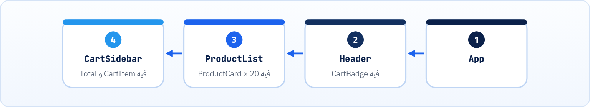

<small>المرحلة 4 · ليه Frameworks</small>

في كورس Jonas هتبني مشاريع بـ querySelector و textContent و classList. وده ممتاز علشان تفهم. بس لما المشروع يكبر، هتلاقي نفسك بتطارد Bugs من نوع «الرقم فوق مش زي الرقم تحت». الفصل ده بيوريك المشكلة دي بكود حقيقي، وبيجرّب الحل «الساذج» ويوريك بيقع فين بنتيجة حقيقية من Chrome، وبعدين بيشرح الأفكار التلاتة اللي كل Framework حديث مبني عليها: الـ Components والـ State والـ UI الـ Declarative.

:::note[بعد الفصل ده هتكون عارف]
- المشكلة: نفس المعلومة ظاهرة في كذا مكان في الصفحة
- الكود الـ Imperative: انت بتقول للمتصفح كل خطوة
- الحل الساذج: ارسم كل حاجة من الأول، وليه بيبوظ
- UI = f(state): الفكرة اللي غيّرت كل حاجة
- الـ State والـ Derived state
- الـ Components والـ Props
- إزاي الـ Frameworks بتحدّث الـ DOM بكفاءة: Virtual DOM والـ Signals والـ Compiler
- إمتى متحتاجش Framework خالص
:::

<a id="s11-1"></a>

## 11.1 Bug صغير في عربية تسوّق

تخيّل صفحة متجر فيها 3 أماكن بتعرض حاجة عن السلة: رقم صغير على أيقونة السلة فوق، وقايمة المنتجات في السايدبار، والإجمالي تحت. والكود اللي كتبته بالطريقة اللي بتتعلمها دلوقتي:

```js title="cart.js · Imperative"
const cart = []

function addToCart(product) {
  cart.push(product)

  // 1) الرقم اللي فوق
  document.querySelector('#badge').textContent = cart.length

  // 2) القايمة
  const li = document.createElement('li')
  li.textContent = product.name
  document.querySelector('#cart-list').append(li)

  // 3) الإجمالي
  const total = cart.reduce((sum, p) => sum + p.price, 0)
  document.querySelector('#total').textContent = total
}

function removeFromCart(id) {
  const i = cart.findIndex((p) => p.id === id)
  cart.splice(i, 1)
  document.querySelector('#badge').textContent = cart.length
  document.querySelector(`[data-id="${id}"]`).remove()
  // نسيت أحدّث الإجمالي!
}
```

شايف الـ Bug؟ في `removeFromCart` نسينا الإجمالي. فالمستخدم يشيل منتج، والرقم اللي فوق ينقص، والقايمة تتغير، والإجمالي **لسه زي ما هو**. ومحدش هياخد باله غير عميل زعلان.

وده مش لأنك مبرمج وحش. ده لأن الطريقة نفسها بتطلب منك تفتكر **كل مكان** في الصفحة بيعرض نفس المعلومة، **في كل Function** بتغيّرها. 3 أماكن × 5 Functions (إضافة، حذف، تغيير كمية، كوبون، تفريغ) = 15 حتة لازم تفتكرها. وزوّد مكان رابع (رسالة "الشحن مجاني فوق 500")، ارجع عدّل الـ 5 Functions.

:::note[الاسم الرسمي للمشكلة]
دي اسمها **مزامنة الـ UI مع الـ State** (أو مزامنة الـ DOM). عندك **بيانات** (السلة) و**شكل** بيعرضها (الـ DOM)، ولازم يفضلوا متطابقين دايماً. والكود اللي فوق اسمه **Imperative** (أمري): انت بتقول للمتصفح "اعمل كذا وبعدين كذا" خطوة بخطوة.
:::

<a id="s11-2"></a>

## 11.2 الحل الساذج: ارسم كل حاجة من الأول

فكرة ذكية: بدل ما نحدّث كل حتة، نعمل Function واحدة اسمها `render()` بترسم **الصفحة كلها** من البيانات، وننديها بعد أي تغيير. مستحيل ننسى حاجة! جرّبنا ده فعلاً:

```js title="naive.html"
const state = { items: ['Milk'], draft: '' }

function render() {
  document.querySelector('#app').innerHTML = `
    <h1>Cart (${state.items.length})</h1>
    <input id="draft" value="${state.draft}">
    <ul>${state.items.map((i) => `<li>${i}</li>`).join('')}</ul>`

  document.querySelector('#draft').addEventListener('input', (e) => {
    state.draft = e.target.value
    render()
  })
}
render()
```

وفتحناه في Chrome (بـ Puppeteer)، وضغطنا على الخانة، وكتبنا كلمة `Bread` حرف حرف:

```text title="Chrome · the real result"
focused before typing: draft
state.draft: "B"
input value: "B"
focused after typing: "BODY"
```

كتبنا 5 حروف، ووصل **حرف واحد**! ليه؟ أول حرف نده `render()`، و`innerHTML` **مسح** الخانة القديمة وعمل واحدة جديدة مكانها. الجديدة شكلها نفس القديمة بالظبط، بس مش هي. فالـ Focus ضاع (راح للـ `BODY`)، والحروف الباقية راحت في الهوا. وكمان لو كان فيه Scroll أو نص متعلّم أو Animation شغالة، كلها هتضيع. وده غير إن رسم الصفحة كلها مع كل حرف بطيء لو الصفحة كبيرة.

:::caution[وفيه مشكلة أمان كمان]
لو `state.draft` فيه `` (حد كتبه في الخانة أو جه من API)، الـ `innerHTML` هيشغّله كـ HTML حقيقي. دي ثغرة اسمها **XSS**. والـ Frameworks بتحميك منها افتراضياً: React بتعامل أي نص كنص.
:::

يعني الفكرة صح (ارسم من البيانات)، بس التنفيذ غلط (امسح وارسم). محتاجين حاجة تاخد "الشكل اللي المفروض يبقى" وتقارنه بـ "الشكل الموجود"، وتغيّر **الفرق بس**: الرقم في الـ `h1` يتغير، والخانة **تفضل هي نفسها**. ده بالظبط اللي الـ Frameworks بتعمله.

<a id="s11-3"></a>

## 11.3 UI = f(state): الفكرة اللي غيّرت كل حاجة

الـ Frameworks الحديثة كلها مبنية على معادلة واحدة: **الشكل دالة في البيانات**. انت بتوصف "لو البيانات كذا، الشكل يبقى كذا"، والـ Framework يتولى الباقي.


*انت مسؤول عن أول خطوتين بس. تغيّر البيانات، والشكل يتبعها لوحده، في كل مكان بيعرضها.*

#### Imperative (أمري)

زي ما تركب تاكسي وتقول للسواق: "يمين، وبعدين تاني شمال، اقف عند الإشارة، ادخل الشارع اللي بعد الجامع". لو غلطت في خطوة، هتتوه.

#### Declarative (وصفي)

زي ما تطلب Uber وتحط العنوان. انت قلت **عايز توصل فين**، والتطبيق بيقرر **إزاي**. والـ Frameworks كده: انت بتقول الشكل، وهي تقرر الخطوات.

ونفس السلة بأسلوب Declarative (ده شكل React تقريباً، متقلقش من التفاصيل، ده للفكرة):

```jsx title="Cart.jsx · Declarative"
function Cart({ items }) {
  const total = items.reduce((sum, p) => sum + p.price, 0)
  return (
    <>
      <span className="badge">{items.length}</span>
      <ul>
        {items.map((p) => <li key={p.id}>{p.name}</li>)}
      </ul>
      <p>Total: {total}</p>
    </>
  )
}
```

مفيش `querySelector` ولا `textContent` ولا `append`. مفيش "نسيت أحدّث الإجمالي"، لأن الإجمالي **بيتحسب** من `items` كل مرة. تضيف ولا تحذف ولا تفرّغ: نفس الوصف.

<a id="s11-4"></a>

## 11.4 التلات أفكار اللي هتقابلها في React

### 1 · الـ State: البيانات اللي بتتغير

الـ **State** = أي معلومة بتتغير مع الوقت والشكل لازم يتبعها: محتوى السلة، الخانة فيها إيه، القايمة مفتوحة ولا مقفولة، البيانات اللي جت من API. وفيه نوع مهم اسمه **Derived state**: حاجة **بتتحسب** من State تانية، زي `total` و`items.length`. والقاعدة الذهبية: **متخزّنش حاجة تقدر تحسبها**. لو خزّنت `total` في متغير لوحده، رجعت لنفس مشكلة "نسيت أحدّثه".

### 2 · الـ Components: قطع ليجو

الـ **Component** = حتة UI ليها اسم، بتاخد بيانات (اسمها **Props**) وبترجّع شكل. زي Function: نفس المدخلات = نفس الشكل.



*الصفحة شجرة Components. ProductCard اتكتب مرة واتستخدم 20 مرة بـ Props مختلفة. وده بيشبه الـ Landmarks والـ Semantic HTML اللي اتعلمتها: كل حتة ليها اسم ودور.*

### 3 · الـ Declarative UI

زي ما شفنا: بتوصف **إيه** مش **إزاي**. وده بيغيّر طريقة تفكيرك: بدل "لما يضغط على الزرار، افتح المينيو"، بتفكر "لو `isOpen` بـ true، المينيو ظاهر". والزرار بيغيّر `isOpen` وبس.

<a id="s11-5"></a>

## 11.5 إزاي بيحدّثوا الفرق بس؟ تلات مدارس

كلهم بيحلوا نفس المشكلة (يغيّروا الفرق بس، والخانة تفضل هي نفسها)، بس بطرق مختلفة:

**تلات طرق لنفس الهدف**

| المدرسة | الفكرة | مين |
|---|---|---|
| **Virtual DOM** | كل ما الـ State تتغير، الـ Component يتنفّذ تاني ويطلّع "وصف" للشكل كـ Objects في الـ Memory. الـ Framework يقارن الوصف الجديد بالقديم (**Diffing**)، ويغيّر في الـ DOM الحقيقي الفرق بس. | React (وفيه React Compiler بيقلل الشغل اللي ملوش لازمة) |
| **Signals / Reactivity** | كل قيمة في الـ State "عارفة" مين بيستخدمها. لما تتغير، بتحدّث الأماكن دي بس، من غير ما تقارن حاجة. | Vue (`ref`)، و Angular (`signal`)، و Svelte 5 (`$state`)، و Solid |
| **Compiler** | أداة الـ Build بتقرا الكومبوننت وتكتب كود JS أمري جاهز بيغيّر الأماكن الصح بالظبط. يعني الـ Framework نفسه بيختفي تقريباً من الناتج. | Svelte أشهر مثال |

وانت كمستخدم React مش محتاج تفهم الـ Diffing بالتفصيل دلوقتي. المهم تفهم: **انت بتغيّر الـ State، والـ Framework بيغيّر الـ DOM**. ولو لقيت نفسك بتكتب `document.querySelector` جوه React، غالباً فيه حاجة غلط.

<a id="s11-6"></a>

## 11.6 إمتى متحتاجش Framework خالص؟

مش كل موقع محتاج React. صفحة هبوط، مدونة، صفحة بروفايل، موقع شركة صغيرة، كلها HTML و CSS وشوية JS بتكفّيها جداً، وهتبقى أسرع وأبسط. الـ Framework بيستاهل لما يبقى عندك **State كتير بتتغير** وبتظهر في **أماكن كتير**: Dashboard، تطبيق شات، متجر فيه سلة وفلاتر، أي "تطبيق" مش "صفحة". والمشروع النهائي في الكتاب ده (فصل 26) معمول من غير Framework عن قصد.

**المصادر الرسمية:** [React · Thinking in React](https://react.dev/learn/thinking-in-react) · [React · Reacting to Input with State](https://react.dev/learn/reacting-to-input-with-state) · [MDN · Introduction to client-side frameworks](https://developer.mozilla.org/en-US/docs/Learn_web_development/Core/Frameworks_libraries/Introduction) · [MDN · Cross-site scripting (XSS)](https://developer.mozilla.org/en-US/docs/Web/Security/Attacks/XSS)

:::tip[ملخص الفصل]
- المشكلة: نفس البيانات ظاهرة في كذا مكان، والكود الـ Imperative لازم يفتكر يحدّثهم كلهم.
- الحل الساذج (`innerHTML` لكل حاجة) بيضيّع الـ Focus والكتابة (جرّبناها: 5 حروف وصل منهم 1)، وبطيء، وفيه خطر XSS.
- الفكرة الحديثة: <strong>UI = f(state)</strong>. توصف الشكل، والـ Framework يغيّر الفرق بس.
- الـ State بيانات بتتغير، والـ Derived state بتتحسب ومتتخزنش.
- الـ Components قطع ليها اسم بتاخد Props.
- تلات مدارس: Virtual DOM (React)، و Signals (Vue و Angular و Svelte)، و Compiler (Svelte).
- موقع بسيط مش محتاج Framework.
:::

### صح ولا غلط؟

1. `innerHTML` بيحافظ على الـ Focus في الخانة لو شكلها متغيرش.
2. الإجمالي في السلة مثال على Derived state.
3. كل موقع محترم لازم يتعمل بـ Framework.

### أسئلة مراجعة

1. اشرح الفرق بين Imperative و Declarative بمثال من حياتك.
2. ليه الكتابة في `naive.html` وصلت حرف واحد بس؟
3. ليه "متخزّنش حاجة تقدر تحسبها"؟
4. إيه الفرق بين طريقة Virtual DOM وطريقة Signals؟

### تحديات الفصل

<small>جرّبها بإيدك، والحلول في ملحق الإجابات.</small>

1. **[سهل]** شغّل `naive.html` بنفسك (فايل HTML عادي)، وجرّب تكتب في الخانة، وشوف المشكلة بعينك.
2. **[متوسط]** صلّح `naive.html` من غير Framework: خلّي `render()` متلمسش الخانة، وتحدّث الـ `h1` والـ `ul` بس. لاحظ الكود بقى أعقد قد إيه.
3. **[صعب]** اكتب عربية التسوّق بالـ Imperative بـ 5 Functions (إضافة، حذف، كمية، كوبون، تفريغ) و4 أماكن عرض. وبعدين اكتبها تاني بـ `state` واحد و`render` لكل جزء لوحده. قارن عدد السطور وعدد الأماكن اللي ممكن تنسى فيها.
