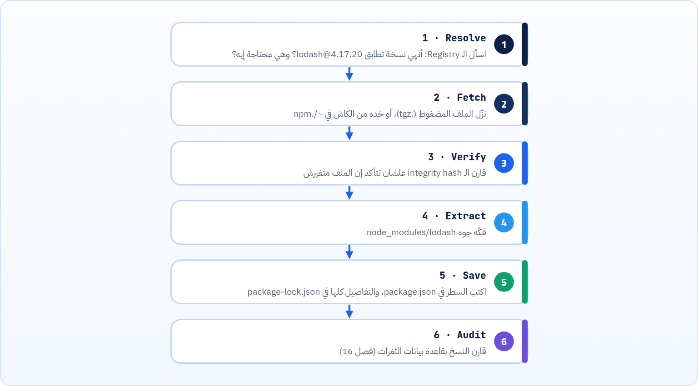

<small>المرحلة 5 · npm بالتفصيل</small>

أول أمر في أي كورس React هو npm create، وبعده npm install، وفجأة عندك فولدر اسمه node\_modules فيه مية Package. الفصل ده بيشرح من الصفر: يعني إيه Package، و npm بيتكون من إيه، وإيه اللي بيحصل بالظبط لما تكتب npm install، وإيه node\_modules و .bin، والفرق بين التسطيب المحلي والـ Global، و npx بيعمل إيه. وكل Output في الفصل حقيقي من Node 24.22.1 و npm 11.19.1.

:::note[بعد الفصل ده هتكون عارف]
- Node على الماك: تسطّبه إزاي وتتأكد منه
- يعني إيه Package، و npm = موقع + Registry + أداة
- npm init -y بيعمل إيه (والـ type commonjs الجديد)
- npm install خطوة بخطوة: Resolve و Download و node\_modules و Lockfile
- جوه node\_modules: Hoisting و .bin والـ Packages الخاصة بالماك
- -D و -E و uninstall و npm ls
- محلي ولا Global: ليه الأفضل محلي
- npx و npm create و npm exec، والـ -- بيعمل إيه
:::

:::note[انت استخدمت npm قبل كده]
لو مشيت بالترتيب، فإنت كتبت `npm install` وشغّلت `node file.mjs` في كتاب APIs و JSON، وشفت `node_modules` في كتاب Git، وعرفت npm في دقيقة في كتاب الـ Terminal (فصل 11). الفصل ده والفصول اللي بعده بيشرحوا اللي كان بيحصل ورا الأوامر دي بالتفصيل.
:::

<a id="s13-1"></a>

## 13.1 ليه محتاجين npm أصلاً؟

تخيّل عايز تعرض "منذ 3 دقايق" جنب كل تعليق. ممكن تكتبها بنفسك: ثواني ودقايق وساعات وأيام وشهور، والجمع والمفرد، والمناطق الزمنية… أو تستخدم كود حد كتبه واختبره ملايين الناس قبلك. زمان كنت هتروح موقعه، تنزّل ملف `.js`، وتحطه في فولدر، وتفتكر تحدّثه كل فترة بإيدك. ولو هو نفسه بيعتمد على مكتبة تانية، تنزّلها هي كمان. ومع 20 مكتبة؟ كارثة.

**npm** حل المشكلة دي: سطر واحد بينزّل المكتبة وكل اللي بتعتمد عليه، وبيكتب النسخة، وأي حد في الفريق يقدر يجيب **نفس** الحاجة بالظبط بأمر واحد.

<a id="s13-2"></a>

## 13.2 Node على الماك

**Node.js** = برنامج بيشغّل JavaScript برة المتصفح (فصل 2). و**npm** بييجي معاه جوه نفس التسطيبة. فيه كذا طريقة تسطّبه على الماك، وكلهم على `nodejs.org/en/download`:

**طرق تسطيب Node على الماك**

| الطريقة | الأمر أو المكان | مناسبة لـ |
|---|---|---|
| Installer رسمي | ملف `.pkg` من nodejs.org | أسهل حاجة، نسخة واحدة |
| Homebrew | `brew install node` (كتاب الـ Terminal فصل 11) | لو كل برامجك من brew |
| مدير نسخ | `nvm` أو `fnm` | لو هتحتاج أكتر من نسخة (مشروع قديم على Node 20 ومشروع جديد على 24) |

أياً كانت الطريقة، اختار نسخة **LTS** (Long-Term Support). وقت الكتابة: **Node 24.22.1 LTS** (والـ Current هي 26.12.1، دي للي عايز أحدث المميزات). والـ Node 24 جاي معاه **npm 11.19.1**. اتأكد:

```sh title="Terminal"
$ node -v
v24.22.1
$ npm -v
11.19.1
$ npx --version
11.19.1
```

:::note[الـ LTS يعني إيه؟]
Node بيطلع نسخة كبيرة كل 6 شهور. النسخ الزوجية (20 و 22 و 24 و 26) بتبقى **LTS**: بتاخد تحديثات أمان وإصلاحات لحوالي 3 سنين. والفردية (25) بتعيش شهور قليلة. فللشغل الحقيقي: زوجية LTS. و`engines` في `package.json` بتاع Vite 8 بيطلب `^20.19.0 || >=22.12.0`، يعني أي LTS حديث هيشتغل.
:::

<a id="s13-3"></a>

## 13.3 npm = 3 حاجات بنفس الاسم

#### الـ Registry

سيرفر ضخم (`registry.npmjs.org`) فيه كل الـ Packages وكل نسخها. ده "المخزن". وسألنا npm عنه: `npm config get registry` رجّع `https://registry.npmjs.org/`.

#### الـ CLI

الأمر `npm` اللي على جهازك. بيكلّم الـ Registry، وبينزّل، وبيكتب الملفات. ده اللي هنشرحه.

#### الموقع

`npmjs.com`: تدوّر على Package، وتقرا الـ README، وتشوف عدد التنزيلات وآخر تحديث والـ License.

#### والـ Package نفسه؟

أي فولدر فيه ملف `package.json`. بس كده. مشروعك نفسه Package، و`vite` Package، و`react` Package.

<a id="s13-4"></a>

## 13.4 npm init: أول package.json

```sh title="Terminal"
$ mkdir npm-play && cd npm-play
$ npm init -y
Wrote to /…/npm-play/package.json:

{
  "name": "npm-play",
  "version": "1.0.0",
  "description": "",
  "main": "index.js",
  "scripts": {
    "test": "echo \"Error: no test specified\" && exit 1"
  },
  "keywords": [],
  "author": "",
  "license": "ISC",
  "type": "commonjs"
}
```

| الأمر | بيعمل إيه |
|---|---|
| `npm init` | بيعمل `package.json` بأسئلة (الاسم؟ النسخة؟ …). |
| `-y / --yes` | "قول آه لكل الأسئلة" وخد الافتراضي. الاسم بياخده من اسم الفولدر. |
| `"type": "commonjs"` | جديد في npm 11: بيكتبها صريحة. معناها إن ملفات `.js` هنا بتستخدم `require()` القديم مش `import`. وقوالب Vite بتكتب `"type": "module"`. هنشرح الفرق في فصل 14 و 17. |

وكل مفتاح في الملف ده هنشرحه في الفصل الجاي. دلوقتي خلينا نسطّب حاجة.

<a id="s13-5"></a>

## 13.5 npm install: إيه اللي بيحصل بالظبط

```sh title="Terminal"
$ npm install lodash@4.17.20

added 1 package, and audited 2 packages in 390ms

1 high severity vulnerability

To address all issues, run:
  npm audit fix --force

Run `npm audit` for details.
```

(النسخة القديمة دي اخترناها عن قصد علشان فيها ثغرات معروفة، وهنستخدمها في فصل 15 و 16. فمتسطّبهاش في مشروع حقيقي.)



*ست خطوات ورا أمر واحد. والجملة «audited 2 packages» معناها مشروعك + lodash.*

وده اللي اتغير في المشروع:

```json title="package.json (الجزء الجديد)"
"dependencies": {
  "lodash": "^4.17.20"
}
```

لاحظ: طلبنا `4.17.20` بالظبط، و npm كتب `^4.17.20`. العلامة `^` دي معناها "4.17.20 أو أحدث، بشرط يفضل 4.x". ودي أهم حاجة في npm كله، وليها فصل لوحدها (فصل 15). ومعاها اتعمل ملف `package-lock.json` وفولدر `node_modules`.

<a id="s13-6"></a>

## 13.6 جوه node\_modules

سطّبنا قالب Vite الـ Vanilla (اللي فيه Package واحد بس في `devDependencies`: `vite`)، وبصينا جوه:

```sh title="Terminal"
$ npm install
added 15 packages, and audited 16 packages in 3s
$ ls node_modules
@oxc-project  fdir         lightningcss-linux-x64-gnu  picocolors  rolldown        vite
@rolldown     lightningcss nanoid                      picomatch   source-map-js
detect-libc   postcss      tinyglobby
$ ls node_modules/.bin
nanoid  rolldown  vite
$ du -sh node_modules
 34M	node_modules
```

| الأمر | بيعمل إيه |
|---|---|
| `15 packages` | انت طلبت واحد (`vite`)، بس `vite` نفسه محتاج `rolldown` و`postcss` و`lightningcss`…، ودول محتاجين حاجات. دي اسمها **Transitive dependencies** (اعتماديات الاعتماديات). |
| `كلهم في نفس المستوى` | npm بيحطهم كلهم جنب بعض في `node_modules` مباشرة بدل ما كل واحد جوه اللي محتاجه. ده اسمه **Hoisting** (التسطيح). لو اتنين محتاجين نسختين مختلفتين من نفس الـ Package، واحدة بتتحط فوق والتانية جوه الـ Package اللي محتاجها. |
| `@oxc-project و @rolldown` | الـ `@` = **Scope**: Namespace لمؤسسة أو شخص. `@rolldown/binding-…` كله تبع فريق Rolldown، ومحدش غيرهم يقدر ينشر تحت الاسم ده. |
| `lightningcss-linux-x64-gnu` | Package **مخصوص لنظام التشغيل**. احنا جرّبنا على Linux، فنزل نسخة Linux. على ماك M1/M2/M3/M4 هينزل `lightningcss-darwin-arm64` بدلها (الـ Registry بيقول عليه `os = 'darwin'` و`cpu = 'arm64'`). وده سبب إنك **متنسخش** `node_modules` من جهاز لجهاز: نسخة الماك مش هتشتغل على Linux والعكس. |
| `node_modules/.bin` | فولدر مخفي فيه الأوامر اللي الـ Packages بتوفّرها. `vite` هنا ده اللي بيشتغل لما تكتب `npm run dev`. (الـ Package بيعلن عنها في مفتاح `bin`: `vite` بيقول `"vite": "bin/vite.js"`.) |
| `34M` | علشان Package واحد. ومشروع React بـ ESLint طلع 90M (فصل 2). عادي، ومش بيترفع على Git. |

وتقدر تشوف الشجرة بـ `npm ls`:

```sh title="Terminal"
$ npm ls
vanilla-app@0.0.0 /…/vanilla-app
└── vite@8.3.5
$ npm ls --all
vanilla-app@0.0.0 /…/vanilla-app
└─┬ vite@8.3.5
  ├── UNMET OPTIONAL DEPENDENCY @types/node@^20.19.0 || >=22.12.0
  ├── UNMET OPTIONAL DEPENDENCY fsevents@~2.3.3
  ├── UNMET OPTIONAL DEPENDENCY less@^4.0.0
  …
  ├─┬ lightningcss@1.33.0
  │ ├── detect-libc@2.1.2
  │ ├── UNMET OPTIONAL DEPENDENCY lightningcss-darwin-arm64@1.33.0
  │ ├── UNMET OPTIONAL DEPENDENCY lightningcss-darwin-x64@1.33.0
  │ ├── lightningcss-linux-x64-gnu@1.33.0
  …
  ├─┬ postcss@8.5.31
  │ ├── nanoid@3.3.20
  │ ├── picocolors@1.1.1
  │ └── source-map-js@1.2.2
  ├─┬ rolldown@1.2.15
  …
```

| الأمر | بيعمل إيه |
|---|---|
| `npm ls` | الـ Packages اللي **انت** طلبتها بس (المستوى الأول). |
| `--all` | الشجرة كاملة. |
| `UNMET OPTIONAL DEPENDENCY` | مش Error. ده Package **اختياري** متسطبش، لسببين: يا إما لنظام تاني (نسخة الماك `darwin-arm64` على جهاز Linux، و`fsevents` اللي بيراقب الملفات على الماك بس)، يا إما حاجة Vite بيستخدمها **لو** انت سطبتها (زي `less` لو بتكتب Less). على الماك بتاعك هتلاقي نسخة الماك متسطبة ونسخة Linux هي اللي UNMET. |
| `npm ls vite / npm explain lodash` | "مين جاب الـ Package ده؟". `npm explain lodash` رد: `lodash@"^4.17.20" from the root project`. مفيد جداً لما `npm audit` يقولك على ثغرة في Package انت عمرك ما سطبته. |

<a id="s13-7"></a>

## 13.7 Flags التسطيب اللي هتستخدمها

**npm install وأصحابه**

| الأمر | بيعمل إيه |
|---|---|
| `npm install` (أو `npm i`) | من غير اسم: سطّب كل اللي في `package.json`. أول أمر بعد ما تعمل `git clone` لأي مشروع. |
| `npm i react` | سطّب وزوّد في `dependencies` (الكود اللي هيروح للمتصفح). |
| `npm i -D eslint` | `-D` = `--save-dev`: في `devDependencies` (أدوات). |
| `npm i -E prettier` | `-E` = `--save-exact`: اكتب `3.9.10` من غير `^`. Prettier نفسه بيطلب كده في الدوكيومنتيشن، لأن كل نسخة ممكن تغيّر شكل التنسيق. |
| `npm i ms@~2.0.0` | نسخة أو Range معين بعد `@`. و`@latest` = أحدث نسخة. |
| `npm uninstall ms` | امسح من `node_modules` ومن `package.json` والـ Lockfile. (اختصاراته: `un` و`rm` و`remove`.) |
| `npm ci` | تسطيب "نظيف" من الـ Lockfile بالحرف (فصل 15). |

جرّبنا `-D -E` وبعدها `~`، ودي النتيجة في `package.json`:

```json
"dependencies": {
  "lodash": "^4.17.20",
  "ms": "~2.0.0"
},
"devDependencies": {
  "is-number": "7.0.0"
}
```

<a id="s13-8"></a>

## 13.8 محلي ولا Global؟

كل اللي فات كان **محلي** (Local): جوه فولدر المشروع. وفيه نوع تاني: **Global** بـ `-g`، بيتسطب في مكان واحد على الجهاز كله، والأمر بيبقى متاح في أي فولدر في الـ Terminal. علشان منلخبطش الجهاز، جرّبناه في فولدر تجريبي بـ `--prefix`:

```sh title="Terminal"
$ npm install -g cowsay --prefix /tmp/gdemo
$ ls /tmp/gdemo/bin
cowsay  cowthink
$ npm ls -g --depth=0 --prefix /tmp/gdemo
/tmp/gdemo/lib
└── cowsay@1.6.0
```

ومن غير `--prefix`، المكان بيتحدد بـ `npm prefix -g`. على جهاز التجربة طلع `/home/box/.local`. وعلى الماك، لو Node من Homebrew غالباً هيطلع `/opt/homebrew` (على أجهزة Apple Silicon)، فالـ Packages في `/opt/homebrew/lib/node_modules` والأوامر في `/opt/homebrew/bin` اللي في الـ PATH بتاعك (كتاب الـ Terminal). جرّب الأمر عندك.

:::tip[القاعدة: محلي دايماً، تقريباً]
لو سطبت Vite **Global**، كل مشاريعك هتستخدم نفس النسخة. ومشروع قديم محتاج Vite 6 ومشروع جديد محتاج Vite 8؟ مشكلة. وزميلك اللي عمل `git clone` مش هيلاقي Vite خالص. فالأدوات اللي مشروعك محتاجها (Vite و ESLint و Prettier و TypeScript) تتسطب **محلي** بـ `-D`، فتتكتب في `package.json` وكل الفريق ياخد نفس النسخة. الـ Global بس لأدوات **انت** بتستخدمها على الجهاز كله مش تبع مشروع، زي CLI بتاع Vercel أو Netlify (فصل 25). وحتى دول تقدر تشغّلهم بـ `npx` من غير تسطيب.
:::

:::danger[مشكلة: EACCES: permission denied مع npm install -g]
**العَرَض**: `npm install -g …` بيفشل بـ `EACCES`.

**السبب**: الـ prefix بتاع npm في فولدر محتاج صلاحيات Admin (بيحصل غالباً مع تسطيبة Node الرسمية من `.pkg`).

**الحل**: <strong>متستخدمش `sudo npm`</strong>، ده بيلخبط صلاحيات الملفات وممكن يشغّل Scripts من Packages كـ root. الحل الرسمي من npm: استخدم مدير نسخ زي nvm أو fnm (بيسطّب في فولدر بتاعك)، أو غيّر الـ prefix لفولدر في الـ Home بتاعك.
:::

<a id="s13-9"></a>

## 13.9 npx: شغّل من غير ما تسطّب

```sh title="Terminal"
$ npx -y cowsay "npx works"
 ___________
< npx works >
 -----------
        \   ^__^
         \  (oo)\_______
            (__)\       )\/\
                ||----w |
                ||     ||
```

| الأمر | بيعمل إيه |
|---|---|
| `npx cowsay` | "شغّل الأمر `cowsay`". لو موجود في `node_modules/.bin` بتاع المشروع، يشغّله. لو مش موجود، ينزّله في كاش مؤقت (مش في مشروعك) ويشغّله. |
| `-y / --yes` | من غيرها، npx هيسألك "Need to install the following packages… Ok to proceed?" قبل ما ينزّل حاجة جديدة. خليها في دماغك: npx ممكن ينزّل كود من الإنترنت ويشغّله، فاتأكد من الاسم (فصل 16). |
| `npx = npm exec` | نفس الحاجة بالظبط، و`npx` اختصار أقصر. |

### npm create = npx create-…

أول أمر في كورس React: `npm create vite@latest`. ده مش أمر سحري. `npm help init` بيقول بالحرف:

```text title="npm help init"
npm init <package-spec> (same as `npx create-<package-spec>`)
npm init <@scope> (same as `npx <@scope>/create`)
```

و`npm create` اسم تاني لـ `npm init`. يعني:

**تشريح الأمر**

```sh
npm create vite@latest my-app -- --template react
```

1. `npm create vite@latest`: = `npx create-vite@latest`: نزّل Package اسمه `create-vite` (أحدث نسخة) وشغّله. ده Package عادي على npm، وقت الكتابة نسخته 9.3.1.
2. `my-app`: بيتبعت لـ `create-vite`: اسم الفولدر.
3. `--`: "اللي بعدي مش لـ npm، ابعته زي ما هو للأمر اللي بيتشغّل". من غيرها npm ممكن يفتكر `--template` Flag ليه هو.
4. `--template react`: Flag لـ `create-vite`: القالب. وشفنا كل القوالب بـ `npx create-vite@latest --help` (فصل 18).

ونفس الفكرة: `npm init @eslint/config@latest` = `npx @eslint/create-config@latest` (فصل 23).

<a id="s13-10"></a>

## 13.10 ليه vite شغال في npm run ومش شغال في الـ Terminal؟

جرّبنا الأمر بتلات طرق في نفس المشروع:

```sh title="Terminal"
$ vite --version
bash: vite: command not found
$ npx vite --version
vite/8.3.5 linux-x64 node-v24.22.1
$ npm run v
> npm-play@1.0.0 v
> vite --version

vite/8.3.5 linux-x64 node-v24.22.1
```

الـ Terminal بيدوّر على الأوامر في الـ **PATH** بس (كتاب الـ Terminal)، و`node_modules/.bin` مش فيه. فـ `vite` لوحدها "command not found" (على الماك بـ zsh: `zsh: command not found: vite`). أما `npx` و`npm run` فبيزوّدوا `node_modules/.bin` للـ PATH مؤقتاً قبل ما يشغّلوا الأمر. علشان كده الـ `scripts` في `package.json` بتكتب `"dev": "vite"` عادي.

**المصادر الرسمية:** [npm Docs · About npm](https://docs.npmjs.com/about-npm) · [npm Docs · npm install](https://docs.npmjs.com/cli/v11/commands/npm-install) · [npm Docs · npm exec (npx)](https://docs.npmjs.com/cli/v11/commands/npm-exec) · [npm Docs · npm init / create](https://docs.npmjs.com/cli/v11/commands/npm-init) · [npm Docs · Folders (prefix, node_modules, .bin)](https://docs.npmjs.com/cli/v11/configuring-npm/folders) · [npm Docs · Resolving EACCES](https://docs.npmjs.com/resolving-eacces-permissions-errors-when-installing-packages-globally) · [Node.js · Download](https://nodejs.org/en/download) · [Node.js · Releases (LTS)](https://nodejs.org/en/about/previous-releases)

:::tip[ملخص الفصل]
- Node بيشغّل JS برة المتصفح، و npm بييجي معاه. اختار LTS (وقت الكتابة 24.22.1 مع npm 11.19.1).
- npm = Registry + CLI + موقع. والـ Package = فولدر فيه `package.json`.
- `npm install`: Resolve ثم Fetch ثم Verify ثم Extract ثم Save ثم Audit.
- `node_modules` فيه الـ Transitive dependencies متسطّحة، و`.bin` فيه الأوامر، وفيه Packages مخصوصة لكل نظام.
- `-D` للأدوات، و`-E` لنسخة بالظبط، و`npm ls` و`npm explain` للشجرة.
- محلي دايماً تقريباً، والـ Global لأدوات الجهاز بس، ومن غير `sudo`.
- `npx` بيشغّل من `.bin` أو ينزّل مؤقتاً، و`npm create x` = `npx create-x`، و`--` بيعدّي الـ Flags للأمر.
:::

### صح ولا غلط؟

1. `npm i -D vite` بيكتب Vite في `dependencies`.
2. ينفع تنسخ `node_modules` من الماك لسيرفر Linux وتشتغل عادي.
3. `npm create vite@latest` بيشغّل Package اسمه `create-vite`.

### أسئلة مراجعة

1. ليه طلبت Package واحد واتسطب 15؟ وإيه اسم الظاهرة دي؟
2. إيه الفرق بين `npm i lodash@4.17.20` واللي اتكتب في `package.json`؟
3. ليه الأفضل تسطّب Vite محلي مش Global؟
4. اشرح وظيفة الـ `--` في `npm create vite@latest my-app -- --template react`.

### تحديات الفصل

<small>جرّبها بإيدك، والحلول في ملحق الإجابات.</small>

1. **[سهل]** شغّل `node -v` و`npm -v` و`npm prefix -g` و`npm config get registry` على الماك بتاعك، واكتب النتايج.
2. **[متوسط]** اعمل مشروع بـ `npm init -y`، وسطّب `vite` بـ `-D`، وبعدين `ls node_modules` ودوّر على الـ Package الخاص بالماك بتاعك (`darwin-arm64` ولا `darwin-x64`؟).
3. **[صعب]** اعمل فولدر جديد، واكتب فيه `package.json` بإيدك (من غير `npm init`) فيه اسم ونسخة بس. سطّب حاجة، وامسح `node_modules` و`package-lock.json`، وشغّل `npm install`. اتأكد إن كل حاجة رجعت. إيه اللي كان ممكن يختلف لو الـ Lockfile اتمسح؟ (الفصل الجاي فيه الإجابة)
