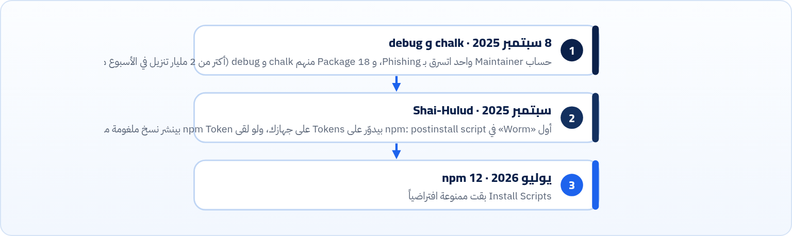
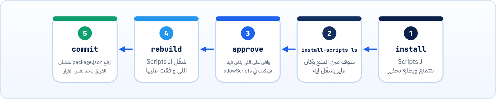

<small>المرحلة 5 · npm بالتفصيل</small>

هتفتح repo على GitHub وتلاقي pnpm-lock.yaml بدل package-lock.json، أو كورس بيقول bun install. ده مش لغة جديدة: دول مديري Packages تانيين بيقروا نفس package.json. والنص التاني من الفصل أهم: لما تكتب npm install، انت بتشغّل كود مئات الناس على جهازك. إزاي تحمي نفسك: npm audit، وهجمات حقيقية حصلت في 2025، والتغيير الكبير في npm 12 اللي بقى بيمنع Install Scripts افتراضياً.

:::note[بعد الفصل ده هتكون عارف]
- تعرف pnpm و Yarn و Bun بيختلفوا في إيه عن npm
- تعرف المشروع بيستخدم أنهي واحد من الـ Lockfile
- تترجم أي أمر بين الأربعة
- تقرا تقرير npm audit وتعرف تصلّح
- تفهم هجمات الـ Supply chain: Typosquatting و Account takeover و postinstall
- allowScripts في npm 12: install-scripts approve و rebuild
- عادات أمان يومية: Lockfile و npm ci و provenance
:::

<a id="s16-1"></a>

## 16.1 ليه فيه أكتر من واحد؟

npm كان بطيء زمان، والـ `node_modules` بيتكرر في كل مشروع. فطلعت بدائل، وكلها بتقرا **نفس** `package.json` ونفس الـ Registry. الفرق في الطريقة اللي بيحطوا بيها الملفات على الجهاز، والسرعة، والـ Lockfile.

<a id="s16-2"></a>

## 16.2 pnpm: نسخة واحدة على الجهاز كله

```sh title="Terminal"
$ npx pnpm@12.15.0 add -D vite
  Content-addressable store is at: /home/box/.local/share/pnpm/store/v11
  Virtual store is at:             node_modules/.pnpm
Packages: +15
+++++++++++++++
Progress: resolved 15, reused 15, downloaded 0, added 15, done

devDependencies:
+ vite 8.3.5

Done in 90ms using pnpm v12.15.0
$ ls -la node_modules
drwxr-xr-x 18 box box 4096 Oct 23 15:47 .pnpm
lrwxrwxrwx  1 box box   34 Oct 23 15:47 vite -> .pnpm/vite@8.3.5/node_modules/vite
```

| الأمر | بيعمل إيه |
|---|---|
| `Content-addressable store` | مخزن واحد على الجهاز كله، كل ملف فيه متخزن مرة واحدة بس (باسم الـ Hash بتاعه). عشر مشاريع فيها Vite = نسخة واحدة على الديسك. |
| `reused 15, downloaded 0` | ده كان تاني مشروع نسطب فيه Vite بـ pnpm، فالـ 15 Package كانوا في المخزن، ومفيش ولا Package نزل من النت: 90ms. |
| `vite -> .pnpm/…` | جوه `node_modules` مفيش غير `vite` (اللي **انت** طلبته) كـ Symlink (اختصار، كتاب الـ Terminal). والباقي مستخبي في `.pnpm`. |

:::note[الفايدة الخفية: مفيش Phantom dependencies]
مع npm، كل الـ 15 Package متسطّحين جنب بعض (Hoisting، فصل 13)، فتقدر تعمل `import { nanoid } from "nanoid"` وهيشتغل، مع إنك عمرك ما طلبته. ولو Vite بطّل يستخدمه في نسخة جاية، مشروعك هيتكسر فجأة. ودي اسمها **Phantom dependency**. مع pnpm مش هتقدر تعمل import لحاجة مش مكتوبة في package.json بتاعك، فالمشكلة بتبان من الأول.
:::

<a id="s16-3"></a>

## 16.3 Bun و Yarn

```sh title="Terminal"
$ npx bun@1.4.4 add -d vite
Resolving dependencies
Resolved, downloaded and extracted [108]
Saved lockfile

installed vite@8.3.5 with binaries:
 - vite

15 packages installed [353.00ms]
$ ls
bun.lock  node_modules  package.json
```

**Bun** مش مدير Packages بس: ده Runtime كامل زي Node (بيشغّل JS و TS)، ومعاه مدير Packages سريع جداً، و Bundler، و Test runner. والـ `bun.lock` بتاعه ملف نصي. و**Yarn** أقدم بديل (2016، من Facebook). فيه نسختين بتلاقيهم في المشاريع: Yarn 1 (Classic، آخر نسخة 1.22.22 وفي وضع صيانة) و Yarn 4 (Berry، 4.18.1 وقت الكتابة). احنا ماجرّبناش Yarn في الكتاب، فالجدول تحت من الدوكيومنتيشن.

**نفس الشغل بأربع أدوات**

| عايز | npm | pnpm | Yarn | Bun |
|---|---|---|---|---|
| سطّب الكل | `npm install` | `pnpm install` | `yarn` | `bun install` |
| زوّد Package | `npm i react` | `pnpm add react` | `yarn add react` | `bun add react` |
| كـ dev | `-D` | `-D` | `-D` | `-d` |
| امسح | `npm un x` | `pnpm remove x` | `yarn remove x` | `bun remove x` |
| شغّل script | `npm run dev` | `pnpm dev` | `yarn dev` | `bun run dev` |
| شغّل من غير تسطيب | `npx` | `pnpm dlx` | `yarn dlx` | `bunx` |
| للـ CI | `npm ci` | `pnpm i --frozen-lockfile` | `yarn install --immutable` | `bun install --frozen-lockfile` |
| الـ Lockfile | `package-lock.json` | `pnpm-lock.yaml` | `yarn.lock` | `bun.lock` |

:::tip[أستخدم أنهي واحد؟]
- <strong>المشروع موجود؟</strong> استخدم اللي الـ Lockfile بتاعه موجود. متخلطش: لو عملت `npm install` في مشروع pnpm، هيطلعلك `package-lock.json` تاني وكل حاجة هتتلخبط. ومفتاح `packageManager` في package.json بيقولك برضه.
- <strong>بتتعلم؟</strong> npm. كل الكورسات (Jonas و Maximilian) والدوكيومنتيشن بيكتبوه الأول، وجاي مع Node.
- <strong>بعدين؟</strong> pnpm اختيار ممتاز لما يبقى عندك مشاريع كتير. و Bun لو عايز سرعة وبتجرّب.
:::

<a id="s16-4"></a>

## 16.4 انت بتثق في مين بالظبط؟

في مشروع الكتاب النهائي (فصل 26) طلبنا بإيدنا 8 Packages بس، و `npm audit signatures` قال إنه فحص **113** Package. كل واحد منهم كاتبه حد، وأي حد منهم ممكن حسابه يتسرق. وده مش كلام نظري:



*هجمات الـ Supply chain: بدل ما يهاجموا موقعك، بيهاجموا حاجة موقعك بيعتمد عليها.*

### أنواع الهجمات

| الأمر | بيعمل إيه |
|---|---|
| `Account takeover` | سرقة حساب صاحب Package مشهور ونشر نسخة ملغومة (chalk و debug). علشان كده الـ `^` بتاعتك ممكن تجيبها في أي `npm install` لو مفيش Lockfile. |
| `Typosquatting` | Package اسمه قريب من المشهور (حرف زيادة أو ناقص، أو `-js` في الآخر) فيه كود ضار. بيعتمد إنك تكتب الاسم غلط. اتأكد من الاسم من الدوكيومنتيشن الرسمي، مش من الذاكرة. |
| `Install scripts` | `preinstall` و`postinstall` في Package بيشتغلوا على جهازك **وقت التسطيب**، قبل ما تشغّل أي كود. وده اللي Shai-Hulud استخدمه. |

<a id="s16-5"></a>

## 16.5 npm audit

فاكر `lodash@4.17.20` من فصل 13؟

```sh title="Terminal"
$ npm audit
# npm audit report

lodash  <=4.17.23
Severity: high
Command Injection in lodash - https://github.com/advisories/GHSA-35jh-r3h4-6jhm
Regular Expression Denial of Service (ReDoS) in lodash - https://github.com/advisories/GHSA-29mw-wpgm-hmr9
lodash vulnerable to Code Injection via `_.template` imports key names - …
lodash vulnerable to Prototype Pollution via array path bypass in `_.unset` and `_.omit` - …
Lodash has Prototype Pollution Vulnerability in `_.unset` and `_.omit` functions - …
fix available via `npm audit fix`
node_modules/lodash

1 high severity vulnerability

To address all issues, run:
  npm audit fix
```

| الأمر | بيعمل إيه |
|---|---|
| `lodash <=4.17.23` | الـ Range المصاب: أي نسخة لحد 4.17.23. |
| `Severity` | low / moderate / high / critical. |
| `GHSA-…` | رقم الثغرة في قاعدة GitHub Advisory. افتح الرابط تعرف التفاصيل: إمتى بتأثر، وهل انت أصلاً بتستخدم الـ Function المصابة؟ |
| `npm audit fix` | بيحدّث لأقرب نسخة آمنة **جوه الـ Range** (هنا 4.18.1، وبعدها `found 0 vulnerabilities`). |
| `npm audit fix --force` | مسموحله يطلع برة الـ Range، يعني ممكن MAJOR جديد يكسر مشروعك. شوف إيه اللي هيتغير قبلها. |

:::caution[audit مش كل حاجة]
`npm audit` بيقارن بثغرات **معروفة ومسجّلة**. كود ملغوم لسه نازل من ساعة مش هيظهر فيه. وفي نفس الوقت، كتير من التنبيهات بتبقى في devDependencies ومش بتأثر على الموقع نفسه. فاقراه بعقل، ومتتجاهلوش ومتخافش منه.
:::

<a id="s16-6"></a>

## 16.6 npm 12: Install Scripts ممنوعة افتراضياً

في 8 يوليو 2026 نزل npm 12 وبقى `latest` على الـ Registry. أهم تغيير: Install Scripts بتاعة الـ Dependencies **مش هتشتغل** إلا لو انت سمحت. ولاحظ إن Node 24 لسه جاي معاه npm 11.19.1، فلو عايز 12: `npm install -g npm@latest`. جرّبناه بـ `npx npm@12` على `esbuild` (اللي محتاج postinstall علشان ينزّل الـ Binary بتاع نظامك):

```sh title="Terminal"
$ npx npm@12 install esbuild

added 2 packages, and audited 3 packages in 632ms

found 0 vulnerabilities
npm warn install-scripts 1 package had install scripts blocked because they are not covered by allowScripts:
npm warn install-scripts   esbuild@0.28.2 (postinstall: node install.js)
npm warn install-scripts
npm warn install-scripts Run `npm install-scripts ls` to review, or `npm install-scripts approve <pkg>` to allow.
$ npx npm@12 install-scripts approve esbuild
Approved esbuild:
  added esbuild@0.28.2
$ npm pkg get allowScripts
{
  "esbuild@0.28.2": true
}
$ npx npm@12 rebuild
rebuilt dependencies successfully
```



*الطريقة الجديدة في npm 12*

وتغييرات تانية في npm 12 تهمك: Dependencies من Git أو من رابط مباشر بقت ممنوعة افتراضياً (`allow-git` و`allow-remote` = `none`)، و`npm init` مابقاش بيكتب License (كان ISC)، و`npm adduser` اتشال (استخدم `npm login`). وكل ده كان موجود ورا تحذيرات من npm 11.16، فلو شفت `npm warn install-scripts` على npm 11، ده التحضير.

:::note[أي Package محتاج Scripts؟]
اللي فيهم كود Native أو بينزّلوا Binary، زي `esbuild` و`sharp` (الصور). أدوات الكتاب ماطلبتش: جرّبنا `npx npm@12 install -D vite tailwindcss @tailwindcss/vite` وخلص من غير ولا تحذير `install-scripts`، لأن Rolldown و lightningcss بينزّلوا الـ Binary كـ optionalDependency مخصوصة لكل نظام (فصل 13) من غير Scripts. لو حاجة مش شغالة بعد التحديث، أول سؤال: هل فيه Script اتمنع؟ `npm install-scripts ls`.
:::

<a id="s16-7"></a>

## 16.7 عادات أمان يومية

1. <strong>ارفع الـ Lockfile، واستخدم `npm ci` في الـ Deploy.</strong> كده نسخة ملغومة جديدة مش هتدخل لوحدها. والـ `integrity` بيتأكد إن الملف ماتغيرش (فصل 15).
2. <strong>قبل ما تسطب Package جديد:</strong> افتح صفحته على npmjs.com: عدد التنزيلات، وآخر تحديث، ورابط الـ GitHub، والاسم بالحرف.
3. <strong>`npx` بحذر:</strong> بينزّل ويشغّل. اكتب الاسم من الدوكيومنتيشن الرسمي.
4. <strong>Provenance:</strong> `npm audit signatures` على مشروعنا النهائي قال `113 packages have verified registry signatures` و`34 packages have verified attestations`. الـ Attestation (Provenance) = إثبات إن الـ Package اتبنى من كود repo معين على GitHub Actions، مش من جهاز حد. Vite 8.3.5 منهم.
5. **فعّل 2FA** على حسابك في npm و GitHub، ومتحطش Tokens في ملفات بتترفع (فصل 19).
6. <strong>متستخدمش `sudo npm install`</strong> (فصل 13).

**المصادر الرسمية:** [pnpm · Motivation (store و symlinks)](https://pnpm.io/motivation) · [pnpm · pnpm add](https://pnpm.io/cli/add) · [Bun Docs · bun install](https://bun.sh/docs/cli/install) · [Yarn · Getting started](https://yarnpkg.com/getting-started) · [npm Docs · npm audit](https://docs.npmjs.com/cli/v11/commands/npm-audit) · [GitHub Changelog · npm v12 install-time security (8 يوليو 2026)](https://github.blog/changelog/2026-07-08-npm-install-time-security-and-gat-bypass2fa-deprecation/) · [GitHub · npm/cli v12.0.0 release notes](https://github.com/npm/cli/releases/tag/v12.0.0) · [npm Docs · approve-scripts / allowScripts](https://docs.npmjs.com/cli/v12/commands/npm-approve-scripts/) · [npm Docs · Provenance](https://docs.npmjs.com/generating-provenance-statements) · [CISA · Shai-Hulud alert (23 سبتمبر 2025)](https://www.cisa.gov/news-events/alerts/2025/09/23/widespread-supply-chain-compromise-impacting-npm-ecosystem) · [Aikido · chalk و debug compromised (8 سبتمبر 2025)](https://www.aikido.dev/blog/npm-debug-and-chalk-packages-compromised)

:::tip[ملخص الفصل]
- pnpm و Yarn و Bun بيقروا نفس package.json. الفرق في التخزين والسرعة والـ Lockfile.
- pnpm: مخزن واحد + Symlinks، ومفيش Phantom dependencies. Bun: Runtime كامل ومدير Packages سريع.
- استخدم اللي الـ Lockfile بتاعه موجود، ومتخلطش.
- هجمات الـ Supply chain حقيقية: Account takeover و Typosquatting و Install scripts.
- `npm audit` + `audit fix` (من غير `--force` إلا وانت فاهم).
- npm 12: `install-scripts ls/approve` بعدين `rebuild`، والموافقات في `allowScripts`.
:::

### صح ولا غلط؟

1. لو مشروع فيه `pnpm-lock.yaml`، الأحسن تشغّل `npm install` فيه.
2. `npm audit` بيكتشف أي كود ملغوم حتى لو لسه نازل.
3. في npm 12، postinstall بتاع Dependency مش هيشتغل إلا لو موجود في `allowScripts`.

### أسئلة مراجعة

1. إيه هي الـ Phantom dependency؟ وليه pnpm بيمنعها؟
2. ترجم `npm ci` و`npx create-vite` لـ pnpm و Bun.
3. ليه الـ Lockfile + `npm ci` بيحموك من نسخة ملغومة نزلت النهارده؟
4. إيه الفرق بين `npm audit fix` و`npm audit fix --force`؟

### تحديات الفصل

<small>جرّبها بإيدك، والحلول في ملحق الإجابات.</small>

1. **[سهل]** شغّل `npm audit` و`npm audit signatures` على مشروع من الكورس، واكتب النتيجة.
2. **[متوسط]** جرّب `npx pnpm add -D vite` في فولدرين مختلفين، وقارن رقم `downloaded` و`reused` في المرتين.
3. **[صعب]** اعمل مشروع تجربة، وشغّل فيه `npx npm@latest install esbuild`. لو اتمنع، اعمل approve و rebuild، واتأكد إن `node -e "console.log(require('esbuild').version)"` شغال.
