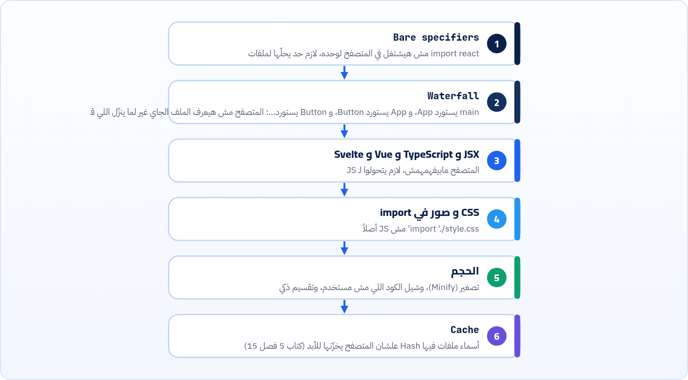

<small>المرحلة 6 · Modules و Vite</small>

في كورس Jonas هتوصل لفصل Modules وتكتب import و export. الفصل ده مش هيعيد شرح الصيغة، هو بيجاوب على أسئلة الإيكوسيستم: المتصفح نفسه بيفهم import إزاي؟ ليه import من npm مش شغال في المتصفح؟ ليه فتح الملف بدبل كليك بيضرب CORS؟ وليه رغم إن المتصفح بيفهم Modules لسه محتاجين Bundler زي Vite؟ كل ده بتجارب في Chrome حقيقي.

:::note[بعد الفصل ده هتكون عارف]
- تعرف الفرق بين ESM و CommonJS من غير ما تتلخبط
- تشغّل Modules في المتصفح من غير أي أداة
- تفهم Error الـ Bare specifier وليه بيحصل
- تفهم ليه file:// بيضرب CORS مع Modules
- تعرف المشاكل اللي الـ Bundler بيحلها
- تشوف Tree-shaking و Code splitting بعينك في Build حقيقي
- تعرف تاريخ الأدوات: Browserify و webpack و Rollup و esbuild و Rolldown
:::

<a id="s17-1"></a>

## 17.1 نظامين، وانت هتقابل الاتنين

#### CommonJS (Node القديم)

```js
const express = require('express')
module.exports = { start }
```

Node عمله سنة 2009 قبل ما JavaScript يبقى فيها Modules رسمي. هتلاقيه في كورسات Node قديمة وكتير من الـ Packages.

#### ES Modules (الرسمي)

```js
import express from 'express'
export { start }
```

جزء من اللغة نفسها من 2015 (ES6). المتصفح بيفهمه، و Node بيفهمه، و Vite و React بيستخدموه. ده المستقبل وده اللي هتكتبه.

و Node بيعرف الملف من أنهي نوع إزاي؟ من `"type"` في package.json أو امتداد `.mjs`/`.cjs` (شفنا الـ Error في فصل 14). المتصفح أبسط: `<script type="module">`.

<a id="s17-2"></a>

## 17.2 Modules في المتصفح من غير أي أداة

تلات ملفات، من غير npm ومن غير Vite:

```html title="index.html"
<script type="module" src="./main.js"></script>
```

```js title="math.js"
export const add = (a, b) => a + b
export default function square(x) {
  return x * x
}
```

```js title="main.js"
import square, { add } from './math.js'
console.log('add:', add(2, 3), 'square:', square(4))
```

شغّلناهم بسيرفر بسيط (`python3 -m http.server`، أو `npx serve`) وفتحنا الصفحة في Chrome:

```sh title="Terminal"
> add: 5 square: 16
```

شغال. المتصفح شاف `import`، فبعت Request تاني لـ `math.js` (هتشوفه في Network، كتاب 5 فصل 18)، ونفّذ. ولاحظ إن `./math.js` كاملة **بالامتداد**: المتصفح مش بيخمّن.

### Error 1: فتح الملف بدبل كليك

```sh title="file:///…/esm/index.html"
x Access to script at 'file:///workspace/book8/lab/esm/main.js' from origin 'null' has been blocked by CORS policy: Cross origin requests are only supported for protocol schemes: chrome, chrome-experimental-site-token-provider, chrome-extension, chrome-untrusted, data, http, https, isolated-app.
x Failed to load resource: net::ERR_FAILED
```

الـ Modules بتتحمّل بقواعد CORS (كتاب 5 فصل 14، وكتاب APIs فصل 13). والصفحة المفتوحة من `file://` الـ Origin بتاعها `null`، فـ Chrome رفض. الحل: أي سيرفر محلي على `http://localhost`. وده واحد من أسباب إن أي مشروع حديث بيبدأ بـ `npm run dev`.

### Error 2: import من npm

```html title="bare.html"
<script type="module">import _ from 'lodash'; console.log(_)</script>
```

```sh title="Terminal"
x Failed to resolve module specifier "lodash". Relative references must start with either "/", "./", or "../".
```

`'lodash'` من غير `./` اسمه **Bare specifier** (اسم "عريان"). Node بيعرف يدوّر عليه في `node_modules`، بس المتصفح مايعرفش يعني إيه `node_modules` أصلاً: هو بيفهم URLs بس. فيه حل رسمي في المتصفح اسمه **Import map** (`<script type="importmap">` بيقول "lodash = الرابط ده")، بس مع مية Package مش عملي. وده بالظبط شغل الـ Bundler: يحوّل `'lodash'` لملف حقيقي.

<a id="s17-3"></a>

## 17.3 ليه Bundler لو المتصفح بيفهم Modules؟



*المشاكل اللي الـ Bundler بيحلها. أول اتنين حتى لو كتبت JS عادي.*

<a id="s17-4"></a>

## 17.4 Tree-shaking و Code splitting بعينك

خدنا قالب Vite الـ Vanilla وكتبنا ملفين. `math.js` فيه Function مش هنستخدمها، و`chart.js` "تقيل" ومش محتاجينه غير لما المستخدم يدوس زرار:

```js title="src/math.js"
export const add = (a, b) => a + b
export const unusedHelper = () =>
  'TREE_SHAKE_ME'
```

```js title="src/chart.js"
export function drawChart(el) {
  el.textContent =
    'chart loaded: ' + 'HEAVY_CHART_CODE'
}
```

```js title="src/main.js"
import { add } from './math.js'

const app = document.querySelector('#app')
app.innerHTML = `<p>2 + 3 = ${add(2, 3)}</p><button id="b">Show chart</button><div id="c"></div>`

document.querySelector('#b').addEventListener('click', async () => {
  // dynamic import: load chart.js only when needed
  const { drawChart } = await import('./chart.js')
  drawChart(document.querySelector('#c'))
})
```

```sh title="Terminal"
$ npx vite build
✓ 7 modules transformed.
rendering chunks...
computing gzip size...
dist/index.html                0.38 kB │ gzip: 0.26 kB
dist/assets/chart-C7XTFmcn.js  0.08 kB │ gzip: 0.10 kB
dist/assets/index-n88G3mra.js  2.52 kB │ gzip: 1.22 kB

✓ built in 61ms
$ grep -l TREE_SHAKE_ME dist/assets/*.js || echo "unusedHelper: not in bundle"
unusedHelper: not in bundle
$ cat dist/assets/chart-C7XTFmcn.js
function e(e){e.textContent=`chart loaded: HEAVY_CHART_CODE`}export{e as drawChart};
```

| الأمر | بيعمل إيه |
|---|---|
| `Tree-shaking` | `unusedHelper` مش موجودة في أي ملف. الـ Bundler شاف إن محدش عملها import فشالها، زي ما بتهز الشجرة فالورق الناشف يقع. وده شغال علشان `import`/`export` ثابتين ويتقروا من غير تشغيل الكود، على عكس `require`. |
| `Code splitting` | `import()` كـ Function (Dynamic import) خلّى `chart.js` ملف لوحده (`chart-C7XTFmcn.js`) مش بيتحمّل غير لما حد يدوس الزرار. في React بتتعمل بـ `lazy()` لصفحات كاملة. |
| `Minify` | `drawChart` اتسمّت `e` جوه الملف، والمسافات اتشالت، وحتى `'chart loaded: ' + 'HEAVY_CHART_CODE'` اتجمعوا في نص واحد وقت البناء. |
| `C7XTFmcn` | Hash من محتوى الملف. لو غيرت `chart.js`، الاسم هيتغير، فالمتصفح هيعرف إنه جديد. ولو ماغيرتوش، يفضل في الـ Cache. |

<a id="s17-5"></a>

## 17.5 تاريخ سريع للأدوات

**هتسمع الأسماء دي في الكورسات والمقالات**

| الأداة | إمتى | الفكرة |
|---|---|---|
| Browserify | 2011 | "خلّي `require` بتاع Node يشتغل في المتصفح". أول Bundler مشهور. |
| webpack | 2012 | كل حاجة Module (CSS وصور وخطوط) بـ Loaders و Plugins. كان أساس `create-react-app` (اللي اتعمله Deprecate في 2025). قوي جداً وإعداداته معقدة. |
| Rollup | 2015 | مبني على ESM من الأول، وأول ما عمل Tree-shaking. Vite لحد نسخة 7 كان بيستخدمه للـ Build. |
| Parcel | 2017 | "Zero config": من غير ملف إعدادات. |
| esbuild | 2020 | مكتوب بـ Go، أسرع 10-100 مرة. Vite لحد 7 كان بيستخدمه في الـ Dev. |
| Vite | 2020 | Dev server بيستخدم ESM بتاع المتصفح مباشرة (من غير Bundle وقت التطوير) + Build سريع. الفصل الجاي. |
| Turbopack | 2022 | من Vercel، مكتوب بـ Rust. الافتراضي في Next.js 16 (فصل 22). |
| Rolldown | 2023 | Rust، من فريق Vite، متوافق مع Rollup. بقى الـ Bundler الوحيد في Vite 8 (مارس 2026) بدل الاتنين (esbuild و Rollup). |

:::note[Bundler ولا Build tool؟]
الـ **Bundler** (Rolldown و webpack) بيجمّع الملفات. والـ **Build tool** (Vite) بيلفّ عليه: Dev server و HMR و env و Plugins. ولما حد يقول "React بـ Vite" يقصد الاتنين. وانت عملياً هتتعامل مع Vite بس، والباقي مستخبي جوه `node_modules` (فاكر `rolldown` في فصل 13؟).
:::

**المصادر الرسمية:** [MDN · JavaScript modules](https://developer.mozilla.org/en-US/docs/Web/JavaScript/Guide/Modules) · [MDN · Import maps](https://developer.mozilla.org/en-US/docs/Web/HTML/Reference/Elements/script/type/importmap) · [MDN · import() (dynamic import)](https://developer.mozilla.org/en-US/docs/Web/JavaScript/Reference/Operators/import) · [Node.js Docs · ECMAScript modules](https://nodejs.org/api/esm.html) · [MDN · Tree shaking](https://developer.mozilla.org/en-US/docs/Glossary/Tree_shaking) · [Vite · Why Vite](https://vite.dev/guide/why) · [Vite · Announcing Vite 8](https://vite.dev/blog/announcing-vite8) · [React Blog · Sunsetting Create React App](https://react.dev/blog/2025/02/14/sunsetting-create-react-app)

:::tip[ملخص الفصل]
- CommonJS (`require`) قديم بتاع Node، و ESM (`import`) رسمي ومستقبل كل حاجة.
- المتصفح بيفهم ESM بـ `type="module"`، بشرط سيرفر (مش `file://`) ومسارات كاملة.
- الـ Bare specifier (`'lodash'`) مش بيشتغل في المتصفح، والـ Bundler بيحلّه.
- الـ Bundler بيحل: الأسماء و الـ Waterfall و JSX/TS و CSS و الحجم و الـ Cache.
- Tree-shaking بيشيل اللي مش مستخدم، و`import()` بيقسّم لملفات بتتحمّل وقت الحاجة.
:::

### صح ولا غلط؟

1. `import x from 'react'` بيشتغل في المتصفح من غير أي أداة.
2. الـ Tree-shaking بيشتغل أحسن مع `import`/`export` من `require`.
3. Vite 8 بيستخدم Rolldown.

### أسئلة مراجعة

1. ليه الصفحة اشتغلت على `http://localhost` وفشلت من `file://`؟
2. اشرح الـ Waterfall بمثال من 3 ملفات.
3. إيه الفرق بين `import { x } from './a.js'` و`await import('./a.js')` في الـ Build؟
4. ليه اسم الملف في `dist` فيه حروف عشوائية؟

### تحديات الفصل

<small>جرّبها بإيدك، والحلول في ملحق الإجابات.</small>

1. **[سهل]** اعمل التلات ملفات بتوع أول الفصل، وشغّلهم بـ `npx serve`، وبص على Network في DevTools: كام Request؟
2. **[متوسط]** افتح نفس الصفحة بدبل كليك من Finder، وشوف الـ Error في Console.
3. **[صعب]** كرر تجربة Tree-shaking و Code splitting في مشروع Vite، وبعدين غيّر سطر في `chart.js` واعمل build تاني. أنهي Hash اتغير؟
