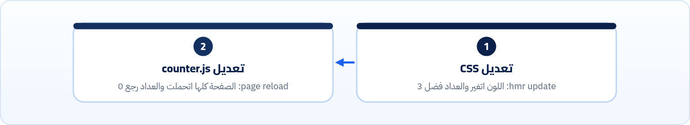

<small>المرحلة 6 · Modules و Vite</small>

أول درس في قسم React عند Jonas هيبدأ بـ npm create vite@latest، وبعدها npm run dev، وصفحة بتظهر في ثانية. الفصل ده بيفتح الصندوق: كل ملف في القالب بيعمل إيه، والـ Dev server بيبعت للمتصفح إيه بالظبط، والـ HMR إزاي بيغيّر الألوان من غير ما العداد يتصفّر، و build بيطلّع إيه في dist، و preview فايدته إيه، وإعدادات vite.config.js اللي هتحتاجها.

:::note[بعد الفصل ده هتكون عارف]
- تعمل مشروع بـ create-vite وتعرف كل Flag
- تشرح كل ملف وفولدر في القالب (public ولا src/assets؟)
- تشوف إيه اللي الـ Dev server بيعدّله في الملفات
- تفهم HMR: إمتى بيحتفظ بالحالة وإمتى بيعمل Reload
- تقرا Output بتاع vite build سطر سطر
- تعرف الفرق بين dev و preview
- تستخدم --host و --port و base في vite.config.js
:::

<a id="s18-1"></a>

## 18.1 create-vite: كل Flag

```sh title="Terminal"
$ npx create-vite@latest --help
Usage: create-vite [OPTION]... [DIRECTORY]

Create a new Vite project in JavaScript or TypeScript.
When running in TTY, the CLI will start in interactive mode.

Options:
  -t, --template NAME                   use a specific template
  -i, --immediate / --no-immediate      install dependencies and start dev
  --eslint / --no-eslint                use ESLint instead of Oxlint (only for React templates)
  --overwrite                           remove existing files if target directory is not empty
  --interactive / --no-interactive      force interactive / non-interactive mode
  -h, --help                            display this help message

Available templates:
vanilla-ts          vanilla
vue-ts              vue
react-ts            react
react-compiler-ts   react-compiler
…
svelte-ts           svelte
solid-ts            solid
qwik-ts             qwik
```

| الأمر | بيعمل إيه |
|---|---|
| `-t / --template` | القالب. `react` بـ JavaScript و`react-ts` بـ TypeScript (فصل 21). و`react-compiler` فيه React Compiler جاهز. |
| `-i / --immediate` | يعمل `npm install` ويشغّل `dev` على طول. |
| `--eslint` | قوالب React بقت بتيجي بـ **Oxlint** (Linter أسرع مكتوب بـ Rust) افتراضياً. لو الكورس بيستخدم ESLint (وده الأغلب)، ضيف `--eslint`. فصل 23. |
| `--no-interactive` | من غير أسئلة. من غيره (في Terminal عادي) هيسألك على الاسم والـ Framework والـ Variant بالأسهم. |
| `--overwrite` | يمسح الفولدر لو موجود وفيه ملفات. خطر، اتأكد من الاسم. |

:::caution[الكورس بيقول create-react-app؟]
لو فيديو قديم بيستخدم `npx create-react-app`: React نفسها أعلنت إنه Deprecated في فبراير 2025 ونصحت بـ Vite أو Framework زي Next.js. ولو الكورس عندك لسه عليه، الفكرة واحدة، والأوامر بتختلف: `npm run dev` بدل `npm start`، وملفات `VITE_` بدل `REACT_APP_` (فصل 19).
:::

<a id="s18-2"></a>

## 18.2 كل ملف في القالب

```sh title="Terminal"
$ npm create vite@latest vanilla-app -- --template vanilla --no-interactive
$ cd vanilla-app && find . -path ./node_modules -prune -o -type f -print | sort
./.gitignore
./index.html
./package-lock.json
./package.json
./public/favicon.svg
./public/icons.svg
./src/assets/hero.png
./src/assets/javascript.svg
./src/assets/vite.svg
./src/counter.js
./src/main.js
./src/style.css
```

| الأمر | بيعمل إيه |
|---|---|
| `index.html` | **نقطة البداية**، وفي الجذر مش جوه public (على عكس أدوات قديمة). Vite بيبدأ منه ويتبع كل `import`. |
| `src/main.js` | أول JS بيشتغل. بيعمل import للـ CSS والصور والـ Counter، ويحط HTML جوه `#app`. في React هتلاقيه `main.jsx` وفيه `createRoot(…).render(<App />)`. |
| `src/counter.js` | مثال Module: Function بتعمل زرار بيعدّ. موجود علشان تجرّب HMR. |
| `src/style.css` | الـ CSS، ومتعمله import من JS (`import './style.css'`). ده مش JS عادي، ده شغل Vite. |
| `src/assets/` | صور بتعملها **import**. Vite بيحسبها: يغيّر اسمها بـ Hash، وأي صورة أصغر من 4 KB بيحطها جوه الـ JS نفسه (javascript.svg 863 بايت فاتحطت كـ `data:image/svg+xml`، و vite.svg 8.7 KB طلعت ملف لوحدها). |
| `public/` | ملفات بتتنسخ **زي ما هي** بنفس الاسم لجذر `dist`: `favicon.svg` و`robots.txt`. بتشاور عليها بـ `/favicon.svg` من غير import. استخدمه للي محتاج اسم ثابت بس. |
| `.gitignore` | جاهز وفيه `node_modules` و`dist` و`*.local` (ملفات env السرية، فصل 19) و`.DS_Store` بتاع الماك. |
| `مفيش vite.config.js؟` | مش محتاجه غير لما تغيّر حاجة. قوالب React فيها واحد علشان Plugin بتاع React. تحت. |

<a id="s18-3"></a>

## 18.3 npm run dev: بيحصل إيه

```sh title="Terminal"
$ npm run dev

  VITE v8.3.5  ready in 135 ms

  ➜  Local:   http://localhost:5173/
  ➜  Network: use --host to expose
```

135ms. مفيش Bundle بيتعمل. Vite بيقدّم الملفات واحد واحد لما المتصفح يطلبها، وبيعدّلها في السكة. بصينا بـ `curl` على اللي بيوصل فعلاً:

```html title="curl localhost:5173/"
<!doctype html>
<html lang="en">
  <head>
    <script type="module" src="/@vite/client"></script>

    <meta charset="UTF-8" />
    …
```

```js title="curl localhost:5173/src/main.js"
import "/src/style.css"
import heroImg from "/src/assets/hero.png?import"
import javascriptLogo from "/src/assets/javascript.svg?import"
import viteLogo from "/src/assets/vite.svg?import"
import { setupCounter } from "/src/counter.js"
```

```js title="curl localhost:5173/src/style.css (مختصر)"
import { createHotContext as __vite__createHotContext } from "/@vite/client";…
const __vite__id = "/…/vanilla-app/src/style.css"
const __vite__css = ":root {\n  --text: #6b6375;\n …"
__vite__updateStyle(__vite__id, __vite__css)
import.meta.hot.accept()
```

| الأمر | بيعمل إيه |
|---|---|
| `/@vite/client` | Script زيادة Vite حطه في الـ HTML: بيفتح اتصال WebSocket مع السيرفر علشان يسمع التغييرات (HMR)، وبيعرض الـ Errors فوق الصفحة. |
| `'./style.css' بقت "/src/style.css"` | المسارات اتحوّلت لمسارات كاملة يفهمها المتصفح. ولو فيه `import 'react'`، هيتحول لمسار جوه `/node_modules/.vite/deps/` (Vite بيجهّز الـ Packages مرة واحدة: ده الـ **Pre-bundling**). |
| `?import` | علامة إن الصورة متعملها import، فـ Vite بيرجّع JS بيقول "رابط الصورة هو …". |
| `CSS بقت JS` | في الـ Dev، الـ CSS بيوصل كـ JS Module بيحط `<style>` في الصفحة، وبيقول `import.meta.hot.accept()`: "لو اتغيرت، بدّلني من غير Reload". |

<a id="s18-4"></a>

## 18.4 HMR: التجربة

فتحنا الصفحة في Chrome، ودوسنا على العداد 3 مرات، وبعدين عدّلنا ملفين وهي مفتوحة:

```sh title="Console في المتصفح"
> [vite] connecting...
> [vite] connected.
> before: Count is 3 rgb(8, 6, 13)
> [vite] hot updated: /src/style.css
> after css edit: Count is 3 rgb(29, 99, 237)
> [vite] connecting...
> [vite] connected.
> after js edit: Clicks: 0
```

```sh title="الـ Terminal اللي فيه npm run dev"
3:52:09 PM [vite] (client) hmr update /src/style.css
3:52:11 PM [vite] (client) page reload src/counter.js
```



*HMR = Hot Module Replacement: بدّل الـ Module بس لو هو بيعرف يستقبل التحديث (accept)*

الـ CSS بيقول `accept` فبيتبدّل في مكانه. لكن `counter.js` العادي مابيقولش، فـ Vite عمل Reload كامل. وده سبب إن React أحلى في HMR: الـ Plugin بتاعها (`@vitejs/plugin-react`) بيخلّي كل Component يعمل accept، فتعدّل Component والـ State بتاعته تفضل زي ما هي (اسمها **Fast Refresh**).

<a id="s18-5"></a>

## 18.5 npm run build

```sh title="Terminal"
$ npm run build
vite v8.3.5 building client environment for production...
transforming...
✓ 9 modules transformed.
rendering chunks...
computing gzip size...
dist/index.html                  0.46 kB │ gzip: 0.29 kB
dist/assets/vite-BF8QNONU.svg    8.70 kB │ gzip: 1.60 kB
dist/assets/hero-CLDdwZDr.png   13.05 kB
dist/assets/index-CsUDhMuy.css   4.10 kB │ gzip: 1.46 kB
dist/assets/index-CAoPt-vL.js    4.05 kB │ gzip: 1.77 kB

✓ built in 65ms
```

| الأمر | بيعمل إيه |
|---|---|
| `client environment` | بيبني الكود اللي هيشتغل في المتصفح. (في SSR فيه Environment تاني للسيرفر، فصل 22.) |
| `9 modules transformed` | عدد الملفات اللي اتعالجت: `index.html` و main و counter و CSS و 3 صور و… |
| `-BF8QNONU` | الـ Hash (فصل 17). `public/` مش هتلاقي فيه Hash (`dist/favicon.svg` زي ما هو). |
| `gzip` | الحجم بعد الضغط اللي السيرفر هيبعته فعلاً (كتاب 5 فصل 9: `Content-Encoding`). الـ PNG مش بيتضغط تاني لأنه مضغوط أصلاً. |
| `dist/` | ده **الموقع**. ملفات ثابتة ترفعها على أي استضافة (فصل 25). ومش بيترفع على Git. |

```html title="dist/index.html"
<head>
  …
  <script type="module" crossorigin src="/assets/index-CAoPt-vL.js"></script>
  <link rel="stylesheet" crossorigin href="/assets/index-CsUDhMuy.css">
</head>
<body>
  <div id="app"></div>
</body>
```

Vite كتب الـ HTML من جديد: `/@vite/client` اختفى، و`/src/main.js` اتبدل بالملف المبني، والـ CSS بقى `<link>` عادي.

<a id="s18-6"></a>

## 18.6 npm run preview

```sh title="Terminal"
$ npm run preview
  ➜  Local:   http://localhost:4173/
  ➜  Network: use --host to expose
```

`preview` بيقدّم فولدر `dist` زي ما هو، على بورت 4173. ده **مش** للتطوير (مفيش HMR، ولازم build تاني بعد أي تعديل). فايدته: تتأكد إن الـ Build نفسه شغال قبل ما ترفعه، لأن حاجات بتشتغل في dev وتبوظ في build (مسار صورة في `public` غلط، أو `base`). وده اللي هنعمله في المشروع النهائي بدل الـ Deploy الحقيقي.

**dev ولا preview**

|   | `npm run dev` | `npm run preview` |
|---|---|---|
| البورت | 5173 | 4173 |
| بيقدّم | ملفات `src` وهو بيحوّلها | `dist` المبني |
| HMR | أيوه | لأ |
| إمتى | طول ما انت بتكتب | قبل الـ Deploy |

<a id="s18-7"></a>

## 18.7 Flags و vite.config.js

```sh title="Terminal"
$ npm run dev -- --host

  VITE v8.3.5  ready in 138 ms

  ➜  Local:   http://localhost:5174/
  ➜  Network: http://172.30.0.2:5174/  enp0s3
```

| الأمر | بيعمل إيه |
|---|---|
| `--host` | افتح للشبكة المحلية. السطر `Network` فيه IP جهازك، فتفتحه من الموبايل على نفس الـ Wi-Fi وتجرّب الـ Responsive بجد. (لو الـ Firewall بتاع الماك شغال، ممكن يسألك تسمح بالاتصالات.) |
| `--port 3000` | بورت تاني. ولو 5173 مشغول، Vite بيقولها صريحة ويجرّب اللي بعده: `Port 5173 is in use, trying another one...` (وده حصل معانا فعلاً، ففتح على 5174). اتأكد من الرابط في الـ Terminal. |
| `--open` | يفتح المتصفح لوحده. |
| `--mode staging` | يحمّل `.env.staging` (الفصل الجاي). |

```js title="vite.config.js (المشروع النهائي)"
import { defineConfig } from 'vite'
import tailwindcss from '@tailwindcss/vite'

// https://vite.dev/config/
export default defineConfig({
  base: '/my-links/',
  plugins: [tailwindcss()],
})
```

| الأمر | بيعمل إيه |
|---|---|
| `defineConfig` | مش بيعمل حاجة غير إن المحرر يقترحلك الخيارات ويكتشف الغلط. |
| `plugins` | إضافات: `react()` لـ JSX و Fast Refresh، و`tailwindcss()` (فصل 20). |
| `base` | المسار اللي الموقع هيتنشر عليه. افتراضياً `/`. لكن GitHub Pages بينشر على `username.github.io/my-links/`، فلازم `'/my-links/'`، وإلا كل الـ CSS والـ JS هيطلعوا 404 (فصل 25). وده بيأثر على dev و preview كمان: في تجربة سابقة بـ `base: '/links-card/'`، الـ preview اشتغل على `http://localhost:4173/links-card/` والـ `/` لوحدها رجّعت 302. |
| `server: { port, open }` | نفس الـ Flags، بس مكتوبة دايماً. |

**المصادر الرسمية:** [Vite · Getting Started](https://vite.dev/guide/) · [Vite · Features (HMR, CSS, assets)](https://vite.dev/guide/features) · [Vite · Static Asset Handling (public)](https://vite.dev/guide/assets) · [Vite · Building for Production](https://vite.dev/guide/build) · [Vite · CLI](https://vite.dev/guide/cli) · [Vite · Config](https://vite.dev/config/) · [Vite · base](https://vite.dev/config/shared-options#base) · [Vite · Dependency Pre-Bundling](https://vite.dev/guide/dep-pre-bundling) · [Vite · HMR API](https://vite.dev/guide/api-hmr)

:::tip[ملخص الفصل]
- `npm create vite@latest name -- --template react`، و`--eslint` لو الكورس بيستخدم ESLint.
- `index.html` في الجذر هو البداية. `src/assets` بـ import و Hash، و`public` زي ما هو.
- الـ Dev server مش بيعمل Bundle: بيقدّم ملف ملف ويعدّل المسارات ويحقن `/@vite/client`.
- HMR بيبدّل الـ Module لو بيعمل accept (CSS و React Components)، وإلا Reload.
- `build` يطلّع `dist` بأسماء فيها Hash، و`preview` يجرّبه على 4173.
- `--host` للموبايل، و`base` لـ GitHub Pages.
:::

### صح ولا غلط؟

1. الملفات اللي في `public/` بتاخد Hash في الاسم.
2. `npm run preview` بيعمل HMR.
3. تعديل ملف CSS في Vite بيحتفظ بحالة الصفحة.

### أسئلة مراجعة

1. ليه Vite بيبدأ في 135ms وأدوات قديمة كانت بتاخد ثواني؟
2. صورة اللوجو بتاعك: تحطها في `public` ولا `src/assets`؟ وإمتى التانية؟
3. ليه counter.js عمل Reload و style.css لأ؟
4. ليه ممكن الموقع يشتغل في dev ويطلع صفحة بيضا بعد الـ Deploy؟

### تحديات الفصل

<small>جرّبها بإيدك، والحلول في ملحق الإجابات.</small>

1. **[سهل]** اعمل مشروع vanilla، وشغّل dev، وافتح Network: لاقي `/@vite/client` و`main.js` وبص على الـ Response.
2. **[متوسط]** شغّل `npm run dev -- --host` وافتح الموقع من موبايلك.
3. **[صعب]** اعمل build، وبعدين افتح `dist/index.html` بدبل كليك. ليه الصفحة فاضية؟ (افتكر فصل 17). وبعدين جرّب `preview`.
