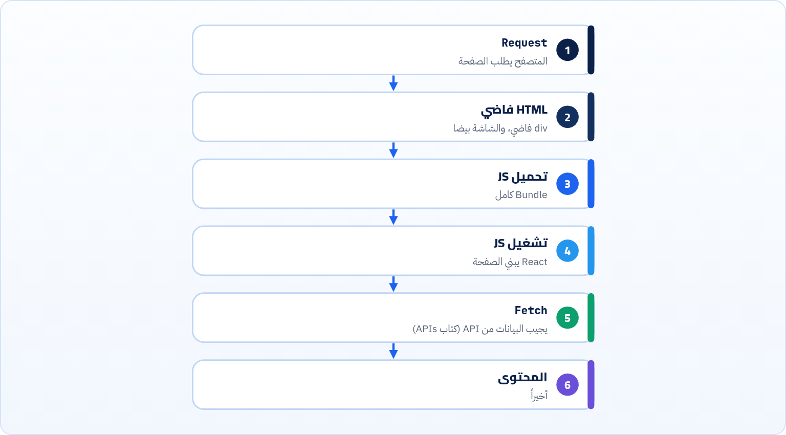

<small>المرحلة 7 · CSS والـ Rendering و TypeScript</small>

افتح View Source لأي موقع React معمول بـ Vite: هتلاقي div فاضي. وافتح View Source لموقع Next.js: هتلاقي المحتوى كله. الفرق ده هو أهم قرار معماري في الـ Front end: الـ HTML بيتبني فين وإمتى؟ في المتصفح، ولا على السيرفر مع كل زيارة، ولا مرة واحدة وقت البناء؟ الفصل ده بيشرح الأربع طرق والـ Hydration، وبيبني مشروع Next.js 16 حقيقي ويقرا جدول الـ Routes بتاعه.

:::note[بعد الفصل ده هتكون عارف]
- تفرق بين CSR و SSR و SSG و ISR بمثال
- تعرف مميزات وعيوب كل واحدة (السرعة و SEO و التكلفة)
- تفهم Hydration وليه ممكن يطلع Error
- تعرف Next.js بيضيف إيه فوق React
- تقرا جدول next build: ○ و ◐ والـ Revalidate
- تفهم Partial Prerendering و Suspense بالتجربة
- تعرف إمتى Vite + React كفاية وإمتى Next.js
:::

<a id="s22-1"></a>

## 22.1 CSR: كل حاجة في المتصفح

ده اللي عملناه طول الكتاب بـ Vite. الـ `dist/index.html` بتاع مشروع React:

```html title="react-app/dist/index.html (الـ body)"
<body>
  <div id="root"></div>
</body>
```

ده كل اللي السيرفر بيبعته. والمحتوى؟ JS بينزل (222 kB في مشروع React، فصل 2)، وبيشتغل، ويبني الصفحة جوه `#root`. ده **Client-Side Rendering**.



*CSR: المستخدم مستني لحد آخر خطوة*

#### كويس لـ

Dashboards، وأي حاجة ورا Login، وتطبيقات تفاعلية جداً. الاستضافة رخيصة (ملفات ثابتة، فصل 25)، ومفيش سيرفر.

#### وحش لـ

أول ظهور على موبايل ونت بطيء (LCP، فصل 24). وأي حاجة بتعتمد على محركات البحث أو معاينة الروابط في واتساب، لأن اللي بيقرا الـ HTML من غير JS بيلاقي صفحة فاضية.

<a id="s22-2"></a>

## 22.2 SSR و SSG و ISR

**الأربع طرق: الـ HTML بيتبني فين وإمتى؟**

|   | بيتبني فين | إمتى | مثال |
|---|---|---|---|
| **CSR** Client-Side Rendering | المتصفح | كل زيارة | Dashboard |
| **SSR** Server-Side Rendering | السيرفر | كل Request | صفحة فيها بيانات المستخدم أو أسعار لحظية |
| **SSG** Static Site Generation | جهاز البناء | مرة واحدة وقت `build` | Blog، و Docs، و Landing page |
| **ISR** Incremental Static Regeneration | السيرفر | زي SSG، بس بيتجدد كل فترة أو عند الطلب | صفحة منتج، أخبار |

وفي الـ SSR والـ SSG، المستخدم بيشوف المحتوى من أول HTML، والـ JS بييجي بعدين يخلّي الصفحة تفاعلية. الخطوة دي اسمها **Hydration**.

<a id="s22-3"></a>

## 22.3 Hydration: "ترطيب" الصفحة


*الصفحة «ناشفة» (HTML بس) وبعدين بتترطّب بالـ JS*

:::danger[مشكلة: Hydration failed / text content does not match]
**العَرَض**: Error في Console بيقول إن الـ HTML اللي جه من السيرفر مش زي اللي React عمله في المتصفح.

**السبب**: الـ Component طلّع نتيجة مختلفة في المكانين: `new Date()` أو `Math.random()` (السيرفر في وقت أو منطقة زمنية تانية)، أو `window` و`localStorage` (مش موجودين على السيرفر)، أو Extension في المتصفح عدّل الـ HTML.

**الحل**: أي حاجة خاصة بالمتصفح تتعمل في `useEffect` (بيشتغل بعد الـ Hydration في المتصفح بس). وجرّب في نافذة Incognito من غير Extensions.
:::

<a id="s22-4"></a>

## 22.4 Next.js: React + سيرفر + Router

React لوحدها مكتبة UI (فصل 2). **Next.js** Framework فوقها (Meta-framework) بيضيف: Routing بالفولدرات، و SSR و SSG و ISR، و Server Components، و API routes، و تحسين الصور والخطوط. ومن Vercel، فالـ Deploy عليها أسهل حاجة (فصل 25). عملنا مشروع حقيقي:

```sh title="Terminal"
$ npx create-next-app@16.4.2 nx --js --no-tailwind --no-eslint --app \
    --no-src-dir --use-npm --disable-git --no-agent-feedback \
    --no-react-compiler --import-alias "@/*" --yes
…
Installing dependencies:
- next
- react
- react-dom

added 22 packages, and audited 23 packages in 6s
…
Success! Created nx at /tmp/nx
$ cat nx/package.json
  "scripts": {
    "dev": "next dev",
    "build": "next build",
    "start": "next start"
  },
  "dependencies": {
    "next": "16.4.2",
    "react": "19.3.0",
    "react-dom": "19.3.0"
  }
```

لاحظ: `start` هنا بيشغّل **سيرفر Node** (مش ملفات ثابتة زي Vite)، والنسخ مكتوبة من غير `^`. وفي `next.config.mjs` لقينا `cacheComponents: true` و`partialPrefetching: true`: من Next 16.4 المشاريع الجديدة بتيجي بـ **Cache Components** شغالة. وكمان القالب حط ملف `AGENTS.md` بيقول لأدوات الـ AI تقرا الدوكيومنتيشن اللي جوه `node_modules/next/dist/docs/` لأن الـ APIs اتغيرت. وده اللي عملناه احنا كمان قبل ما نكتب الكود تحت.

### تلات صفحات، تلات طرق

الـ Routing بالفولدرات: `app/now/page.js` = الصفحة `/now`، و`[id]` = جزء متغير.

```jsx title="app/posts/[id]/page.js"
export async function generateStaticParams() {
  return [{ id: '1' }, { id: '2' }]
}

export default async function Post({ params }) {
  const { id } = await params
  return <h1>Post {id} (built at build time)</h1>
}
```

```jsx title="app/now/page.js"
import { Suspense } from 'react'
import { connection } from 'next/server'

async function ServerTime() {
  await connection() // wait for a real request: render per request
  return <p>Rendered on the server at {new Date().toISOString()}</p>
}

export default function NowPage() {
  return (
    <main>
      <h1>Now</h1>
      <Suspense fallback={<p>Loading time...</p>}>
        <ServerTime />
      </Suspense>
    </main>
  )
}
```

```jsx title="app/news/page.js"
import { cacheLife } from 'next/cache'

export default async function News() {
  'use cache'
  cacheLife('minutes') // rebuild this page in the background every few minutes
  return <h1>News generated at {new Date().toISOString()}</h1>
}
```

```sh title="Terminal"
$ npm run build
▲ Next.js 16.4.2 (Turbopack)
- Cache Components enabled
- Partial Prefetching enabled

  Creating an optimized production build ...
✓ Compiled successfully in 2.0s
…
✓ Generating static pages using 7 workers (9/9) in 427ms

Route (app)        Revalidate  Expire
┌ ○ /
├ ○ /_not-found
├ ○ /news                  1m      1h
├ ◐ /now
└   /posts/[id]
  ├ ◐ /posts/[id]
  ├ ○ /posts/1
  └ ○ /posts/2

○  (Static)             prerendered as static content
◐  (Partial Prerender)  prerendered as static HTML with dynamic server-streamed content
```

| الأمر | بيعمل إيه |
|---|---|
| `○ /posts/1 و /posts/2` | **SSG**: `generateStaticParams` قال "ابني 1 و 2"، فاتبنوا HTML جاهز وقت البناء. |
| `◐ /posts/[id]` | أي id تاني (زي 3) هيتبني أول ما حد يطلبه ويتخزن. طلبنا `/posts/3` بعد البناء ورجع `Post 3 (built at build time)` (النص ثابت في الكود، بس الصفحة نفسها اتعملت عند الطلب). |
| `○ /news · 1m · 1h` | **ISR**: Static، بس `cacheLife('minutes')` قال: بعد دقيقة (Revalidate) أي زيارة تخلّي السيرفر يبني نسخة جديدة في الخلفية، وبعد ساعة (Expire) النسخة القديمة متتعرضش خالص. |
| `◐ /now` | **Partial Prerender**: الجزء الثابت (`<h1>Now</h1>` والـ Fallback) اتبنى وقت البناء، والجزء اللي جوه `Suspense` بيتعمل على السيرفر مع كل Request ويتبعت Stream. |

### التجربة على السيرفر

شغّلنا `npx next start -p 3055` (`✓ Ready in 112ms`) وطلبنا الصفحات بـ `curl`:

```sh title="Terminal"
$ curl -s localhost:3055/news | grep -o '<h1>.*</h1>'
<h1>News generated at <!-- -->2026-10-23T12:58:37.754Z</h1>
$ curl -sI localhost:3055/posts/1 | grep -i -E "cache-control|x-nextjs"
x-nextjs-cache: HIT
x-nextjs-prerender: 1
x-nextjs-stale-time: 300
Cache-Control: s-maxage=31536000
```

| الأمر | بيعمل إيه |
|---|---|
| `12:58:37.754Z` | الـ `Z` = UTC، يعني 3:58 العصر بتوقيت القاهرة. ده وقت **البناء** مش وقت الطلب: الصفحة متخزنة. |
| `x-nextjs-cache: HIT` | اتقدّمت من الـ Cache من غير ما تتبني تاني. |
| `s-maxage=31536000` | "أي CDN يخزّنها سنة" (كتاب 5 فصل 15). صفحة SSG = ملف ثابت عملياً. |
| `<!-- -->` | علامات React بتحطها بين النصوص علشان الـ Hydration يعرف كل نص بيبدأ وبيخلص فين. |

وطلبنا `/now` مرتين: الـ HTML فيه `<h1>Now</h1>` و`Loading time...` على طول، وتحت في نفس الـ Response وصل الجزء الديناميكي: `Rendered on the server at 2026-10-23T12:58:48.556Z` في المرة الأولى و`…12:58:48.578Z` في التانية. وقت مختلف لكل Request = SSR. وده كله Response واحد بيوصل على مراحل (Streaming).

:::note[Server Components]
في الـ App Router كل Component افتراضياً **Server Component**: بيشتغل على السيرفر بس، والكود بتاعه مش بيوصل للمتصفح أصلاً (يقدر يقرا قاعدة بيانات مباشرة). ولو محتاج `useState` أو `onClick`، بتكتب `'use client'` أول الملف. هتتعلمه بالتفصيل لما توصل Next.js بعد React.
:::

<a id="s22-5"></a>

## 22.5 Vite + React ولا Next.js؟

**الاختيار**

|   | Vite + React (SPA) | Next.js |
|---|---|---|
| الـ Rendering | CSR | SSR و SSG و ISR و PPR و CSR كمان |
| الاستضافة | ملفات ثابتة: GitHub Pages و Netlify و Vercel | محتاج سيرفر Node (أو Vercel وأمثالها)، أو `output: 'export'` لموقع ثابت بدون مميزات السيرفر |
| SEO ومعاينة الروابط | ضعيف | ممتاز |
| التعقيد | أقل: React بس | أكتر: سيرفر و Cache و Client/Server components |
| مناسب لـ | تتعلم React، و Dashboards، وتطبيقات ورا Login | مواقع عامة، و E-commerce، و Blogs، ومشاريع Full-stack |

وفيه Meta-frameworks تانية بنفس الفكرة: **React Router** v7 (Framework mode، وده اللي Remix اندمج فيه)، و**Nuxt** لـ Vue، و**SvelteKit** لـ Svelte، و**Astro** للمواقع اللي أغلبها محتوى. وترتيبك: React مع Vite الأول (كورس Jonas)، وبعدين Next.js.

**المصادر الرسمية:** [Next.js · Installation](https://nextjs.org/docs/app/getting-started/installation) · [Next.js · Caching و Prerendering](https://nextjs.org/docs/app/getting-started/caching) · [Next.js · generateStaticParams](https://nextjs.org/docs/app/api-reference/functions/generate-static-params) · [Next.js · cacheLife](https://nextjs.org/docs/app/api-reference/functions/cacheLife) · [Next.js · connection](https://nextjs.org/docs/app/api-reference/functions/connection) · [Next.js · cacheComponents](https://nextjs.org/docs/app/api-reference/config/next-config-js/cacheComponents) · [Next.js Blog · Next.js 16](https://nextjs.org/blog/next-16) · [web.dev · Rendering on the Web](https://web.dev/articles/rendering-on-the-web) · [React · hydrateRoot](https://react.dev/reference/react-dom/client/hydrateRoot)

:::tip[ملخص الفصل]
- CSR: HTML فاضي و JS بيبني كل حاجة. سهل ورخيص، بس أبطأ في الظهور وضعيف في SEO.
- SSR: مع كل Request. SSG: مرة وقت البناء. ISR: Static وبيتجدد.
- Hydration = ربط JS بـ HTML جاهز. والـ Mismatch بييجي من حاجات بتختلف بين السيرفر والمتصفح.
- Next.js 16: Routing بالفولدرات و Cache Components و `'use cache'` و Suspense و Streaming.
- جدول `next build`: ○ Static و ◐ Partial Prerender و Revalidate/Expire.
:::

### صح ولا غلط؟

1. في CSR، محرك البحث اللي مابيشغّلش JS بيشوف المحتوى كامل.
2. صفحة SSG بتتبني من جديد مع كل زيارة.
3. `new Date()` جوه Component بيتعمله SSR ممكن يعمل Hydration mismatch.

### أسئلة مراجعة

1. موقع مطعم فيه المنيو (بتتغير كل شهر) وصفحة طلبات المستخدم. تختار إيه لكل صفحة؟
2. ليه الوقت في `/news` كان قبل وقت الطلب؟
3. إيه الفرق بين ○ و ◐ في جدول Next.js؟

### تحديات الفصل

<small>جرّبها بإيدك، والحلول في ملحق الإجابات.</small>

1. **[سهل]** افتح View Source (`⌥⌘U` في Chrome على الماك) لموقع React بـ Vite ولموقع Next.js. قارن الـ body.
2. **[متوسط]** اعمل مشروع Next.js، وزوّد صفحة بـ `generateStaticParams`، وشوف علامتها في `npm run build`.
3. **[صعب]** كرر صفحة `/now` و`/news`، وشغّل `next start`، واطلب كل واحدة كذا مرة بـ `curl` وقارن الأوقات. استنى أكتر من دقيقة واطلب `/news` مرتين: إمتى الوقت اتغير؟
