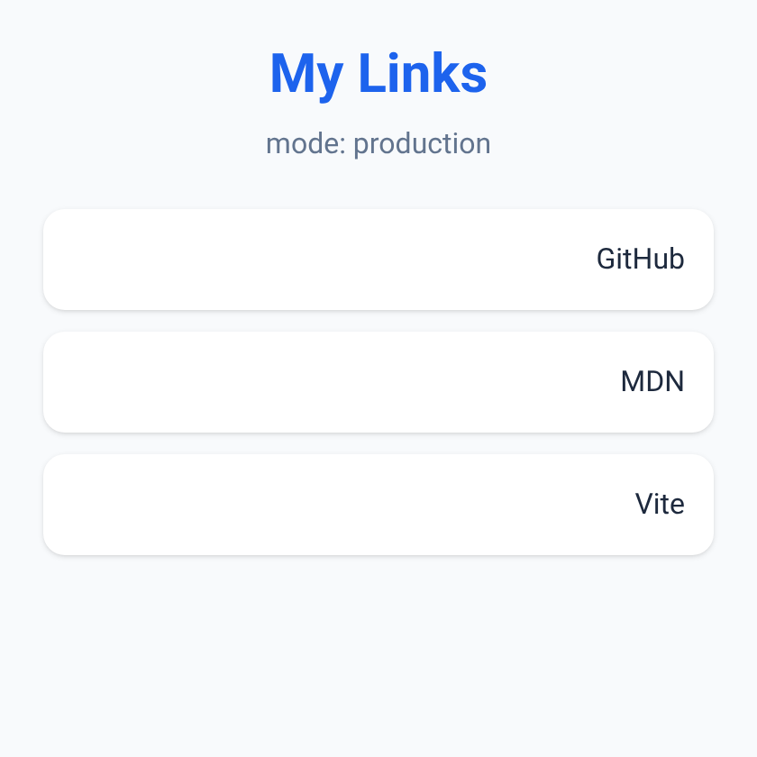

<small>المرحلة 8 · الجودة والأداء والنشر</small>

كل اللي في الكتاب في مشروع واحد صغير: صفحة «My Links» (زي Linktree) بـ Vite و Tailwind، و ESLint و Prettier، ومتغير بيئة، و Git، و Workflow جاهز لـ GitHub Pages. كل أمر بالـ Output الحقيقي بتاعه، وكل ملف اتعمل أو اتعدّل مشروح ومربوط بالفصل بتاعه. نفّذه على الماك خطوة خطوة.

:::note[بعد الفصل ده هتكون عارف]
- تعمل مشروع Vite من الصفر بـ create-vite
- تزوّد Tailwind v4 وتعرّف لون في @theme
- تكتب الصفحة بـ HTML سليم و RTL ومتغير بيئة
- تزوّد ESLint و Prettier والـ scripts
- تعمل build و preview وتتأكد من base
- تعمل commit بالملفات الصح بس
- تجهّز Workflow للنشر
:::



*النتيجة: لقطة حقيقية من `vite preview` على `http://localhost:4190/my-links/`. الكروت على اليمين لأن الصفحة `dir="rtl"`.*

<a id="s26-1"></a>

## 26.1 1 · اعمل المشروع

```sh title="Terminal"
$ npm create vite@latest my-links -- --template vanilla --no-interactive
create-vite v9.3.1
│
◇  Scaffolding project in /…/my-links...
│
└  Done. Now run:

  cd my-links
  npm install
  npm run dev
$ cd my-links
$ npm install

added 15 packages, and audited 16 packages in 2s

8 packages are looking for funding
  run `npm fund` for details

found 0 vulnerabilities
```

فصل 13 و 18: `create-vite` عمل القالب، و`npm install` نزّل Vite والـ 14 Package بتوعه. امسح ملفات المثال اللي مش هنحتاجها (`src/counter.js` والصور في `src/assets` و`public/icons.svg`)، وسيب `public/favicon.svg`.

:::note[«looking for funding»]
سطر معلومات مش تحذير: بعض الـ Packages عندها صفحة تبرعات. `npm fund` يعرضهم.
:::

<a id="s26-2"></a>

## 26.2 2 · Tailwind

```sh title="Terminal"
$ npm install tailwindcss @tailwindcss/vite

added 17 packages, and audited 33 packages in 2s
```

```js title="vite.config.js (ملف جديد)"
import { defineConfig } from 'vite'
import tailwindcss from '@tailwindcss/vite'

// https://vite.dev/config/
export default defineConfig({
  base: '/my-links/',
  plugins: [tailwindcss()],
})
```

```css title="src/style.css (بدّل المحتوى كله)"
@import 'tailwindcss';

@theme {
  --color-brand: #1d63ed;
}
```

| الأمر | بيعمل إيه |
|---|---|
| `plugins: [tailwindcss()]` | Tailwind بيشتغل جوه Vite (فصل 20). |
| `base: '/my-links/'` | علشان GitHub Pages (فصل 25). لو هتنشر على Netlify أو Vercel، امسحه. |
| `--color-brand` | لون الكتاب، وبيولّد `text-brand` و`outline-brand`. |

<a id="s26-3"></a>

## 26.3 3 · الصفحة

```html title="index.html"
<!doctype html>
<html lang="ar" dir="rtl">
  <head>
    <meta charset="UTF-8" />
    <link rel="icon" type="image/svg+xml" href="/favicon.svg" />
    <meta name="viewport" content="width=device-width, initial-scale=1.0" />
    <title>%VITE_APP_TITLE%</title>
  </head>
  <body class="min-h-svh bg-slate-50 text-slate-800">
    <main id="app" class="mx-auto max-w-md p-6"></main>
    <script type="module" src="/src/main.js"></script>
  </body>
</html>
```

| الأمر | بيعمل إيه |
|---|---|
| `lang="ar" dir="rtl"` | لغة الصفحة واتجاهها (فصل 3 و 5، و Lighthouse بيدوّر على `lang`). |
| `%VITE_APP_TITLE%` | العنوان من `.env` (فصل 19). |
| `<main>` | بدل `div`: Landmark (فصل 3). |
| `min-h-svh / mx-auto max-w-md p-6` | ارتفاع الشاشة على الأقل، وعمود في النص أقصاه 28rem، و Padding. |

```js title="src/links.js"
export const links = [
  { label: 'GitHub', url: 'https://github.com/' },
  { label: 'MDN', url: 'https://developer.mozilla.org/' },
  { label: 'Vite', url: 'https://vite.dev/' },
]
```

```sh title=".env"
VITE_APP_TITLE=My Links
```

```sh title=".env.local (مش بيترفع)"
SECRET_TOKEN=do-not-ship
```

```js title="src/main.js"
import './style.css'
import { links } from './links.js'

const app = document.querySelector('#app')
const title = import.meta.env.VITE_APP_TITLE

app.innerHTML = `
  <header class="mb-6 text-center">
    <h1 class="text-3xl font-bold text-brand">${title}</h1>
    <p class="mt-2 text-slate-500">mode: ${import.meta.env.MODE}</p>
  </header>
  <nav aria-label="links">
    <ul class="flex flex-col gap-3">
      ${links
        .map(
          (l) =>
            `<li><a class="block rounded-xl bg-white p-4 shadow hover:shadow-lg focus-visible:outline-2 focus-visible:outline-brand" href="${l.url}">${l.label}</a></li>`,
        )
        .join('')}
    </ul>
  </nav>
`
```

| الأمر | بيعمل إيه |
|---|---|
| `import './style.css'` | Vite بيحوّله لـ `<link>` في الـ build (فصل 18). |
| `import { links }` | ES Module (فصل 17). البيانات منفصلة عن العرض. |
| `<nav aria-label> و <ul>` | Screen reader هيقول "links, navigation, list 3 items" (فصل 3 و 5). |
| `focus-visible:outline-brand` | إطار واضح للي بيستخدم Tab بس (فصل 5). |
| `.map().join('')` | JS عادي من كورس Jonas. ونفس الشكل ده في React هيبقى `{links.map(l => <li key=…>)}`. ولاحظ إن `innerHTML` مع بيانات من المستخدم خطر (XSS)، هنا البيانات بتاعتنا فمقبول. |

شغّل `npm run dev` وافتح `http://localhost:5173/my-links/` (فيه `/my-links/` بسبب `base`).

<a id="s26-4"></a>

## 26.4 4 · ESLint و Prettier

```sh title="Terminal"
$ npm install -D eslint @eslint/js globals eslint-config-prettier

added 80 packages, and audited 113 packages in 1s
$ npm install -D --save-exact prettier

added 1 package, and audited 114 packages in 397ms
$ npm pkg set scripts.lint="eslint ."
$ npm pkg set scripts.format="prettier . --write"
$ npm pkg set scripts.format:check="prettier . --check"
```

وبعدين الملفات اللي شرحناها في فصل 23: `eslint.config.js` و`.prettierrc` (`{"singleQuote": true, "semi": false}`) و`.prettierignore` (`dist` و`package-lock.json`). وشغّلنا `npm run format` مرة (غيّر `@import "tailwindcss"` لـ Single quotes)، وبعدها:

```sh title="Terminal"
$ npm run lint

> my-links@0.0.0 lint
> eslint .

$ npm run format:check
Checking formatting...
All matched files use Prettier code style!
```

ESLint من غير Output = مفيش مشاكل.

<a id="s26-5"></a>

## 26.5 5 · package.json النهائي

```json title="package.json"
{
  "name": "my-links",
  "version": "0.0.0",
  "private": true,
  "type": "module",
  "scripts": {
    "dev": "vite",
    "build": "vite build",
    "preview": "vite preview",
    "lint": "eslint .",
    "format": "prettier . --write",
    "format:check": "prettier . --check"
  },
  "devDependencies": {
    "@eslint/js": "^10.0.1",
    "eslint": "^10.13.0",
    "eslint-config-prettier": "^10.1.8",
    "globals": "^17.13.0",
    "prettier": "3.9.10",
    "vite": "^8.3.4"
  },
  "dependencies": {
    "@tailwindcss/vite": "^4.3.3",
    "tailwindcss": "^4.3.3"
  }
}
```

لاحظ: `prettier` من غير `^` (`-E`)، و npm حط Tailwind في `dependencies` لأننا ماكتبناش `-D` (زي ما دوكيومنتيشن Tailwind بيقول). في موقع Vite مش هتفرق (فصل 14)، وحطه في devDependencies لو تحب.

<a id="s26-6"></a>

## 26.6 6 · build و preview

```sh title="Terminal"
$ npm run build
…
✓ 6 modules transformed.
rendering chunks...
computing gzip size...
dist/index.html                 0.57 kB │ gzip: 0.35 kB
dist/assets/index-NALiIVJV.css  9.53 kB │ gzip: 2.56 kB
dist/assets/index-Ba828Msq.js   1.29 kB │ gzip: 0.73 kB

✓ built in 98ms
```

```html title="dist/index.html (الـ head)"
<link rel="icon" type="image/svg+xml" href="/my-links/favicon.svg" />
<title>My Links</title>
<script type="module" crossorigin src="/my-links/assets/index-Ba828Msq.js"></script>
<link rel="stylesheet" crossorigin href="/my-links/assets/index-NALiIVJV.css">
```

| الأمر | بيعمل إيه |
|---|---|
| `/my-links/…` | كل المسارات فيها الـ `base`. ده اللي هيمنع الصفحة البيضا على GitHub Pages (فصل 25). |
| `<title>My Links</title>` | `%VITE_APP_TITLE%` اتبدل. |
| `1.29 kB JS` | مفيش Framework. و TBT 0 في Lighthouse (فصل 24). |

```sh title="Terminal"
$ npx vite preview --port 4190
  ➜  Local:   http://localhost:4190/my-links/
  ➜  Network: use --host to expose
```

(احنا اخترنا بورت 4190 بـ `--port` وقت التجربة. `npm run preview` عادي هيفتح على 4173.) افتح الرابط واتأكد إن الشكل زي dev، وجرّب Tab على الروابط، وشغّل Lighthouse (فصل 24).

<a id="s26-7"></a>

## 26.7 7 · Git

```sh title="Terminal"
$ git init -b main
$ git add .
$ git commit -m "my-links: vite + tailwind + eslint + prettier"
$ git show --stat HEAD
 .env                         |    1 +
 .github/workflows/deploy.yml |   45 +
 .gitignore                   |   24 +
 .prettierignore              |    2 +
 .prettierrc                  |    4 +
 eslint.config.js             |   16 +
 index.html                   |   13 +
 package-lock.json            | 2450 ++++++++++++++++++++++++++++++++++++++++++
 package.json                 |   26 +
 public/favicon.svg           |    1 +
 src/links.js                 |    5 +
 src/main.js                  |   22 +
 src/style.css                |    5 +
 vite.config.js               |    8 +
 14 files changed, 2622 insertions(+)
$ git check-ignore -v .env.local
.gitignore:13:*.local	.env.local
```

راجع اللستة: `package-lock.json` موجود (فصل 15)، و`node_modules` و`dist` و`.env.local` **مش موجودين**، و`check-ignore` بيأكد إن `.env.local` متجاهل بسطر `*.local` في `.gitignore` بتاع القالب (كتاب Git فصل 5). و`.env` اترفع لأنه مفيهوش أسرار.

<a id="s26-8"></a>

## 26.8 8 · النشر (عليك)

الـ Workflow (`.github/workflows/deploy.yml`) جاهز في الـ commit، ومشروح سطر سطر في فصل 25. الباقي على حسابك:

1. اعمل repo على GitHub اسمه `my-links` (لازم نفس اسم الـ `base`).
2. `git remote add origin …` و`git push -u origin main` (كتاب Git فصل 9).
3. Settings ← Pages ← Source: GitHub Actions.
4. تاب Actions: استنى الـ ✓، والرابط `https://USERNAME.github.io/my-links/`.

:::tip[خطوات تكمّل بيها]
- زوّد `<meta name="description">` (الـ SEO هيبقى 100).
- اعمل نفس المشروع بـ `--template react`: Component اسمه `LinkCard` و`links.map` في JSX.
- جرّبه بـ `react-ts` واعمل `type Link = { label: string; url: string }`.
- انشره على Netlify أو Vercel (امسح `base`).
:::

**المصادر الرسمية:** [Vite · Getting Started](https://vite.dev/guide/) · [Tailwind CSS · Installing with Vite](https://tailwindcss.com/docs/installation/using-vite) · [ESLint · Getting Started](https://eslint.org/docs/latest/use/getting-started) · [Prettier · Install](https://prettier.io/docs/install) · [Vite · Deploy to GitHub Pages](https://vite.dev/guide/static-deploy#github-pages)

:::tip[ملخص الفصل]
- create-vite ثم install ثم Tailwind ثم الصفحة ثم ESLint و Prettier ثم build و preview ثم Git ثم Workflow.
- 14 ملف في الـ commit، من غير `node_modules` و`dist` والأسرار.
- الناتج: HTML 0.57 kB و CSS 9.53 kB و JS 1.29 kB، وكل المسارات تحت `/my-links/`.
:::

### أسئلة مراجعة

1. لكل ملف في `git show --stat`: اتعمل في أنهي خطوة؟ وأنهي فصل بيشرحه؟
2. لو هتنشر على Vercel، إيه اللي هتغيره؟
3. ليه `.env` اترفع و`.env.local` لأ؟

### تحديات الفصل

<small>جرّبها بإيدك، والحلول في ملحق الإجابات.</small>

1. **[سهل]** نفّذ المشروع على الماك بتاعك خطوة خطوة، وقارن أرقامك بأرقام الكتاب.
2. **[متوسط]** زوّد Dark mode بـ `dark:` في Tailwind.
3. **[صعب]** انشره على GitHub Pages، وشغّل Lighthouse على الرابط الحقيقي و PageSpeed Insights.
