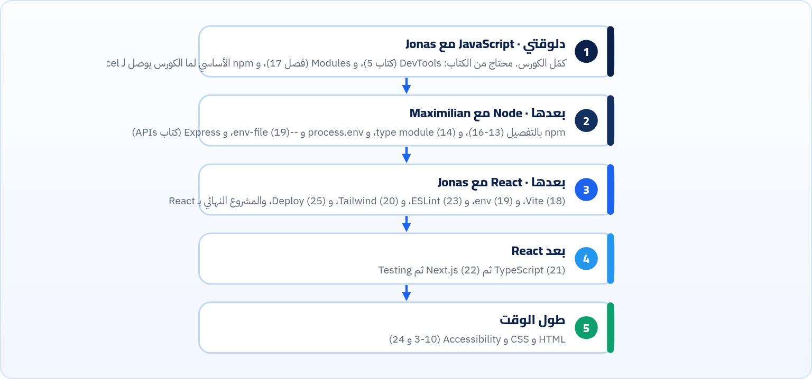

<small>المرحلة 8 · الجودة والأداء والنشر</small>

بعد 26 فصل، الأسماء كتير: npm و Vite و Tailwind و TypeScript و Next.js و ESLint… السؤال الطبيعي: أتعلمهم كلهم دلوقتي؟ لأ. الفصل ده بيرتّب الرحلة على الكورسات اللي انت ماشي فيها، وبيقولك إيه اللي محتاجه في كل مرحلة وإيه اللي يستنى، وإزاي تفضل متابع من غير ما تغرق.

:::note[بعد الفصل ده هتكون عارف]
- تعرف ترتيب التعلم على رحلة JS ثم Node ثم React
- تعرف إيه من الكتاب هتحتاجه في كل مرحلة
- تعرف إيه اللي يستنى لبعدين
- تعرف مصادر رسمية تتابع منها
- تعمل خطة مشاريع صغيرة
:::

## 27.1 الرحلة

*الكتاب ده مرجع ترجعله في كل مرحلة، مش حاجة تخلّصها مرة واحدة*

## 27.2 إيه اللي محتاجه دلوقتي وإيه اللي يستنى

**أولويات**

| اتعلمه دلوقتي | بعد React | لما تحتاجه |
|---|---|---|
| Semantic HTML و Forms (3-4) | TypeScript (21) | Sass (20) |
| Cascade و Flexbox و Grid و Responsive (6-9) | Next.js و SSR (22) | pnpm و Bun (16) |
| npm: install و scripts و ^ و Lockfile (13-15) | Testing: Vitest و Playwright | Vue أو Svelte أو Angular (12) |
| Vite و env (18-19) | مكتبة Components (20) | CSS Modules (20) |
| Git و Deploy بسيط (25) | Core Web Vitals بعمق (24) | Monorepos و Workspaces |

:::tip[القاعدة]
اتعلّم الأداة لما **تحس بالمشكلة** اللي بتحلها. Tailwind هيبقى منطقي لما الـ CSS بتاعك يكبر، و TypeScript لما تقضي ساعة تدوّر على `undefined`، و Next.js لما تحتاج SEO. لو اتعلمتهم قبل المشكلة، هتحفظ أوامر من غير ما تفهمها.
:::

## 27.3 مشاريع صغيرة على الطريق

1. <strong>مع JS:</strong> المشروع النهائي (فصل 26) بـ Vanilla، وبعدين زوّد Form يضيف روابط ويحفظها في `localStorage`.
2. <strong>مع Node:</strong> API صغير بـ Express يرجّع الروابط JSON (كتاب APIs)، وخلّي الصفحة تعمل `fetch` منه، والمفتاح السري في `.env` على السيرفر.
3. <strong>مع React:</strong> نفس الصفحة بـ `--template react` و Tailwind، و ESLint، ونشر على Netlify أو Vercel.
4. <strong>بعد React:</strong> نفس المشروع بـ `react-ts`، وبعدين Next.js بصفحة لكل رابط بـ `generateStaticParams`.

## 27.4 تتابع إزاي من غير ما تغرق

| الأمر | بيعمل إيه |
|---|---|
| `المصادر الرسمية` | MDN و web.dev للمنصة، و `vite.dev/blog` و `react.dev/blog` و `nextjs.org/blog` و GitHub Changelog لـ npm. كل لينك في ملحق الروابط آخر الكتاب. |
| `Baseline` | قبل ما تستخدم ميزة CSS أو JS جديدة: هل هي "Widely available"؟ (فصل 10). |
| `npm outdated` | مرة كل فترة على مشاريعك (فصل 15)، واقرا الـ Changelog قبل أي MAJOR. |
| `التاريخ على المقال` | الإيكوسيستم بيتغير بسرعة: `create-react-app` و`tailwind.config.js` و FID و `.eslintrc` كلهم اتغيروا في سنتين. أي Tutorial أقدم من سنة، قارنه بالدوكيومنتيشن. والكتاب ده نفسه صورة من أكتوبر 2026. |

:::note[الأساس مابيتغيرش]
الأدوات بتتغير كل سنة، بس HTML و CSS و JavaScript و HTTP و Git ثابتين من سنين. اللي فاهم الـ Cascade هيفهم أي أداة CSS، واللي فاهم Modules والـ Bundler هيفهم أي Build tool جديد. استثمر في الأساس، والأدوات هتيجي.
:::

**المصادر الرسمية:** [MDN · Learn web development](https://developer.mozilla.org/en-US/docs/Learn_web_development) · [web.dev · Learn](https://web.dev/learn) · [React · Learn](https://react.dev/learn) · [Vite · Blog](https://vite.dev/blog) · [Next.js · Learn](https://nextjs.org/learn) · [roadmap.sh · Frontend](https://roadmap.sh/frontend) · [Vitest · Guide](https://vitest.dev/guide/) · [Playwright · Intro](https://playwright.dev/docs/intro)

:::tip[ملخص الفصل]
- JS ثم Node ثم React ثم TypeScript و Next.js، و HTML و CSS و a11y طول الوقت.
- اتعلم الأداة لما تحس بمشكلتها.
- مشروع صغير في كل مرحلة، وتابع من المصادر الرسمية وبص على التاريخ.
:::

### أسئلة مراجعة

1. إيه أهم 3 فصول من الكتاب هترجعلها في كورس React؟
2. لقيت Tutorial بيستخدم `create-react-app` و`tailwind.config.js`. إيه اللي هتراجعه؟

### تحديات الفصل

<small>جرّبها بإيدك، والحلول في ملحق الإجابات.</small>

1. **[سهل]** اكتب خطتك للشهرين الجايين بالمشاريع الصغيرة.
2. **[متوسط]** افتح ملحق الروابط، واعمل Bookmarks folder لكل مرحلة.
3. **[صعب]** بعد ما تخلّص React: ارجع للكتاب كله واعمل التحديات الصعبة اللي فاتتك.
