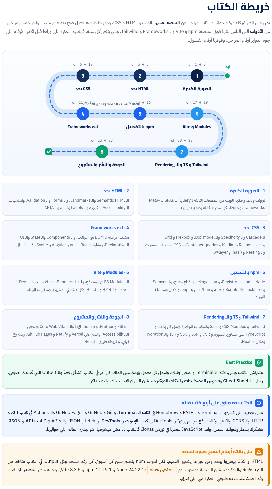

الكتاب ماشي معاك على 8 مراحل. الأول الصورة الكبيرة: الفرونت إند يعني إيه، ووصلنا لهنا إزاي، وخريطة بكل الأدوات. بعدين HTML و CSS على مستوى أعمق من الكورسات. وبعدها السؤال المهم: ليه الـ Frameworks اتعملت أصلاً. وفي النص npm بالتفصيل الممل، والـ Modules و Vite. وبعدين Tailwind و TypeScript وطرق الـ Rendering. وفي الآخر الجودة والنشر، ومشروع نهائي كامل، وخريطة طريق: إيه اللي لازم تعرفه قبل React وإيه اللي يستنى.

:::tip[تحميل]
- [الكتاب كامل PDF](/biginner-journey/downloads/06-frontend-book.pdf)
- [الـ Cheat Sheet PDF](/biginner-journey/downloads/06-frontend-cheatsheet.pdf)
:::

## خريطة الكتاب

- **1 · الصورة الكبيرة**: فرونت وباك، وحكاية الويب من الصفحات الثابتة لـ jQuery للـ SPAs للـ Meta-frameworks، وخريطة بكل اسم هتقابله وهو بيعمل إيه.
- **2 · HTML بجد**: الـ Semantic HTML والـ Landmarks، والـ Forms والـ Validation، وأساسيات الـ Accessibility: الكيبورد والـ Labels والـ alt والـ ARIA.
- **3 · CSS بجد**: الـ Cascade والـ Specificity والـ Box model، و Flexbox و Grid، والـ Responsive بالـ Media و Container queries، و CSS الحديثة: المتغيرات والـ Nesting و :has() و @layer.
- **4 · ليه Frameworks**: مشكلة مزامنة الـ DOM مع البيانات، والـ Components والـ State والـ UI الـ Declarative، ومقارنة React و Vue و Angular و Svelte بنفس المثال.
- **5 · npm بالتفصيل**: Node و npm والـ Registry، و package.json مفتاح مفتاح، والـ Semver والـ Lockfile، والـ Scripts و npx، و pnpm/yarn/bun، والأمان وسلسلة التوريد.
- **6 · Modules و Vite**: الـ ES Modules في المتصفح، وليه الـ Bundlers، و Vite من جوه: الـ Dev server والـ HMR والـ Build، وكل ملف في المشروع، ومتغيرات البيئة.
- **7 · Tailwind و TS والـ Rendering**: Tailwind و CSS Modules و Sass والمكتبات الجاهزة وإمتى كل واحد، و TypeScript على مستوى الصورة، و CSR و SSR و SSG و ISR والـ Hydration ومكان Next.js.
- **8 · الجودة والنشر والمشروع**: ESLint و Prettier، و Lighthouse والـ Core Web Vitals وفحص الـ Accessibility، والنشر على Vercel و Netlify و GitHub Pages، ومشروع نهائي، وخريطة طريق لـ React.

## الفصول

**المرحلة 1 · الصورة الكبيرة**

- [الفصل 1: الحكاية من الأول: الفرونت إند يعني إيه، ووصلنا لهنا إزاي؟](./ch01/)
- [الفصل 2: خريطة الأدوات: كل اسم هتسمعه، وهو بيعمل إيه](./ch02/)

**المرحلة 2 · HTML بجد**

- [الفصل 3: الـ Semantic HTML: إنك تقول للمتصفح «ده إيه» مش «شكله إيه»](./ch03/)
- [الفصل 4: الـ Forms: أقدم طريقة تبعت بيها بيانات، ولسه أذكى مما تتخيل](./ch04/)
- [الفصل 5: الـ Accessibility: الموقع لكل الناس، مش للي زيك بس](./ch05/)

**المرحلة 3 · CSS بجد**

- [الفصل 6: الـ Cascade والـ Specificity والـ Box model: ليه الـ CSS بتاعي مش شغال؟](./ch06/)
- [الفصل 7: Flexbox: ترتيب العناصر في خط واحد](./ch07/)
- [الفصل 8: CSS Grid: الصفحة كلها كشبكة](./ch08/)
- [الفصل 9: الـ Responsive Design: صفحة واحدة لكل الشاشات](./ch09/)
- [الفصل 10: CSS الحديثة: الحاجات اللي خلّت Sass مش ضرورية](./ch10/)

**المرحلة 4 · ليه Frameworks**

- [الفصل 11: ليه الـ Frameworks اتعملت أصلاً؟ مشكلة مزامنة الـ DOM](./ch11/)
- [الفصل 12: React و Vue و Angular و Svelte: نفس الفكرة بأربع لهجات](./ch12/)

**المرحلة 5 · npm بالتفصيل**

- [الفصل 13: Node و npm: المخزن اللي فيه ملايين الحتت الجاهزة](./ch13/)
- [الفصل 14: package.json مفتاح مفتاح](./ch14/)
- [الفصل 15: الـ ^ والـ ~ والـ Lockfile: «بيشتغل عندي ومش عندك»](./ch15/)
- [الفصل 16: pnpm و Yarn و Bun، وأمان الـ Packages](./ch16/)

**المرحلة 6 · Modules و Vite**

- [الفصل 17: الـ Modules وليه محتاجين Bundler](./ch17/)
- [الفصل 18: Vite من جوه: dev و build و preview](./ch18/)
- [الفصل 19: متغيرات البيئة و .env: الإعدادات والأسرار](./ch19/)

**المرحلة 7 · CSS والـ Rendering و TypeScript**

- [الفصل 20: إيكوسيستم الـ CSS: Tailwind و CSS Modules و Sass والمكتبات الجاهزة](./ch20/)
- [الفصل 21: TypeScript: نظرة من فوق](./ch21/)
- [الفصل 22: CSR و SSR و SSG و ISR و Hydration: الصفحة بتتبني فين؟](./ch22/)

**المرحلة 8 · الجودة والأداء والنشر**

- [الفصل 23: ESLint و Prettier: مصحح ومنسّق أوتوماتيك](./ch23/)
- [الفصل 24: Lighthouse و Core Web Vitals وفحص الـ Accessibility](./ch24/)
- [الفصل 25: النشر: GitHub Pages و Netlify و Vercel](./ch25/)
- [الفصل 26: المشروع النهائي: صفحة روابط من الصفر للـ Deploy](./ch26/)
- [الفصل 27: الخريطة: تتعلم إيه وإمتى](./ch27/)

**الملاحق**

- [ملحق أ: Cheat Sheet وجدول الـ Flags وجدول الرموز](./appendix-1/)
- [ملحق ب: قاموس المصطلحات](./appendix-2/)
- [ملحق ج: ملحق الروابط الرسمية](./appendix-3/)
- [ملحق د: المصادر ومنهجية التحقق](./appendix-4/)
- [ملحق ه: الإجابات والحلول](./appendix-5/)
