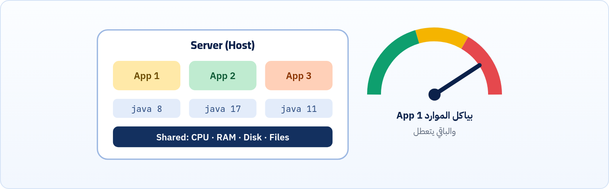
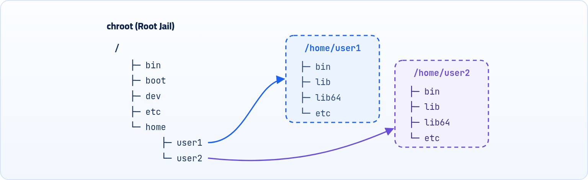
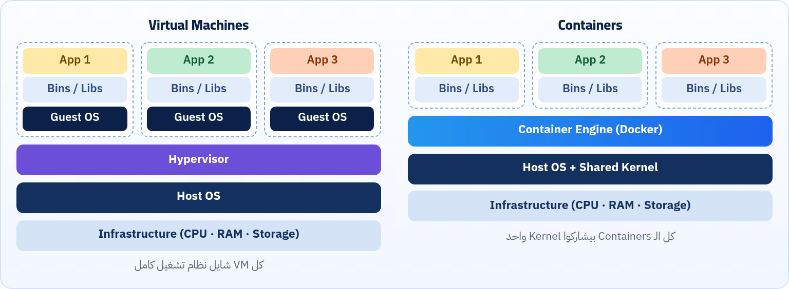

عندنا كام مشكلة عايزين نفهمهم، وإزاي اتحلّوا على مر السنين، وإيه دور Docker في ده. الفصل ده هو الأساس اللي هتبني عليه كل اللي جاي.

:::note[الكتاب ده بيبني على اللي فات]
هتحتاج من الكتب اللي قبله: الـ **Processes** و `ps` (كتاب الـ Terminal فصل 9)، والـ **Ports** و **localhost** (كتاب الإنترنت فصل 3)، و `npm install` و `npm run build` (كتاب الفرونت إند فصول 13 و 18)، و YAML (كتاب APIs و JSON فصل 21). والأمثلة هنا مكتوبة على سيرفر Linux (`moaz@Linux`)، بس نفس الأوامر بالحرف بتشتغل على الماك، وفيه صندوق في فصل 3 بيقولك الفروق.
:::

## 1.1 المشكلة الأولى: الـ Compatibility بين السيرفر والـ Apps

قبل كده لو عندك مشروع كبير فيه موقع وموبايل أبلكيشن وباك إند كمان، فكانت الدنيا بتمشي إزاي؟ مين بيتحط على السيرفر ومين بيروح فين؟ خلينا نقسمها 3 حاجات:

#### (1) كود الـ Front end

بعد ما الشغل فيه يخلص، المبرمج بيشغل الأمر `npm run build` يحوّله لنسخة production ويطلع folder فيه:

- `index.html`
- ملفات JS مضغوطة
- ملفات CSS مضغوطة
- الـ assets

وده اللي بيترفع على السيرفر، وبنشغّل Nginx على الـ folder ده عشان يشتغل كـ Web Server ويقدّم ملفات الموقع للمستخدمين.

#### (2) كود الـ Back end

بعد ما الشغل فيه يخلص، المبرمج بيشغل الأمر `npm install` علشان ينزّل الـ dependencies ويبعت الملفات على السيرفر.

#### (3) كود الـ Mobile app

ده كان أسهلهم، لأنك بمجرد ما تعمل export وتطلع نسخة APK أي حد يقدر ينزّلها على الموبايل ويثبّتها مباشرة. مش محتاج dependencies ومش بيتحط على سيرفر بنفس الطريقة، فمش هنركز عليه.

:::caution[وهنا بقى بتحصل المشكلة]
- الكودين (الفرونت والباك) دول ليهم dependencies خاصة بيهم زي node و java و python وغيرهم، فلازم تكون متسطبة على السيرفر أصلاً، وكمان بالـ Versions الصح عشان يشتغلوا.
- فلما يحصل نقص في أي حاجة من الحاجات دي أو اختلاف في الـ Versions، الكود ميشتغلش. ولما تيجي تكلم الـ Developer هيقولك الجملة المشهورة: <strong>"It works on my machine"</strong>، يعني "دي شغالة عندي عادي وسليمة!"، فلازم تراجع كل الحاجات الناقصة وتسطّبهم وتمشّي حالك.
:::

فإحنا هنا محتاجين حل لمشكلة الـ **compatibility** بين السيرفر والـ apps اللي هرفعها عليه. ده غير **المشكلة التانية** اللي هتظهر نتيجة إني برفع كذا app على نفس السيرفر.

## 1.2 المشكلة التانية: كذا App على نفس السيرفر

قبل كده كانت الشركات بتحط كل الـ apps بتاعتها على نفس السيرفر، وكلهم بيشوفوا نفس الملفات وبيتشاركوا نفس الـ Resources بتاعة السيرفر. وهنا كان بيحصل عندنا شوية مشاكل:

- <strong>استهلاك الموارد:</strong> احتمال إن app واحد يستهلك موارد السيرفر بشكل كبير، فيأثّر على باقي الـ apps ويعطّلهم.
- <strong>تعارض الـ Dependencies:</strong> مثلاً app1 بيحتاج java بـ version معينة، و app2 بيحتاج java برضه بس بـ version مختلفة، وهكذا. فمع كترة الـ versions هيحصل عندي مشكلتين:

  1. استهلاك مساحة تخزين كبيرة.
  2. احتمال حدوث خطأ: مع كترة الـ apps، لو جيت أمسح app فيهم ونسيت هو كان شغال بأنهي version من java، ممكن أمسح version كانت بتشغّل app تاني.

*كل الـ apps على نفس السيرفر: موارد مشتركة، و versions مختلفة من نفس الـ dependency.*

المشكلة دي اتطوّرلها كذا حل لمحاولة القضاء عليها، لأننا لقينا إننا محتاجين نعمل <strong>عزل (Isolation)</strong> بين كل app والتاني. هنتكلم عن الحلين اللي عندنا، بس الأول هنشرح الفكرة الأساسية اللي اتبنى عليها الحلين.

## 1.3 البداية: فكرة الـ chroot

ظهرت فكرة الـ **chroot**، وهي إني أعمل عزل لكل app عن التاني. يبقى كل app مش شايف ملفات النظام أو السيرفر نفسه، هو شايف root تاني خاص بيه مختلف عن root السيرفر، وشايف فولدرات زي `bin` و `lib` و `etc` خاصة بيه غير بتوع السيرفر، يعني كأنه على سيرفر لوحده. وبجانب ده اتعمل تحديد لاستهلاك كل app لموارد السيرفر باستخدام حاجة اسمها **ulimit**.

*كل app شايف فولدر معين على إنه الـ root بتاعه (/)، وميعرفش حاجة عن باقي ملفات السيرفر.*

:::note[معلومة مهمة]
طبعاً الفكرة دي مكانتش كفاية إنها تبقى هي الحل الوحيد للمشكلة، بس كانت **الأساس** لحلول تانية بعد كده، زي اللي هنشوفهم دلوقتي.
:::

## 1.4 الحل الأول: Virtual Machines

لو عندك سيرفر عليه Linux كنظام تشغيل رئيسي (Host OS)، وحبيت تقسّم السيرفر ده لأجزاء أصغر (Sub-Servers) كل جزء يشيل برنامج معين، كنت بتستخدم برنامج زي VirtualBox يعملك: VM 1 · VM 2 · VM 3.

كل VM بيبقى كأنه سيرفر مستقل تماماً، وليه نظام تشغيل خاص بيه (Guest OS)، وبيتحط عليه الـ App وكل الـ dependencies الخاصة بيه، ونظام تشغيل كامل يقدر يستخدمه. الطبقات من تحت لفوق:

| الأمر | بيعمل إيه |
|---|---|
| `Infrastructure` | الهاردوير نفسه: CPU و RAM و Storage |
| `Host OS` | نظام التشغيل الأساسي على الجهاز |
| `Hypervisor` | البرنامج اللي بيعمل الـ VMs ويديرها |
| `Guest OS` | نظام التشغيل اللي جوه كل VM |

## 1.5 الحل التاني: Linux Containers

لو عندك سيرفر عليه Linux كنظام تشغيل أساسي (Host OS)، فبدل ما تعمل Virtual Machines وتنزّل Guest OS كامل لكل واحد، Linux وفّرلك طريقة أخف اسمها **OS-Level Virtualization**. يعني بدل ما نقسم السيرفر بأنظمة تشغيل كاملة، نقسمه على مستوى العمليات (Processes)، وهيبقى عندك حاجة اسمها **Container**.

كل Container بيبقى شايل app لوحده، وشغال كأنه process عادية في Linux، وكل الـ Containers بيشاركوا الـ **Kernel** بتاع الـ Host.

*الفرق في المعمارية بين الـ Virtual Machines والـ Containers.*

الـ Container بيعتمد على خاصيتين في Linux:

#### (1) Linux Namespaces

دي المسؤولة عن <strong>العزل (Isolation)</strong>. كل Container يحس إنه لوحده:

- ليه PID خاص
- ليه Network خاص
- ليه Filesystem view خاص
- ليه Hostname خاص

هو فاكر إنه لوحده على الجهاز، لكن فعلياً هو **Process معزولة**.

#### (2) Control Groups (cgroups)

دي المسؤولة عن **التحكم في الموارد**:

- CPU limit
- Memory limit
- I/O limit
- Network limit

يعني نقدر نقول: Container 1 ياخد 1GB RAM، و Container 2 ياخد 512MB RAM.

**مقارنة سريعة بين الـ Virtual Machine والـ Container**

| وجه المقارنة | Virtual Machine | Container |
|---|---|---|
| العزل بيتم على مستوى | الهاردوير (عن طريق Hypervisor) | نظام التشغيل (Namespaces + cgroups) |
| نظام التشغيل | Guest OS كامل جوه كل VM | مفيش Guest OS، بيستخدم Kernel الـ Host |
| الحجم | جيجات (GBs) | غالباً ميجات (MBs) |
| وقت التشغيل | دقايق (Boot كامل) | ثواني أو أقل (مجرد Process) |
| استهلاك الموارد | عالي: RAM و CPU لكل OS | خفيف جداً |
| العدد على نفس السيرفر | قليل | كبير جداً |
| قوة العزل | أقوى (Kernel منفصل) | كويس، بس الـ Kernel مشترك |
| أمثلة | VirtualBox و VMware و KVM | LXC و Docker و Podman |

الحلين دول كانوا كويسين، بس كل حل فيهم كان ليه عيوب، وواضح إن الأحسن فيهم فكرة الـ **Containers**، لأن مفيش Guest OS كامل، ومفيش Boot process مكرر، ومفيش Kernel مكرر، وكلهم بيستخدموا نفس الـ Kernel.

## 1.6 لكن الحلو مبيكملش: مشاكل الـ Linux Containers

زي ما احنا عارفين، الحلو مبيكملش. التعامل مع الـ Linux Containers بشكل مباشر كان فيه مشاكل عملية:

1. مفيش Standard واضح لبناء Container.
2. مفيش Distribution mechanism، يعني مفيش طريقة سهلة توزّع بيها الـ Container.
3. إدارة معقدة.
4. صعب على المطورين استخدامها.

كان الموضوع أقرب لإدارة نظام تشغيل، مش تجربة مطور سهلة.

من الآخر نقدر نقول إن Linux Containers وفّرت العزل والتحكم في الموارد، لكنها كانت تقنية منخفضة المستوى (Low-level). و **Docker** خد نفس التكنولوجيا وحوّلها لـ **Platform**:

جاهزة للإنتاجسهلة الاستخدامموحّدة المعاييرقابلة للتوزيع عالمياً

:::note[خلينا نرتب الصورة]
- **المشكلة التانية** (كذا app على نفس السيرفر): حلّيناها بالـ Linux Containers اللي اتحسّن شكلها بـ Docker، وكده ضمنّا العزل والفصل بين كل app والتاني.
- **المشكلة الأولى** (الـ compatibility): حلها بقى موجود على طول بسبب Docker. محتجناش نطوّر حلول، Docker حلها بشكل مباشر، مش زي المشكلة التانية.
:::

:::tip[ملخص الفصل]
- المشكلة الأولى: الـ app محتاج dependencies بـ versions معينة على السيرفر، ومن هنا جت "It works on my machine".
- المشكلة التانية: كذا app على نفس السيرفر بيتنافسوا على الموارد وبيتعارضوا في الـ versions، فمحتاجين عزل.
- الـ chroot كانت أول فكرة للعزل، وكانت الأساس للـ VMs والـ Containers.
- الـ VM فيها Guest OS كامل فوق Hypervisor، والـ Container مجرد Process معزولة بتشارك Kernel الـ Host.
- العزل بيتم بالـ Namespaces، والتحكم في الموارد بالـ cgroups.
- Docker خد فكرة الـ Linux Containers وخلاها Platform سهلة وموحّدة وقابلة للتوزيع.
:::

### أسئلة مراجعة

1. اشرح بكلامك معنى جملة "It works on my machine"، وليه كانت بتحصل؟
2. إيه المشكلتين اللي بيحصلوا لما نحط كذا app على نفس السيرفر؟
3. إيه الفرق الجوهري بين الـ VM والـ Container من ناحية نظام التشغيل؟
4. مين المسؤول عن العزل ومين المسؤول عن تحديد الموارد في الـ Linux Containers؟
5. ليه الـ Linux Containers لوحدها مكانتش كفاية، وإيه اللي Docker ضافه؟
