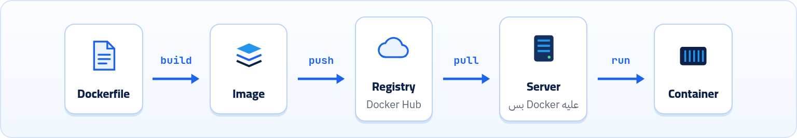
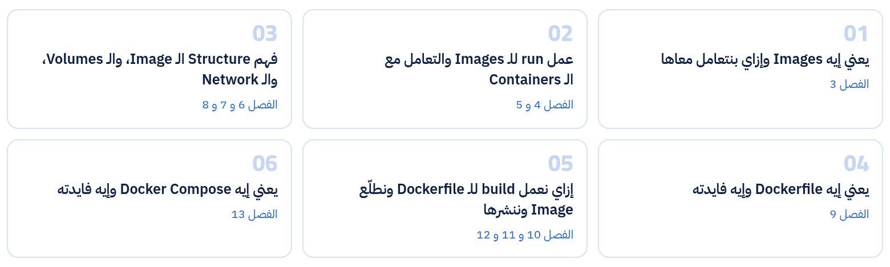

Docker بيستخدم نفس فكرة الـ Linux Containers بس بشكل منظم: Dockerfile بيتعمله build فيطلع Image، والـ Image بنعملها run فيطلع Container. في الفصل ده هنفهم الرحلة دي كلها من غير ما نكتب ولا أمر.

## 2.1 Docker Containers

Docker بيعيد استخدام الـ Linux Containers ولكن بشكل أحسن، عن طريق إنه يبقى فيه ملف اسمه **Dockerfile** بيتكتب بمعايير أو syntax محددة، عشان لما يتعمله **build** يدينا حاجة اسمها **Image**. والـ Image دي بتكون أساس الـ Container، بمعنى إني لما بعمل **run** للـ Image بيتولد الـ **Container**، ويشتغل كـ Process عادية في النظام، بس بيحمل جواه الـ app اللي عايز تقوّمه على السيرفر.

*من الـ Dockerfile للـ Image للـ Container.*

### Docker عمل 3 نقلات نوعية

#### Image جاهزة

بقى عندي Image جاهزة بتشتغل في أي مكان.

#### وصف واضح للبيئة

بقى فيه وصف واضح لبناء البيئة بفضل الـ Dockerfile.

#### توزيع عالمي

بقى فيه نظام توزيع عالمي، والـ images بتتنشر في كل مكان، وده بيسهّل ويسرّع رفع الـ apps على السيرفرات.

## 2.2 المشكلة الأولى اتحلّت إزاي؟

بالنسبة للمشكلة الأولى (الـ compatibility)، فبعد ما قررنا نستخدم Docker الوضع بيتغير تماماً عن الطريقة التقليدية. بدل ما كنا بنرفع الكود على السيرفر ونبدأ نسطّب عليه Node أو Java أو أي dependencies مطلوبة عشان المشروع يشتغل، دلوقتي أنا مجرد باخد **image** معمولة من **Dockerfile** فيه كل حاجة خاصة بالـ app ده، ولما أعمل run للـ image هتشغّل container على السيرفر، وده بيعادل تشغيل Process.

طب هل احتجت أسطّب حاجة على السيرفر عشان أقوّم الـ container اللي شايل الـ app؟

:::note[الإجابة: لأ]
كل اللي احتجته على السيرفر إني سطّبت **Docker** بس. كل الـ dependencies والـ versions موجودة جوه الـ Image نفسها.
:::

دي كانت مقدمة بس عشان نفهم الموضوع جه منين، وليه Docker جامد وبيطلّع نار من بُقّه.

## 2.3 الرحلة من الـ Dockerfile لحد الـ Container

عايزين نشوف الموضوع بيتم إزاي من أول ما نكتب الـ Dockerfile لحد ما نقوّم container على السيرفر. هنشوف الموضوع بشكل نظري الأول، وبعدها نشوفه بشكل عملي. دلوقتي كـ **DevOps Engineer** دي الخطوات اللي همشي عليها (ووارد أبدأ من خطوة متقدمة، إني أشتغل على image جاهزة وأنا مجرد بقوّم بيها الـ container وأتعامل معاها):

1. بكتب **Dockerfile** فيه مواصفات البيئة اللي التطبيق محتاجها، زي الـ Base Image اللي هبدأ منها (مثلاً `node:18-alpine`)، وبعدها بحدد مكان الشغل، وأنسخ الكود، وأنزّل الـ dependencies، وأحدد أمر التشغيل. فالـ Dockerfile ده يعتبر وصف لبناء Image.
2. بعد كده بعمل **build** للـ Dockerfile، سواء على جهازي أو عن طريق CI/CD (هنتكلم عنها بعدين)، فتتكوّن **Image** جاهزة فيها: الـ app نفسه + الـ runtime بتاعه + المكتبات اللي محتاجها + الـ filesystem الخاص بالتوزيعة اللي بدأت منها.
3. بعد ما الـ image تجهز، بترفعها على **Registry** زي Docker Hub.
4. على السيرفر اللي عليه Docker بس، كل اللي السيرفر بيعمله إنه يسحب الـ Image دي ويعملها **run**، فيشغّل منها **Container**.
5. ساعتها الـ app بيشتغل جوه بيئة معزولة، لكن باستخدام Kernel نظام التشغيل الأساسي للسيرفر.

*دورة الشغل الكاملة كـ DevOps Engineer.*

:::note[تشبيه يقرّب الصورة]
تخيّل الموضوع كده: الـ **Dockerfile** هو كود الـ Mobile App. لما بنعمله build بيدّينا الـ **Image**، اللي هي نسخة الـ APK، اللي بعد كده بننقلها على أي تليفون عايزين نشغّل عليه الـ App ونعمله install ونشغّله. وده بالظبط إننا عملنا run للـ image وبقى عندنا **container** شغال.
:::

## 2.4 خطة الجزء العملي

كل الكلام اللي فات ده ممكن لحد دلوقتي ميكونش واضح أوي، هيوضح أكتر لما ندخل للجزء العملي ونفهمه. الجزء العملي هيكون بالشكل ده:

### طب ليه مبدأناش بالـ Dockerfile؟

ممكن تستغرب الترتيب ده، وليه مبدأناش بالـ Dockerfile رغم إنه المفروض أول حاجة. ببساطة لأن هدف Docker الفعلي مش إنك تبتدي من الصفر خالص، تطبيقاً لمبدأ <strong>"متعيدش اختراع العجلة تاني"</strong>. Docker بيوفّرلك images كتير جداً جاهزة (إما من الشركة نفسها أو من مطورين رافعين images على النت)، وانت تاخدها تشتغل بيها زي ما هي، أو تعدّل وتضيف عليها حاجات تخدم شغلك، وده بيكون عن طريق إنك تكتب Dockerfile.

فعلياً، انت بنسبة كبيرة جداً هتستخدم الـ Dockerfile لمجرد إنك تبني image جديدة من image قديمة، تاخدها وتعدّل وتضيف عليها عشان تعمل image جديدة تفيدك في شغلك. فعشان كده هنبتدي بإننا نفهم الـ images ونتعامل معاها كويس، وبعد كده نتعلم نبني بتاعتنا.

:::tip[ملخص الفصل]
- Dockerfile ← build ← Image ← run ← Container.
- الـ Image قالب جاهز فيه الـ app والـ runtime والمكتبات والـ filesystem.
- الـ Container هو Process معزولة شغالة من الـ Image.
- الـ Images بتترفع على Registry زي Docker Hub، والسيرفر بيعملها pull و run.
- السيرفر مش محتاج غير Docker بس، وده حل مشكلة الـ compatibility.
:::

### أسئلة مراجعة

1. رتّب الكلمات دي حسب دورة الشغل: Container، Dockerfile، Registry، Image.
2. إيه الحاجات اللي بتبقى جوه الـ Image بعد الـ build؟
3. ليه السيرفر مبقاش محتاج يتسطّب عليه Node أو Java؟
4. ليه الكتاب بدأ بالـ Images قبل الـ Dockerfile؟
