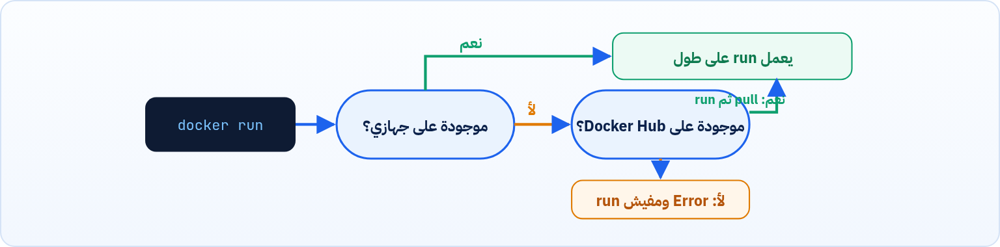
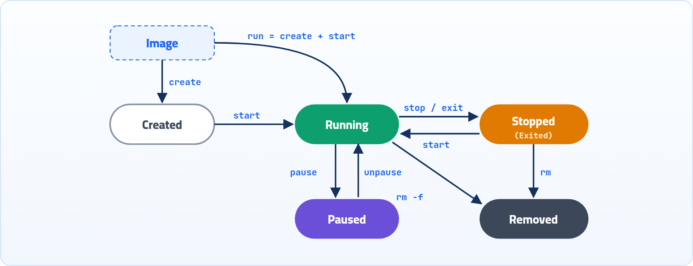
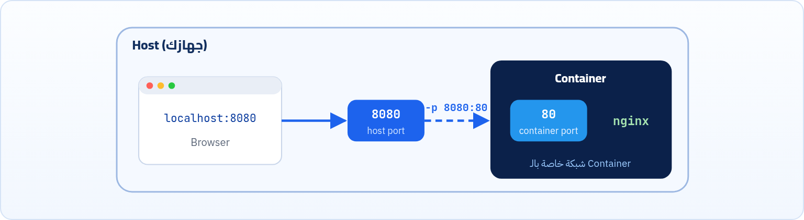
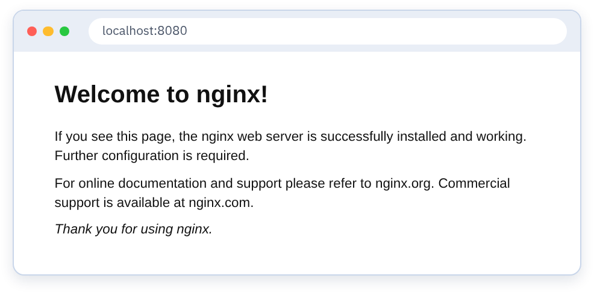

هنا بنبدأ الشغل الحقيقي: نعمل run لـ Image، نفهم ليه الـ Container بيقف لوحده، نشغّله في الخلفية، ندخل جواه، ونفتح بورت عشان نشوف موقع nginx من المتصفح.

<a id="s4-1"></a>

## 4.1 تشغيل Container (docker run)

```sh title="Terminal"
docker run [--name container_name] image_name
```

<strong>معناها:</strong> اعمل run للـ Image اللي اسمها `image_name`، وشغّلها كـ Container عندي على الجهاز.

- لو الـ image موجودة على جهازي بالفعل، هيعملها run عادي.
- أما لو مش موجودة، هيشوف لو هي موجودة على Docker Hub تحديداً على `docker.io/library/`:

  - لو لقاها، هيروح من نفسه يسحبها وينزّلها على الجهاز وبعدها يعملها run.
  - لو ملقاهاش، مش هيعمل run أصلاً.



*Docker بيدوّر على الـ Image فين قبل ما يعمل run.*

:::tip[Best Practice]
لو مكتبتش `--name container_name`، Docker هيدّي الـ container اسم عشوائي (زي `keen_jang`). الأحسن تسمّيه بنفسك بدل ما تستخدم الـ ID بتاعه، لأنه بيكون طويل، فاسم واضح أحسن بكتير.
:::

<a id="s4-2"></a>

## 4.2 ليه الـ Container اشتغل وخلص على طول؟

بعد ما عملنا run للـ image هينشأ Container عندنا. هتلاحظ إن الـ Container اللي انت لسه مقوّمه اشتغل وخلص على طول، وكمان إنه لما اشتغل خد الـ Terminal ومبقاش متاح ليك تستخدمه، ولما خلص رجّعهولك تاني.

وده منطقي جداً، لأن ببساطة الـ Container في الأول والآخر **Process** بتشتغل، ولما بتخلص بتقف. نفس الكلام لما بتقوّم Container: طالما مفيش حاجة تجبره يفضل شغال، هو بيقوم وبعدها يخلص ويقف.

#### عشان يفضل شغال

تدّيله أمر يجبره على كده، زي إنك تكتب `sleep time` في آخر السطر، فكده انت بتقوله يفضل شغال لمدة `time` ثانية. ولو عايزه يفضل شغال على طول اكتب `sleep infinity`.

#### عشان ميخدش منك الـ Terminal

اكتب `-d` بعد `run` عشان تفعّل الـ **Detached Mode**، يعني التشغيل في الخلفية.

```sh title="Terminal"
docker run -d busybox sleep infinity
```

<a id="s4-3"></a>

## 4.3 عرض الـ Containers (docker ps)

| الأمر | بيعمل إيه |
|---|---|
| `docker ps` | بيعرض الـ Containers الشغالة بس (running). |
| `docker ps -a` | بيعرض كل الـ Containers: الشغالة واللي وقفت (running و ended). |

**معنى كل عمود في ناتج `docker ps`**

| العمود | معناه |
|---|---|
| CONTAINER ID | رقم تعريف الكونتينر |
| IMAGE | الـ image اللي اتعمل منها الكونتينر |
| COMMAND | الأمر اللي شغال جوه الكونتينر |
| CREATED | وقت إنشاء الكونتينر |
| STATUS | حالته (Up يعني شغال) |
| PORTS | البورتات المفتوحة |
| NAMES | اسم الكونتينر |

:::note[Process = Container]
لو لاحظت، هتلاقيك كتبت أمر `ps` اللي كنا بنكتبه لما نحب نشوف الـ Processes الشغالة على الجهاز. وده يفسّر ليه بنقول إن **الـ Container = Process**، فعشان كده لما حبينا نشوف الـ Containers الشغالة كتبنا `ps`، بس قبلها `docker` عشان نوضّح إننا عايزين نشوف الـ Docker Containers.
:::

<a id="s4-4"></a>

## 4.4 أوامر التعامل مع الـ Container

| الأمر | بيعمل إيه |
|---|---|
| `docker exec -it CONTAINER_ID sh` | هيدخّلك جوه الـ Container ويفتحلك shell، تقدر تكتب commands وتتعامل مع الملفات اللي جواه (كأنك جوه VM عادي جداً). |
| `docker stop CONTAINER_ID` | هيوقّف الـ Container لو هو شغال. |
| `docker start CONTAINER_ID` | هيشغّل الـ Container لو كان واقف بعد ما كان شغال. |
| `docker rm CONTAINER_ID` | هيحذف الـ Container.لازم تبقى حذر في الخطوة دي، خصوصاً لو فيه Container تاني معتمد عليه. |
| `docker rm -f CONTAINER_ID` | حذف Container بس بالإجبار (حتى لو شغال). |



*دورة حياة الـ Container والأوامر اللي بتنقله من حالة للتانية.*

<a id="s4-5"></a>

## 4.5 مثال عملي: busybox

1. نشغّل Container من الـ image اللي اسمها busybox، ونخليه شغال في الخلفية (`-d`) وشغال على طول (`sleep infinity`):

   ```sh title="Terminal"
   $ docker run -d busybox sleep infinity
   b4fcc648e91d464a41922f14e598f7eb9f1f9e881c91a5ee0fa435c828a4db23
   ```
2. نشوف الـ Containers الشغالة عشان نعرف الـ ID بتاع الـ Container اللي لسه مشغّلينه:

   ```sh title="Terminal"
   $ docker ps
   CONTAINER ID   IMAGE     COMMAND            CREATED         STATUS         PORTS   NAMES
   b4fcc648e91d   busybox   "sleep infinity"   2 minutes ago   Up 2 minutes           keen_jang
   ```
3. ندخل على الـ Container اللي لسه مشغّلينه بالـ ID بتاعه، عشان نجرّب نكتب أي أوامر أو نتعامل مع الملفات اللي فيه:

   ```sh title="Terminal"
   $ docker exec -it b4fcc648e91d sh
   / # 
   ```
4. نجرّب نكتب `ls` مثلاً، هنلاقي إننا شايفين الملفات والفولدرات اللي جوه الـ Container، وهنلاقيها شبه الفولدرات اللي في أي VM، كأننا مقوّمين جهاز بالفعل:

   ```sh title="Terminal"
   / # ls
   bin   dev   etc   home   lib   lib64   proc   root   sys   tmp   usr   var
   ```
5. نجرّب مثلاً نعمل ملف جديد اسمه `file.txt`، هنلاقي إننا شايفين الملفات والفولدرات اللي كانت موجودة جوه الـ Container من قبل، والملف اللي لسه عاملينه:

   ```sh title="Terminal"
   / # touch file.txt
   / # ls
   bin   dev   etc   file.txt   home   lib   lib64   proc   root   sys   tmp   usr   var
   ```
6. هنلاحظ حاجة مهمة: لما نقفل الـ Container ده خالص (نمسحه) ونقوّم Container جديد من نفس الـ image، مش هنلاقي الملف اللي لسه عاملينه:

   ```sh title="Terminal"
   / # ls
   bin   dev   etc   home   lib   lib64   proc   root   sys   tmp   usr   var
   ```

ده راجع لسبب معين في هيكل الـ image نفسها، هنشرحه بالتفصيل في فصل هيكل الـ Image.

:::caution[خلي بالك]
الفرق بين `stop` و `rm` مهم: لو عملت `docker stop` وبعدين `docker start` لنفس الـ Container، الملف هيفضل موجود. الملف بيضيع لما الـ Container **يتمسح** (`docker rm`) ونشغّل واحد جديد من الـ image.
:::

<a id="s4-6"></a>

## 4.6 مثال عملي: nginx Web Server

1. نشغّل Container من الـ image اللي اسمها nginx ونخليه شغال في الخلفية (`-d`). الـ Image دي فيها أمر تشغيل افتراضي، فمش محتاج تكتب `sleep infinity` عشان تجبره يفضل شغال: كده أنا أقدر أجرّب nginx من غير ما أسطّبه عندي على الجهاز.

   ```sh title="Terminal"
   docker run -d nginx
   ```
2. لكن هلاحظ مشكلة: لما بجرّب أدخل على `http://localhost:8080` هلاقي إن صفحة nginx الافتراضية مش موجودة، والمتصفح مطلّعلي رسالة <strong>"This site can’t be reached"</strong>. السبب إن الـ nginx شغال جوه الـ Container ده بس، فكأنه شغال على جهاز منفصل مع نفسه. فعشان نقدر نخليه يسمع على جهازنا (الـ host)، لازم نفهم إنه بما إن الـ Container يعتبر جهاز خاص، فأكيد ليه شبكة خاصة بيه، و nginx بيسمع على port معين جوه الـ Container (اللي هو 80).
3. هنا هنضطر نقول للـ Container إنه يوصّل الـ Port اللي عنده (جواه) بـ Port عندنا على الـ Host، والعملية دي اسمها **Port Mapping**. بنعملها بطريقتين:

   | الأمر | بيعمل إيه |
   |---|---|
   | `docker run -d -P nginx` | يعني: افتح Port عشوائي عندي (أيًّا كان رقمه) ووصّله بـ 80 جوه الـ Container. |
   | `docker run -d -p 8080:80 nginx` | يعني: افتح Port 8080 عندي ووصّله بـ 80 جوه الـ Container. |
4. ساعتها لو دخلت على `http://localhost:8080` هتشوف الصفحة دي:



*الـ Port Mapping: الطلب بيوصل لبورت 8080 على الـ Host، و Docker بيحوّله لبورت 80 جوه الـ Container.*



*صفحة nginx الافتراضية بعد ما عملنا Port Mapping صح.*

**الفرق بين `-p` و `-P`**

| الصيغة | بتعمل إيه | إمتى تستخدمها |
|---|---|---|
| `-p 8080:80` | انت اللي بتحدد رقم البورت على الـ Host | أغلب الوقت، علشان تعرف الرابط ثابت |
| `-P` | Docker بيختار بورت عشوائي لكل بورت معمول له EXPOSE | للتجربة السريعة (اعرف الرقم بـ `docker ps`) |

<a id="s4-7"></a>

## 4.7 خصائص الـ Container في سطور

عايزين نقول كام ملحوظة عن الـ Container ونلخّص أهم النقط:

#### بيستخدم نفس Kernel السيرفر

- مفيش Guest OS.
- مفيش Kernel خاص بيه، بيشارك الـ Host Kernel.
- علشان كده أخف وأسرع من الـ VM.

#### ليه ملفات و Packages خاصة بيه

- filesystem خاص (Layer معزولة).
- Libraries و Dependencies خاصة.
- Environment variables خاصة.

يعني Container A ممكن يستخدم Python 3.8، و Container B يستخدم Python 3.12، بدون تعارض.

#### هو في الأساس Process

الـ Container مش "جهاز"، هو مجموعة Processes معزولة جوه النظام. لو عملت `ps aux` على السيرفر، هتلاقي عمليات الكونتينر ضمن عمليات السيرفر.

#### بيبدأ ويقف بسرعة جداً

لأنه مفيش Boot لنظام تشغيل، ومفيش BIOS، ومفيش Kernel load. هو مجرد تشغيل Process.

#### خفيف في استهلاك الموارد

لأنه مفيش RAM لنظام تشغيل كامل، ولا CPU overhead للـ Hypervisor، فتقدر تشغّل عدد أكبر مقارنة بالـ VMs.

#### Stateless افتراضياً

بمعنى إن أي بيانات جوه الـ writable layer هتضيع لو الكونتينر اتمسح (وده اللي هنحله بالـ Volumes).

#### بيخليك تجرّب من غير ما تسطّب

تقدر تنزّل image جاهزة فيها packages عايز تجربها من غير ما تسطّبها على السيرفر وتاخد مساحة. مثلاً busybox جواها أوامر مش بتشتغل عندك على Linux إلا لو مسطّب packages معينة، فتعمل run للـ image وتجرّبها من جوه الـ Container.

#### قابل للنقل (Portable)

لو عندك Image، هتشتغل على أي سيرفر فيه Docker بنفس السلوك، ونفس البيئة، ونفس الإعدادات. وجملة "It works on my machine" تنتهي هنا.

:::caution[خلي بالك: الـ Kernel مشترك]
لو السيرفر Linux، الكونتينر لازم يكون Linux. مينفعش تشغّل Windows container على Linux مباشرة.
:::

:::tip[ملخص الفصل]
- `docker run` بيشغّل Container من Image، ولو مش موجودة بيعملها pull الأول.
- الـ Container بيقف لما الـ Process الأساسية تخلص، و `-d` بيشغّله في الخلفية.
- `docker ps` للشغال، و `docker ps -a` للكل.
- `exec -it ... sh` للدخول، و `stop` و `start` و `rm` للإدارة.
- علشان توصل لخدمة جوه الـ Container من جهازك لازم Port Mapping بـ `-p host:container`.
- الملفات اللي بتتعمل جوه الـ Container بتضيع لما الـ Container يتمسح.
:::

### أسئلة مراجعة

1. ليه `docker run busybox` بيخلص على طول، وإزاي تخليه يفضل شغال؟
2. إيه الفرق بين `docker ps` و `docker ps -a`؟
3. اكتب الأمر اللي يشغّل nginx في الخلفية باسم `web` على بورت 3000 في جهازك.
4. عملت ملف جوه Container وبعدين `stop` ثم `start`، الملف موجود ولا لأ؟ وليه؟
5. ليه مينفعش نشغّل Windows container على سيرفر Linux؟
