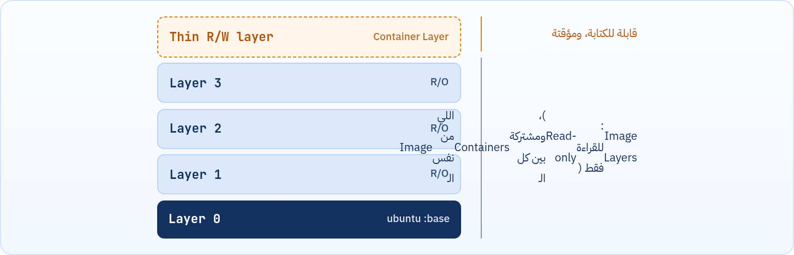
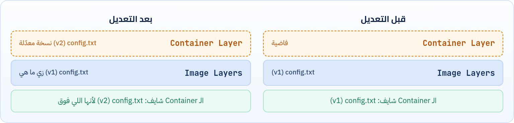
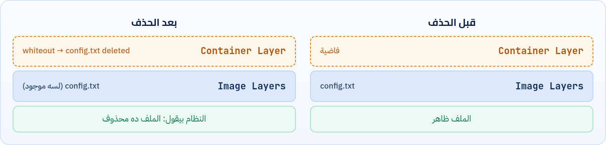

ليه الملف اللي عملناه جوه الـ Container اختفى؟ الإجابة في طريقة بناء الـ Image نفسها: طبقات فوق بعض، كلها Read-only، وفوقها طبقة واحدة بس قابلة للكتابة.

## 6.1 الـ Image مكوّنة من Layers

بما إننا عرفنا قبل كده إن الـ Container بيتعمل أصلاً من الـ Image، فده معناه إن أي حاجة إحنا بنشوفها جوه الـ Container، سواء ملفات أو برامج أو إعدادات أو أي behavior، كلها جاية أساساً من الـ Image. فلو لاحظنا سلوك معين في الـ Container، زي مثلاً إن التعديلات بتختفي لما الكونتينر يتمسح، فده معناه إن السبب الحقيقي غالباً راجع لطريقة تصميم الـ Image نفسها. علشان كده لازم نفهم الـ Image شغالة إزاي من جوه.

- الحقيقة إن الـ Image في Docker مش عبارة عن حاجة واحدة بس، لكنها بتتكوّن من مجموعة طبقات اسمها **Layers**.
- الـ Layers دي هي اللي بتكوّن محتوى الـ Image بالكامل، وهي اللي بتحدد الملفات والبرامج وكل حاجة إحنا بنشوفها لما نشغّل Container منها.
- الطبقات دي بتكون **Immutable**، يعني غير قابلة للتعديل: تقدر تشوف محتواها وتستخدمه، لكن ما ينفعش تعدّل فيها بشكل مباشر. ولو حاولت تعمل تعديل (زي تعديل ملف أو إضافة ملف جديد)، Docker ما بيغيّرش في الـ Layers الأصلية، لكنه بيعمل Layer جديدة فوقها ويحط فيها التعديل اللي حصل.
- لما بنشغّل Container من Image، Docker بيجمّع كل الـ Layers بتاعة الـ Image فوق بعضها علشان يبني منها نظام الملفات اللي إحنا بنشوفه جوه الـ Container. والطريقة دي اسمها **Union File System**، وفكرتها ببساطة إن فيه كذا Layer فوق بعض، لكن إحنا شايفينهم كأنهم File System واحد.
- بعد كده لما الـ Container يشتغل، أي تعديل أو إضافة بتحصل أثناء التشغيل بتتحط في Layer جديدة فوقهم اسمها **Container Layer**، والـ Layer دي هي الوحيدة اللي بتكون قابلة للتعديل.

*الـ Image عبارة عن Layers للقراءة فقط، والـ Container بيضيف فوقها طبقة رقيقة قابلة للكتابة.*

:::note[معلومة إضافية: شوف الـ Layers بعينك]
الأمر `docker image history nginx` بيعرضلك كل Layer في الـ Image، وحجمها، والخطوة اللي عملتها.
:::

## 6.2 الـ Container Layer مؤقتة (Volatile)

- المهم نفهم إن الـ Container Layer دي مؤقتة أو **Volatile**، يعني زي الرامات في الكمبيوتر بالظبط: أول ما البرنامج يقفل، البيانات اللي فيها بتختفي.
- بنفس الفكرة، أول ما الـ Container يتشال أو يتمسح، الـ Layer دي بتروح بكل اللي فيها.
- عشان كده لما تشغّل Container جديد من نفس الـ Image، كل حاجة بترجع زي ما كانت.

## 6.3 لو عملت ملف جديد جوه الـ Container؟

Docker بيحط الملف اللي اتضاف في الـ **Container Layer** اللي فوق، والـ Image Layers نفسها مبتتغيرش.

## 6.4 لو عدّلت ملف موجود؟ (Copy-on-Write)

Docker ما يقدرش يعدّل الملف في مكانه، لأن الطبقات الأصلية Immutable. فاللي بيحصل إنه بياخد نسخة من الملف ده ويحطها في الـ Container Layer، وبعد كده يعمل التعديل على النسخة دي. فكده يبقى عندك:

- نسخة أصلية موجودة في الـ Layers بتاعة الـ Image.
- نسخة معدّلة موجودة في الـ Container Layer.

والسيستم دايماً بيشوف النسخة اللي فوق. ولو مسحت الـ Container، الـ Container Layer بتختفي، ويرجع الملف يظهر زي ما كان في الـ Image.

*الـ Copy-on-Write: التعديل بيتعمل على نسخة في الـ Container Layer، والأصل مبيتلمسش.*

## 6.5 لو مسحت ملف موجود؟ (Whiteout)

لو عندنا ملف اسمه `/etc/config.txt` ومسحناه، Docker ما يمسحش الملف الحقيقي. بدل كده بيعمل حاجة اسمها **Whiteout file**، أو سجل بيقول إن الملف ده محذوف، والسجل ده بيتحط في الـ Container Layer.

*الـ Whiteout: الملف لسه موجود فعلياً في الـ Image، بس مستخبي.*

:::caution[خلي بالك]
يعني مسح ملف كبير جوه الـ Container (أو في سطر RUN لاحق في الـ Dockerfile) **مش بيصغّر** حجم الـ Image، لأن الملف لسه موجود في الـ Layer اللي تحت. وده هيفرق معانا جداً لما نكتب Dockerfile.
:::

:::tip[ملخص الفصل]
- الـ Image مجموعة Layers للقراءة فقط (Immutable) فوق بعض.
- الـ Union File System بيخلّي الطبقات تبان كأنها File System واحد.
- كل Container بياخد Container Layer رقيقة قابلة للكتابة، وبتضيع لما الـ Container يتمسح.
- التعديل = Copy-on-Write، والحذف = Whiteout، والأصل في الـ Image مبيتغيرش.
:::

### أسئلة مراجعة

1. ليه تقدر تشغّل 10 Containers من نفس الـ Image من غير ما المساحة تتضرب في 10؟
2. اشرح اللي بيحصل لما تعدّل ملف موجود في الـ Image من جوه الـ Container.
3. مسحت ملف حجمه 500MB جوه Container، هل حجم الـ Image قلّ؟ وليه؟
