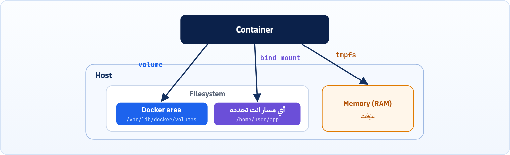

الـ Container Layer مؤقتة، بس فيه بيانات لازم تفضل موجودة حتى لو الـ Container اتمسح، زي قواعد البيانات والملفات اللي رفعها المستخدمين. الحل اسمه Volumes.

:::note[يعني إيه Database؟]
هنتكلم في الفصل ده واللي بعده عن قواعد البيانات زي **Postgres** و MySQL كتير. الـ **Database** برنامج متخصص في حفظ بيانات التطبيق (المستخدمين والطلبات...) ورجّعها بسرعة، والتطبيق بيكلمها على Port (Postgres على 5432). وأهم حاجة هنا: بياناتها لازم تعيش حتى لو الـ Container اتمسح، وعشان كده هي أشهر مثال للـ Volumes. (اتشرحت في سطور في كتاب الإنترنت فصل 3.)
:::

<a id="s7-1"></a>

## 7.1 ليه محتاجين Volumes؟

إحنا لحد دلوقتي فهمنا إن أي تعديل بنعمله جوه الـ Container بيتخزن في الـ Container Layer، والـ Layer دي مؤقتة. يعني أول ما الـ Container يتمسح أو يتشال، كل التعديلات اللي كانت فيها بتختفي. لكن في الاستخدام العملي، غالباً بيكون عندنا بيانات لازم تفضل موجودة حتى لو الـ Container اتشال أو اتعمله إعادة تشغيل.

بيانات قاعدة بياناتملفات رفعها المستخدمينإعداداتوغيرها

لو اعتمدنا على الـ Container Layer بس، كل البيانات دي هتضيع. علشان كده Docker قدّم مفهوم اسمه **Volumes**.

<a id="s7-2"></a>

## 7.2 يعني إيه Volume في Docker؟

الـ Volume ببساطة هو طريقة تخلّي البيانات تتخزن **برّه** نظام الملفات الخاص بالـ Container. بدل ما البيانات تتحفظ جوه الـ Container Layer، بنخليها تتحفظ على جهازك انت نفسه (الـ Host). فبالتالي حتى لو الـ Container اتمسح، البيانات تفضل موجودة، ولما تشغّل Container جديد تقدر توصّله بنفس البيانات. فكأنك بتشارك ملفات معينة بينك وبين كل الـ Containers.


*Volume واحد على الـ Host متشارك بين كذا Container.*

:::note[معلومة مهمة]
لازم تبقى فاهم إن التعديلات اللي هتتعمل من كل الـ Containers على الـ Volume هتفضل ثابتة. يعني الـ Volume نفسه، وهو على الـ Host، محتواه هيتحدّث ويتغير بناءً على التعديلات اللي بتحصل من كل الـ Containers، حتى بعد ما كل الـ Containers دي تقع.
:::

ده يخلينا نسأل سؤال: لو حصل وكل الـ Containers عدّلت في نفس اللحظة على الـ Volume، إيه تأثير ده على محتوى الـ Volume؟ الإجابة: <strong>"Docker ملوش دعوة، والبقاء للأخير"</strong>. هنفهم الكلام ده في آخر الفصل.

<a id="s7-3"></a>

## 7.3 أنواع الـ Volumes



*كل نوع من أنواع التخزين بيحفظ البيانات فين على الـ Host.*

### (1) Named Volumes

ده أفضل وأأمن نوع، وأكتر نوع Docker بينصح بيه (**Best Practice**) في بيئة الإنتاج (Production).

```sh title="Terminal"
docker run -v my-volume:/path/in/container image_name
```

<strong>فكرته:</strong> انت بتطلب من Docker يعملك مساحة تخزين وبتدّيها "اسم محدد" (مثلاً `my-volume`). Docker بياخد الاسم ده، ويروح في مكان آمن وعميق جداً جوه ملفات النظام بتاعك (الـ Host)، ويعمل فولدر بالاسم ده ويديره بالكامل. ده المكان:

```sh title="Host path"
/var/lib/docker/volumes/my-volume/_data/
```

- عشان توصله لازم تبقى root، فاستخدم الأمر `sudo -i`. تقدر تضيف جواه ملفات أو فولدرات من الـ host عادي (وانت root)، أو من جوه الـ Container وهو شغال.
- لاحظ إن المكان ده `_data/` هو اللي بيشوفه الـ Container بس، سواء هيقرا اللي فيه أو يضيف ملفات جديدة.

:::caution[على الماك]
المسار ده جوه الـ Linux VM بتاعة Docker Desktop، مش على الماك نفسه، فـ `sudo -i` مش هيوصّلك ليه. اتفرج على محتوى الـ Volume من جوه Container: `docker run --rm -it -v my-volume:/data busybox ls /data`. أما الـ Bind Mounts (تحت) فبتشاور على فولدرات حقيقية على الماك عادي.
:::

<strong>إمتى نستخدمه؟</strong> لحفظ بيانات قواعد البيانات (Databases)، أو لو عايز تشارك نفس الداتا بين أكتر من Container في نفس الوقت.

### (2) Anonymous Volumes

ده الأخ الصغير للـ Named Volume، بيشتغل بنفس الطريقة بالظبط، بس من غير اسم!

<strong>فكرته:</strong> Docker بيعمل مساحة تخزين آمنة برضه، بس بدل ما انت تدّيله اسم، Docker بيدّيله اسم عبارة عن "كود مشفّر طويل جداً" (Hash).

<strong>بيتعمل إزاي؟</strong> بيتعمل تلقائياً لو استخدمت الـ Instruction بتاعة `VOLUME` جوه الـ Dockerfile، أو عن طريق الأمر ده:

```sh title="Terminal"
docker run -v /path/in/container my-image
```

<strong>إمتى نستخدمه؟</strong> نادراً ما بنستخدمه في بيئة العمل الحقيقية. بيُستخدم أكتر لعمل Back Up سريع أو لحفظ داتا مؤقتة انت مش مهتم ترجعلها باسمها بعدين.

### (3) Bind Mounts

انت اللي بتمسك الدركسيون وبتتحكم في كل حاجة، و Docker ملوش دعوة بإدارة الملفات دي!

<strong>فكرته:</strong> انت بتجيب مسار صريح ومحدد على جهازك انت (مثلاً `/home/user/app/`)، وتربطه بمسار جوه الـ Container. أي تعديل في المسار ده على جهازك بيسمّع فوراً جوه الـ Container، والعكس صحيح.

```sh title="Terminal"
docker run -v /path/on/my/laptop:/app my-node-app
```

<strong>إمتى نستخدمه؟</strong> ده بطل بيئة التطوير (Development). لما تكون بتكتب كود وعايز الـ Container يحس بالتعديلات اللي بتعملها على الـ Editor بتاعك (زي VS Code) في نفس اللحظة، من غير ما تعمل Build للـ Image من أول وجديد (Live Reloading).

### (4) tmpfs Mounts

ده النوع السري والسريع جداً، اللي مابيكتبش أي حاجة على الهارد ديسك أصلاً!

<strong>فكرته:</strong> المساحة دي بتتخلق جوه الـ RAM (الذاكرة العشوائية) بتاعة جهازك الأساسي. بمجرد ما الـ Container يقف، الداتا دي بتتبخر وتختفي للأبد.

```sh title="Terminal"
docker run --tmpfs /app/secure-temp-data my-secure-app
```

<strong>إمتى نستخدمه؟</strong>

- <strong>للأمان العالي:</strong> لو عندك ملفات حساسة جداً (Passwords و API Keys و Secrets) ومش عايزها تتكتب على الهارد ديسك عشان محدش يسرقها.
- <strong>للأداء العالي (Performance):</strong> لو الكونتينر بيعمل عمليات حسابية معقدة وبيكتب ويقرا ملفات مؤقتة كتير جداً، فالـ RAM أسرع بكتير من الهارد.

**مقارنة بين أنواع التخزين الأربعة**

| النوع | بيتخزن فين؟ | مين بيديره؟ | بيعيش لحد إمتى؟ | أحسن استخدام |
|---|---|---|---|---|
| Named Volume | Docker area باسم انت مختاره | Docker | لحد ما تمسحه بنفسك | Databases و Production |
| Anonymous Volume | Docker area باسم Hash | Docker | لحد ما يتمسح (أو مع `docker rm -v`) | داتا مؤقتة مش مهم اسمها |
| Bind Mount | أي مسار على جهازك | انت | زي أي ملف عندك | Development و Live Reloading |
| tmpfs | الـ RAM | Docker | لحد ما الـ Container يقف | Secrets و ملفات مؤقتة سريعة |

:::note[معلومة إضافية: صيغة <span class="ltr">--mount</span>]
فيه صيغة أوضح وأطول بتعمل نفس الحاجة، ومفضّلة في السكربتات لأنها صريحة:

```sh title="Terminal"
docker run --mount type=volume,src=my-volume,dst=/data image_name
docker run --mount type=bind,src=/home/user/app,dst=/app image_name
```
:::

<a id="s7-4"></a>

## 7.4 أوامر إدارة الـ Volumes

بما إن Docker هو اللي بيدير الـ Named والـ Anonymous Volumes، فوفّرلنا مجموعة أوامر عشان نتحكم فيهم (الأوامر دي مابتشتغلش مع الـ Bind Mounts لأنها ملفاتك انت الشخصية):

| الأمر | بيعمل إيه |
|---|---|
| `docker volume create my-volume-name` | إنشاء Volume جديد (قبل ما تشغّل الـ Container). |
| `docker volume ls` | عرض كل الـ Volumes الموجودة على جهازك. |
| `docker volume inspect my-volume-name` | معرفة تفاصيل الـ Volume (مكانه فين بالظبط على جهازك؟).هيطلعلك ملف JSON فيه مسار الـ Mountpoint، وده المكان السري اللي Docker شايل فيه ملفاتك. |
| `docker volume rm my-volume-name` | مسح Volume معين.Docker مش هيرضى يمسح الـ Volume لو فيه Container بيستخدمه. |
| `docker volume prune` | بيمسح أي Volume مش مربوط بـ Container حالياً. مفيد جداً عشان تفضّي مساحة من الهارد. |

:::caution[خلي بالك]
قبل ما تدوس Enter على `docker volume prune`، اتأكد إنك مش محتاج الداتا القديمة دي، لأنها بتتمسح نهائياً.
:::

<a id="s7-5"></a>

## 7.5 لو كذا Container عدّلوا في نفس الوقت؟

لازم تفهم إن Docker مش بيعمل أي إدارة للصراعات (**Conflict Resolution**) جوه الـ Volume. الـ Volume في النهاية هو مجرد فولدر عادي جداً موجود على الهارد ديسك بتاع جهازك. Docker بيفتح الباب للـ Containers ويقولهم: "الفولدر أهو، اتعاملوا انتوا مع بعض". التعامل هنا بيبقى كأنه نظام تشغيل عادي جداً، فاتحين فيه برنامجين بيحاولوا يعدّلوا على نفس الفولدر. وهنا بيظهر عندنا سيناريوهين:

#### السيناريو الأول: بيعدّلوا في ملفات مختلفة

لو الـ Container الأول بيكتب بيانات في ملف اسمه `file_A.txt`، والـ Container التاني بيكتب في ملف اسمه `file_B.txt`، والاتنين جوه نفس الـ Volume.

<strong>النتيجة:</strong> مفيش أي مشكلة خالص. الـ Volume هيحتوي على الملفين، والتعديلات كلها هتتحفظ.

#### السيناريو التاني: بيعدّلوا في نفس الملف في نفس اللحظة

لو 2 Containers بيحاولوا يفتحوا ملف اسمه `data.json` ويعدّلوا فيه في نفس اللحظة بالظبط، بيحصل حاجة في البرمجة اسمها **Race Condition** (حالة السباق).

<strong>إيه اللي هيحصل؟</strong> القاعدة هنا هي <strong>"Last Write Wins"</strong> (الكتابة الأخيرة هي اللي بتكسب). يعني الـ Container اللي هيعمل Save متأخر جزء من الثانية هو اللي تعديله هيفضل، وهيمسح تعديل الـ Container الأولاني تماماً!

:::caution[خلي بالك: Data Corruption]
ولو البرنامجين بيكتبوا في نفس الجزء من الملف في نفس الملّي ثانية، ممكن يحصل **Data Corruption** (تلف في البيانات)، والملف كله يبوظ ويبقى غير قابل للقراءة.
:::

<a id="s7-6"></a>

## 7.6 إزاي المهندسين بيحلّوا المشكلة دي؟

بما إن Docker مش هيحل المشكلة، الحل لازم ييجي مننا إحنا بطريقتين:

:::tip[الحل الأول: الاعتماد على ذكاء التطبيق نفسه (Application-Level Locks)]
لو انت مشغّل Data Base (زي Postgres أو MySQL) في كذا Container وبيقروا من نفس الـ Volume، الـ Data Base دي متبرمجة بذكاء إنها تعمل حاجة اسمها **File Lock** (قفل الملف). يعني لما Container (أ) يدخل يعدّل في الملف، بيحط عليه قفل. لو Container (ب) حاول يعدّل في نفس اللحظة، هيلاقي الملف مقفول، فهيستنى في طابور لحد ما (أ) يخلص ويشيل القفل.

(عشان كده مشاركة نفس فوليوم الـ Data Base بين كذا Container شغالين مش محبّذة أصلاً، وليها طرق تانية أعقد زي الـ Replication).
:::

:::tip[الحل التاني: تحديد الصلاحيات (Read-Only)]
دي الطريقة الأشهر والأأمن في Docker. لو عندك فولدر فيه صور أو ملفات، وعندك Container واحد وظيفته "يرفع" الصور دي، و 3 Containers تانيين وظيفتهم "يعرضوا" الصور دي للناس.

<strong>بنعمل إيه؟</strong> بندّي للـ Container الأولاني صلاحية الكتابة، وبندّي للباقيين صلاحية "القراءة فقط"، وده بيتعمل بإضافة `:ro` في آخر الـ Volume:

```sh title="Terminal"
docker run -d --name uploader -v photos:/data        uploader-app
docker run -d --name viewer1  -v photos:/data:ro     viewer-app
docker run -d --name viewer2  -v photos:/data:ro     viewer-app
```
:::

:::tip[ملخص الفصل]
- الـ Volume بيخزّن البيانات برّه الـ Container، فبتفضل موجودة حتى لو الـ Container اتمسح.
- Named Volume للإنتاج وقواعد البيانات، و Anonymous للمؤقت، و Bind Mount للتطوير، و tmpfs للـ RAM والـ Secrets.
- أوامر الإدارة: `create` و `ls` و `inspect` و `rm` و `prune` مع `docker volume`.
- Docker مش بيحل التعارض: الكتابة الأخيرة هي اللي بتكسب (Last Write Wins).
- الحل: Locks في التطبيق نفسه، أو صلاحيات قراءة فقط بـ `:ro`.
:::

### أسئلة مراجعة

1. إيه الفرق بين `-v data:/app` و `-v /home/me/data:/app`؟
2. انت بتطوّر موقع وعايز التعديلات تبان على طول جوه الـ Container، تستخدم أنهي نوع؟
3. فين بيتخزن الـ Named Volume على الـ Host؟
4. اشرح معنى "Last Write Wins" بمثال.
5. إزاي تخلّي Container يقرا من Volume من غير ما يقدر يعدّل فيه؟
