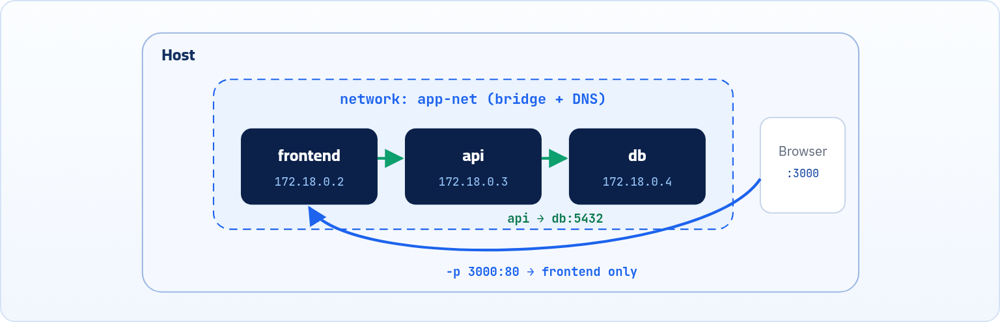

:::note[إضافة]
الفصل ده إضافة على الشرح الأصلي علشان الكتاب يبقى كامل، ومكتوب بنفس الأسلوب.
:::

عرفنا إن كل Container ليه شبكة خاصة بيه، وفتحنا بورت عشان نوصله من جهازنا. طب لو عندي Backend عايز يكلم Database في Container تاني؟ هنا بييجي دور الـ Docker Networks.

<a id="s8-1"></a>

## 8.1 يعني إيه Docker Network؟

فاكر لما قلنا في مثال nginx إن الـ Container يعتبر جهاز خاص فأكيد ليه شبكة خاصة بيه؟ Docker بيعمل شبكات افتراضية جوه الـ Host، وكل Container بيتوصّل بشبكة (أو أكتر)، وبياخد IP خاص بيه جواها. الـ Containers اللي على نفس الشبكة يقدروا يكلّموا بعض، واللي على شبكات مختلفة معزولين عن بعض.

كل شبكة ليها **Driver** بيحدد هي بتشتغل إزاي. أهمهم تلاتة بيبقوا موجودين من أول ما تسطّب Docker:

```sh title="Terminal"
$ docker network ls
NETWORK ID     NAME      DRIVER    SCOPE
7b3c2a1f9d0e   bridge    bridge    local
1e5f8a2b6c3d   host      host      local
9a0d4c7e2f1b   none      null      local
```

<a id="s8-2"></a>

## 8.2 أنواع الشبكات: bridge و host و none

**الـ Network Drivers الأساسية**

| الـ Driver | بيعمل إيه؟ | إمتى نستخدمه؟ |
|---|---|---|
| **bridge** (الافتراضي) | شبكة داخلية معزولة على الـ Host. كل Container بياخد IP جواها، وعشان توصله من برّه لازم `-p`. | أغلب الحالات على سيرفر واحد. |
| **host** | الـ Container بيستخدم شبكة الـ Host نفسها مباشرة، من غير عزل ولا Port Mapping. لو nginx بيسمع على 80، يبقى على 80 بتاعة الـ Host على طول. | لما تحتاج أعلى أداء للشبكة (متاح على Linux). |
| **none** | مفيش شبكة خالص، غير الـ loopback جوه الـ Container. | مهام معزولة تماماً مش محتاجة نت. |

```sh title="Terminal"
docker run -d nginx                     # bridge (default)
docker run -d --network host nginx      # host network
docker run --rm --network none busybox ip addr
```

:::note[معلومة مهمة]
فيه Drivers تانية للحالات المتقدمة، زي **overlay** اللي بيربط Containers على كذا سيرفر (بيُستخدم مع Docker Swarm)، و **macvlan** اللي بيدّي الـ Container عنوان MAC كأنه جهاز حقيقي على الشبكة.
:::

<a id="s8-3"></a>

## 8.3 الشبكات اللي بتعملها بنفسك (User-defined)

أي Container بتشغّله من غير ما تحدد شبكة بيروح على الـ **bridge** الافتراضية. المشكلة إن الشبكة الافتراضية دي مفيهاش **DNS**، يعني الـ Containers يقدروا يكلّموا بعض بالـ IP بس، والـ IP بيتغيّر كل ما الـ Container يتعمل من جديد. الحل إنك تعمل شبكة بنفسك:

| الأمر | بيعمل إيه |
|---|---|
| `docker network create app-net` | إنشاء شبكة جديدة من نوع bridge اسمها `app-net`. |
| `docker run -d --name db --network app-net postgres:16` | تشغيل Container وتوصيله بالشبكة من البداية. |
| `docker network connect app-net web` | توصيل Container شغال أصلاً بشبكة (و `disconnect` لفصله). |
| `docker network inspect app-net` | تفاصيل الشبكة: الـ Subnet والـ Containers المتوصّلة بيها. |
| `docker network rm app-net` | مسح الشبكة (لازم مفيش Containers عليها). و `docker network prune` يمسح كل الشبكات اللي مش مستخدمة. |

<a id="s8-4"></a>

## 8.4 الـ DNS جوه الشبكة: كلّم الـ Container باسمه

أحلى حاجة في الـ User-defined networks إن Docker بيشغّل فيها **DNS داخلي**، فأي Container يقدر يوصل لأي Container تاني على نفس الشبكة **باسمه** (الـ `--name`). يعني الـ Backend يكتب في إعداداته إن الـ Database موجودة على `db:5432`، ومش محتاج يعرف أي IP.



*شبكة User-defined: الـ Containers بتكلّم بعض بالاسم، وبس اللي محتاج يتشاف من برّه هو اللي ليه Port Mapping.*

:::note[مثال عملي: جرّب الـ DNS بنفسك]
```sh title="Terminal"
$ docker network create app-net
$ docker run -d --name web --network app-net nginx
$ docker run --rm --network app-net busybox wget -qO- http://web
<!DOCTYPE html>
<html><head><title>Welcome to nginx!</title> ...
```

الـ busybox وصل لـ nginx بكلمة `web` بس، من غير IP ومن غير `-p`، لأنهم على نفس الشبكة. (و `--rm` معناها امسح الـ Container أول ما يخلص).
:::

:::caution[خلي بالك]
- الـ Containers اللي على نفس الشبكة بيكلّموا بعض على **بورت الـ Container** نفسه (زي 80 أو 5432)، مش على البورت اللي عملتله Mapping على الـ Host.
- متعملش `-p` لقاعدة البيانات لو مفيش حد من برّه محتاجها. سيبها جوه الشبكة بس، ده أأمن.
:::

:::tip[ملخص الفصل]
- كل Container بيتوصّل بشبكة وبياخد IP جواها، والـ Driver الافتراضي هو bridge.
- host: الـ Container بيستخدم شبكة الـ Host مباشرة، و none: مفيش شبكة.
- اعمل شبكة بنفسك بـ `docker network create` علشان تاخد DNS داخلي.
- جوه الـ User-defined network الـ Containers بتكلّم بعض بالاسم وعلى بورت الـ Container.
- `-p` بس للحاجة اللي لازم تتشاف من برّه الـ Host.
:::

### أسئلة مراجعة

1. ليه مينفعش تعتمد على الـ IP بتاع الـ Container في إعدادات التطبيق؟
2. إيه الفرق بين الـ bridge الافتراضية والـ bridge اللي انت بتعملها بنفسك؟
3. Container بـ `--network host` هل محتاج `-p`؟ وليه؟
4. الـ api عايز يوصل لـ postgres اسمه `db` على نفس الشبكة، يكتب العنوان إزاي؟
