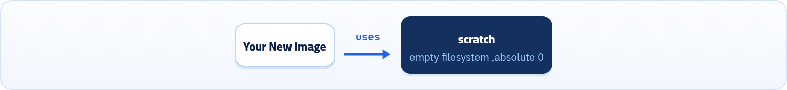
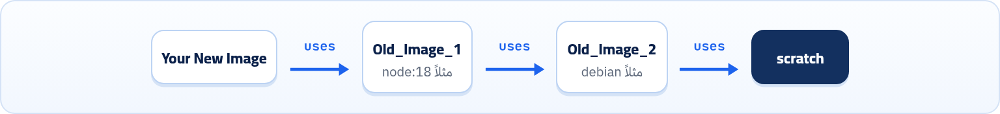

هنا بنتعلم نكتب الـ Dockerfile بنفسنا: إزاي ننشئه، شكله العام، وكل Instruction بالتفصيل، مع الفروق المهمة والـ Best Practices اللي بتفرق بين Image محترمة و Image مليانة مشاكل.

<a id="s9-1"></a>

## 9.1 يعني إيه Dockerfile؟

- زي ما احنا عارفين، الـ Dockerfile هو ملف نصّي بنكتب فيه مجموعة **Instructions** اللي Docker بيستخدمها عشان يبني Image.
- بمعنى أبسط، كل سطر انت بتكتبه جوه الـ Dockerfile بيكون خطوة من خطوات بناء الـ Image اللي هتطلع منه لما نعمله build.
- وعشان كده نقدر نقول إن الـ Dockerfile هو الأساس اللي بتتبني عليه أي Docker Image، لأنه هو اللي بيحدد بالظبط الـ Image دي هيبقى فيها إيه وإزاي هتتجهز.

<a id="s9-2"></a>

## 9.2 بنستخدم Dockerfile ليه؟

الـ Dockerfile بيُستخدم غالباً في حالتين أساسيين:

### (1) إنك تبني Image جديدة من البداية (From Scratch)

يعني تعمل Image من الصفر خالص، من غير ما تعتمد على Image موجودة قبل كده. (ودي تعتبر مستوى متقدم جداً جداً، نادراً ما بيحصل، أو نادراً ما بيتعامل معاه مبتدئ زيك).



*بناء Image من الصفر مباشرة على `scratch`.*

### (2) إنك تعدّل على Image موجودة بالفعل

بمعنى إنك تاخد Image جاهزة وتستخدمها كقاعدة (**Base Image**)، وبعد كده تضيف عليها حاجات أو تغيّر فيها، بحيث تطلع Image جديدة مخصصة (Customized) تناسب احتياجاتك أو احتياجات الشغل. (ودي اللي هنركز عليها في الشرح أكتر لأنها الأكثر شيوعاً).



*أي Image جاهزة هي في الآخر مبنية فوق Images تانية لحد ما توصل لـ `scratch`.*

<a id="s9-3"></a>

## 9.3 أهمية الـ Dockerfile: توثيق مش بس بناء

غير إنه بيبني الـ Image، الـ Dockerfile كمان ليه دور مهم جداً في **توثيق** طريقة بناء الـ Image، لأن كل الخطوات اللي حصلت أثناء البناء بتكون مكتوبة فيه بشكل واضح. وده معناه إن أي حد يشوف الـ Dockerfile يقدر يفهم:

- الـ Image دي اتبنت إزاي.
- إيه التعديلات اللي اتعملت عليها.
- وإيه المكونات أو الإعدادات الموجودة جواها.

:::caution[خلي بالك: docker commit]
ده بيختلف عن إنك تعدّل يدوياً جوه Container وبعدين تعمل `docker commit`، لأن الطريقة دي بتطلّع Image جديدة فعلاً، لكن مش بتوضّح الخطوات اللي اتعملت عشان نوصل للتغييرات دي. محدش هيعرف يكرّرها أو يراجعها.
:::

خلينا نمشي الموضوع خطوة خطوة: الأول إزاي تنشئ Dockerfile، بعد كده الشكل العام للـ syntax، وبعدها نمسك كل instruction بالتفصيل والقيم المحتملة والملاحظات المهمة.

<a id="s9-4"></a>

## 9.4 إزاي تنشئ Dockerfile

مجرد ملف نصّي عادي بدون أي extension، يعني اسمه يكون بالظبط: `Dockerfile`، مش `Dockerfile.txt` ولا `dockerfile`. هتنشئ الملف عادي جداً زي أي ملف:

```sh title="Terminal"
nano Dockerfile
```

<a id="s9-5"></a>

## 9.5 الشكل العام للـ Dockerfile

الـ Dockerfile عبارة عن instructions مكتوبة سطر سطر. الشكل العام بيكون كده:

```dockerfile
FROM base_image:tag
LABEL key=value
ENV variable=value
ARG variable=value
WORKDIR /path
COPY source destination
ADD  source destination
RUN command
EXPOSE port
CMD ["command"]
ENTRYPOINT ["command"]
```

1. `FROM base_image:tag`: الـ Base Image اللي هنبني عليها
2. `LABEL key=value`: بيانات وصفية (Metadata)
3. `ENV variable=value`: واحد منهم أو الاتنين مع بعض
4. `WORKDIR /path`: مسار الشغل
5. `COPY source destination`: واحد منهم (COPY أو ADD)
6. `RUN command`: أوامر وقت البناء
7. `EXPOSE port`: توثيق البورت
8. `CMD ["command"]`: أمر التشغيل: CMD أو ENTRYPOINT

:::tip[Best Practice: قلّل عدد الـ Layers]
لاحظ إن كل سطر من سطور الـ Dockerfile بيتحوّل لـ **layer** لما يتعمل build للـ Dockerfile ويبقى image. فلذلك مهم جداً نقلّل عدد السطور، عشان منخليش عدد الـ layers بتاعة الـ image اللي هتطلع كبير، لأنه هينعكس على حجم الـ image ويزوّدها، وده مش مستحب خالص.

فلو مثلاً هضطر أكتب نفس الـ instruction أكتر من مرة، هحاول أجمعهم كلهم في نفس السطر مع بعض عشان يبقوا layer واحدة، بدل ما أكتبهم في كذا سطر ويطلع عندي كذا layer والحجم يزيد.
:::

:::note[معلومة مهمة]
بالتحديد، الـ Instructions اللي بتضيف ملفات فعلاً (`RUN` و `COPY` و `ADD`) هي اللي بتعمل Layers ليها حجم. الباقي (زي `ENV` و `LABEL` و `CMD`) بيضيف معلومات (metadata) بس، ومبيكبّرش الحجم.
:::

<a id="s9-6"></a>

## 9.6 FROM: نقطة البداية

ده أول سطر تقريباً في أي Dockerfile. وظيفته يحدد الـ **base image** اللي هنبني عليها.

```dockerfile title="Syntax"
FROM image_name:tag
```

| الأمر | بيعمل إيه |
|---|---|
| `image_name` | اسم الـ image اللي عايز تبني عليها (لو هتبني image جديدة من image قديمة)، أو `scratch` لو عايز تعمل image جديدة من الصفر، وكده معناه إن مفيش OS جاهز. |
| `tag` | الـ version بتاع الـ image. لو مكتبتش `:tag` خالص هيفترض إنك عايز أحدث نسخة (يعني كأنك كتبت `:latest`). |

<a id="s9-7"></a>

## 9.7 LABEL: بيانات وصفية

طريقة بنضيف بيها "بيانات وصفية" (**Metadata**) للـ Docker Image بتاعتنا. البيانات دي مبتأثرش خالص على طريقة شغل الـ Image أو الكود اللي جواها، لكنها بتدّي معلومات توضيحية مهمة جداً للمطورين أو للأنظمة اللي بتتعامل مع الـ Image دي.

```dockerfile title="Syntax"
LABEL key=value
LABEL key1=value1 key2=value2 ... keyN=valueN
LABEL author="moaz"
```

ولو عايز تكتب كذا حاجة جوه نفس السطر بتاع الـ instruction بس عايز تقسّمهم لسطور تحت بعض، دي الطريقة العامة (علامة `\` في آخر السطر):

```dockerfile title="Dockerfile"
LABEL key1=value1 \
      key2=value2 \
      keyN=valueN
```

<a id="s9-8"></a>

## 9.8 ENV و ARG: المتغيرات

### ENV

بتُستخدم لتعريف متغيرات البيئة (**Environment Variables**). الفكرة هنا إنك بتحدد قيم ثابتة أو إعدادات معينة (زي الـ Port، أو مسار ملفات، أو بيئة التشغيل) جوه الـ Image. أهم ميزة في الـ ENV إن المتغيرات دي بتفضل موجودة وشغالة حتى بعد ما الـ Image تتحول لـ Container ويبدأ يشتغل، وتقدر تغيّر قيمتها من برّه وانت بتشغّل الـ Container (بـ `-e`)، من غير ما تحتاج تبني الـ Image من أول وجديد. (والعُرف إن أسماء المتغيرات تتكتب كلها Capital).

```dockerfile title="Syntax"
ENV key=value
ENV key1=value1 key2=value2 ... keyN=valueN
ENV PORT=8080
```

### ARG

هو متغير بنستخدمه عشان نمرّر قيم أو إعدادات للـ Dockerfile **وقت بناء الـ Image فقط**. الفرق الجوهري بينه وبين الـ ENV إن الـ ARG بيختفي تماماً بمجرد ما الـ Image تخلص بناء، ومبيكونش متاح جوه الـ Container وهو شغال.

```dockerfile title="Syntax"
ARG key
ARG key=value
ARG key1=value1 key2=value2 ... keyN=valueN
```

**ENV مقابل ARG**

|   | ENV | ARG |
|---|---|---|
| متاح وقت الـ build | أيوه | أيوه |
| متاح جوه الـ Container | أيوه، وبيفضل موجود | لأ، بيختفي بعد الـ build |
| تغيير القيمة | `docker run -e PORT=9090` | `docker build --build-arg VERSION=2` |
| مثال استخدام | PORT و NODE\_ENV | رقم version لأداة هتتسطّب |

:::caution[خلي بالك]
متحطش Passwords أو API Keys في `ENV` أو `ARG` جوه الـ Dockerfile، لأنهم بيتسجّلوا في الـ Image وأي حد معاه الـ Image يقدر يشوفهم بـ `docker inspect` أو `docker image history`.
:::

<a id="s9-9"></a>

## 9.9 WORKDIR: مسار الشغل

بيحدد "مسار العمل الحالي" (**Current Working Directory**). المعنى هنا إن أي Instruction هتيجي تحته في الـ Dockerfile هتتنفذ تلقائياً جوه المسار اللي انت هتحدده.

```dockerfile title="Syntax"
WORKDIR /path
```

كأنك بتخلّي قبل كل Command ممكن يتكتب جوه الـ Container وهو شغال، يتعمل الأمر `cd /path` على المسار اللي حددته. (ولو المسار مش موجود، Docker بيعمله لوحده).

<a id="s9-10"></a>

## 9.10 COPY و ADD: نقل الملفات

بياخد نسخة من الملفات أو الفولدرات اللي موجودة على جهازك (Host)، ويحطها جوه الـ Docker Image، فالملفات أو الفولدرات دي هتبقى موجودة جوه الـ Container وهو شغال.

```dockerfile title="Syntax"
COPY source_path destination_path
ADD  source_path destination_path
```

الـ ADD والـ COPY بيعملوا نفس الحاجة بالظبط، بس الـ ADD معاه حاجتين زيادة مابيعملهمش COPY:

#### (1) فك الضغط التلقائي (Auto-Extraction)

لو المصدر (src) بتاعك عبارة عن ملف مضغوط (زي `.tar` أو `.tar.gz`) موجود على جهازك، Docker مش بس هينقله، ده هيفك ضغطه تلقائياً جوه الـ Image في المسار اللي انت حددته.

```dockerfile title="Dockerfile"
ADD my_app_code.tar.gz /app/
```

#### (2) التحميل من الروابط (URL Download)

لو المصدر (src) عبارة عن لينك (URL) لملف على الإنترنت، Docker هيحمّله ويحطه في الوجهة اللي حددتها.

```dockerfile title="Dockerfile"
ADD https://example.com/config.json /app/
```

:::tip[Best Practice: إمتى أستخدم ده وإمتى ده؟]
توصيات Docker الرسمية بتقولك: <strong>"استخدم COPY دايماً، إلا للضرورة القصوى!"</strong>. طب ليه بنفضّل COPY؟

- <strong>الوضوح والشفافية:</strong> لما المطور بيشوف COPY بيبقى عارف ومتأكد إن دي مجرد عملية نقل ملفات بسيطة. لكن ADD ممكن يكون بيفك ضغط ملف أو بيحمّل حاجة من النت، وده بيخلّي سلوك الـ Dockerfile مش متوقع أحياناً.
- <strong>ميزة التحميل من الروابط في ADD مش مفضّلة:</strong> لأنك لو حمّلت ملف بـ ADD مش هتقدر تمسح الملفات المؤقتة في نفس الخطوة (يعني الملف الأصلي المضغوط هيفضل موجود حتى بعد ما يتفك ضغطه)، وده بيكبّر حجم الـ Image على الفاضي، لأنه هيبقى فيها الملف المضغوط + الملفات اللي طلعت منه.
:::

<strong>البديل الأفضل لتحميل الروابط:</strong> بدل ما تستخدم ADD لتحميل ملف من النت، الأفضل تستخدم RUN مع أداة زي `curl` أو `wget`، عشان تقدر تحمّل الملف، وتعمل اللي انت عايزه، وتمسح الملفات الزيادة في نفس السطر (وبكده تحافظ على حجم الـ Image صغير):

```dockerfile title="Dockerfile"
RUN curl -O https://example.com/big_file.tar.gz \
    && tar -xzf big_file.tar.gz \
    && rm big_file.tar.gz
```

**COPY مقابل ADD**

| الميزة | COPY | ADD |
|---|---|---|
| نسخ ملفات وفولدرات من الجهاز | أيوه | أيوه |
| فك ضغط `.tar` تلقائي | لأ | أيوه |
| تحميل من URL | لأ | أيوه (مش مفضّل) |
| السلوك متوقع وواضح | دايماً | مش دايماً |
| التوصية | **الاختيار الافتراضي** | للضرورة بس (فك ضغط ملف محلي) |

<a id="s9-11"></a>

## 9.11 RUN: عضلات الـ Dockerfile

هي "العضلات" بتاعة الـ Dockerfile. دي الـ Instruction اللي بتنفّذ أي أمر انت متعوّد تكتبه بإيدك في التيرمينال (زي تسطيب Packages، أو تنزيل Libraries، أو إنشاء فولدرات).

<strong>بيشتغل إمتى؟</strong> بيشتغل وقت بناء الـ Image فقط (**Build-Time**). بمجرد ما الـ Image تتبني، الأوامر دي مش بترجع تشتغل تاني جوه الـ Container.

```dockerfile title="Syntax"
RUN command
RUN command1 && command2 && ...
```

:::tip[Best Practice: عشان تحافظ على حجم الـ Image صغير وسريع]
- <strong>دمج الأوامر (Chaining):</strong> دايماً ادمج أوامر التحديث، والتسطيب، وتنظيف الملفات المؤقتة في سطر واحد (طبقة واحدة) باستخدام `&&` وعلامة `\` عشان تنزل سطر جديد.
- <strong>فخ الكاش (The Cache Trap):</strong> إياك تكتب أمر التحديث (`apt-get update`) في سطر RUN منفصل. Docker هيستخدم الكاش (النسخة المخبّأة) ومش هيحدّث حاجة. دايماً اربط التحديث بالتسطيب.

```dockerfile title="Dockerfile"
RUN apt-get update \
    && apt-get install -y --no-install-recommends curl \
    && rm -rf /var/lib/apt/lists/*
```
:::

<a id="s9-12"></a>

## 9.12 CMD و ENTRYPOINT: أمر التشغيل

هما التعليمات اللي بتحدد "البرنامج أو الـ Process الأساسي" اللي الـ Container هينفّذه أول ما يشتغل (**Run-time**). حياة الـ Container مرتبطة بالبرنامج ده: طول ما هو شغال الـ Container عايش، ولما يخلص (أو يقفل) الـ Container بيقع (Exits) فوراً.

```dockerfile title="Syntax"
CMD        ["executable", "param1", "param2"]
ENTRYPOINT ["executable", "param1", "param2"]
```

:::note[ملاحظة: الـ Exec Form]
اللي بيتكتب بعدهم هو command عادي، ولكن مش بيتكتب بالصورة العادية (كلمات بينها مسافات)، لأ بيتكتب بـ **Exec Form**، يعني كل كلمة بتتحط بين علامتين تنصيص مزدوجة `"..."`، وكلهم جوه `[ ]`.
:::

الـ CMD والـ ENTRYPOINT بيعملوا نفس الحاجة بالظبط (تشغيل الكونتينر)، بس الفرق الجوهري بينهم في <strong>"المرونة مقابل الإجبار"</strong>:

#### (1) الأمر الافتراضي المرن: CMD

بيحدد أمر افتراضي. لو المستخدم وهو بيشغّل الـ Container بـ `docker run` كتب أي أمر إضافي من عنده، Docker بيلغي أمر الـ CMD تماماً، وبينفّذ أمر المستخدم.

```dockerfile title="Dockerfile"
CMD ["echo", "Hello"]
```

```sh title="Terminal"
$ docker run my-image bash
# الـ Container هيتجاهل echo ويشغّل bash
```

#### (2) الأمر الإجباري الثابت: ENTRYPOINT

بيحدد برنامج ثابت وإجباري، مستحيل يتلغي بمجرد كتابة أمر بعد `docker run`. لو المستخدم كتب أي كلام زيادة، Docker بياخد الكلام ده ويعتبره "إضافات" (Arguments)، ويلزقه جنب أمر الـ ENTRYPOINT الأساسي.

```dockerfile title="Dockerfile"
ENTRYPOINT ["echo", "Hello"]
```

```sh title="Terminal"
$ docker run my-image World
Hello World
```

:::tip[Best Practice: إمتى أستخدم ده وإمتى ده؟]
- <strong>استخدم CMD:</strong> لو بتعمل Image عامة وممكن تشغّل جواها كذا حاجة (زي بيئة Ubuntu أو Node)، ومحتاج بس تدّي أمر افتراضي ينفع المستخدم يغيّره بسهولة.
- <strong>استخدم ENTRYPOINT:</strong> لو بتعمل Image معمولة لغرض واحد محدد (زي سيرفر Nginx أو أداة CLI زي `curl` أو `ping`)، وعايز تقفل الكونتينر على البرنامج ده عشان محدش يلغيه بالغلط.
:::

### دمجهم مع بعض (The Pro Way)

في بيئات العمل الحقيقية، أحسن طريقة إننا نستخدمهم هما الاتنين مع بعض: بنخلّي الـ ENTRYPOINT هو البرنامج الأساسي (اللي مش هيتغير)، والـ CMD هي الإضافات الافتراضية (اللي ينفع تتغير لو اليوزر حابب).

```dockerfile title="Dockerfile"
ENTRYPOINT ["ping"]
CMD ["google.com"]
```

```sh title="Terminal"
$ docker run my-ping
# ping google.com
$ docker run my-ping docker.com
# ping docker.com
```

**CMD مقابل ENTRYPOINT**

|   | CMD | ENTRYPOINT |
|---|---|---|
| دوره | أمر افتراضي | البرنامج الثابت للـ Container |
| لو كتبت أمر بعد `docker run` | بيتلغي ويتنفّذ أمرك | كلامك بيتضاف كـ Arguments |
| تغييره بالإجبار | بسهولة | بس بـ `--entrypoint` |
| مناسب لـ | Images عامة (ubuntu و node) | Images لغرض واحد (nginx و أدوات CLI) |

<a id="s9-13"></a>

## 9.13 EXPOSE: يافطة معلومات

بتمثّل "يافطة معلومات" (**Documentation**). بنستخدمها عشان نقول للمطورين اللي هيستخدموا الـ Image من بعدنا: "يا جماعة، الـ Container ده لما يشتغل، هيكون جواه تطبيق مستني حد يكلّمه على الـ Port الفلاني".

```dockerfile title="Syntax"
EXPOSE port
```

:::caution[الخدعة الكبيرة: إيه اللي EXPOSE مابيعملوش؟]
الـ EXPOSE **مش بيفتح الـ Port فعلياً** للعالم الخارجي (لجهازك). يعني لو كتبت `EXPOSE 80` وشغّلت الـ Container، مش هتقدر تفتح موقعك من متصفح جهازك. هي مجرد توثيق داخلي بيقول إن الـ Container جاهز يستقبل اتصالات على الـ Port ده جوه شبكة Docker نفسها.
:::

<strong>إزاي نفتح الـ Port بجد؟</strong> زي ما عملنا في مثال nginx: وانت بتعمل run للـ image هتضيف بعد كلمة run:

```sh title="Terminal"
-p host_port:container_port
```

أو `-P` بس، وساعتها هيختار الـ Port بشكل عشوائي لكل بورت متعمله EXPOSE.

<a id="s9-14"></a>

## 9.14 USER: متشغّلش كـ root

بيحدد مين هو "المستخدم" (User) اللي هينفّذ الأوامر اللي جاية في الـ Dockerfile (تحديداً RUN و CMD و ENTRYPOINT)، وهو نفس المستخدم اللي الـ Container هيشتغل بصلاحياته بعد كده.

```dockerfile title="Syntax"
USER user_name
USER UID
```

لو مكتبتش USER خالص، Docker بيشغّل الـ Container والـ App بتاعك بصلاحيات الـ **root** (المدير العام اللي يقدر يعمل أي حاجة). وده خطر جداً أمنياً! طب ليه؟ تخيّل لو تطبيقك فيه ثغرة والـ Hacker قدر يخترق الـ Container. لو الـ Container شغال بـ root، الـ Hacker ممكن يسيطر على جهازك الأساسي (Host) نفسه! لكن لو شغال بمستخدم عادي، الـ Hacker هيكون محبوس بصلاحيات ضعيفة.

<strong>طب إيه الحل؟</strong> نعمل خدعة بسيطة: بنسطّب البرامج الأول كـ root، وبعدين بنعمل مستخدم جديد بصلاحيات محدودة، وفي الآخر بنعمل سويتش (Switch) للمستخدم ده عشان نشغّل بيه التطبيق:

```dockerfile
RUN apk add --no-cache nodejs \
    && adduser -D appuser
USER appuser
CMD ["node", "app.js"]
```

1. `RUN apk add --no-cache nodejs \`: إحنا هنا root (عشان نعرف نسطّب برامج). مش شرط تعمل كده بالظبط، بس القصد إنك تخلّص كل اللي محتاج تعمله وانت root، وبعدها تضيف في الآخر أمر بيعمل user جديد.
2. `USER appuser`: بنعمل Switch للمستخدم الجديد.
3. `CMD ["node", "app.js"]`: الأمر ده هيشتغل بصلاحيات `appuser` الضعيفة (أمان تام).

:::tip[ملخص الفصل]
- الـ Dockerfile ملف اسمه `Dockerfile` بالظبط، فيه Instructions بتبني الـ Image، وبيوثّق طريقة بنائها.
- FROM للبداية، و LABEL للـ Metadata، و WORKDIR لمسار الشغل.
- ENV بيفضل جوه الـ Container، و ARG وقت الـ build بس.
- COPY هو الافتراضي، و ADD للضرورة (فك ضغط ملف محلي).
- RUN وقت الـ build: ادمج الأوامر ونضّف في نفس السطر.
- CMD أمر افتراضي مرن، و ENTRYPOINT برنامج ثابت، والأحسن الاتنين مع بعض.
- EXPOSE توثيق بس، والفتح الحقيقي بـ `-p`. و USER علشان متشغّلش كـ root.
:::

### أسئلة مراجعة

1. ليه الأفضل تكتب الـ Image بـ Dockerfile بدل `docker commit`؟
2. اكتب سطر RUN واحد يحدّث الـ packages ويسطّب `git` وينضّف الكاش.
3. Image فيها `ENTRYPOINT ["ping"]` و `CMD ["google.com"]`، إيه اللي هيتنفّذ لو كتبت `docker run img 8.8.8.8`؟
4. كتبت `EXPOSE 3000` ومش عارف تفتح التطبيق من المتصفح، ليه؟ وإيه الحل؟
5. إيه الفرق بين ENV و ARG؟ وإمتى تستخدم كل واحد؟
6. ليه تشغيل الـ Container كـ root خطر؟
