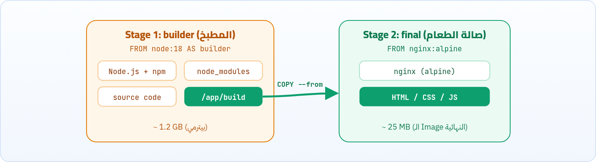

خلّصنا كتابة الـ Dockerfile، فاضل نعمله build ونشغّل الناتج. وبعدها نشوف مشكلة الـ Images التقيلة اللي مليانة كراكيب، وحلها الذكي: Multi-stage Build.

<a id="s10-1"></a>

## 10.1 أمر docker build

بمجرد ما تخلّص كتابة الـ Dockerfile، تحفظه وتقفله، وبعدها تكتب:

| الأمر | بيعمل إيه |
|---|---|
| `docker build -t image_name /path/to/folder` | ابني Image من الفولدر ده، اللي جواه ملف اسمه `Dockerfile`. |
| `docker build -t image_name .` | لو الـ Dockerfile في نفس المسار اللي انت فيه (النقطة = المسار الحالي). |
| `docker build -t image_name -f /path/to/MyDockerfile .` | لو الملف اسمه أي حاجة غير `Dockerfile`، تحدد مكانه بـ `-f`. |

:::note[يعني إيه النقطة في الآخر؟]
المسار اللي في آخر أمر `docker build` اسمه الـ **Build Context**: ده الفولدر اللي Docker بيبعته كله للـ builder، وهو اللي `COPY` و `ADD` بيقدروا ياخدوا منه ملفات. وعلشان كده هنحتاج ملف `.dockerignore` اللي هنشرحه في الفصل الجاي.
:::

<a id="s10-2"></a>

## 10.2 مثال عملي: موقع static بـ nginx

عايزين نعمل Dockerfile نعمل بيه Image جديدة تقوّملنا موقع باستخدام nginx، بس الموقع هيكون خاص بينا، مش الصفحة الافتراضية بتاعة nginx.

1. نعمل فولدر فيه ملفات الموقع اسمه `my-static-website`، ونعمل جواه ملفين اتنين بس: ملف الكود بتاع الموقع `index.html`، وملف الـ `Dockerfile`.
2. هنفتح ملف الـ Dockerfile ونكتب فيه (هتلاحظ إننا طبّقنا كل اللي شرحناه قبل كده):

```dockerfile
FROM nginx:alpine
WORKDIR /usr/share/nginx/html
RUN rm -rf ./*
COPY ./index.html .
EXPOSE 80
```

1. `FROM nginx:alpine`: بنحدد البيئة الأساسية (اخترنا نسخة alpine لأن حجمها صغير جداً وسريعة).
2. `WORKDIR /usr/share/nginx/html`: بنحدد مسار العمل الافتراضي اللي Nginx متبرمج يقرا منه ملفات الموقع.
3. `RUN rm -rf ./*`: بنمسح صفحة الترحيب الافتراضية بتاعة Nginx عشان نحط صفحتنا إحنا.
4. `COPY ./index.html .`: بننسخ ملف `index.html` من جهازنا لمسار العمل جوه الـ Image.
5. `EXPOSE 80`: بنوثّق إن الـ Container بيستقبل الاتصالات على بورت 80.

:::note[معلومة مهمة]
مكتبناش CMD ولا ENTRYPOINT، لأننا ورثناهم جاهزين من الـ Image الأصلية بتاعة Nginx.
:::

3. دلوقتي هنفتح التيرمينال (Terminal) جوه الفولدر بتاعنا، ونكتب أمر البناء: هنا إحنا بنقول لـ Docker: ابني Image واديها اسم `my-nginx-website` باستخدام ملف الـ Dockerfile اللي في المسار الحالي.

   ```sh title="Terminal"
   docker build -t my-nginx-website .
   ```
4. بعد ما البناء يخلص، هنشغّل الـ Container ونربط البورتات عشان نقدر نشوف الموقع: وافتح `http://localhost:8080` هتلاقي صفحتك انت.

   ```sh title="Terminal"
   docker run -d --name my-running-site -p 8080:80 my-nginx-website
   ```

<a id="s10-3"></a>

## 10.3 المشكلة: الـ Image المليانة كراكيب

تخيّل إنك بتعمل تطبيق بـ React أو Angular، أو حتى برنامج بـ Java أو Go. عشان تحوّل الكود بتاعك لتطبيق شغال، انت محتاج الآتي:

- <strong>أدوات البناء (Build Tools):</strong> زي Node.js و npm أو المترجمات (Compilers).
- <strong>كود المصدر (Source Code):</strong> الكود اللي انت كاتبه.
- <strong>المكتبات (Dependencies):</strong> فولدر زي `node_modules` اللي حجمه ممكن يوصل لجيجات!

لو كتبنا Dockerfile عادي، هنضطر نحط كل ده جوه الـ Image. النتيجة؟

#### حجم الـ Image ضخم جداً

ممكن يوصل لـ 1 أو 2 جيجا! في حين إن التطبيق النهائي (ملفات HTML و CSS و JS) حجمه 10 ميجا بس.

#### كارثة أمنية (Security Risk)

انت كده رافع الـ Source Code بتاعك، وأدوات البناء، والمكتبات على سيرفر الإنتاج (Production). لو هاكر دخل، هيلاقي بيئة كاملة يقدر يلعب فيها براحته!

<a id="s10-4"></a>

## 10.4 الحل: Multi-stage Build (نظرية المطبخ وصالة الطعام)

فكرة البناء متعدد المراحل ببساطة عاملة زي المطعم:

- <strong>المرحلة الأولى (المطبخ):</strong> فيها الطبّاخين، والسكاكين، ومكونات الأكل الخام، والبوتاجاز. بنطبخ هنا الأكل (بنعمل Build للكود).
- <strong>المرحلة التانية (صالة الطعام):</strong> دي اللي الزبون بيقعد فيها. الزبون مش محتاج يشوف السكاكين ولا قشر البصل، هو محتاج "الطبق النهائي الجاهز" بس!

Docker بيسمحلك تعمل كذا `FROM` في نفس الـ Dockerfile. كل `FROM` بتبدأ مرحلة (**Stage**) جديدة تماماً. وفي النهاية، Docker بياخد المرحلة الأخيرة بس ويحوّلها لـ Image، وبيرمي كل المراحل اللي قبلها في الزبالة!



*الـ Multi-stage Build: بنبني في مرحلة، وبناخد الناتج بس للمرحلة الأخيرة.*

<a id="s10-5"></a>

## 10.5 مثال عملي متكامل: تطبيق React مع Nginx

```dockerfile
FROM node:18 AS builder
WORKDIR /app
COPY package.json .
RUN npm install
COPY . .
RUN npm run build
FROM nginx:alpine
COPY --from=builder /app/build /usr/share/nginx/html
EXPOSE 80
CMD ["nginx", "-g", "daemon off;"]
```

1. `FROM node:18 AS builder`: <strong>المرحلة الأولى: مرحلة البناء (المطبخ).</strong> بنستخدم نسخة Node عشان فيها أدوات البناء، وبندّي للمرحلة دي اسم `builder`.
2. `COPY package.json .`: بننسخ ملفات المكتبات وبنعملها Install.
3. `COPY . .`: بننسخ الكود بتاعنا كله وبنعمله Build (بيطلع فولدر اسمه `build` جواه التطبيق النهائي).
4. `FROM nginx:alpine`: <strong>المرحلة التانية: مرحلة التشغيل (صالة الطعام).</strong> بنبدأ مرحلة جديدة تماماً بنسخة Nginx خفيفة جداً (حجمها حوالي 20 ميجا).
5. `COPY --from=builder /app/build /usr/share/nginx/html`: بنقول لـ Docker: روح للمرحلة اللي اسمها `builder`، هات منها الفولدر النهائي بس، وسيب الباقي!
6. `EXPOSE 80`: بنوثّق البورت، ونشغّل nginx في الـ foreground علشان الـ Container يفضل عايش.

:::tip[Best Practice: ترتيب السطور والكاش]
لاحظ إننا نسخنا `package.json` وعملنا `npm install` **قبل** ما ننسخ باقي الكود. كده لو غيّرت في الكود بس، Docker هيستخدم الكاش للـ `npm install` ومش هيعيده، والـ build يبقى أسرع بكتير.
:::

<a id="s10-6"></a>

## 10.6 تحليل السحر اللي حصل هنا

#### تسمية المراحل (AS builder)

إحنا سمّينا الـ FROM الأولى `builder` عشان نقدر ننادي عليها بعدين. (تقدر تسمّيها أي اسم زي `build-stage`، أو حتى تعتمد على رقمها `0`).

#### بداية مرحلة جديدة (FROM nginx:alpine)

بمجرد ما كتبنا FROM تانية، Docker بدأ Image جديدة نظيفة تماماً. مفيش فيها Node.js، ولا كود المصدر، ولا `node_modules`.

#### الكوبري السحري (COPY --from)

إحنا محتاجين بس "الطبق الجاهز" اللي طلع من المطبخ، فاستخدمنا فلاج `--from=builder` مع COPY. ده بيخلّي Docker يروح للـ Image المؤقتة بتاعة المرحلة الأولى، وياخد فولدر الـ build (اللي فيه ملفات الـ HTML والـ JS الصافية)، وينسخه للـ Image الجديدة.

<a id="s10-7"></a>

## 10.7 إيه المكاسب اللي طلعنا بيها؟

**المكاسب من الـ Multi-stage Build**

| المكسب | التفاصيل |
|---|---|
| حجم Image خرافي (Small Footprint) | بدل ما الـ Image كان حجمها 1.2 جيجا، بقى حجمها 25 ميجا بس! (حجم الـ Nginx + ملفات الموقع). وده معناه سرعة رهيبة في الرفع (Push) والتنزيل (Pull) على السيرفرات. |
| أمان لا يُعلى عليه (High Security) | الـ Image النهائية مفيهاش غير سيرفر Nginx وملفات HTML و JS ثابتة. مفيش Node.js، ومفيش كود سري، ومفيش أدوات بناء ممكن حد يستغلها عشان يعمل اختراق. لو الهاكر دخل، مش هيلاقي حاجة يشتغل بيها أصلاً! |
| كود أنظف (Clean Dockerfile) | زمان كنا بنضطر نكتب سكربتات معقدة جداً جوه سطر RUN واحد عشان ننزّل أدوات البناء، ونعمل Build، وبعدين نمسح الأدوات دي تاني عشان نوفّر مساحة. دلوقتي كل حاجة بقت منظمة ومفصّلة. |

:::tip[ملخص الفصل]
- `docker build -t name .` بيبني Image من الـ Dockerfile اللي في المسار الحالي، و `-f` لاسم ملف مختلف.
- المسار في آخر الأمر هو الـ Build Context.
- الـ Image العادية لتطبيق محتاج build بتبقى ضخمة وخطر أمنياً.
- Multi-stage: كذا `FROM`، والمرحلة الأخيرة بس هي اللي بتبقى Image، و `COPY --from` بينقل الناتج.
- رتّب السطور بحيث الحاجات اللي بتتغير قليل تيجي الأول علشان تستفيد من الكاش.
:::

### أسئلة مراجعة

1. إيه معنى النقطة في `docker build -t app .`؟
2. ليه مكتبناش CMD في مثال الموقع الـ static؟
3. في الـ Multi-stage، الـ Image النهائية فيها Node.js ولا لأ؟ وليه؟
4. ليه بننسخ `package.json` لوحده قبل باقي الكود؟
