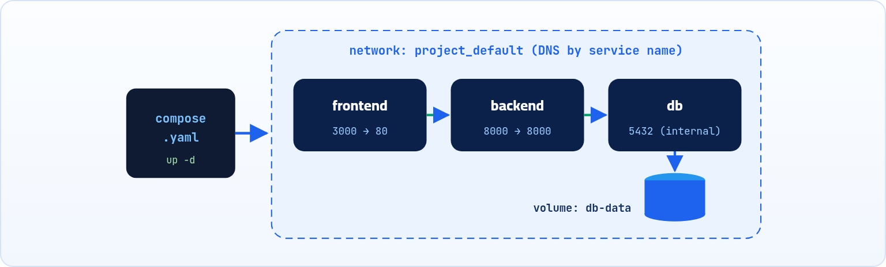

:::note[إضافة]
الفصل ده إضافة على الشرح الأصلي علشان الكتاب يبقى كامل، ومكتوب بنفس الأسلوب.
:::

مشروع حقيقي فيه Frontend و Backend و Database. تشغيلهم بـ docker run واحد واحد، مع الشبكة والـ Volume والـ Environment، متعب وسهل تغلط فيه. Compose بيخليك توصف كل ده في ملف واحد.

:::note[ملف Compose مكتوب بـ YAML]
قواعد YAML (المسافات، و `key: value`، والشرطة `-` للـ Lists) اتشرحت في صفحة واحدة في كتاب APIs و JSON (فصل 21). ولو الـ Compose رفض الملف، 90% من المرات السبب مسافة في غير مكانها.
:::

<a id="s13-1"></a>

## 13.1 المشكلة: أوامر كتير لمشروع واحد

خلينا نتخيل إننا عايزين نشغّل المشروع اللي اتكلمنا عنه في أول الكتاب: موقع (Frontend) و API (Backend) وقاعدة بيانات. بالأوامر اللي اتعلمناها، هنحتاج نكتب حاجة زي كده:

```sh title="Terminal"
docker network create app-net
docker volume create db-data
docker run -d --name db --network app-net -v db-data:/var/lib/postgresql/data \
  -e POSTGRES_USER=app -e POSTGRES_PASSWORD=secret -e POSTGRES_DB=appdb postgres:16-alpine
docker build -t backend ./backend
docker run -d --name backend --network app-net -p 8000:8000 \
  -e DATABASE_URL=postgres://app:secret@db:5432/appdb backend
docker build -t frontend ./frontend
docker run -d --name frontend --network app-net -p 3000:80 frontend
```

أوامر كتير، والترتيب مهم، ولو حد تاني في الفريق عايز يشغّل المشروع لازم يحفظها كلها. هنا بييجي دور **Docker Compose**: أداة بتخليك توصف كل الـ Containers والشبكات والـ Volumes في ملف **YAML** واحد، وتشغّلهم كلهم بأمر واحد.

<a id="s13-2"></a>

## 13.2 ملف compose.yaml

بنعمل في جذر المشروع ملف اسمه `compose.yaml` (أو `docker-compose.yml` بالاسم القديم). كل Container اسمه هنا **service**:

```yaml title="compose.yaml"
services:
  frontend:
    build: ./frontend          # يبني من ./frontend/Dockerfile
    ports:
      - "3000:80"
    depends_on:
      - backend

  backend:
    build: ./backend
    ports:
      - "8000:8000"
    environment:
      PORT: 8000
      DATABASE_URL: postgres://app:secret@db:5432/appdb
    depends_on:
      db:
        condition: service_healthy

  db:
    image: postgres:16-alpine  # Image جاهزة من Docker Hub
    environment:
      POSTGRES_USER: app
      POSTGRES_PASSWORD: secret
      POSTGRES_DB: appdb
    volumes:
      - db-data:/var/lib/postgresql/data
    healthcheck:
      test: ["CMD-SHELL", "pg_isready -U app -d appdb"]
      interval: 5s
      retries: 5

volumes:
  db-data:
```



*Compose بيعمل شبكة للمشروع، ويشغّل كل service في Container، وبيوصّل الـ Volume بقاعدة البيانات.*

**أهم مفاتيح ملف compose.yaml**

| المفتاح | بيعمل إيه؟ | الأمر اللي بيقابله |
|---|---|---|
| `image` | يستخدم Image جاهزة | `docker pull` / `run image` |
| `build` | يبني Image من فولدر فيه Dockerfile | `docker build` |
| `ports` | Port Mapping بصيغة `"host:container"` | `-p` |
| `environment` | متغيرات البيئة | `-e` |
| `volumes` | توصيل Volume أو Bind Mount | `-v` |
| `depends_on` | ترتيب التشغيل (ومع `condition` يستنى الـ healthcheck) | انت كنت بترتّب بنفسك |
| `healthcheck` | أمر بيتأكد إن الخدمة جاهزة فعلاً | `--health-cmd` |

:::note[الشبكة بتتعمل لوحدها]
Compose بيعمل شبكة خاصة بالمشروع تلقائياً ويوصّل عليها كل الـ services، وبيشغّل الـ DNS اللي اتكلمنا عنه في فصل الشبكات. علشان كده الـ backend بيوصل لقاعدة البيانات بكلمة `db` (اسم الـ service) في `DATABASE_URL`.
:::

<a id="s13-3"></a>

## 13.3 أوامر Compose الأساسية

كل الأوامر دي بتتكتب في الفولدر اللي فيه `compose.yaml`:

| الأمر | بيعمل إيه |
|---|---|
| `docker compose up -d` | يبني (لو محتاج) ويشغّل كل الـ services في الخلفية. |
| `docker compose up -d --build` | يعيد بناء الـ Images الأول (بعد ما تعدّل الكود أو الـ Dockerfile). |
| `docker compose ps` | يعرض الـ Containers بتاعة المشروع وحالتها. |
| `docker compose logs -f backend` | يتابع الـ logs بتاعة service معينة (من غير اسم = كل الـ services). |
| `docker compose exec backend sh` | يدخلك جوه Container الـ service، زي `docker exec`. |
| `docker compose stop` | يوقّف الـ Containers من غير ما يمسحها. |
| `docker compose down` | يوقّف ويمسح الـ Containers والشبكة. الـ Volumes بتفضل موجودة، فالداتا مبتضيعش. |
| `docker compose down -v` | زي اللي فوق، بس بيمسح الـ Volumes كمان.كده بيانات قاعدة البيانات هتتمسح نهائياً. |

:::note[مثال عملي: يوم شغل عادي]
```sh title="Terminal"
$ docker compose up -d
 ✔ Network shop_default       Created
 ✔ Volume "shop_db-data"      Created
 ✔ Container shop-db-1        Healthy
 ✔ Container shop-backend-1   Started
 ✔ Container shop-frontend-1  Started
$ docker compose ps
NAME              IMAGE                SERVICE    STATUS                  PORTS
shop-backend-1    shop-backend         backend    Up 10 seconds           0.0.0.0:8000->8000/tcp
shop-db-1         postgres:16-alpine   db         Up 16 seconds (healthy) 5432/tcp
shop-frontend-1   shop-frontend        frontend   Up 9 seconds            0.0.0.0:3000->80/tcp
$ docker compose down
```

اسم المشروع (`shop`) بياخده Compose من اسم الفولدر، وبيبدأ بيه أسماء الـ Containers والشبكة والـ Volume.
:::

:::caution[خلي بالك]
- الأمر الحديث هو `docker compose` (بمسافة، جزء من Docker نفسه). الأمر القديم `docker-compose` (بشَرطة) كان أداة منفصلة ومبقاش بيتطوّر.
- المفتاح `version:` اللي بتلاقيه في أول ملفات قديمة مبقاش له لازمة في الإصدارات الحديثة، وممكن تشيله.
- `depends_on` لوحده بيرتّب التشغيل بس، مش بيستنى قاعدة البيانات تبقى جاهزة. علشان كده استخدمنا `healthcheck` مع `condition: service_healthy`.
:::

:::tip[Best Practice]
متكتبش الـ Passwords صريحة في `compose.yaml` في المشاريع الحقيقية. حطها في ملف `.env` جنبه واستخدمها بـ `${POSTGRES_PASSWORD}`، وضيف `.env` للـ `.gitignore` والـ `.dockerignore`.
:::

:::tip[ملخص الفصل]
- Compose بيوصف المشروع كله (services و volumes و networks) في ملف `compose.yaml`.
- `build` و `image` و `ports` و `environment` و `volumes` بتقابل أوامر `docker` اللي اتعلمناها.
- الـ services بتكلّم بعض باسمها على شبكة المشروع التلقائية.
- `up -d` للتشغيل، و `ps` و `logs` للمتابعة، و `down` للإيقاف والمسح (و `-v` للـ Volumes بحذر).
:::

### أسئلة مراجعة

1. إيه الفرق بين `image` و `build` في ملف Compose؟
2. ليه الـ backend بيكتب `db` في عنوان قاعدة البيانات بدل IP؟
3. عملت `docker compose down`، هل بيانات الـ Postgres اتمسحت؟ وماذا عن `down -v`؟
4. عدّلت كود الـ backend، تكتب إيه علشان التعديل يشتغل؟
