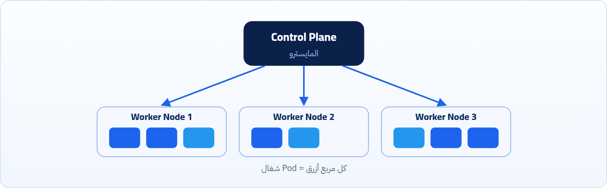

<small>المرحلة 1 · الأساسيات</small>

Container واحد سهل تديره بإيدك. بس لما يبقوا 100 أو 1000 بتظهر مشاكل محتاجة حد ينظم الحركة كلها. الحد ده اسمه Orchestrator، و Kubernetes هو الأشهر فيهم.

:::note[بعد الفصل ده هتكون عارف]
- المشاكل اللي بتظهر لما الـ Containers تكتر
- يعني إيه Orchestrator ودور Kubernetes
- يعني إيه Cluster و Node و Pod
- المشاكل القديمة اللي Kubernetes حلها
- مميزات Kubernetes زي الـ Declarative Model
:::

## 1.1 المشكلة: لما الـ Containers تكتر

تخيل لو عندك Container واحد، الموضوع سهل. لكن لو بقوا 100؟ أو 1000؟ هنا بتظهر مشاكل:

#### مين يقومه؟

لو Container وقع، مين يقومه؟

#### السيرفر باظ؟

لو السيرفر (Host) نفسه باظ، الـ Containers اللي عليه هتروح فين؟

#### الأحمال

إزاي نوزع الأحمال (Traffic) ما بينهم؟

هنا بييجي دور المنسق (**Orchestrator**)، Kubernetes هو <strong>"المايسترو"</strong> اللي بينظم الحركة دي كلها، بيتأكد إن الـ Containers شغالة، ولو حاجة وقعت بيشغل غيرها فوراً.

*زي المايسترو في الأوركسترا: الـ Control Plane بيقود، والـ Worker Nodes (العازفين) بتنفّذ، والجمهور هو الـ Users والـ Traffic.*

## 1.2 مفاهيم جديدة: Cluster و Node و Pod

عشان Kubernetes يقدر يحل المشاكل دي، قدم لنا شوية مفاهيم جديدة.

زمان كنت بترفع الـ Containers على جهاز واحد أو أكتر وتحتاس في إدارتهم وتوصيلهم ببعض. Kubernetes حل ده بإنشاء حاجة اسمها **Cluster**، وهي ببساطة إنك بتوصل مجموعة الأجهزة والسيرفرات دي ببعض عشان تحولهم لـ <strong>"كمبيوتر واحد عملاق"</strong>. ده بيخليك تاخد أقصى استفادة من الـ Hardware المتاح في كل الأجهزة في نفس الوقت، وتقدر توزع الـ Containers والأحمال (Traffic) عليهم بذكاء.

ومع النظام الجديد ده، Kubernetes غيّر شوية مسميات عشان تناسب شغله:

#### Node

بدل ما بنقول "جهاز" أو "مكنة"، بقى اسمها **Node** طالما دخلت واشتغلت جوه الـ Cluster.

#### Pod

وبدل ما بنتعامل مع كل Container لوحده بشكل مباشر، Kubernetes عمل كبسولة أو غلاف اسمه **Pod**.

:::note[معلومة مهمة]
الـ Pod هو أصغر وحدة Kubernetes بيتعامل معاها، وبنحط جواه الـ Container الأساسي أو معاه Container تاني مساعد ليه، والـ Pod ده بيوفرلهم بيئة مشتركة (زي شبكة واحدة ومساحة تخزين واحدة) يشتغلوا فيها مع بعض.
:::

## 1.3 المشاكل القديمة اللي Kubernetes حلها

:::note[يعني إيه Cloud و AWS و EC2؟]
الـ **Cloud** = إنك تأجّر سيرفرات من شركة كبيرة بالساعة بدل ما تشتريها وتحطها عندك. أشهرهم **AWS** (بتاعة Amazon) و Google Cloud و Azure. و **EC2** اسم خدمة السيرفرات الافتراضية في AWS. وعكسها **On-premises**: السيرفرات عندك في الشركة. Kubernetes بيشتغل على الاتنين، وفي الكتاب ده هنجرّب على جهازك بـ minikube.
:::

**قبل Kubernetes وبعده**

| المشكلة قبل Kubernetes | الحل في Kubernetes |
|---|---|
| **تشغيل Container وقع؟** حد لازم يصحى يعمله restart. | الـ `kubelet` والـ Controller بيعملوا restart أوتوماتيك. |
| **زحمة على السيرفر؟** حد يشتري سيرفر جديد ويعمل setup. | الـ `Scheduler` بيحط الـ Pods على Nodes فيها مكان، ومع أداة زي **Cluster Autoscaler** على الـ Cloud يقدر يزود سيرفرات (`EC2`) وقت الضغط ويقفلها لما الضغط يروح. |
| **سيرفر بكامله وقع؟** كل الـ Containers اللي عليه راحت. | بيشيل الـ Pods ويعيد جدولتها على Nodes تانية سليمة. |
| **عايز توزع الـ Traffic على كذا Container؟** هتتعب في تظبيط nginx بإيدك. | Kubernetes عنده `Services` بتوزع الترافيك أوتوماتيك. |
| **الـ Containers تتكلم مع بعض؟** الـ IP بيتغير كل ما تعيد تشغيل. | الـ `Service Discovery` بيدي كل خدمة اسم ثابت. |

:::caution[تفصيلة مهمة: مين اللي بيزود السيرفرات؟]
زيادة عدد السيرفرات نفسها (الـ Nodes) مش بتحصل لوحدها في أي Cluster افتراضي؛ ده شغل مكوّن إضافي اسمه **Cluster Autoscaler** (أو **Karpenter** على AWS) بتركّبه وتربطه بحساب الـ Cloud. وزيادة عدد الأجهزة بالطريقة دي اسمها **Scale Out** (توسع أفقي)، أما **Scale Up** فمعناها الأدق إنك تكبّر موارد نفس الجهاز.
:::

## 1.4 مميزات Kubernetes أضافها من الأصل

**مميزات مش بس "أوتوماتيك"**

| الميزة | يعني إيه؟ |
|---|---|
| **الـ Declarative Model** | الفرق مش بس أوتوماتيكي. إنت بقيت بتوصف الهدف مش الخطوات. بتكتب `replicas: 5` وهو يفهم إزاي يوصل لده ويحافظ عليه. |
| **الـ Portability الحقيقية** | الـ YAML بتاعك بيشتغل على أي Cloud أو On-premises من غير ما تغير حاجة. الـ Infrastructure بقت abstractable. |
| **الـ Storage Orchestration** | ربط الـ Container بـ Storage Volumes بيتم ديناميكياً، سواء كان local disk أو AWS EBS أو NFS، من غير ما الـ Container يعرف الفرق. |
| **الـ Batch Execution المنظمة** | تقدر تشغل Job يخلص ويقفل، أو CronJob على schedule، بنفس الـ Infrastructure بدون أي setup إضافي. |

:::note[معلومة مهمة]
فيه مصطلحات وكلمات ممكن متكونش واضحة أوي دلوقتي، هتتوضح بعدين، فمتقلقش. ولو نسيت معنى أي كلمة، ارجع لـ **قاموس المصطلحات** في آخر الكتاب.
:::

:::tip[ملخص الفصل]
- لما الـ Containers تكتر، محتاجين حد يقوّم اللي يقع، وينقل الشغل لو سيرفر باظ، ويوزع الـ Traffic.
- Kubernetes هو الـ Orchestrator (المايسترو) اللي بيعمل ده.
- الـ Cluster: مجموعة أجهزة متوصلة كأنها كمبيوتر واحد. كل جهاز فيه اسمه Node.
- الـ Pod: أصغر وحدة Kubernetes بيتعامل معاها، وجواها Container أو أكتر.
- أهم ميزة: الـ Declarative Model، إنت بتوصف الهدف وهو يحافظ عليه.
:::

### أسئلة مراجعة

1. اذكر 3 مشاكل بتظهر لما يبقى عندك مئات الـ Containers.
2. يعني إيه Cluster؟ وإيه الفرق بين الـ Node والـ Pod؟
3. إيه معنى الـ Declarative Model؟ اديني مثال.
4. مين اللي بيزود عدد السيرفرات في الـ Cloud لما الضغط يزيد؟

### صح ولا غلط؟

1. Kubernetes بيتعامل مع كل Container لوحده بشكل مباشر.
2. الـ YAML بتاع Kubernetes ممكن يشتغل على أكتر من Cloud من غير تغيير.
3. أي Cluster بيزود عدد الـ Nodes لوحده من غير أي إعداد.
