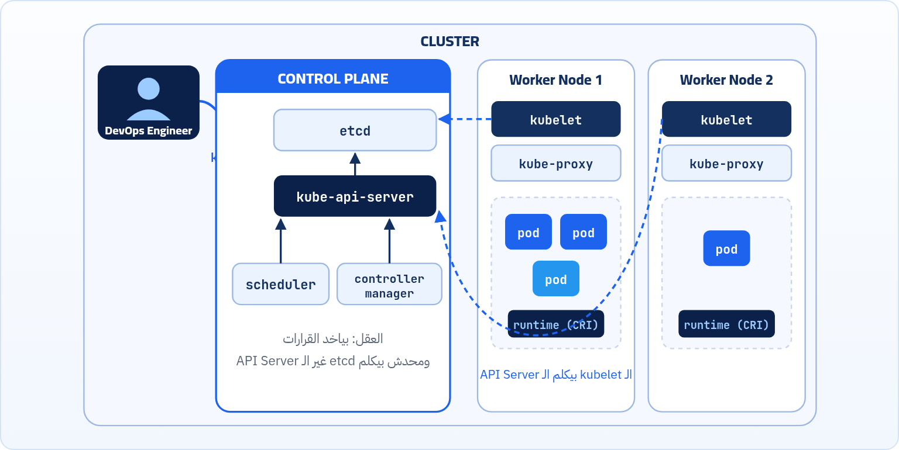
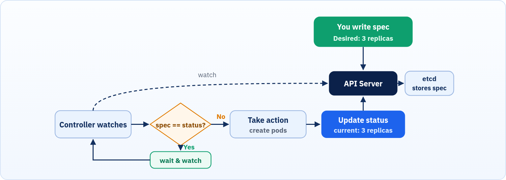

<small>المرحلة 1 · الأساسيات</small>

لما بنشغّل Kubernetes على مشروع، هو بيبني Cluster واحد أو مجموعة Clusters يقوم عليهم المشروع، فلازم نفهم تكوين الـ Cluster. تخيل إنه عبارة عن "شركة مقاولات": فيها إدارة عليا بتاخد القرارات، وعمال في الموقع بينفّذوا.

:::note[بعد الفصل ده هتكون عارف]
- مكونات الـ Control Plane ودور كل واحد
- مكونات الـ Worker Node
- يعني إيه Container Runtime
- آلية عمل Kubernetes: Desired State Reconciliation
:::

## 2.1 شكل الـ Cluster من فوق

لما بنيجي نشغّل Kubernetes على مشروع، فهو بيبني Cluster واحد أو مجموعة Clusters يقوم عليهم المشروع، فلازم نفهم تكوين الـ Cluster. تخيل إنه عبارة عن <strong>"شركة مقاولات"</strong>: فيها **إدارة عليا** (الـ Control Plane) و**عمال وموقع** (الـ Worker Nodes). وإنت كـ DevOps Engineer بتكلم الإدارة عن طريق أداة اسمها `kubectl`.

*الـ Structure بتاع الـ Cluster: Control Plane بيدير، و Worker Nodes عليها الـ Pods، وإنت بتكلم الـ API Server بـ kubectl.*

## 2.2 الإدارة العليا: الـ Control Plane

ده <strong>"عقل"</strong> السيستم. هو اللي بياخد القرارات، بيراقب الوضع، وبيوزع الشغل. بيتكون من 4 أجزاء:

#### مكتب الاستقبال (API Server)

ده الواجهة بتاعة السيستم. أي حد عايز حاجة من Kubernetes (سواء إنت كمبرمج بتكتب أوامر، أو حتة تانية في السيستم بتكلمه) لازم يعدي على الـ API Server الأول. هو اللي بيستقبل الطلبات ويتأكد منها ويوزعها.

#### خزنة الأسرار والذاكرة (etcd)

دي Database سريعة جداً وخفيفة. Kubernetes بيسجل فيها كل تفصيلة عن السيستم: (إيه اللي شغال دلوقتي؟ إيه اللي المفروض يشتغل؟ مين وقع؟). لو الـ etcd دي باظت، السيستم كله بيفقد الذاكرة.

#### مدير الموارد (Scheduler)

تخيل إنك طلبت تشغّل أبلكيشن جديد. الـ Scheduler ده هو اللي بيبص على الـ Nodes، ويشوف مين فيهم فاضي، راماته مستريحة، ومناسب للشغلانة دي، ويبعتله الشغل. بيستغل الموارد صح عشان ميحمّلش على Node ويسيب التانية.

#### المشرف / المراقب (Controller Manager)

ده راجل بيطابق "الواقع" باللي "المفروض يحصل". يعني لو إنت قايل للسيستم "أنا عايز 5 نسخ من الأبلكيشن شغالين طول الوقت"، وفجأة سيرفر وقع ونسختين ماتوا.. المشرف ده بيلاحظ فوراً إن العدد بقى 3، ويقوم مدّي أمر فوري: "شغّلوا نسختين كمان بسرعة في أي حتة تانية عشان نرجّعهم 5!".

:::tip[Best Practice]
علشان الـ etcd هي ذاكرة الـ Cluster كله، في الـ Production بيتعمل لها **Backup** بشكل دوري، وبيتشغّل منها أكتر من نسخة (غالباً 3) علشان لو واحدة وقعت السيستم ميفقدش الذاكرة.
:::

## 2.3 العمال والموقع: الـ Worker Nodes

دي السيرفرات الفعلية (سواء كانت Physical أو Virtual) اللي بتشيل الأبلكيشن بتاعك وترن الكود. كل مكنة (Node) عليها 3 حاجات أساسية عشان تعرف تشتغل مع المايسترو:

#### رئيس العمال (Kubelet)

ده عميل (Agent) صغير كده متسطب على كل مكنة. وظيفته إنه يسمع كلام الـ API Server (المايسترو). لما المايسترو يقوله "شغّل كذا عندك"، هو بينفذ، ويبعت تقارير مستمرة للإدارة يقولهم "أنا تمام والشغل اللي عندي شغال زي الفل".

#### عسكري المرور (Kube-proxy)

ده المسئول عن الشبكات (Networking) جوه المكنة. هو اللي بيظبط قواعد التوجيه وبيفتح السكك عشان الأبلكيشنز تعرف تكلم بعضها، ويتأكد إن الزوار اللي جايين من بره بيروحوا للمكان الصح من غير ما يتوهوا.

#### الموتور (Container Runtime)

Kubernetes مبيقدرش يـ run الـ Containers بنفسه، ولكن بيوكّل المهمة دي لبرنامج تاني ألا وهو الـ Container Runtime، بيكون بيعرف يقرا ويشغّل الـ Containers ويتعامل معاهم. زي Docker أو containerd.

:::caution[دقة: kube-proxy و Docker]
- الـ IP بتاع كل Pod مش kube-proxy اللي بيدّيه، ده شغل الـ **CNI plugin** (زي Calico أو Flannel أو Cilium). kube-proxy بيظبط قواعد الشبكة (iptables أو IPVS) اللي بتوصّل الـ Traffic الجاي على الـ Services للـ Pods الصح.
- من Kubernetes 1.24 الدعم المباشر لـ Docker Engine كـ Runtime اتشال (اللي كان اسمه dockershim). الـ Runtimes المستخدمة النهارده هي **containerd** و **CRI-O**. الـ Images اللي بتبنيها بـ Docker لسه شغالة عادي جداً لأنها بنفس الـ Standard (OCI).
:::

## 2.4 آلية عمل Kubernetes: Desired State Reconciliation

الـ Kubernetes بيشتغل على مبدأ **Desired State Reconciliation**: إنت بتقوله "أنا عايز 5 نسخ من الأبلكيشن" وهو يفضل يحارب عشان يحقق ده ويحافظ عليه أوتوماتيك.

*الـ Reconciliation Loop: الـ Controller بيقارن الـ spec (المطلوب) بالـ status (الواقع) طول الوقت، ولو مختلفين بيتحرك.*

:::note[مثال من الحياة]
زي التكييف بالظبط: إنت بتحدد درجة الحرارة اللي عايزها (الـ Desired State = 22°). التكييف بيقيس الحرارة الحالية طول الوقت، ولو لقاها 26° يشتغل لحد ما توصل 22، ولو وصلت يهدى ويفضل يراقب. إنت مقولتلوش "اشتغل 10 دقايق"، إنت وصفتله النتيجة بس.
:::

:::tip[ملخص الفصل]
- الـ Cluster = Control Plane (الإدارة) + Worker Nodes (العمال).
- الـ Control Plane: API Server (الاستقبال)، etcd (الذاكرة)، Scheduler (توزيع الشغل)، Controller Manager (المطابقة بين المطلوب والواقع).
- كل Worker Node عليها: kubelet و kube-proxy و Container Runtime.
- Kubernetes شغال بالـ Desired State Reconciliation: بيقارن المطلوب بالواقع طول الوقت ويصلّح الفرق.
:::

### أسئلة مراجعة

1. إيه الجزء اللي بيكلمه `kubectl` لما تكتب أمر؟
2. لو الـ etcd باظت من غير Backup، إيه اللي هيحصل؟
3. مين اللي بيختار الـ Node اللي الـ Pod هيشتغل عليها؟ ومين اللي بيشغّله فعلاً؟
4. اشرح الـ Reconciliation Loop في 3 خطوات.

### صح ولا غلط؟

1. الـ kubelet موجود على كل Worker Node.
2. Kubernetes بيشغّل الـ Containers بنفسه من غير Runtime.
3. الـ Scheduler هو اللي بيعمل restart للـ Pods اللي وقعت.
