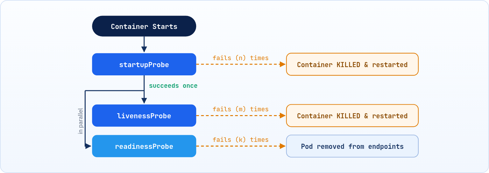

<small>المرحلة 2 · الـ Pod من جوه</small>

بما إننا عاملين الـ Pod عشان نقدر نتحكم في الـ Containers، فلازم نستخدم حاجات تعرّفنا حالة الـ Containers: شغال ولا لأ؟ ولو شغال، هل شغال بشكل فعّال ولا شغال اسماً بس؟ Kubernetes بيوفرلنا حاجة اسمها الـ Probes.

:::note[بعد الفصل ده هتكون عارف]
- يعني إيه Healthy Container
- الـ Mechanisms: httpGet و exec و tcpSocket
- الـ Parameters وقيمها الافتراضية
- الفرق بين Liveness و Readiness و Startup
- ترتيب تنفيذ الـ 3 Probes مع بعض
:::

<a id="s5-1"></a>

## 5.1 ليه محتاجين Probes؟

بما إننا عاملين الـ Pod عشان نقدر نتحكم في الـ Containers، فلازم نستخدم حاجات تعرّفنا حالة الـ Containers سواء شغال ولا لأ، ولو شغال فهل شغال بشكل فعّال ولا شغال اسماً بس (ودي اسمها الـ **healthy**، إنه هل الـ Container ده healthy ولا لأ)، وكمان نحدد إيه اللي يحصل في حالة إنه وقع: نقومه إزاي وإمتى ونحاول كام مرة وما إلى ذلك. فـ Kubernetes بيوفرلنا حاجة اسمها الـ **Probes**.

- كل Probe فيهم بيعتمد على **Mechanism** معين عشان يقدر يقدّملنا معلومة معينة.
- كل Probe فيهم بيستخدم شوية **Parameters** معينة عشان يحدد الوقت وعدد المرات اللي هيعمل فيها وظيفته.
- بنكتب الكود بتاع كل Probe فيهم جوه الـ Configuration بتاعة الـ Pod سواء في ملف (`pod.yaml`) أو (`deployment.yaml`)، جوه الـ tag بتاع الـ `containers`.

الشكل العام للكود اللي بنكتبه عشان نستخدم أي Probe منهم:

```yaml title="Probe · الشكل العام"
NameOfProbe:
  httpGet:
    path: path/to/health_endpoint
    port: port
  #---OR----
  exec:
    command: command
  initialDelaySeconds: time(s)
  periodSeconds: time(s)
  failureThreshold: times(n)
  successThreshold: times(n)
  timeoutSeconds: time(s)
```

1. `NameOfProbe:`: اسم الـ Probe: `livenessProbe` أو `readinessProbe` أو `startupProbe`.
2. `httpGet:`: الـ Mechanism المستخدم: واحد بس منهم.
3. `initialDelaySeconds: time(s)`: الـ Parameters اللي بتحدد التوقيت وعدد المرات.

<a id="s5-2"></a>

## 5.2 الـ Mechanisms: هيعرف الحالة إزاي؟

**الـ Mechanisms المتاحة**

<table class="cmp keep">

<tr><th>الـ Mechanism</th><th>بيعمل إيه؟</th><th>بنستخدمه إمتى؟</th></tr>
<tr><td><code>httpGet</code><br/><code>path:</code><br/><code>port:</code></td><td>بتقول لـ Kubelet: اعمل HTTP GET request على الـ path والـ port دول، وشوف كود الرد اللي هيجيلك، وبناءً عليه حدد حالة الـ Container:<br/>• <b>200</b> (أو أي كود من 200 لـ 399): شغال (healthy)<br/>• أي كود تاني: مش شغال (unhealthy)<br/>• مفيش رد خالص (time out): يبقى واقع أصلاً</td><td>لما تطبيقك عنده HTTP server: APIs، web apps، microservices.</td></tr>
<tr><td><code>exec</code><br/><code>command:</code></td><td>بتقول لـ Kubelet: "شغّل الأمر ده جوه الـ Container كأنك فاتح terminal جواه، وشوف الـ exit code اللي هيطلعلك بعد ما تـ run الـ command":<br/>• <b>0</b>: شغال (healthy)<br/>• أي كود غير 0: مش شغال (unhealthy)</td><td>لما مفيش HTTP server: databases، workers، sidecars.</td></tr>
<tr><td><code>tcpSocket</code><br/><code>port:</code></td><td><span class="badge soft">إضافة</span> بيحاول يفتح اتصال TCP على الـ port. لو الاتصال اتفتح يبقى healthy.</td><td>خدمات مش HTTP بس بتسمع على port، زي Redis أو أي TCP server.</td></tr>
</table>

:::note[لاحظ]
حتة إنه هل الـ Container ده healthy ولا لأ: إنت اللي بتحطلها معيار محدد تقدر من خلاله تحدد الحالة، إنما Kubernetes نفسه ميقدرش يعرف ده. فبالتالي تختار الطريقة اللي إنت متأكد إنها تقدر تعرّفك الحالة بتاعته وتستخدمها في الـ Mechanism اللي هتختاره جوه الـ Probe.

- فمثلاً إنت عارف إن فيه endpoint لو بعت عليها request وجالك رد منها، هتعرف الحالة بناءً على قيمة الكود اللي طلع في الرد، فتستخدم `httpGet`.
- أو إنت عارف إن فيه command معين لو اتـ run جوه الـ Container واشتغل وادّاك exit code معين، يبقى هتعرف الحالة، فتستخدم `exec`.
:::

<a id="s5-3"></a>

## 5.3 الـ Parameters: إمتى وكام مرة؟

**الـ Parameters وقيمها الافتراضية**

<table class="cmp">

<tr><th>الـ Parameter</th><th>معناه</th><th>الـ Default</th></tr>
<tr><td><code>initialDelaySeconds</code></td><td>كام ثانية Kubernetes يستنى بعد ما الـ Container نفسه يبدأ (قبل ما يطبّق عليه الـ Probe).<br/><b>تستخدمه إمتى:</b> لو تطبيقك بياخد وقت يبدأ (JVM، loading config، connecting to DB).<br/>لو مستخدمتهوش هيبدأ الـ Probe فوراً، ولو تطبيقك لسه بيبدأ هيفشل وهيعمل restart.</td><td><b>0</b></td></tr>
<tr><td><code>periodSeconds</code></td><td>كل كام ثانية Kubernetes يعيد تطبيق الـ Probe.<br/><b>إمتى تقلله:</b> لو عايز تكتشف المشكلة بسرعة (5 ثواني).<br/><b>إمتى تكبره:</b> لو الـ Probe بياخد resources أو DB query (30 ثانية).</td><td><b>10</b></td></tr>
<tr><td><code>failureThreshold</code></td><td>Kubernetes يستنى كام مرة فشل متتالية قبل ما ياخد action:<br/>• لـ liveness: بعد الفشل يعمل restart<br/>• لـ readiness: بعد الفشل يشيله من الـ load balancer<br/><b>إمتى تكبره:</b> لو تطبيقك بيعمل spikes مؤقتة، عشان ما يعملش restart بسبب مشكلة لحظية.</td><td><b>3</b></td></tr>
<tr><td><code>successThreshold</code></td><td>كام مرة نجاح متتالية بعد الفشل عشان يرجع يعتبره healthy.<br/><b>إمتى تكبره:</b> لو عايز تتأكد إن التطبيق مش بس بيرد مرة وبعدين بيوقع تاني.<br/>لـ liveness و startup لازم يكون <b>1</b> دايماً، و Kubernetes بيرفض أي قيمة تانية.</td><td><b>1</b></td></tr>
<tr><td><code>timeoutSeconds</code></td><td>لو الـ Probe مردّش في كام ثانية يعتبره فشل: يعني Kubelet بعت request أو شغّل command وبعد وقت معين معدّش رد، يبقى فشل.<br/><b>إمتى تزوده:</b> لو الـ health endpoint بتاعك بيعمل DB query بتاخد وقت.<br/>لو صغير أوي: هتاخد false failures بدون سبب. الأحسن تستخدمه وتخليه 3.</td><td><b>1</b></td></tr>
</table>

<a id="s5-4"></a>

## 5.4 الأنواع التلاتة للـ Probes

#### (1) Liveness Probe

بتسأل: هل الـ Container شغال صح ولا وقع في مشكلة جواه؟

#### (2) Readiness Probe

بتسأل: هل الـ Container جاهز يستقبل traffic دلوقتي؟

#### (3) Startup Probe

بتسأل: هل التطبيق خلّص بدأ ووصل للحالة الأولانية؟

### (1) الـ Liveness Probe

- بتسأل هل الـ Container شغال صح ولا وقع في مشكلة جواه؟
- التطبيق ممكن يبقى في process شغالة بس متجمدة، زي: deadlock في الـ threads، أو memory leak، و Kubernetes مش عارف من غير ما تحددله الطريقة اللي يقدر يعرف بيها هو healthy ولا لأ زي ما قلنا فوق.
- <strong>لو فشل:</strong> Kubernetes بيوقف الـ Container، بيمسحه، وبيعمله restart من أول وجديد.

```yaml title="livenessProbe"
livenessProbe:
  httpGet:
    path: /healthz
    port: 8080
  initialDelaySeconds: 10
  periodSeconds: 15
  failureThreshold: 3
  successThreshold: 1
  timeoutSeconds: 5
```

:::caution[خلي بالك]
متحطش في الـ Liveness check على DB أو services خارجية، عشان لو وقعوا متعملش restart لكل الـ Pods دفعة واحدة (والمشكلة أصلاً مش فيهم).
:::

### (2) الـ Readiness Probe

- بتسأل هل الـ Container جاهز يستقبل traffic دلوقتي؟
- التطبيق ممكن يكون شغال بس لسه بيحمّل cache أو بيتصل بـ DB أو تحت ضغط.
- هنا تمام تعمل check على الـ DB والـ external services، لأن الفشل مش بيوقف الـ Container، هو بس بيشيله من الـ load balancer.
- ضروري جداً في الـ rolling deployments عشان zero downtime.
- <strong>لو فشل:</strong> Kubernetes بيشيل الـ Pod من الـ endpoints، مش بيعمل restart، بس مبيجيلوش traffic.

```yaml title="readinessProbe"
readinessProbe:
  httpGet:
    path: /ready
    port: 8080
  initialDelaySeconds: 5
  periodSeconds: 10
  failureThreshold: 3
  successThreshold: 2
```

### (3) الـ Startup Probe

- بتسأل هل التطبيق خلّص بدأ ووصل للحالة الأولانية؟
- طول ما هي شغالة، الـ liveness والـ readiness بيتوقفوا خالص، ولأنها بعد ما تنجح مرة واحدة بس بتوقف وتسيب المجال للتانيين.
- بتستخدمها مع التطبيقات اللي بتاخد وقت طويل تبدأ زي JVM أو legacy apps، بدلاً من إنك تحط `initialDelaySeconds` كبيرة على الـ liveness.
- **لو فشل أكتر من** `failureThreshold`: بيعمل restart زي الـ liveness.

```yaml title="startupProbe"
startupProbe:
  httpGet:
    path: /healthz
    port: 8080
  failureThreshold: 30
  periodSeconds: 10
```

:::note[معلومة مهمة]
هنا التطبيق قدامه لحد **30 × 10 = 300 ثانية** (5 دقايق) عشان يبدأ. أول ما ينجح مرة، الـ Startup Probe بتقف والـ Liveness تبدأ شغلها.
:::

<a id="s5-5"></a>

## 5.5 الـ 3 Probes مع بعض

لاحظ إن ممكن Pod تحتاج نعملها Probe واحدة من التلاتة، أو اتنين، أو التلاتة كلهم. ده شكل الـ flow بتاع التنفيذ بتاع الـ 3 Probes مع بعض:



*الـ startupProbe الأول، ولما تنجح مرة يشتغل الـ liveness والـ readiness مع بعض (بالتوازي).*

**مقارنة سريعة بين الـ 3 Probes**

|   | Liveness | Readiness | Startup |
|---|---|---|---|
| **السؤال** | عايش ولا متجمّد؟ | جاهز يستقبل Traffic؟ | خلّص بدأ ولا لسه؟ |
| **لو فشل** | restart للـ Container | يتشال من الـ endpoints (من غير restart) | restart للـ Container |
| <strong>check على DB؟</strong> | لأ | أيوه، تمام | حسب التطبيق |
| **بيشتغل إمتى** | بعد نجاح الـ Startup، طول الوقت | بعد نجاح الـ Startup، طول الوقت | في الأول بس، لحد أول نجاح |

:::tip[ملخص الفصل]
- الـ Probes بتعرّف Kubernetes إذا كان الـ Container healthy ولا لأ، بمعيار إنت اللي بتحدده.
- الـ Mechanisms: `httpGet` (كود الرد)، `exec` (الـ exit code)، `tcpSocket` (الاتصال).
- الـ Defaults: initialDelay 0، period 10، failure 3، success 1، timeout 1.
- Liveness فشل = restart. Readiness فشل = مفيش traffic. Startup بيحمي التطبيقات البطيئة في البداية.
- متحطش checks على DB في الـ Liveness.
:::

### أسئلة مراجعة

1. عندك Worker مفيهوش HTTP server، هتستخدم أنهي Mechanism؟
2. ليه مينفعش تعمل check على الـ DB في الـ Liveness Probe؟
3. تطبيق بياخد دقيقتين يبدأ: إيه الأفضل، `initialDelaySeconds: 120` على الـ liveness ولا Startup Probe؟ وليه؟
4. Readiness Probe فشلت 3 مرات، إيه اللي هيحصل للـ Pod بالظبط؟

### صح ولا غلط؟

1. لو الـ Readiness Probe فشلت، الـ Container بيعمل restart.
2. ينفع تخلي `successThreshold: 3` في الـ Liveness Probe.
3. طول ما الـ Startup Probe شغالة، الـ Liveness مش بتشتغل.
