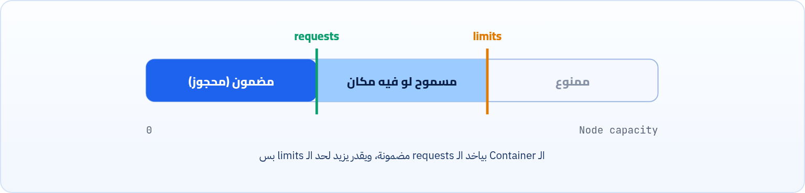

<small>المرحلة 2 · الـ Pod من جوه</small>

لما بتشتغل مع Kubernetes، في الآخر عندك Nodes (سيرفرات فعلية أو سحابية)، وعليها بتشتغل الـ Pods. الـ Node عندها موارد محدودة (CPU و Memory) والـ Pods بتتشارك فيهم. إزاي Kubernetes يقرر يحط الـ Pod على أنهي Node؟ وإزاي يمنع Pod واحد ياخد كل الموارد؟

:::note[بعد الفصل ده هتكون عارف]
- الفرق بين الـ Requests والـ Limits
- إيه اللي بيحصل لو الـ Container عدّى الـ Limit
- وحدات الـ CPU (m) والـ Memory (Mi و Gi)
- ليه الـ Requests مهمة للـ Scheduler
- الـ QoS Classes
:::

<a id="s6-1"></a>

## 6.1 المشكلة: موارد محدودة متشاركة

لما بتشتغل مع Kubernetes، في الآخر عندك **Nodes** (سيرفرات فعلية أو سحابية)، وعليها بتشتغل الـ **Pods** (اللي جواها التطبيقات بتاعتك). الـ Node عندها موارد محدودة (CPU و Memory) والـ Pods بتتشارك فيهم.

<strong>إزاي Kubernetes يقرر يحط الـ Pod على أنهي Node؟ وإزاي يمنع Pod واحد ياخد كل الموارد؟</strong> الإجابة هي نظام الـ **Requests & Limits**.



*الـ requests هي الأرضية المضمونة، والـ limits هي السقف.*

<a id="s6-2"></a>

## 6.2 (1) الـ Limits: السقف

- من اسمه هو حد (limit)، يعني بتحدد **الحد الأقصى** من الموارد اللي ممكن يستخدمها الـ Container ومينفعش يزيد عنها. العملية بتتم في الـ Kernel Level عن طريق الـ **cgroups**.
- لو الـ Container حاول يعدّي الـ limit بتاع الـ **CPU**: هيفضل شغال بس هيتم تبطيئه (Throttling). إنما لو حاول يعدّي الـ limit بتاع الـ **RAM**: هيتم قفله تماماً (kill)، وده بيتم عن طريق الـ kernel's **OOM** (Out-of-Memory) killer، وهتلاقي حالته `OOMKilled`.
- بنستخدمه لما نكون عايزين نحمي الـ Node اللي عليها الـ Pod ده، وغيره من الـ Pods، من إن Pod يستهلك أغلب الموارد لوحده ويأثر على الباقي. وده في حالة إننا عارفين إن فيه services أو حاجات في الـ app اللي هنقومه صعب نتوقع استهلاكها الحقيقي، وفي نفس الوقت ممكن تستهلك موارد كتير.
- <strong>طريقة الاستخدام:</strong> جوه الـ tag بتاع الـ `containers` اللي جوه الـ Pod بنعمل tag اسمها `resources` وتحتها بنحط `limits`.

```yaml title="limits"
resources:
  limits:
    cpu: "number of cores"    # x: x cores  //  (x)m: x millicores
    memory: "size of memory"  # (x)Ki / Mi / Gi
```

<a id="s6-3"></a>

## 6.3 وحدات الموارد

**وحدات الـ Memory**

| الوحدة | اسمها | قيمتها |
|---|---|---|
| `Ki` | Kibibyte | 1,024 bytes (مش 1000 زي الـ kilobyte) |
| `Mi` | Mebibyte | 1,048,576 bytes (مش 1,000,000 زي الـ megabyte) |
| `Gi` | Gibibyte | 1,073,741,824 bytes (مش 1,000,000,000 زي الـ gigabyte) |

**وحدات الـ CPU إضافة**

| القيمة | معناها |
|---|---|
| `"1"` | Core كامل (أو vCPU واحد) |
| `"500m"` | نص Core (500 millicores) |
| `"100m"` | عُشر Core |
| `"0.25"` | نفس `"250m"` |

:::caution[خلي بالك: M غير Mi]
لو كتبت `memory: 128M` (من غير i) ده معناه 128 ميجا بالنظام العشري (128,000,000 byte)، ولو كتبت `128m` بـ m صغيرة ده معناه **0.128 byte**! استخدم دايماً `Mi` و `Gi` للـ Memory.
:::

:::caution[دقة: لو مفيش Limits]
لو سبت الـ tag من الاتنين (`memory` أو `cpu`) فاضي من غير قيمة، ساعتها هيتفهم إنه ملهوش حدود، ويقدر يستخدم الموارد المتاحة على الـ Node لحد آخرها، وده ممكن يأثر على كل الـ Pods اللي معاه على نفس الـ Node. لكن Kubernetes مش هيقفل باقي الـ Pods عشان خاطره: لو الـ Memory خلصت، الـ kubelet بيبدأ يطرد (Evict) Pods، وبيبدأ باللي ملهاش requests ولا limits، وممكن الـ OOM killer يقتل الـ Container اللي بياكل الرامات نفسه. فالنتيجة فوضى، وعشان كده حط حدود دايماً.
:::

<a id="s6-4"></a>

## 6.4 (2) الـ Requests: الأرضية

- بتحدد **الحد الأدنى** من الموارد اللي محتاجها الـ Container ده عشان يقوم بدوره بشكل طبيعي، والـ Scheduler بيحجزهاله.
- الـ Container يقدر يزيد عن الحد الأدنى ده عادي طالما فيه إمكانية (مساحة يعني)، ولحد الـ limit لو موجود.
- لازم نستخدمه دايماً، عشان الـ Kubernetes **Scheduler** لما ييجي يقوم الـ Pod اللي فيها الـ Container ده يكون عارف هي عايزة موارد قد إيه (كحد أدنى)، عشان يشوف أنهي Node متوفر عليها المساحة دي أو أكتر فيحطها عليها.
- لاحظ إن عدم استخدامك للـ requests هيخليه يتعامل معاه إنه مش محتاج موارد، فممكن يتحط على Node عليها حمل عالي مفيهاش مكان، فمتشتغلش وتعمل مشاكل.
- <strong>طريقة الاستخدام:</strong> جوه الـ tag بتاع الـ `containers` بنعمل tag اسمها `resources` وتحتها بنحط `requests`.

```yaml title="requests"
resources:
  requests:
    cpu: "number of cores"    # x: x cores  //  (x)m: x millicores
    memory: "size of memory"  # (x)Ki / Mi / Gi
```

:::note[مثال كامل]
```yaml title="pod.yaml · resources"
spec:
  containers:
  - name: api
    image: my-api:1.0
    resources:
      requests:
        cpu: "250m"
        memory: "128Mi"
      limits:
        cpu: "500m"
        memory: "256Mi"
```

الـ Scheduler هيدوّر على Node فاضي فيها ربع Core و 128Mi على الأقل. والـ Container يقدر يوصل لنص Core (بعدها throttling) و 256Mi (بعدها OOMKilled).
:::

<a id="s6-5"></a>

## 6.5 الـ QoS Classes: مين يتطرد الأول؟ <small>(إضافة)</small>

على حسب إنت كاتب requests و limits إزاي، Kubernetes بيدّي كل Pod "درجة" اسمها **QoS Class**. لما الـ Node تتزنق في الـ Memory، بيطرد الأقل درجة الأول.

**الـ QoS Classes**

| الـ Class | بيتحسب إمتى؟ | أولوية الطرد |
|---|---|---|
| **Guaranteed** | كل Container عنده requests و limits للـ CPU والـ Memory، والـ requests = الـ limits. | آخر واحد يتطرد |
| **Burstable** | فيه requests أو limits لكن مش متساويين أو مش كاملين. | في النص |
| **BestEffort** | مفيش requests ولا limits خالص. | أول واحد يتطرد |

```sh title="Terminal"
kubectl get pod my-pod -o jsonpath='{.status.qosClass}'
kubectl top pod        # الاستهلاك الحقيقي (محتاج metrics-server)
```

**تشريح الأمر**

```sh
kubectl get pod my-pod -o jsonpath='{.status.qosClass}'
```

1. `get pod my-pod`: هات الـ Pod اللي اسمه my-pod بالذات.
2. `-o jsonpath=`: بدل الجدول، طلّع قيمة حقل معين من الـ JSON بتاع الـ Object.
3. `'`: علامات التنصيص المفردة بتمنع الـ shell إنه يفسّر الأقواس `{}` بطريقته.
4. `{.status.qosClass}`: المسار جوه الـ Object: الـ `.` الأولى هي الـ Object نفسه، وبعدين الحقل `status` وجواه `qosClass`.

**تشريح الأمر**

```sh
kubectl top pod
```

1. `top`: اعرض الاستهلاك اللحظي للـ CPU والـ Memory (زي أمر top في Linux).
2. `pod`: للـ Pods. وينفع `kubectl top node` للـ Nodes. محتاج metrics-server (في minikube: `minikube addons enable metrics-server`).

:::tip[ملخص الفصل]
- الـ requests: الحد الأدنى المحجوز، والـ Scheduler بيستخدمه عشان يختار الـ Node.
- الـ limits: السقف. عدّى الـ CPU = throttling، عدّى الـ Memory = OOMKilled.
- الـ CPU بالـ cores أو millicores (`500m`)، والـ Memory بـ `Mi` و `Gi`.
- من غير حدود الـ Container يقدر ياكل موارد الـ Node، وده بيعمل Evictions ومشاكل.
- الـ QoS: Guaranteed أحسن من Burstable أحسن من BestEffort.
:::

### أسئلة مراجعة

1. Container عدّى الـ Memory limit، وواحد تاني عدّى الـ CPU limit، إيه اللي هيحصل لكل واحد؟
2. ليه الـ requests مهمة للـ Scheduler بالذات؟
3. إيه الفرق بين `256Mi` و `256M`؟
4. Pod فيه requests = limits لكل الموارد، يبقى QoS بتاعه إيه؟

### صح ولا غلط؟

1. `cpu: "500m"` معناها نص Core.
2. الـ Container مينفعش يستخدم أكتر من الـ requests بتاعته أبداً.
3. الـ Pods اللي ملهاش requests ولا limits هي أول حاجة بتتطرد.
