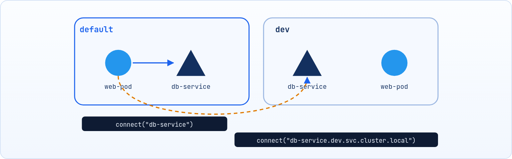

<small>المرحلة 3 · إدارة الـ Workloads</small>

الـ Namespace عبارة عن عزل أو تقسيم الـ Cluster الكبير اللي شايل كل حاجة لمجموعة Clusters صغيرة، ولكن بشكل افتراضي (Virtually). ومعاها هنشوف إزاي نحط حدود للموارد بتاعة كل Namespace بالـ ResourceQuota والـ LimitRange.

:::note[بعد الفصل ده هتكون عارف]
- يعني إيه Namespace وليه بنستخدمه
- الـ 4 Namespaces اللي بتتعمل تلقائي
- إيه الـ Objects اللي بتتحط في Namespace وإيه لأ
- إزاي الـ Pods بتكلم بعض عبر Namespaces
- الـ ResourceQuota والـ LimitRange
:::

<a id="s9-1"></a>

## 9.1 يعني إيه Namespace؟

عبارة عن عزل أو تقسيم الـ Cluster الكبير اللي شايل كل حاجة لمجموعة Clusters صغيرة، ولكن بشكل افتراضي (**Virtually**). وده بنعمله عشان لو عندنا أكتر من Team بيشتغلوا في نفس الـ Cluster، نفصل بينهم وشغلهم ميدخلش على بعض ولا يأثر على بعض. وفي الأغلب أشهر استخدام ليها إنك تعمل كذا environment جوه نفس الـ Cluster، وكل واحدة فيهم ليها غرض ما.

#### dev

معمولة عشان الـ Developers يكون ليهم بيئة خاصة بيهم يجربوا فيها كل حاجة محتاجينها للـ app، بعيداً عن الـ production عشان ميأثرش عليه (كأنها مسودة بيتجرب فيها قبل ما يطلع الشكل النهائي للـ app على الـ production).

#### prod

البيئة الحقيقية اللي المستخدمين شغالين عليها، ومحدش يلمسها غير بحساب.

وممكن يتعمل أكتر من Namespace زي ما نحب، المهم إنه لازم يتحددلها القواعد الخاصة بيها (**Roles**) ومقدار استهلاكها للموارد.

<a id="s9-2"></a>

## 9.2 الـ Namespaces اللي بتتعمل تلقائي

لما بتنشئ Cluster، فـ Kubernetes بشكل تلقائي بيعمل 4 Namespaces ألا وهم:

**الـ Namespaces الافتراضية**

| الـ Namespace | دورها |
|---|---|
| `default` | ده الـ Namespace الافتراضي، وأي Object بتنشئه (من غير ما تحدد Namespace) بيتعمل جواه. متاح ليه يستخدم كل الموارد اللي جوه الـ Cluster. تجنّب تستخدمه كبيئة للـ production. |
| `kube-system` | ده الـ Namespace اللي جواه كل الـ Objects الأساسية بتاعة Kubernetes زي kube-dns (CoreDNS)، kube-proxy، الـ API server، controller manager وغيرهم. متحطش فيه شغلك أبداً. |
| `kube-public` | Namespace عام يقدر يشوفه أي حد حتى من غير ما يكون logged in. بيتستخدم لمعلومات الـ cluster اللي المفروض تكون متاحة للجمهور. في الغالب مش هتحتاج تتعامل معاه. |
| `kube-node-lease` | ده بيحتوي على ملفات صغيرة اسمها **Lease**، واحدة لكل Node. الـ Node بتبعت heartbeat كل شوية لـ Kubernetes تقوله "أنا لسه شغال وبخير". ده بيساعد الـ cluster يكتشف بسرعة لو Node وقعت. |

<a id="s9-3"></a>

## 9.3 إيه اللي بيتحط في Namespace وإيه لأ؟

#### جوه Namespace معين

- Pods
- Services
- Deployments
- ReplicaSets
- ConfigMaps
- Secrets

#### على مستوى الـ Cluster كله

- الـ Nodes نفسها، مش بتتحط جوه مساحة افتراضية.
- الـ Persistent Volumes: الهاردات المتوصلة بالـ Cluster.
- الـ Namespace نفسه، مش جواه Namespace تاني!
- ClusterRoles و ClusterRoleBindings: الصلاحيات اللي على مستوى الـ Cluster كله.

:::note[ملحوظة]
لو عايز تعرف أي Object في Kubernetes تبع أنهي نوع، تقدر تستخدم الأمر ده:

```sh title="Terminal"
kubectl api-resources --namespaced=true
kubectl api-resources --namespaced=false
```

لو `true` يبقى هيجيبلك الحاجات اللي جوه Namespace، ولو `false` الحاجات اللي على مستوى الـ Cluster.
:::

<a id="s9-4"></a>

## 9.4 أوامر الـ Namespaces

عشان نعمل Namespace عندنا طريقتين:

```yaml title="namespace.yaml"
apiVersion: v1
kind: Namespace
metadata:
  name: dev
```

```sh title="Terminal"
kubectl create namespace dev
# أو اختصاراً
kubectl create ns dev
```

| الأمر | بيعمل إيه |
|---|---|
| `kubectl get namespaces` | تعرض كل الـ Namespaces اللي عندك (أو `kubectl get ns` اختصاراً). |
| `kubectl get pods -n dev` | الـ Pods جوه Namespace اسمها dev (أو `--namespace=dev`). |
| `kubectl get pods -A` | الـ Pods في كل الـ Namespaces مرة واحدة (اختصار `--all-namespaces`). |
| `kubectl delete namespace dev` | تمسح الـ Namespace **وكل اللي جواه**. خلي بالك! |

**تشريح الأمر**

```sh
kubectl get pods -n dev
```

1. `get pods`: اعرض الـ Pods.
2. `-n`: اختصار `--namespace`: نفّذ الأمر جوه Namespace معينة. ينفع مع أي أمر تقريباً (apply و delete و logs ...).
3. `dev`: اسم الـ Namespace.

لاحظ إن أي أمر بتكتبه فهو بيتنفذ جوه الـ Namespace الافتراضية اللي هي الـ `default` (فكّر فيها كأنها users بتبدّل بينهم في نظام Linux). فلو عايز تغيّر الـ Namespace اللي إنت جواها لواحدة تانية عشان تكتب أوامر جواها، بدل ما كل مرة تكتب الأمر اللي عايزه وفي آخره تحدد الـ Namespace اللي عايزها (`-n dev`):

```sh title="Terminal"
# الأمر ده بيثبت الـ dev كـ Namespace افتراضية للـ context الحالي
kubectl config set-context --current --namespace=dev
```

**تشريح الأمر**

```sh
kubectl config set-context --current --namespace=dev
```

1. `config`: أوامر بتعدّل ملف الإعدادات بتاع kubectl (`~/.kube/config`).
2. `set-context`: عدّل Context. الـ Context = (Cluster + User + Namespace افتراضية).
3. `--current`: عدّل الـ Context اللي إنت شغال بيه دلوقتي.
4. `--namespace=dev`: خلي الـ Namespace الافتراضية dev. تتأكد بـ `kubectl config view --minify | grep namespace`.

<a id="s9-5"></a>

## 9.5 إزاي الـ Pods بتكلم بعضها؟



*في نفس الـ Namespace بالاسم على طول، ومن Namespace تانية بالعنوان الكامل.*

#### لو في نفس الـ Namespace

الـ `web-pod` اللي جوه الـ default عايز يكلم الـ `db-service` اللي معاه في نفس الأوضة؟ هينادي عليه باسمه علطول:

`mysql.connect("db-service")`

#### لو في Namespace تانية

الـ `web-pod` اللي جوه الـ default عايز يكلم الـ `db-service` اللي في dev؟ لازم يكتب العنوان بالكامل عشان الـ DNS يوجهه صح:

`"db-service.dev.svc.cluster.local"`

**تشريح الأمر**

```text
db-service.dev.svc.cluster.local
```

1. `db-service`: اسم الـ Service.
2. `dev`: الـ Namespace اللي الـ Service فيها.
3. `svc`: ثابتة: معناها إن الاسم ده بتاع Service.
4. `cluster.local`: الـ Domain الافتراضي بتاع الـ Cluster.

:::note[معلومة مهمة]
الـ Namespaces بتعزل **الأسامي والصلاحيات والموارد**، لكن مش بتعزل الشبكة: أي Pod يقدر يكلم أي Pod في أي Namespace طالما عارف العنوان. لو عايز تمنع ده بتستخدم حاجة اسمها **NetworkPolicy**.
:::

<a id="s9-6"></a>

## 9.6 الـ ResourceQuota: تحجيم الموارد للفرق

<strong>من غير حدود، فريق واحد ممكن يعمل Deploy لحاجة تاكل كل الـ CPU والـ RAM، ويوقّع بقية الفرق في الـ Cluster. الـ ResourceQuota هو "عسكري المرور" اللي بيمسك الـ Namespace ويقولها: "ليكِ حدود مش هتعديها".</strong>

شكل الـ YAML file اللي بنعمل بيها الكلام ده:

```yaml title="resource-quota.yaml"
apiVersion: v1
kind: ResourceQuota
metadata:
  name: backend-team-quota
  namespace: my-team
spec:
  hard:
    pods: "20"
    services: "10"
    configmaps: "30"
    secrets: "30"
    persistentvolumeclaims: "10"
    requests.cpu: "8"
    limits.cpu: "16"
    requests.memory: 16Gi
    limits.memory: 32Gi
```

1. `apiVersion: v1`: اسم الـ ResourceQuota (بنسميه براحتنا).
2. `namespace: my-team`: حددنا الـ Namespace المستهدفة.
3. `spec:`: أقصى عدد Pods مسموح بيه هو 20. و `hard` يعني حد صارم مينفعش يتعدّى.
4. `services: "10"`: أقصى عدد Services هو 10.
5. `configmaps: "30"`: هيتشرحوا بعدين... متقلقش.
6. `requests.cpu: "8"`: مجموع حجز الـ CPU للـ Pods ميزيدش عن 8 cores.
7. `limits.cpu: "16"`: مجموع سقف الـ CPU ميزيدش عن 16 cores: بعد ما كل Pod اتوفرله الـ cores اللي محتاجها بشكل مبدئي وابتدوا يشتغلوا، فآخرهم كلهم في الاستهلاك هو ده.
8. `requests.memory: 16Gi`: نفس فكرة الـ CPU بالظبط بس للـ Memory.

:::caution[خلي بالك]
أول ما تحط ResourceQuota فيها `requests.cpu` أو `limits.cpu` على Namespace، أي Pod جديد فيها **لازم** يكون كاتب الـ requests والـ limits دي، وإلا هيترفض. وده بالظبط اللي الـ LimitRange بيحلّه.
:::

```sh title="Terminal"
kubectl apply -f resource-quota.yaml
kubectl describe resourcequota backend-team-quota -n my-team   # المستخدم مقابل الحد
```

<a id="s9-7"></a>

## 9.7 الـ LimitRange: القيم الافتراضية للـ Containers

<strong>لو الـ Developer نسي يكتب الـ resources (الـ requests والـ limits) جوه الـ YAML بتاع الـ Pod بتاعه، الـ Container ده ممكن يسرح في الـ Node وياكل الأخضر واليابس.</strong> الحل: الـ LimitRange بيحط "كتالوج افتراضي" للـ Namespace. لو الـ Developer نسي يحدد، الـ LimitRange بينزل عليه بالقيم الافتراضية أوتوماتيك، وكمان بيحددله سقف وأرضية للطلبات بتاعته.

```yaml title="limit-range.yaml"
apiVersion: v1
kind: LimitRange
metadata:
  name: default-container-limits
  namespace: my-team
spec:
  limits:
    - type: Container
      default:
        cpu: "500m"
        memory: "256Mi"
      defaultRequest:
        cpu: "200m"
        memory: "128Mi"
      max:
        cpu: "4"
        memory: "4Gi"
      min:
        cpu: "50m"
        memory: "32Mi"
```

1. `apiVersion: v1`: الاسم والـ Namespace اللي هيتطبق عليها.
2. `spec:`: القواعد دي لكل Container.
3. `default:`: القيم الافتراضية للـ **limits** اللي هتنزل أوتوماتيك لو الـ developer نسي يحط حاجة.
4. `defaultRequest:`: القيم الافتراضية للحجز المبدئي (**requests**) لو نسيها.
5. `max:`: هنا هو منسيش يحط القيم، هو حطها بالفعل، ولكن إحنا بنحددله range معين يختار فيه: أقصى حد مسموح لـ Container واحد يطلبه، عشان مفيش Pod واحد يستهبل ويطلب الـ quota كلها.
6. `min:`: أقل حد مسموح بيه، عشان ميكونش الـ Pod صغير لدرجة إنه ملوش لازمة ويستهلك أسماء ع الفاضي.

**ResourceQuota مقابل LimitRange**

|   | ResourceQuota | LimitRange |
|---|---|---|
| **بيحدد** | المجموع الكلي للـ Namespace كلها | الحدود لكل Container (أو Pod) لوحده |
| <strong>بيحط Defaults؟</strong> | لأ | أيوه (`default` و `defaultRequest`) |
| **مثال** | الفريق كله ميعدّيش 16 core | كل Container بين 50m و 4 cores |

:::note[معلومة مهمة]
فاضل آخر حاجة في الـ Namespaces ألا وهي الـ **RBAC** (Role-Based Access Control)، ولكن دي هنأجلها لبعدين في الآخر عشان نقدر نفهمها كويس.
:::

:::tip[ملخص الفصل]
- الـ Namespace تقسيم افتراضي للـ Cluster، أشهر استخدام ليه dev و prod أو فرق مختلفة.
- فيه 4 تلقائي: default و kube-system و kube-public و kube-node-lease.
- الـ Nodes والـ PVs والـ ClusterRoles على مستوى الـ Cluster، مش جوه Namespace.
- `-n` لـ Namespace معينة، `-A` لكلهم، و `set-context --current --namespace` لتغيير الافتراضي.
- من Namespace تانية: `service.namespace.svc.cluster.local`.
- الـ ResourceQuota للمجموع، والـ LimitRange للـ Defaults والحدود لكل Container.
:::

### أسئلة مراجعة

1. Pod في `dev` عايز يكلم Service اسمها `api` في `prod`، هيكتب العنوان إزاي؟
2. ليه مينفعش تحط شغلك في `kube-system`؟
3. حطيت ResourceQuota فيها `limits.memory` وبعدين عملت Pod من غير resources، إيه اللي هيحصل؟ وإيه الحل؟
4. اكتب الأمر اللي يخلي `staging` هي الـ Namespace الافتراضية.

### صح ولا غلط؟

1. الـ Nodes بتتحط جوه Namespace.
2. مسح Namespace بيمسح كل اللي جواها.
3. الـ Namespaces بتمنع الـ Pods إنها تكلم بعض بالشبكة.
