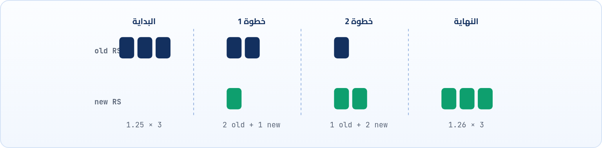

<small>المرحلة 3 · إدارة الـ Workloads</small>

في الحاجات اللي فاتت شفنا مجموعة Options بتتعمل على الـ Pod في الـ YAML بتاعها زي: ReplicaSet و Probes و Volumes و Resources (Limits & Requests) وغيرها. مع كتر الحاجات دي بنحتاج ننظم الـ YAML بتاع الـ Pod أكتر، وكمان محتاجين مرونة عالية في التحكم في الـ Pod دي، فعشان كده موجود الـ Deployment.

:::note[بعد الفصل ده هتكون عارف]
- ليه الـ Deployment مع إن الـ ReplicaSet موجودة
- مشكلة تحديث الـ image من غير Deployment
- العلاقة Deployment ← ReplicaSet ← Pods
- الـ Rolling Update والـ Rollback
- الـ Scaling بأمر واحد
:::

<a id="s10-1"></a>

## 10.1 يعني إيه Deployment؟

هو عبارة عن Object بيدير الـ Pod اللي جواه، بالإضافة لأي Options أو خلينا نقول Objects مرتبطة بالـ Pod دي.

تسأل سؤال وتقولي: ما أنا أقدر أكتب YAML للـ Pod ومعاها كل الـ Objects اللي محتاجاها عادي، إيه لازمته إني أحطها جوه Object جديد اسمه Deployment؟

<strong>لسببين:</strong> الأول هو فكرة الـ ReplicaSet، وإنه عشان نضمن إن فيه عدد X نسخ من الـ Pod دي شغالة، ولو حاجة وقعت تقوم تاني. ولكن النقطة دي مش جوهرية أوي، لأن زي ما قلنا عادي أحط ReplicaSet للـ Pod وخلاص، ودي حقيقة، ومن هنا ننتقل للسبب التاني.

<a id="s10-2"></a>

## 10.2 السبب الحقيقي: الـ Update

تخيل السيناريو ده: عايز تغيّر الـ image اللي بيتعمل منها الـ Container اللي جوه الـ Pod من `nginx:1.25` لـ `nginx:1.26`.

- لو عدّلت الـ image في الـ YAML بتاع الـ ReplicaSet وعملت (`kubectl apply`)، مفيش حاجة هتحصل للـ Pods الموجودة. اللي اتعملت وشغالة من الـ YAML القديم هتفضل معمولة من الـ Image القديمة.
- وهنا هتظهر الحاجة للـ Deployment، لأنه حتى لو حاطط ReplicaSet في الـ YAML فده مش كفاية، لأنه بيراقب بس <strong>"العدد المطلوب"</strong>، مش بيتأكد من إن "النسخ اللي شغالة دي مطابقة للي مكتوب في الـ YAML ولا لأ (لو اتحدّث يعني)".
- فكده الـ Pods القديمة هتفضل شغالة بـ `nginx:1.25` للأبد، والتحديث مش هيتطبق إلا لو Pod جديدة اتعملت (يعني لو واحدة ماتت بالصدفة).
- أو هتحتاج تحدّث إنت بإيدك بنفسك، يعني هتمسح كل الـ Pods يدوياً عشان الـ ReplicaSet يعمل جداد بالـ image الجديدة. وده معناه **downtime** فعلي لو مسحتهم كلهم مع بعض وتستنى الـ ReplicaSet تقومهم تاني. شوف الوقت اللي هتستغرقه العملية دي وتأثيرها على أي Traffic هييجي على الـ Pods دي وهي مش شغالة.

<a id="s10-3"></a>

## 10.3 الـ Structure: مين بيدير مين؟


*إنت بتتعامل مع الـ Deployment بس، هو اللي بيدير الـ ReplicaSet، وهي اللي بتدير الـ Pods.*

حاجة أخيرة بيقدّمها وهي الـ **Scaling**: زيادة أو تقليل عدد الـ Pods (في الـ ReplicaSet) بأمر واحد، بدل ما تعدّل في الـ YAML وتعمل Save وبعدها تعمل (`kubectl apply`)، هو بيختصرلك العملية دي.

<a id="s10-4"></a>

## 10.4 شكل الـ YAML بتاعه

شكل الـ YAML بتاعه مفهوش جديد، زي ما قلتلك هو تجميع للي فات:

```yaml title="deployment.yaml"
apiVersion: apps/v1
kind: Deployment
metadata:
  name: webapp
  namespace: default
  labels:
    app: webapp
spec:
  replicas: 3
  selector:
    matchLabels:
      app: webapp
  template:
    metadata:
      labels:
        app: webapp
    spec:
      containers:
      - name: webapp
        image: nginx:1.25
        ports:
        - containerPort: 80
        resources:
          requests:
            cpu: "100m"
            memory: "128Mi"
          limits:
            cpu: "200m"
            memory: "256Mi"
```

1. `apiVersion: apps/v1`: الـ Deployment في الـ API group `apps/v1`.
2. `metadata:`: اسم الـ Deployment، والـ Namespace، و Label على الـ Deployment نفسه.
3. `spec:`: عدد النسخ (الـ ReplicaSet).
4. `selector:`: الـ Pods اللي الـ Deployment مسؤول عنها، بالـ Labels.
5. `template:`: بداية شكل الـ Pod. الـ labels هنا **لازم** تطابق الـ selector.
6. `spec:`: نفس الـ spec بتاع الـ Pod اللي اتعلمناه. علامة `-` معناها عنصر في list.
7. `resources:`: الـ Requests والـ Limits زي فصل 6. وهنا كمان مكان الـ Probes.

<a id="s10-5"></a>

## 10.5 الـ Rolling Update: تحديث من غير Downtime <small>(إضافة)</small>

أحلى حاجة في الـ Deployment إنه لما تغيّر الـ image، مش بيمسح كل الـ Pods مرة واحدة. بيعمل **ReplicaSet جديدة** بالـ image الجديدة، ويزوّدها Pod Pod، وفي نفس الوقت يقلّل القديمة Pod Pod، لحد ما الجديدة تبقى 3 والقديمة 0. وطول الوقت فيه Pods شغالة بتستقبل Traffic.



*الـ Rolling Update: الـ ReplicaSet الجديدة بتكبر والقديمة بتصغر تدريجياً.*

```yaml title="deployment.yaml · strategy"
spec:
  strategy:
    type: RollingUpdate
    rollingUpdate:
      maxSurge: 1
      maxUnavailable: 0
```

1. `spec:`: الـ Default. البديل `Recreate`: يمسح الكل الأول وبعدين يعمل الجديد (فيه downtime).
2. `rollingUpdate:`: أقصى عدد Pods **زيادة** عن الـ replicas وقت التحديث (الـ Default 25%).
3. `maxUnavailable: 0`: أقصى عدد Pods مسموح يبقوا مش جاهزين وقت التحديث. `0` = مفيش أي نقص في الخدمة (الـ Default 25%).

:::tip[Best Practice]
الـ Rolling Update بيعتمد على الـ **Readiness Probe** عشان يعرف إن الـ Pod الجديدة جاهزة قبل ما يكمل ويمسح قديمة. من غيرها ممكن يمسح القديم ويحوّل الـ Traffic على Pods لسه مش جاهزة.
:::

### تحديث الـ image ومتابعته

**تشريح الأمر**

```sh
kubectl set image deployment/webapp webapp=nginx:1.26
```

1. `set image`: غيّر الـ image بتاعة Container جوه Object موجود (من غير ما تفتح الـ YAML).
2. `deployment/webapp`: النوع والاسم، والـ `/` بتفصل بينهم. ينفع تكتبها `deploy/webapp`.
3. `webapp=`: اسم الـ Container (من `containers.name`) وبعده `=`.
4. `nginx:1.26`: الـ image الجديدة بالـ tag.

:::caution[خلي بالك]
الأحسن في الشغل الحقيقي إنك تعدّل الـ image في ملف الـ YAML نفسه وتعمل `kubectl apply -f deployment.yaml`، عشان الملف (اللي غالباً في Git) يفضل مطابق للي شغال. `set image` سريع للتجربة بس.
:::

| الأمر | بيعمل إيه |
|---|---|
| `kubectl rollout status deploy/webapp` | تابع التحديث لحد ما يخلص (أو يفشل). |
| `kubectl rollout history deploy/webapp` | النسخ (Revisions) اللي اتعملت قبل كده. |
| `kubectl rollout undo deploy/webapp` | ارجع للنسخة اللي قبلها (Rollback). |
| `kubectl rollout undo deploy/webapp --to-revision=2` | ارجع لـ Revision معينة برقمها من الـ history. |
| `kubectl rollout restart deploy/webapp` | اعمل restart لكل الـ Pods بالتدريج (مفيد بعد تغيير ConfigMap مثلاً). |
| `kubectl rollout pause deploy/webapp` | وقّف التحديث مؤقتاً (و `resume` تكمّله). |

```sh title="Terminal · توضيح للناتج"
$ kubectl rollout status deploy/webapp
Waiting for deployment "webapp" rollout to finish: 1 out of 3 new replicas have been updated...
Waiting for deployment "webapp" rollout to finish: 2 out of 3 new replicas have been updated...
deployment "webapp" successfully rolled out
$ kubectl get rs
NAME                DESIRED   CURRENT   READY   AGE
webapp-5d8f7c9b6    0         0         0       10m
webapp-7b9c4d2f1    3         3         3       40s
```

لاحظ إن الـ ReplicaSet القديمة لسه موجودة بس بـ 0 Pods، وده اللي بيخلي الـ `rollout undo` سريع: بيكبّرها تاني ويصغّر الجديدة.

<a id="s10-6"></a>

## 10.6 الـ Scaling بأمر واحد <small>(إضافة)</small>

**تشريح الأمر**

```sh
kubectl scale deployment webapp --replicas=5
```

1. `scale`: غيّر عدد النسخ.
2. `deployment webapp`: النوع والاسم (بمسافة هنا بدل `/`، الاتنين شغالين).
3. `--replicas=5`: العدد الجديد. هيزود أو يقلل الـ Pods فوراً.

:::note[معلومة مهمة]
لو عملت scale بالأمر وبعدين عملت `apply` للملف القديم اللي فيه `replicas: 3`، العدد هيرجع 3. وعشان كده لو عايز Scaling أوتوماتيك على حسب الضغط، فيه الـ **HPA** اللي هنشوفه في المرحلة الأخيرة.
:::

**تشريح الأمر**

```sh
kubectl create deployment web --image=nginx --replicas=3 --dry-run=client -o yaml > deployment.yaml
```

1. `create deployment web`: اعمل Deployment اسمه web.
2. `--image=nginx`: الـ image بتاعة الـ Container.
3. `--replicas=3`: عدد النسخ.
4. `--dry-run=client`: متعملوش بجد في الـ Cluster، جرّب بس على جهازك.
5. `-o yaml`: طلّع الناتج بصيغة YAML.
6. `>`: علامة الـ redirect في الـ shell: احفظ الناتج في ملف بدل ما يظهر على الشاشة (وتمسح أي حاجة كانت فيه).
7. `deployment.yaml`: اسم الملف. كده عملت قالب جاهز تعدّل عليه بدل ما تكتب من الصفر.

:::tip[ملخص الفصل]
- الـ Deployment بيدير ReplicaSet، والـ ReplicaSet بتدير الـ Pods.
- الـ ReplicaSet لوحدها مش بتحدّث الـ Pods القديمة لما الـ image تتغير.
- الـ Deployment بيعمل Rolling Update من غير downtime، وتقدر ترجع بـ `rollout undo`.
- `maxSurge` و `maxUnavailable` بيتحكموا في سرعة وأمان التحديث.
- `kubectl scale` للـ Scaling السريع، والملف هو مصدر الحقيقة.
:::

### أسئلة مراجعة

1. ليه الـ ReplicaSet لوحدها مش كفاية عشان تحدّث الـ image؟
2. اشرح اللي بيحصل للـ ReplicaSets وقت الـ Rolling Update.
3. عملت تحديث والنسخة الجديدة فيها bug، إيه الأمر اللي يرجّعك؟
4. إمتى تستخدم `strategy: Recreate` بدل `RollingUpdate`؟

### صح ولا غلط؟

1. الـ Deployment بيمسح كل الـ Pods القديمة مرة واحدة وهو بيحدّث.
2. `maxUnavailable: 0` معناها إن عدد الـ Pods الجاهزة مش هيقل عن المطلوب.
3. الـ `--dry-run=client` بيعمل الـ Object في الـ Cluster.
