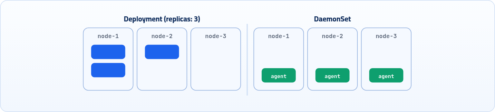

<small>المرحلة 3 · إدارة الـ Workloads</small>

شبه الـ Deployment، بس الفرق إن الـ DaemonSet بتكون لـ Pods ليها مهام متعلقة بالـ Node نفسها، زي الـ Logs والمراقبة وما إلى ذلك. ومعاها هنتعلم إزاي نختار Nodes معينة بالـ Node Selector والـ Node Affinity.

:::note[بعد الفصل ده هتكون عارف]
- الفرق بين الـ DaemonSet والـ Deployment
- الـ Images المشهورة للـ DaemonSets
- إزاي الـ Pod يقرا ملفات الـ Node بـ hostPath
- تحديد Nodes معينة بـ nodeSelector و nodeAffinity
- حل المشاكل الشائعة (taints و tolerations)
:::

<a id="s11-1"></a>

## 11.1 يعني إيه DaemonSet؟

شبه الـ Deployment، بس الفرق إن الـ DaemonSet بتكون لـ Pods ليها مهام متعلقة بالـ Node نفسها، زي الـ Logs والمراقبة وما إلى ذلك.

يعني كأنك عملت Pods عادية بس شغلها مرتبط بالـ Node اللي عليها، فبنحطها جوه Object اسمه DaemonSet، هتشغّلها على **كل** الـ Nodes اللي موجودة (أو اللي ممكن تتعمل مستقبلاً) في الـ Cluster بشكل تلقائي، كأنها حاجة افتراضية على كل Node.

- ممكن أحدد Nodes معينة بس يشتغل عليها في حالات محدودة.
- ممكن أعمل كذا DaemonSet على كل Node. يعني مثلاً أنا محتاج على كل Node مجموعة DaemonSets، كل واحدة فيهم جواها Pod بتعمل حاجة مختلفة عن الـ Pod اللي جوه الـ DaemonSet التانية: واحدة بتجمع الـ Logs، وواحدة بتراقب استهلاك الـ Resources، ....



*الـ Deployment بيوزع عدد معين على أي Nodes، والـ DaemonSet بيحط Pod واحدة بالظبط على كل Node.*

<a id="s11-2"></a>

## 11.2 شكل الـ YAML بتاعه

نيجي لشكل الـ YAML بتاعه (شبه الـ Deployment جداً، ولكن الفرق إنه مفيش `replicas`، لأن العدد = عدد الـ Nodes):

```yaml title="daemonset.yaml"
apiVersion: apps/v1
kind: DaemonSet
metadata:
  name: log-collector
  namespace: monitoring
  labels:
    app: log-collector
spec:
  selector:
    matchLabels:
      app: log-collector
  template:
    metadata:
      labels:
        app: log-collector
    spec:
      containers:
      - name: fluentd
        image: fluentd:v1.14
        resources:
          requests:
            cpu: "50m"
            memory: "64Mi"
          limits:
            cpu: "100m"
            memory: "128Mi"
        volumeMounts:
        - name: varlog
          mountPath: /var/log
      volumes:
      - name: varlog
        hostPath:
          path: /var/log
```

1. `apiVersion: apps/v1`: اسم الـ DaemonSet نفسها (من اختيارك)، في أنهي Namespace، و Label على الـ DaemonSet نفسها.
2. `spec:`: إيه الـ Pods اللي الـ DaemonSet مسؤول عنها. لازم يطابق labels الـ Pod تحت.
3. `template:`: مواصفات الـ Pod اللي هيعمله. هنختار Image ليها علاقة بالهدف بتاعنا من الـ Pod اللي هنقومها (الجدول الجاي).
4. `resources:`: هنحط حدود للـ resources اللي مسموح للـ Pod دي تستخدمها، ومنطقي نخلي استهلاكها قليل، لأنه مش دورها تبع الـ App نفسه فتحتاج تستهلك كتير، لا هي بتراقب بس.
5. `volumeMounts:`: `volumeMounts` جوه الـ containers: المسار **جوه الـ Container** اللي الملفات اللي هناخدها من الـ Node هتظهر فيه.
6. `volumes:`: `volumes` جوه الـ spec (مش الـ containers): مكان الملفات **على الـ Node** اللي هنجيب منه. والـ `name` هو اللي بيربط الاتنين ببعض.

زي ما قلنا فوق، الـ Pod أو الـ Image تحديداً هتحتاج تاخد بيانات من الـ Node نفسها، وده منطقي، لأن كل البيانات اللي هتراقبها أو هتعرضها بتكون عبارة عن ملفات جوه الـ Node نفسها، فلازم أخليها تكلم الملفات دي على الـ Node عشان تاخد البيانات اللي محتاجاها، فأكيد هنستخدم الـ **Volumes**. والـ DaemonSet في الغالب بيستخدم volumes من نوع `hostPath` عشان يوصل مباشرة لملفات الـ Node نفسها.

**Images مشهورة للـ DaemonSets**

| الـ Image | بتعمل إيه؟ |
|---|---|
| **Prometheus** (Node Exporter) | مراقبة الـ Resources (CPU، Memory، Disk) + ميزة Alerts لما الاستهلاك يوصل للـ Max يبلّغك. |
| **Fluentd / Filebeat** | جمع الـ Logs من الـ Node اللي هي عليها. |
| **Calico / Weave** | إدارة الشبكة. |

:::caution[دقة]
اللي بيشتغل كـ DaemonSet في المراقبة هو الـ **node-exporter** (بيطلّع أرقام كل Node)، والـ Prometheus نفسه بيشتغل غالباً كـ Deployment أو StatefulSet ويجمع من كل الـ exporters. وفي الشبكات، Weave اتوقف تطويره، والمشهور النهارده Calico و **Cilium**.
:::

زي ما إنت لاحظت، أنا غالباً هحتاج أعمل الـ 3 حاجات مع بعض، مش هختار مراقبة الـ Resources بس مثلاً، عشان كده قلت في الأول ممكن أعمل أكتر من DaemonSet، وتبقى كل واحدة لحاجة فيهم، ويشتغلوا كلهم على كل Node موجودة عادي. مش هندخل في تفاصيل الحتة دي أوي، ولكن يكفينا حالياً نبقى عارفين الـ Images دي واستخدامها. أما بقى هتبلّغك إزاي أو هتبعتلك التقارير إزاي، فيكفينا نعرف إنه بيبقى ليها Configurations خاصة بيها بتظبطها، وبتبعتلك التقارير دي عن طريق Dashboard خاصة بيها. إنما هنا إنت بس بتظبط الـ Pod من ناحيتك إنت كـ Cluster: آخرها فين كاستهلاك، وهتستخدم أنهي Image، وهتاخد بياناتها منين.

```sh title="Terminal"
kubectl apply -f daemonset.yaml
kubectl get daemonset -n monitoring     # أو ds اختصاراً
```

<a id="s11-3"></a>

## 11.3 تحديد Nodes معينة

عايزين نتكلم على جزئية إننا إزاي نحدد Nodes معينة نشغّل عليها DaemonSet وغيرها لأ. ممكن نعمل ده بطريقة من اتنين: <strong>(1) Node Selector</strong> أو <strong>(2) Node Affinity</strong>.

### (1) Node Selector

بتخلي الـ DaemonSet تشتغل على الـ Nodes اللي عندها الـ label معينة. بيعمل Match من الآخر.

<strong>(1)</strong> لازم الأول تعمل label على الـ Nodes اللي عايزها، بالطريقة دي:

```sh title="Terminal"
kubectl label nodes <node-name> <key>=<value>
kubectl label nodes node-1 hardware=gpu
kubectl label nodes node-2 hardware=gpu
```

**تشريح الأمر**

```sh
kubectl label nodes node-1 hardware=gpu
```

1. `label nodes`: ضيف Label على Node (نفس فكرة الـ Pods بالظبط).
2. `node-1`: اسم الـ Node زي ما بيظهر في `kubectl get nodes`. والـ `<>` في الشكل العام معناها "حط القيمة بتاعتك هنا" ومش بتتكتب.
3. `hardware=gpu`: الـ Label: key هو hardware و value هو gpu.

عشان تتأكد إنه اتضاف:

```sh title="Terminal"
$ kubectl get nodes --show-labels
NAME     STATUS   LABELS
node-1   Ready    hardware=gpu,...
node-2   Ready    hardware=gpu,...
node-3   Ready    ...
```

<strong>(2)</strong> هتضيف الجزء ده في الـ YAML:

```yaml title="YAML"
  template:
    spec:
      nodeSelector:
        hardware: gpu       # name of selected label/s of the nodes
```

لو ضفت Node جديدة وحطيت عليها الـ label دي، الـ DaemonSet بيتعمل عليها أوتوماتيك.

وإزاي تشيل الـ label لو غلطت:

```sh title="Terminal"
kubectl label nodes <node-name> <label>-
kubectl label nodes node-1 hardware-
```

### (2) Node Affinity

بتديك نفس نتيجة الـ nodeSelector، بس بإمكانيات أكتر، يعني تقدر تقول اختار الـ Node دي "أو" دي، وتحدد نطاقات. وزي الـ nodeSelector بالظبط، لو الشرط مش متحقق، الـ Pod مش بيتعمل خالص.

```yaml title="nodeAffinity"
template:
  spec:
    affinity:
      nodeAffinity:
        requiredDuringSchedulingIgnoredDuringExecution:
          nodeSelectorTerms:
          - matchExpressions:
            - key: hardware
              operator: In
              values:
              - gpu
              - gpu-v2
```

1. `template:`: بنحدد قواعد اختيار الـ Node.
2. `requiredDuringSchedulingIgnoredDuringExecution:`: الاسم الطويل ده معناه: الشرط **إجباري** وقت الجدولة، ولو الـ Label اتغيرت بعد ما الـ Pod اشتغل، متطردوش. (فيه نوع تاني `preferred...` يعني "يُفضَّل" مش إجباري).
3. `nodeSelectorTerms:`: الـ `nodeSelectorTerms` بتاخد List من الـ `matchExpressions`، واللي هي تعتبر شرط.
4. `- key: hardware`: الـ `key` هو اسم الـ label اللي هنختاره، والـ `operator` هو الشرط نفسه، والـ `values` القيم اللي هيتعمل عليها الشرط (بندوّر فيها). في المثال ده بنقوله: لو قيمة الـ label بتاعة الـ Node في (In) القيم دي، اختارها.

**الـ Operators**

| الـ Operator | معناه |
|---|---|
| `In` | القيمة موجودة في القايمة (values). |
| `NotIn` | القيمة مش موجودة في القايمة (values). |
| `Exists` | الـ key موجود أصلاً بشكل عام (إن فيه label بتاعة الـ Node اسمها كده)، أياً كانت قيمتها. ومش بتكتب values. |
| `DoesNotExist` | الـ key مش موجود خالص أصلاً. |
| `Gt` / `Lt` | إضافة أكبر من / أصغر من (للقيم الرقمية). |

بعد ما تخلص كتابة الملف احفظه واعمل: `kubectl apply -f daemonset.yaml`

:::note[معلومة مهمة]
الـ `nodeSelector` والـ `nodeAffinity` مش خاصين بالـ DaemonSet بس، بتقدر تستخدمهم في أي `template.spec` بتاع Deployment أو Pod عادي.
:::

<a id="s11-4"></a>

## 11.4 مشاكل شائعة

:::danger[مشكلة: الـ Pod مش بيتعمل على Nodes الـ control plane]
بشكل افتراضي، الـ DaemonSet مش بيشتغل على Nodes الـ control plane (master) لأنها عندها `taint` خاص بيمنع الـ Pods العادية. والـ taint زي "يافطة ممنوع الدخول" على الـ Node، والـ toleration هي "التصريح" اللي بيخلي Pod معينة تعدّي.

**الحل** لو محتاجه يشتغل عليها:

```yaml title="YAML"
spec:
  template:
    spec:
      tolerations:
      - key: node-role.kubernetes.io/control-plane
        operator: Exists
        effect: NoSchedule
```
:::

:::danger[مشكلة: الـ READY مختلف عن الـ DESIRED]
يعني فيه Node أو أكتر الـ Pod مش شغال عليها. الأسباب الشائعة:

- الـ Node عندها taint والـ DaemonSet معندوش toleration ليها.
- مشكلة في الـ image أو الـ resources.
- الـ nodeSelector مش مطابق.

```sh title="Terminal"
kubectl describe daemonset log-collector   # شوف Events
kubectl get pods -o wide                    # شوف على أنهي Node الـ Pod مش موجود
```
:::

:::danger[مشكلة: موارد زيادة على الـ Nodes]
لأن الـ DaemonSet بيشغّل Pod على كل Node، لو نسيت تحط resource limits، Pod واحد ممكن ياكل موارد الـ Node كلها ويأثر على باقي التطبيقات.

<strong>الحل:</strong> دايماً حط `resources.requests` و `resources.limits`.
:::

:::tip[نصيحة: الـ DaemonSets في Kubernetes نفسها]
Kubernetes نفسها بتستخدم DaemonSets داخلياً، زي `kube-proxy` اللي بيشتغل على كل Node ومسؤول عن الـ networking. لو عملت `kubectl get daemonset -n kube-system` هتلاقيه هناك.
:::

:::tip[ملخص الفصل]
- الـ DaemonSet بيشغّل Pod واحدة على كل Node (أو Nodes مختارة)، ومفيهوش replicas.
- بيستخدم في الـ Logs والمراقبة والشبكات، وغالباً بـ `hostPath` volumes.
- `volumeMounts` = المسار جوه الـ Container، و `volumes` = المصدر على الـ Node.
- `nodeSelector` للـ match البسيط، و `nodeAffinity` للشروط (In و NotIn و Exists ...).
- الـ taints بتمنع، والـ tolerations بتسمح.
:::

### أسئلة مراجعة

1. ليه الـ DaemonSet مفيهوش `replicas`؟
2. اشرح الفرق بين `volumeMounts` و `volumes` في مثال الـ log-collector.
3. عايز Pod تشتغل على Nodes عليها `disk=ssd` أو `disk=nvme`، هتستخدم إيه؟ اكتب الشرط.
4. DaemonSet شغال على 2 Nodes بس من 3، إيه أول حاجة تعملها؟

### صح ولا غلط؟

1. لو ضفت Node جديدة للـ Cluster، الـ DaemonSet بيعمل عليها Pod أوتوماتيك.
2. الـ operator `Exists` محتاج values.
3. kube-proxy شغال كـ DaemonSet.
