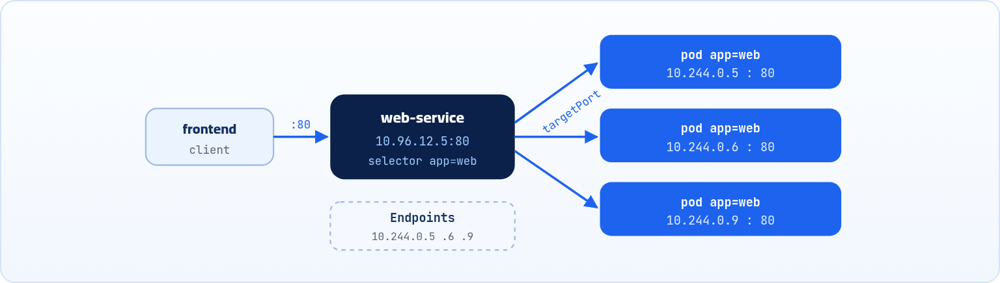
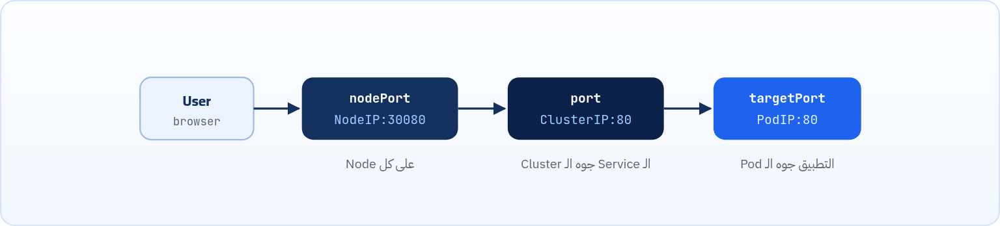

<small>المرحلة 4 · الشبكات</small>

كل Pod بياخد IP جديدة كل ما يتعمل من أول وجديد، فإزاي الـ Frontend يلاقي الـ Database لو عنوانها بيتغير؟ الحل بنفس مبدأ رقم تليفون الشركة: رقم ثابت مش مهم مين الموظف اللي بيرد النهارده. ده بالظبط الـ Service.

:::note[بعد الفصل ده هتكون عارف]
- المشاكل التلاتة اللي الـ Service بتحلها
- إزاي الـ Service بتلاقي الـ Pods بالـ Labels والـ Endpoints
- الفرق بين port و targetPort و nodePort
- الأنواع الأربعة: ClusterIP و NodePort و LoadBalancer و ExternalName
- الـ DNS جوه الـ Cluster وحل المشاكل الشائعة
:::

<a id="s13-1"></a>

## 13.1 المشكلة: الـ IP بيتغير

- تخيل إن عندك تطبيق فيه Frontend بيتكلم مع Database. الـ Frontend محتاج يعرف عنوان الـ Database عشان يتكلم معاها.
- في Kubernetes، كل Pod بياخد IP جديدة كل ما يتعمل من أول وجديد. يعني لو الـ Pod بتاعة الـ Database اتحذفت واتعملت تاني هتاخد IP جديد، والـ Frontend يفضل بيدوّر على العنوان القديم وبيرفض يشتغل.
- الحل هيكون بنفس مبدأ رقم تليفون الشركة: زي ما الشركة عندها رقم تليفون ثابت، مش مهم مين الموظف اللي بيرد النهارده، الرقم مابيتغيرش.

الـ **Service** هي نفس الفكرة: عنوان ثابت أمام الـ Pods اللي ممكن تتغير في أي وقت. في الحقيقة مش مشكلة واحدة، في تلاتة، والـ Service بتحل التلاتة دول مرة واحدة:

**المشاكل التلاتة وحل الـ Service**

| المشكلة | الـ Service بتعمل إيه؟ |
|---|---|
| الـ IP بتاع الـ Pod بيتغير كل ما تتعمل من الأول. | بتديك IP ثابت تقدر من خلاله تكلم مجموعة Pods (بيكونوا مختارين جوه الـ Service). |
| لو عندك 3 نسخ من نفس الـ Pod، مين يوزع الطلبات عليهم؟ | بتوزع الحمل على الـ Pods اللي هي بتخدم عليهم. |
| لو الـ Pod ماتت، مفيش حاجة تمنع إنه يتبعت طلب لـ IP فاضية (الـ Pod الميتة). | بتعرف لوحدها الـ Pods الشغالة من الميتة. |

<a id="s13-2"></a>

## 13.2 إزاي الـ Service بتشتغل فعلاً؟

الـ Service زي أي Object تاني في Kubernetes: بتكتبها في YAML وبتعملها apply. بتاخد IP ثابتة اسمها **ClusterIP**، ودي بتفضل زي ما هي طول عمر الـ Service.

الـ Service مش بتحتفظ بقايمة IPs مكتوبة لمجموعة Pods. لأ، هي بتقول "جيبلي كل الـ Pods اللي عندها label معينة"، زي `app: web` مثلاً.

- أي Pods بتتخلق بنفس الـ label، الـ Service بتلاقيها علطول.
- أي Pods تموت، بتشيلها من القايمة (الخدمة يعني).

```yaml title="service.yaml"
apiVersion: v1
kind: Service
metadata:
  name: web-service
spec:
  selector:
    app: web
  ports:
  - port: 80
    targetPort: 80
```

1. `apiVersion: v1`: اسم الـ Service، وده نفسه اللي هيبقى اسم الـ DNS بتاعها.
2. `spec:`: هيختار مجموعة الـ Pods اللي عليهم الـ Label ده.
3. `ports:`: `port`: الـ Port اللي الـ Service بتسمع عليه (بتستقبل عليه) أي حاجة جيالها.
4. `targetPort: 80`: `targetPort`: الـ Port اللي الـ App نفسه جوه الـ Pod بيسمع عليه (بيستقبل عليه) أي حاجة جياله.



*الـ Service ليها IP ثابت، وبتوزع الطلبات على الـ Pods اللي في الـ Endpoints، واللي بتتحدّث أوتوماتيك بالـ selector.*

ورا كل Service فيه Object اسمه **Endpoints** (وفي النسخ الحديثة **EndpointSlices**)، هو ده اللي فيه IPs الـ Pods الشغالة حالياً، و Kubernetes بيعمله update تلقائي. يعني هو وظيفته يروح على الـ Pods اللي تبع الـ Label اللي الـ Service عايزاه ويجيب الـ IPs بتاعة الـ Pods اللي شغالة فيهم (والـ Ready بس، وهنا بتبان فايدة الـ Readiness Probe).

الـ Service بتتولى هي مسؤولية توزيع الـ Traffic (بشكل عشوائي تقريباً) على الـ Pods اللي وراها.

<a id="s13-3"></a>

## 13.3 الأنواع الأربعة للـ Services

عندنا 4 أنواع للـ Services في Kubernetes:

#### ClusterIP

ده الـ default: يعني لو ماكتبتش `type` خالص في الـ YAML، Kubernetes هيعتبره ClusterIP تلقائي. فكرته إنه بيديك IP داخلية بس، مفيش حاجة من بره الـ Cluster تقدر توصلها. ده اللي بتستخدمه لكل حاجة المفروض تفضل داخلية: الـ database، الـ cache، الـ backend API. أي حاجة مش عايز العالم يشوفها مباشرة. بيستخدم في 90% من الحالات، وباقي الحالات بنسمح بإن حاجة بره الـ Cluster تكلم اللي جواه، ولكن بيكون فيه قيود Security وغيرها.

```yaml title="YAML"
spec:
  type: ClusterIP   # أو سيبها فاضية
  selector:
    app: backend
  ports:
  - port: 8080
    targetPort: 8080
```

#### NodePort

بيفتح Port على كل Node في الـ Cluster (في الـ Range: **30000–32767**)، وبيوصّل الـ traffic الجاي عليه للـ Service. يعني من بره تقدر توصل للتطبيق عن طريق `Node_IP:30080` مثلاً. والجميل إنك تقدر تستخدم IP أي Node حتى لو الـ Pod مش شغالة عليها، ساعتها Kubernetes بيعمل routing علطول لأي Node تانية.

```yaml title="YAML"
spec:
  type: NodePort
  selector:
    app: web
  ports:
  - port: 80
    targetPort: 80
    nodePort: 30080
```

#### LoadBalancer

ده اللي بتستخدمه للـ production على الـ Cloud. لما بتعمل Service بـ LoadBalancer، ساعتها Kubernetes بيتكلم مع الـ Cloud ويعملك Load Balancer حقيقي أوتوماتيك، وبتاخد IP أو DNS من بره حقيقية.

```yaml title="YAML"
spec:
  type: LoadBalancer
  selector:
    app: frontend
  ports:
  - port: 80
    targetPort: 3000
```

#### ExternalName

من اسمه هو بيتعامل مع حاجة خارجية. وفعلاً وظيفته يوصّل حاجة جوه الـ Cluster لحاجة بره، مثلاً فيه Pod عايزة تكلم عنوان معين بره الـ Cluster. بيعمل **DNS alias** لاسم خارج الـ Cluster. التطبيق بيتكلم مع اسم Service عادي، والـ DNS بيوديه للـ endpoint الخارجي.

```yaml title="YAML"
spec:
  type: ExternalName
  externalName: my-db.us-east-1.rds.amazonaws.com
```



*رحلة الطلب في NodePort: من الـ nodePort، للـ port بتاع الـ Service، للـ targetPort بتاع الـ Pod.*

<a id="s13-4"></a>

## 13.4 ملاحظات على أنواع الـ Services

**ملاحظات مهمة على كل نوع**

| النوع | الملاحظة |
|---|---|
| **NodePort** | النوع ده مش مناسب للـ production، لأنك بتكشف Port غريب على كل ماكينة، والمستخدم محتاج يعرف IP الـ Node والـ Port بتاعها. مش الأسهل تقوله "روح على myapp.com" وخلاص؟ لأ، هتضطر تخليه كل مرة يكتب: "Node\_IP:Port"، طب ما ممكن ينسى، وغير كده دي مش طريقة احترافية. كمان IPs الـ Nodes ممكن تتغير، فهو هيعرف منين ساعتها؟ استخدمه للـ dev والاختبار، أو لو عندك load balancer خارجي إنت بتديره. |
| **LoadBalancer** | حاجة مهمة جداً، الـ local clusters: لو اشتغلت على minikube أو kind أو أي cluster محلي وكتبت `type: LoadBalancer`، مش هيحصل error، بس الـ EXTERNAL-IP هتفضل `<pending>` للأبد. الحل: شغّل `minikube tunnel` في Terminal تاني. |
| **ExternalName** | فايدته إيه؟ بدل ما تكتب الـ IP بتاع المكان (اللي بره الـ Cluster) اللي عايز تكلمه في كل حتة في الكود، بتكتب اسم الـ Service، ولو الـ IP اتغير بعدين، بتغير الـ YAML بس وخلاص، التطبيق مش محتاج يتغير. |

:::tip[نصيحة: الـ port هو الوحيد الإلزامي]
في الـ NodePort Service، الوحيد الـ required هو `port`. لو مكتبتش `targetPort`، هيبقى زي الـ `port`. ولو مكتبتش `nodePort`، Kubernetes بيختار رقم free من الرينج أوتوماتيك.
:::

:::tip[نصيحة: الـ ports هي array]
الـ Service الواحدة تقدر تفتح بورتات كتير في نفس الوقت. بس حط dash (`-`) قبل كل entry، ولازم كل واحد يبقى ليه `name`. مفيد لو التطبيق بيـ serve HTTP على 80 و gRPC على 9090 من نفس الـ Pods.
:::

<a id="s13-5"></a>

## 13.5 إزاي الـ Pods بتلاقي بعضها؟ (DNS)

كل Service بتتعمل ليها **DNS record** أوتوماتيك، من غير أي إعداد منك. Kubernetes بيشغّل **CoreDNS** جوه الـ Cluster، وهو اللي بيحفظ أسماء كل الـ Services. عشان تكلم أي Service بتنده عليها باسمها بالشكل ده:

#### service-name

تستخدم الاسم علطول لو هي في نفس الـ Namespace اللي إنت فيه.

#### \<service-name\>.\<namespace\>.svc.cluster.local

دي الطريقة الأطول والأعم (في حالة إنت كنت في Namespace تانية غير الـ Namespace اللي الـ Service دي موجودة فيها).

تخيلها زي الـ Contacts اللي عندك في التليفون: مش محتاج تحفظ الأرقام، بتدوّر على الاسم وتلاقي الرقم. في Kubernetes بيعمل نفس الحاجة بالظبط.

<a id="s13-6"></a>

## 13.6 أوامر kubectl السريعة للـ Services

| الأمر | بيعمل إيه |
|---|---|
| `kubectl get services` | شوف كل الـ Services (أو `svc` اختصاراً). |
| `kubectl get endpoints` | شوف IPs الـ Pods ورا كل Service. |
| `kubectl describe service <name>` | تفاصيل كاملة: selector + events. |
| `kubectl expose deploy <name> --port=80` | اعمل Service من Deployment بسرعة. |
| `kubectl port-forward svc/<name> 8080:80` | اختبار محلي من غير NodePort. |

**تشريح الأمر**

```sh
kubectl expose deployment webapp --port=80 --target-port=8080 --type=NodePort
```

1. `expose`: اعمل Service لـ Object موجود (بياخد الـ selector من الـ labels بتاعته أوتوماتيك).
2. `deployment webapp`: الـ Deployment اللي عايز تعمله Service.
3. `--port=80`: الـ `port` بتاع الـ Service.
4. `--target-port=8080`: الـ `targetPort`: البورت اللي التطبيق بيسمع عليه جوه الـ Pod.
5. `--type=NodePort`: نوع الـ Service. لو مكتبتهوش يبقى ClusterIP.

**تشريح الأمر**

```sh
kubectl port-forward svc/web-service 8080:80
```

1. `port-forward`: افتح نفق (tunnel) من جهازك لحاجة جوه الـ Cluster. بيفضل شغال لحد ما تدوس `Ctrl+C`.
2. `svc/web-service`: الهدف: Service اسمها web-service (ينفع `pod/name` أو `deploy/name`).
3. `8080`: الـ Port على جهازك إنت (localhost).
4. `:80`: الـ Port بتاع الـ Service. فلما تفتح `http://localhost:8080` هتوصل للـ Service على 80.

:::note[جرّبها على minikube]
```sh title="Terminal"
$ kubectl create deployment web --image=nginx --replicas=2
$ kubectl expose deployment web --port=80 --type=NodePort
$ kubectl get svc web
NAME   TYPE       CLUSTER-IP     EXTERNAL-IP   PORT(S)        AGE
web    NodePort   10.96.144.20   <none>        80:31234/TCP   5s
$ minikube service web --url
http://192.168.49.2:31234
```

في عمود `PORT(S)`، الـ `80:31234/TCP` معناها: الـ port بتاع الـ Service هو 80، والـ nodePort اللي اتختار أوتوماتيك هو 31234، والبروتوكول TCP. و `minikube service --url` بيديك الرابط الجاهز.
:::

<a id="s13-7"></a>

## 13.7 مشاكل وأخطاء شائعة

:::danger[مشكلة: الـ Service مش بتروّح لأي Pod]
عملت الـ Service بس الطلبات بتتضيّع. أول حاجة اعملها:

```sh title="Terminal"
$ kubectl get endpoints my-service
NAME         ENDPOINTS   AGE
my-service   <none>      5m
```

`<none>` = فاضية = مفيش Pod اتلاقت. ده في 95% من الحالات بيبقى الـ selector مش مطابق للـ labels. افتح الاتنين وقارن:

```sh title="Terminal"
kubectl get pods --show-labels
kubectl describe service my-service | grep Selector
```

<strong>خلي بالك:</strong> الـ labels حساسة لحالة الحروف. `app: Web` مش زي `app: web`.
:::

**تشريح الأمر**

```sh
kubectl describe service my-service | grep Selector
```

1. `describe service my-service`: طلّع كل تفاصيل الـ Service كنص طويل.
2. `|`: الـ **Pipe**: خد الناتج بتاع الأمر اللي على شمالي وابعته كـ input للأمر اللي على يميني.
3. `grep Selector`: من كل النص ده، اعرض بس السطور اللي فيها كلمة Selector.

:::danger[مشكلة: الـ targetPort غلط]
الـ Service شغالة بس الطلبات بتفشل. الغلطة الكلاسيكية:

```yaml title="YAML"
ports:
  - port: 80          # ✓ العميل بيتكلم على 80
    targetPort: 80    # ✗ بس التطبيق داخل الـ Pod بيسمع على 8080
```

<strong>الحل:</strong> دايماً تحقق من البورت الفعلي اللي التطبيق بيسمع عليه جوه الـ Pod، وطابقه مع الـ `targetPort`.
:::

:::tip[ملخص الفصل]
- الـ Service = IP واسم ثابتين قدام مجموعة Pods متغيرة، بتختارهم بالـ selector.
- الـ Endpoints فيها IPs الـ Pods الجاهزة، وبتتحدث أوتوماتيك.
- `port` بتاع الـ Service، `targetPort` بتاع التطبيق، `nodePort` على كل Node (30000–32767).
- ClusterIP داخلي (الافتراضي)، NodePort للتجربة، LoadBalancer للـ Cloud، ExternalName لـ alias خارجي.
- الـ DNS: `name` في نفس الـ Namespace، أو `name.ns.svc.cluster.local`.
:::

### أسئلة مراجعة

1. ليه منكتبش IP الـ Pod في إعدادات الـ Frontend على طول؟
2. الـ Endpoints بتاعة Service طلعت `<none>`، إيه أول حاجة تشك فيها؟
3. التطبيق بيسمع على 3000 وعايز الناس توصله على 80 جوه الـ Cluster، اكتب الـ ports.
4. عملت LoadBalancer على minikube والـ EXTERNAL-IP `<pending>`، ليه؟ وإيه الحل؟

### صح ولا غلط؟

1. لو مكتبتش `type`، الـ Service هتبقى NodePort.
2. الـ nodePort ممكن يبقى أي رقم زي 8080.
3. Pod مش Ready مش بيتحط في الـ Endpoints.
