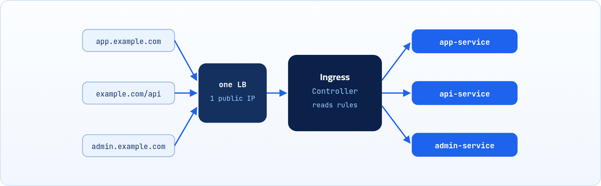

<small>المرحلة 4 · الشبكات</small>

تخيل إنك عملت تطبيقك بـ LoadBalancer Service زي ما اتعلمنا. تمام، شغال. بعدين الفريق ضاف admin dashboard، وبعدين API منفصل. كل جزء محتاج Load Balancer لوحده وفاتورة لوحده. الـ Ingress بيحل المشكلة دي بباب رئيسي واحد بيوزّع على الكل.

:::note[بعد الفصل ده هتكون عارف]
- المشكلة اللي الـ Ingress بيحلها (التكلفة)
- الفرق بين Ingress Resource و Ingress Controller
- تركيب nginx-ingress على minikube وبـ Helm
- يعني إيه Routing: الـ Host والـ Path
- كتابة Ingress بالـ Path وبالـ Host
:::

<a id="s14-1"></a>

## 14.1 المشكلة: Load Balancer لكل حاجة

- تخيل عملت تطبيقك بـ LoadBalancer Service زي ما اتعلمنا. تمام، شغال. بعدين الفريق ضاف admin dashboard. وبعدين API منفصل.
- كل جزء في الـ App محتاج LB خاص بيه، يعني كل واحد بياخد cloud load balancer لوحده، و IP خارجي لوحده، وسطر منفصل في فاتورة الـ cloud.
- طب لما تعرف إن الـ Load Balancer الواحد بيكلف تقريباً من 20 لـ 50 دولار شهرياً. يعني لو عندك 5 أجزاء في الـ App بتاعك، هتدفع 100-250 دولار شهرياً بس في الـ load balancers، قبل ما تحسب تكلفة باقي الحاجات أصلاً.

الـ **Ingress** بيحل المشكلة دي بطريقة ذكية: بيعمل **Load Balancer واحد بس** على الـ Cluster من بره، وكل الـ Traffic بيعدي منه. الـ Ingress بعد كده بيوزع كل request للمكان الصح بناءً على الـ **hostname** أو الـ **path**، وفاهم HTTP/HTTPS بالكامل، وفيه **TLS termination** مدمج.

:::note[تخيله كده]
زي مكتب الاستقبال في مبنى فيه شركات كتير. مش كل شركة محتاجة باب خاص بيها من الشارع: فيه باب رئيسي واحد، والريسيبشن (الـ Ingress) بيوجه كل زائر للدور والمكتب الصح حسب اسمه أو طلبه.
:::



*Load Balancer واحد، والـ Ingress Controller بيوزّع على الـ Services حسب الـ Host أو الـ Path.*

<a id="s14-2"></a>

## 14.2 الـ Ingress عنده جزئين

#### Ingress Resource

الـ YAML اللي إنت بتكتبه، وبيبقى فيه القواعد اللي هيتعمل بيها routing للـ Traffic.

#### Ingress Controller

البرنامج الفعلي اللي هيقرا القواعد دي ويبتدي ينفذها ويوزع الـ Traffic. هي مجرد أداة هتسطّبها بس، وتخليها تقرا ملف الـ YAML، وهي هتتعامل مع نفسها، مش محتاج تعمل حاجة تانية في الحتة دي.

:::caution[لاحظ]
Kubernetes مش بييجي معاه Ingress Controller افتراضي. لازم تركّبه إنت بنفسك. لو عملت Ingress Resource من غير ما تركّب Controller، هيتعمل الـ Object آه، بس مش هيحصل أي routing فعلي.
:::

يعني الـ flow هو: إنت بتكتب القواعد في YAML، والـ Controller أياً كان نوعه (nginx، traefik، أو غيره) بيراقب التغييرات دي ويظبط نفسه أوتوماتيك، وبعد كده هو اللي بيوجه الـ Traffic فعلياً للـ Services الصح.

<a id="s14-3"></a>

## 14.3 تركيب الـ Ingress Controller

الأشهر والأكتر استخداماً هو **ingress-nginx**. خلينا نركّبه.

### لو شغال على Minikube (للتجربة محلياً)

```sh title="Terminal"
$ minikube addons enable ingress
# للتأكد إنه شغال:
$ kubectl get pods --namespace=ingress-nginx
NAME                                       READY   STATUS    AGE
ingress-nginx-controller-5c8d66c76d-v7jkp  1/1     Running   30s
```

**تشريح الأمر**

```sh
minikube addons enable ingress
```

1. `addons`: إضافات جاهزة بتيجي مع minikube (ingress، metrics-server، dashboard ...). تشوفها كلها بـ `minikube addons list`.
2. `enable`: فعّل الإضافة (و `disable` تقفلها).
3. `ingress`: اسم الإضافة: بتركّب ingress-nginx controller.

### لو على Cluster حقيقي (Helm)

```sh title="Terminal"
helm repo add ingress-nginx https://kubernetes.github.io/ingress-nginx
helm repo update
helm install ingress-nginx ingress-nginx/ingress-nginx \
  --namespace ingress-nginx \
  --create-namespace \
  --set controller.replicaCount=2
# هات الـ IP/hostname الخارجي
kubectl get service ingress-nginx-controller --namespace=ingress-nginx
# NAME                       TYPE           EXTERNAL-IP
# ingress-nginx-controller   LoadBalancer   a1b2c3.elb.amazonaws.com
```

**تشريح الأمر**

```sh
helm install ingress-nginx ingress-nginx/ingress-nginx --namespace ingress-nginx --create-namespace --set controller.replicaCount=2
```

1. `helm install`: سطّب Chart (حزمة جاهزة من ملفات YAML). هنشرح Helm بالتفصيل في آخر فصل.
2. `ingress-nginx `: اسم الـ Release (النسخة المتسطبة عندك، اسمها من اختيارك).
3. `ingress-nginx/ingress-nginx`: اسم الـ Chart: `repo/chart`، يعني Chart اسمها ingress-nginx من الـ repo اللي ضفناه بنفس الاسم.
4. `--namespace ingress-nginx`: سطّبه في الـ Namespace دي.
5. `--create-namespace`: اعمل الـ Namespace لو مش موجودة.
6. `--set controller.replicaCount=2`: غيّر قيمة إعداد في الـ Chart: شغّل نسختين من الـ Controller.

:::note[معلومة مهمة]
علامة `\` في آخر السطر معناها "الأمر لسه مكمّل في السطر اللي تحت"، عشان الأوامر الطويلة تبقى مقروءة. ولو بتنسخ الأوامر خلي بالك إن `--namespace` بشرطتين عاديتين `--`، مش شرطة طويلة `–` (بتحصل كتير لما تنسخ من Word).
:::

:::caution[خلي بالك: ingress-nginx اتقفل]
مشروع ingress-nginx (التابع لـ Kubernetes) اتعمله **Retirement** رسمي في 24 مارس 2026: مفيش أي releases أو security patches جديدة بعد التاريخ ده. اللي متسطّب لسه شغال، والـ Helm charts والـ images لسه موجودة، وعشان كده لسه بنستخدمه هنا للتعلم لأنه أسهل حاجة على minikube. لكن لمشروع حقيقي جديد، الـ Kubernetes نفسها بتنصح بالـ **Gateway API** (هتلاقي نبذة عنه في آخر الفصل) أو Controller تاني متصان زي Traefik أو HAProxy. الأفكار اللي في الفصل ده (Host و Path و TLS) هي هي في كل الحلول دي.
:::

قبل ما نكمّل في أي تفاصيل عملية، زي إننا هنكتب ملف الـ YAML بتاع الـ Ingress Resource وإزاي نخلي الـ Controller يتصرف على أساسه، عايزين نفهم Concept مهم جداً ألا وهو الـ **Routing**.

<a id="s14-4"></a>

## 14.4 الـ Routing: الطلب ده يروح فين؟

الـ Routing معناها بكل بساطة: <strong>"الطلب ده يروح فين؟"</strong>. الـ Ingress Controller بيستقبل آلاف الطلبات من كل حتة في الدنيا، وكل طلب لازم يوصل للـ Service الصح. إزاي بيقرر؟ بيبص على حاجتين بس في الطلب اللي جاله:

1. **الـ Host**: يعني إيه Domain اللي المستخدم كتبه؟ `app.example.com` ولا `api.example.com`؟
2. **الـ Path**: يعني إيه الـ Path بعد الدومين؟ `/app` ولا `/api`؟

خلينا نقسّم أي رابط (URL) لأجزائه عشان تفهم بالظبط الـ Ingress بيبص على إيه:

**تشريح الأمر**

```text
https://app.example.com/api/users
```

1. `https://`: البروتوكول (Scheme). الـ s معناها إن الاتصال متشفّر بـ TLS.
2. `app.example.com`: ده الـ <strong>Domain (Host)</strong>، اللي هو اسم الموقع، ولو فيه أي إضافة عليه زي app أو api (اسمها subdomain).
3. `/api/users`: ده الـ **Path**: مسار جوه الـ Domain بيبقى صفحة معينة جوه الموقع. يعني مثلاً `example.com/login` معناه إنك عايز صفحة تسجيل الدخول اللي جوه الموقع ده.

من الآخر نقدر نستخدم الـ Domain أو الـ Path لنفس الهدف (استهداف أجزاء معينة من الموقع):

#### بالـ Domain

`www.app.example.com`<br>`www.api.example.com`

#### بالـ Path

`www.example.com/app`<br>`www.example.com/api`

ولكن ممكن نستغرب أول طريقة دي، إنه ممكن أعمل path جوه الـ 2 Domains المختلفة: `app.example.com/path` أو `api.example.com/path`. فكده إيه لازمة الطريقة الأولى طالما أقدر أستخدم الـ Path في الحالتين؟

دي ملاحظة كويسة، وفعلاً ممكن يبان إنه مفيش فرق وفكرة التفريق بالـ Domain ملهاش لازمة، ولكن في الحقيقة الـ Domain هنا بيستخدم لغرض أشمل وأعم... إزاي؟

خلينا نتخيل إن الموقع بتاعنا فيه 50 صفحة مختلفين، والصفح دي متقسمة، بمعنى إنها مش بتظهر لكل مستخدم: فمثلاً فيه صفح للمستخدم العادي، وفيه صفح للـ Admin، وهكذا. وكل مجموعة صفح من دول مختلفة عن التانية.

#### طريقة الـ Path

`www.example.com/path1`<br>`www.example.com/path2`<br>`www.example.com/path3`<br>`www.example.com/path1/path2`<br>...

هي صح وتمام، ولكن شايف كم التعقيد؟ والدنيا داخلة في بعضها إزاي (ده في حالة إنه فيه مسارات كتير جداً، لكن لو حاجات معقولة فعادي)، خصوصاً مع كتر الصفحات وبالتالي طول الكتابة لكل link هتكتبه، فممكن تغلط وإنت بتكتب.

#### طريقة الـ Domain

`www.app.example.com/path1`<br>`www.app.example.com/path2`<br>`www.admin.example.com/path1`<br>`www.admin.example.com/path2`<br>...

هنا إنت عملت تصنيف من الأول للخدمات أو الصفح: `app` بيستهدف كل الصفح/الخدمات المتاحة للـ user العادي، و `admin` بيستهدف كل الصفح/الخدمات المتاحة للـ admin. ولكل Domain منهم تقدر تكتب path الخدمة اللي عايزها، فتعتبر طريقة الـ Domain هي mix بين الطريقتين.

فالموضوع هنا بقى أسهل: كتابة أقل، أخطاء أقل... ولكن هل ده معناه إننا نستخدم طريقة واحدة بس دوناً عن التانية؟ الإجابة لأ، الطريقتين صح وتمام، والاختيار بيتحدد بناءً على شكل الموقع بتاعك إنت، وأنهي طريقة تخدم الموقع بتاعك أفضل.

<a id="s14-5"></a>

## 14.5 (1) على حسب الـ Path (Path-based)

نرجع بقى للـ Ingress: الـ Ingress بيقدر يوزع الطلبات بأي طريقة من الاتنين.. إنت اللي بتحدد تخليه يستخدم أنهي. هنا إحنا هنعتمد على Paths مختلفة تحت نفس الـ Domain:

```yaml title="ingress.yaml · Path-based"
apiVersion: networking.k8s.io/v1
kind: Ingress
metadata:
  name: my-app-ingress
  annotations:
    nginx.ingress.kubernetes.io/rewrite-target: /
spec:
  ingressClassName: nginx
  rules:
  - host: www.example.com
    http:
      paths:
      - path: /app
        pathType: Prefix
        backend:
          service: { name: app-service, port: { number: 80 } }
```

1. `apiVersion: networking.k8s.io/v1`: حالياً ممكن نحفظ دي كـ Format ثابت عشان نعمل Ingress، والحاجة الوحيدة اللي بنغيرها هي الاسم `name: my-app-ingress`، إنما باقي الحاجات هنثبتها.
2. `annotations:`: إعداد خاص بـ nginx: بيشيل الـ `/app` من الطلب قبل ما يبعته للـ Service، فالتطبيق يستلمه كأنه `/`.
3. `spec:`: الـ `ingressClassName` بتكتب فيها اسم الـ Ingress Controller اللي إنت عايزه ينفذ الـ YAML ده أصلاً. ولاحظ لازم يكون متسطّب من قبلها على الـ Cluster، وإلا مفيش Traffic هيتوزع على الـ Services، يعني الـ Ingress هيتعمل بس مش هيوزع حاجة.
4. `rules:`: الـ `rules` بتاخد list من الـ hosts (عشان لو عندك أكتر من Domain)، ولكن في حالتنا هنعتمد على Paths مختلفة تحت نفس الـ Domain. والـ `host` بياخد الـ Domain بتاعك (لينك الموقع).
5. `http:`: بنستخدم جوه الـ `http` tag تانية اسمها `paths`، ودي بتستقبل list من الـ paths.
6. `- path: /app`: الـ `path` بتحدد فيها المسار نفسه، بمعنى إنك بتقوله: لو لقيت بعد `www.example.com` الـ `/app`، هتعمل إيه أو هتروح فين.
7. `pathType: Prefix`: طريقة الـ Matching: لو عايزه ينفذ لما يلاقي `/app` بس بالظبط، تكتب `Exact`. ولو لقى أي path أوله `/app` وخلاص، أياً كان فيه حاجة بعدها ولا لأ (زي `/app/settings`)، تكتب `Prefix`.
8. `backend:`: جوه الـ `backend` فيه `service`، بتكتب جواها بيانات الـ Service اللي هتكلمها. مكتوبة هنا بصيغة مختصرة (Flow style) زي الـ JSON.

الصيغة المختصرة `{ name: app-service, port: { number: 80 } }` هي هي بالظبط الشكل ده وهو مفرود:

```yaml title="YAML"
backend:
  service:
    name: app-service
    port:
      number: 80
```

اختصاراً في الكتابة بس مكتبناش path تاني، لكن عادي تكتب زيادة، كله ينطبق عليه نفس الكلام (`- path: /api` لـ `api-service` مثلاً).

<a id="s14-6"></a>

## 14.6 (2) على حسب الـ Domain (Host-based)

هنا إحنا هنعتمد على Domains مختلفة بغض النظر عن لو هنستهدف paths جواها ولا لأ. نفس Syntax الـ YAML بتاع النوع الأول، الفرق إننا هنستخدم كذا `host` جوه الـ `rules`، عشان زي ما قلنا بتاخد list من الـ hosts:

```yaml title="ingress.yaml · Host-based"
spec:
  ingressClassName: nginx
  rules:
  - host: app.example.com
    http:
      paths:
      - path: /
        pathType: Prefix
        backend: { service: { name: app-service, port: { number: 80 } } }
  - host: api.example.com
    http:
      paths:
      - path: /
        pathType: Prefix
        backend: { service: { name: api-service, port: { number: 8080 } } }
```

هنا إحنا عملنا 2 Domains مختلفين (`app.example.com` و `api.example.com`) بنوزع عليهم الـ Traffic أياً كان الـ Path اللي بعدهم، عشان كتبنا `/` بس في الـ path، وكمان اخترنا `Prefix`، فكده إحنا بنقول أياً كان مكتوب إيه بعد الـ Domain، حتى لو مفيش حاجة.

### التشغيل والتأكد

بمجرد ما تحفظ ملف الـ YAML بتاعك (وليكن هنسميه `ingress.yaml`) هتكتب الأمر ده عشان تشغّل الـ Ingress اللي كتبتله الـ YAML، ولو الملف سليم ومفيش مشاكل هيظهر كده:

```sh title="Terminal"
$ kubectl apply -f ingress.yaml
ingress.networking.k8s.io/my-app-ingress created
$ kubectl get ingress
NAME             CLASS   HOSTS             ADDRESS        PORTS   AGE
my-app-ingress   nginx   www.example.com   192.168.49.2   80      40s
```

مهم تتأكد إن الـ Ingress Controller (اللي هو Nginx في حالتنا) شاف الملف واستلمه صح. ولاحظ إن أول ما بتشغّل الأمر، ممكن تلاقي خانة الـ `ADDRESS` فاضية. استنى ثواني وجرّب الأمر تاني لحد ما يظهر فيها عنوان الـ IP الفعلي. ظهور الـ IP معناه إن الـ Nginx استلم الـ Ingress وربطه بنجاح.

:::note[جرّب من غير DNS]
معندكش Domain حقيقي؟ ابعت الطلب على الـ IP وقوله إنت عايز أنهي Host:

```sh title="Terminal"
curl -H "Host: www.example.com" http://192.168.49.2/app
```

`-H` بتضيف Header للطلب، والـ Ingress بيقرا الـ Host من الـ Header ده بالظبط.
:::

<a id="s14-7"></a>

## 14.7 مقارنة الـ Controllers وأوامر سريعة

**مقارنة الـ Ingress Controllers**

| Controller | الأنسب لـ | ملاحظات |
|---|---|---|
| **ingress-nginx** | عام / general | الأكتر استخداماً، annotations كتير |
| **Traefik** | cloud-native | بيكتشف الـ services لوحده، فيه dashboard |
| **HAProxy** | أداء عالي | مميزات enterprise |
| **AWS ALB Controller** | AWS EKS بس | متكامل مع AWS ALB |
| **Istio Gateway** | service mesh | إدارة ترافيك متقدمة |

| الأمر | بيعمل إيه |
|---|---|
| `kubectl get ingress` | يسرد كل الـ Ingress resources (أو `ing` اختصاراً). |
| `kubectl describe ingress <name>` | قواعد الـ routing والـ events. |
| `kubectl get ingressclass` | الـ Controllers المتاحة (الأسامي اللي تكتبها في `ingressClassName`). |
| `kubectl logs -n ingress-nginx deploy/ingress-nginx-controller --tail=50` | لوجز الـ Controller: آخر 50 سطر. |

<a id="s14-8"></a>

## 14.8 مشاكل شائعة

:::danger[مشكلة: مفيش Ingress Controller متركّب]
عملت Ingress بس عمود ADDRESS فاضي للأبد:

```sh title="Terminal"
$ kubectl get ingress
NAME    CLASS   HOSTS             ADDRESS   PORTS   AGE
myapp   nginx   app.example.com             80      10m
```

<strong>الحل:</strong> ركّب Controller (ingress-nginx، traefik، أو غيره). الـ Ingress Resource مايعملش حاجة من غيره.
:::

:::danger[مشكلة: الـ DNS مش موجّه للـ LoadBalancer]
`curl https://app.example.com` بيرجع `Could not resolve host`.

```sh title="Terminal"
kubectl get service ingress-nginx-controller -n ingress-nginx
# انسخ EXTERNAL-IP واعمل A record أو CNAME عليه
```

<strong>الحل:</strong> عند الشركة اللي اشتريت منها الـ Domain، اعمل **A record** (لو IP) أو **CNAME** (لو hostname) بيشاور على الـ EXTERNAL-IP.
:::

:::danger[مشكلة: 404 من nginx بس الـ Service شغالة]
الـ `port-forward` للـ Service بيشتغل عادي، بس الـ Ingress بيرجع 404. الأسباب المحتملة:

- `ingressClassName` مش مطابق للـ Controller المتركّب.
- الـ path أو الـ pathType غلط.
- اسم الـ Service أو البورت غلط.

```sh title="Terminal"
kubectl describe ingress my-ingress
# شوف قسم Rules و Events
kubectl logs -n ingress-nginx deployment/ingress-nginx-controller --tail=50
# شوف اللوجز عشان تعرف القرارات اللي بياخدها
```
:::

<a id="s14-9"></a>

## 14.9 الـ Gateway API: البديل الحديث للـ Ingress <small>(إضافة)</small>

الـ Gateway API هي النسخة الأحدث والأقوى من فكرة الـ Ingress، ومعمولة بحيث كل فريق يمسك الجزء بتاعه: فريق الـ Infrastructure يعمل الـ **Gateway** (الباب نفسه)، وكل فريق تطبيق يعمل الـ **HTTPRoute** بتاعه (قواعد التوجيه). والـ Controller هنا برضه لازم يتسطّب (زي Envoy Gateway أو Istio أو Traefik أو NGINX Gateway Fabric).

```yaml title="gateway.yaml"
apiVersion: gateway.networking.k8s.io/v1
kind: Gateway
metadata:
  name: main-gateway
spec:
  gatewayClassName: envoy
  listeners:
  - name: http
    protocol: HTTP
    port: 80
```

1. `apiVersion: gateway.networking.k8s.io/v1`: الباب نفسه. الـ `gatewayClassName` زي الـ `ingressClassName`: بيحدد مين الـ Controller.
2. `listeners:`: الـ Gateway بيسمع على أنهي بروتوكول وبورت.

```yaml title="httproute.yaml"
apiVersion: gateway.networking.k8s.io/v1
kind: HTTPRoute
metadata:
  name: app-route
spec:
  parentRefs:
  - name: main-gateway
  hostnames: ["www.example.com"]
  rules:
  - matches:
    - path: { type: PathPrefix, value: /app }
    backendRefs:
    - name: app-service
      port: 80
```

1. `apiVersion: gateway.networking.k8s.io/v1`: الـ Route دي متعلّقة على أنهي Gateway.
2. `hostnames: ["www.example.com"]`: نفس فكرة الـ Ingress بالظبط: Host و Path والـ Service اللي هيروحلها.

:::tip[ملخص الفصل]
- الـ Ingress = Load Balancer واحد بيوزع على Services كتير، بدل LB لكل Service.
- الـ Ingress Resource (القواعد) محتاج Ingress Controller (المنفّذ) متركّب.
- الـ Routing بالـ Host (الدومين) أو بالـ Path (المسار)، أو الاتنين مع بعض.
- `pathType`: Exact للمسار بالظبط، Prefix لأي مسار بيبدأ بيه.
- ADDRESS فاضي = Controller مش شغال أو لسه بيستلم.
:::

### أسئلة مراجعة

1. ليه الـ Ingress بيوفّر فلوس مقارنة بـ LoadBalancer لكل Service؟
2. إيه الفرق بين الـ Ingress Resource والـ Ingress Controller؟
3. عايز `/docs` و `/docs/intro` يروحوا لنفس الـ Service، تستخدم أنهي pathType؟
4. اكتب rule تبعت `shop.example.com` لـ `shop-service` على 80.

### صح ولا غلط؟

1. Kubernetes بييجي معاه Ingress Controller جاهز.
2. الـ Ingress بيقرر على حسب الـ Host والـ Path.
3. `pathType: Exact` مع `/app` هيطابق `/app/users`.
