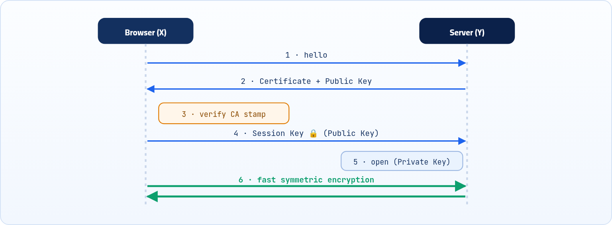

<small>المرحلة 4 · الشبكات</small>

من ضمن الحاجات اللي الـ Ingress بيقدمها هي الـ TLS Termination. فخلينا الأول نفهم إيه هو الـ TLS بشكل مفصّل، وبعدين نشوف إزاي نجيب شهادات مجانية من Let's Encrypt ونجددها أوتوماتيك بـ cert-manager.

:::note[بعد الفصل ده هتكون عارف]
- ليه الاتصال لازم يتشفّر
- الأهداف التلاتة للـ TLS
- التشفير غير المتماثل (الصندوق والقفل)
- خطوات الـ HTTPS ودور الـ Certificate والـ CA
- يعني إيه TLS Termination في الـ Ingress
- تركيب cert-manager وربطه بالـ Ingress
:::

<a id="s15-1"></a>

## 15.1 ليه محتاجين TLS؟

مبدئياً، أي مستخدم بيكتب اسم موقع في أي متصفح زي Google مثلاً، فهو بيبعت طلب إنه يكلم الموقع ده، أو بمعنى أدق عايز يكلم السيرفر اللي عليه الموقع ويشوف الموقع نفسه. وفي الحالة دي السيرفر بيرد عليه ببيانات، اللي بدورها بتظهرله الموقع ويبتدي يتعامل معاه.. العملية أو الاتصال ده بقى لازم يكون متشفّر أو متأمّن، عشان لو بطريقة ما حد اتدخل في النص، ممكن يشوف التواصل ده ويسرق بيانات.

يعني تخيل مثلاً حد فاتح موقع بنك وبيحط بياناته: لو الاتصال بينه وبين موقع البنك مش متشفّر، ساعتها المخترق هيشوف الحساب والبيانات الحساسة كلها ويسرق المستخدم ده.

الـ <strong>TLS (Transport Layer Security)</strong> هو بروتوكول بيعمل "قناة مشفرة" بين طرفين (متصفح المستخدم والسيرفر بتاعك) عشان البيانات تمشي فيه بأمان.

<a id="s15-2"></a>

## 15.2 الـ TLS بيحقق 3 أهداف رئيسية

#### التشفير (Encryption)

البيانات بتتحول لطلاسم، محدش يقدر يفهمها لو اعترضها في السكة (زي الباسوردات أو بيانات الفيزا).

#### التوثيق (Authentication)

بيتأكد إن السيرفر اللي إنت بتكلمه هو فعلاً السيرفر الحقيقي (عن طريق حاجة اسمها Certificate)، عشان محدش ينتحل شخصية الموقع.

#### سلامة البيانات (Integrity)

بيتأكد إن البيانات متمّش التلاعب بيها أو تعديلها أثناء نقلها.

<a id="s15-3"></a>

## 15.3 الفكرة التأسيسية: التشفير غير المتماثل

طب إزاي بيشتغل؟.. في الأول محتاجين نعرف أبسط شكل لعمليات التشفير: الـ **Asymmetric Encryption**. في البداية، فكّروا في طريقة **الصندوق والقفل**:

1. <strong>التجهيز:</strong> الطرف المستقبِل، وليكن اسمه Y اللي هو السيرفر، بيجيب صندوق مفتوح وقفل، وبيخلي "المفتاح المعدني" (الخاص) معاه هو بس.
2. <strong>التبادل:</strong> Y بيبعت "القفل المفتوح" (**Public Key**) لأي حد عايز يبعتله بيانات.
3. <strong>الإرسال:</strong> وليكن الطرف اللي هيبعت اسمه X، اللي هو المتصفح اللي استخدمه الـ user عشان يوصل للموقع (السيرفر)، بيحط البيانات في الصندوق، بيقفله بـ "القفل المفتوح"، ويبعته لـ Y.
4. <strong>الاستقبال:</strong> الصندوق بيوصل لـ Y مقفول، وبما إنه الوحيد اللي معاه المفتاح المعدني (**Private Key**)، بيقدر يفتحه ويقرأ البيانات.

:::caution[المشكلة هنا]
الطريقة دي (اللي بتعتمد على قفل وفتح الصناديق في كل مرة) بتستهلك "مجهود حسابي" ضخم جداً من المعالج (CPU). لو استخدمناها في كل حرف بتبعته، السيرفر بتاعك هيبطّأ جداً وهيفشل في خدمة آلاف المستخدمين في نفس الوقت.
:::

<a id="s15-4"></a>

## 15.4 التطور الحديث: نظام الـ HTTPS والـ TLS

عشان نحل مشكلة البطء، المهندسين عملوا "خلطة سحرية" بتدمج بين الأمان العالي والسرعة القصوى. إزاي؟ عن طريق فصل مرحلة "التعارف" عن مرحلة "نقل البيانات". العملية بتتم في أجزاء من الثانية:



*المراحل: التعارف، التحقق، تبادل السر بالصندوق مرة واحدة، وبعدين تشفير سريع بمفتاح مشترك.*

1. <strong>التعارف:</strong> المتصفح بيكلم السيرفر، والسيرفر بيبعتله **Certificate** (بطاقة هويته) المختومة من جهة موثوقة.
2. <strong>التحقق:</strong> المتصفح بيتأكد إن الشهادة دي أصلية ومش مزوّرة، عن طريق إنه بيدوّر على ختم الجهة الموثوقة دي فيها.
3. <strong>تبادل السر (استخدام الصندوق):</strong> هنا بنستخدم فكرة "الصندوق" لمرة واحدة فقط! المتصفح بيولّد مفتاح سري مؤقت (**Session Key**)، بيحطه في صندوق ويقفله بالـ Public Key بتاع السيرفر، ويبعته.
4. <strong>فتح السر:</strong> السيرفر بيفتح الصندوق بالـ Private Key الخاص بيه، وبيطلّع المفتاح السري.
5. <strong>الاتصال السريع (الواقع العملي):</strong> دلوقتي الطرفين معاهم نفس "المفتاح السري". الـ HTTPS هنا بيبطّل يستخدم الصناديق والقفل (لأنه بطيء)، وبيستخدم المفتاح السري ده لتشفير/فك تشفير كل البيانات المتبادلة بشكل متماثل (**Symmetric Encryption**)، وده أسرع بمراحل!

:::note[دقة: TLS 1.3]
الطريقة اللي فوق هي الفكرة الأساسية وكانت بتحصل كده بالظبط في النسخ القديمة (RSA key exchange). في **TLS 1.3** (المستخدم النهارده) المتصفح والسيرفر بيتفقوا على الـ Session Key بطريقة رياضية اسمها **ECDHE** من غير ما المفتاح نفسه يتبعت أصلاً في الصندوق، والـ Private Key بتاع السيرفر بيستخدم إنه "يمضي" ويثبت إنه هو صاحب الشهادة. النتيجة هي هي: تعارف تقيل مرة واحدة، وبعدين تشفير متماثل سريع.
:::

### مهم جداً نفهم حتة الـ Certificate دي

- الـ Certificate دي بطاقة هوية (Identity Document) رقمية.
- هي بتثبت إن الـ Public Key ده بتاع الموقع الفلاني فعلاً، مش بتاع واحد نصّاب.
- اللي بيضمن ده هو الطرف الثالث الموثوق (**CA**: Certificate Authority) اللي ختم الـ Certificate بختمه الرقمي.
- المتصفح بيثق في السيرفر لأنه واثق في الـ CA اللي ختم الـ Certificate نفسها.

<a id="s15-5"></a>

## 15.5 يعني إيه TLS Termination في الـ Ingress؟

بعد ما فهمنا القصة الكبيرة دي بقى.. الـ Ingress يقدر يعمل **TLS termination**، يعني الـ HTTPS بيتفك تشفيره عند الـ Ingress Controller، وبعد كده الـ Traffic الداخلي للـ Services بيبقى HTTP عادي (من غير تشفير، لأنه جوه الـ Cluster أصلاً).


*التشفير من المستخدم لحد الـ Ingress، وجوه الـ Cluster HTTP عادي.*

<a id="s15-6"></a>

## 15.6 إزاي نعمل الموضوع ده بـ cert-manager

في الـ production، بنستخدم حاجة اسمها **cert-manager** عشان يجيب شهادات مجانية من **Let's Encrypt** ويجدّدها لوحده، مش هتلمس الشهادات بإيدك تاني أبداً.

### (1) تسطيب الـ cert-manager

أسهل طريقة هي استخدام Helm. نفّذ الأوامر دي في الـ Terminal:

```sh title="Terminal"
# إضافة الـ Repository
helm repo add jetstack https://charts.jetstack.io
helm repo update
# تنصيب الـ cert-manager
helm install cert-manager jetstack/cert-manager \
  --namespace cert-manager \
  --create-namespace \
  --set crds.enabled=true
```

**تشريح الأمر**

```sh
helm repo add jetstack https://charts.jetstack.io
```

1. `repo add`: ضيف مستودع Charts جديد لـ Helm.
2. `jetstack`: اسم مختصر إنت بتختاره للمستودع، وبتستخدمه بعد كده في `jetstack/cert-manager`.
3. `https://charts.jetstack.io`: عنوان المستودع. وبعدها `helm repo update` بينزّل آخر قايمة Charts منه.

:::note[معلومة مهمة]
الـ `--set crds.enabled=true` بيسطّب الـ **CRDs** (Custom Resource Definitions): دي أنواع Objects جديدة بيضيفها cert-manager على Kubernetes، زي `ClusterIssuer` و `Certificate`، عشان تقدر تكتبهم في YAML زي الـ Pod والـ Service بالظبط.
:::

### (2) تعريف "جهة الإصدار" (Issuer)

الـ cert-manager محتاج يعرف مين اللي هيصدر الشهادات. هننشئ ملف اسمه `issuer.yaml` عشان يربطنا بـ Let's Encrypt:

```yaml title="issuer.yaml"
apiVersion: cert-manager.io/v1
kind: ClusterIssuer
metadata:
  name: letsencrypt-prod
spec:
  acme:
    server: https://acme-v02.api.letsencrypt.org/directory
    email: your-email@example.com
    privateKeySecretRef:
      name: letsencrypt-prod-key
    solvers:
    - http01:
        ingress:
          class: nginx
```

1. `apiVersion: cert-manager.io/v1`: `ClusterIssuer`: جهة إصدار متاحة للـ Cluster كله (و `Issuer` لـ Namespace واحدة).
2. `spec:`: الـ ACME هو البروتوكول اللي Let's Encrypt بيستخدمه، وده عنوان السيرفر الحقيقي (production).
3. `email: your-email@example.com`: اكتب إيميلك هنا عشان يبعتولك تنبيه لو الشهادة قربت تنتهي.
4. `privateKeySecretRef:`: اسم الـ Secret اللي هيتحفظ فيه المفتاح الخاص بحسابك عند Let's Encrypt.
5. `solvers:`: طريقة إثبات ملكية الدومين: HTTP-01 Challenge عن طريق الـ Ingress بتاع nginx.

بعد ما تخلص كتابة الملف احفظه واعمل: `kubectl apply -f issuer.yaml`

### (3) تعديل الـ Ingress بتاعك (الربط السحري)

دلوقتي هنروح لملف الـ Ingress اللي عملناه قبل كده، ونضيف عليه "Annotation" عشان الـ cert-manager يفهم إنه هو اللي مسؤول عن الشهادة دي:

```yaml title="ingress.yaml · TLS"
apiVersion: networking.k8s.io/v1
kind: Ingress
metadata:
  name: my-app-ingress
  annotations:
    cert-manager.io/cluster-issuer: "letsencrypt-prod"
    nginx.ingress.kubernetes.io/rewrite-target: /
spec:
  ingressClassName: nginx
  tls:
  - hosts:
    - myapp.example.com
    secretName: my-app-tls-secret
  rules:
  - host: myapp.example.com
    http:
      paths:
      - path: /
        pathType: Prefix
        backend:
          service: { name: app-service, port: { number: 80 } }
```

1. `apiVersion: networking.k8s.io/v1`: السطر ده هو اللي بيكلم الـ cert-manager: "اعمل شهادة للـ Ingress ده من الـ ClusterIssuer ده".
2. `nginx.ingress.kubernetes.io/rewrite-target: /`: زي ما هي من الفصل اللي فات.
3. `tls:`: الدومينات اللي عايز لها HTTPS، و `secretName` هو الاسم اللي الـ cert-manager هيحفظ جواه الشهادة.
4. `rules:`: نفس قواعد الـ routing. لاحظ إن الـ host هنا لازم يطابق اللي في `tls.hosts`.

<a id="s15-7"></a>

## 15.7 إيه اللي هيحصل في الخلفية؟

السحر ده بيحصل في ثواني:

1. <strong>الاكتشاف:</strong> بمجرد ما تعمل apply للـ Ingress، الـ cert-manager بيشوف الـ Annotation.
2. <strong>التحدي (HTTP-01 Challenge):</strong> الـ cert-manager بيبعت طلب لـ Let's Encrypt يقولهم: أنا عايز شهادة للدومين `myapp.example.com`.
3. <strong>إثبات الملكية:</strong> بترد بـ "تحدي" (ملف صغير لازم يكون متاح على الموقع بتاعك عشان نثبت إنك صاحب الدومين). الـ cert-manager بيعدّل الـ Ingress مؤقتاً عشان يخلي التحدي ده يمر، وبعدها بيمسحه.
4. <strong>الاستلام:</strong> بمجرد ما Let's Encrypt تتأكد، بتبعت الشهادة للـ cert-manager، اللي بيحفظها جوه Secret اسمه `my-app-tls-secret`.
5. <strong>التفعيل:</strong> الـ Ingress Controller (Nginx) بيشوف الـ Secret ده وبيبدأ يستخدمه فوراً لتشفير أي اتصال يجيلك!

:::caution[ملاحظات]
- Let's Encrypt ليها حدود في عدد الطلبات (Rate Limits). يفضّل في البداية تستخدم سيرفر الـ staging عشان لو غلطت في حاجة متتحظرش من الموقع:<br>`server: https://acme-staging-v02.api.letsencrypt.org/directory`
- الـ HTTP-01 محتاج الدومين يكون موجّه فعلاً للـ Ingress، والبورت 80 مفتوح من النت. على minikube من غير دومين حقيقي مش هينفع.
:::

تقدر دايماً تتأكد إن الشهادة طلعت صح بالأمر ده:

```sh title="Terminal"
$ kubectl get certificate
NAME                READY   SECRET              AGE
my-app-tls-secret   True    my-app-tls-secret   2m
$ kubectl describe certificate my-app-tls-secret
```

الـ `READY = True` معناها الشهادة اتصدرت واتحفظت. ولو `False` افتح الـ describe وشوف الـ Events.

<a id="s15-8"></a>

## 15.8 مشاكل شائعة

:::danger[مشكلة: مشاكل في الشهادة (TLS)]
الشهادة مش بتطلع أو READY فاضلة False. افحص بالترتيب:

```sh title="Terminal"
kubectl describe certificate my-app-tls-secret
kubectl describe certificaterequest
kubectl get events --sort-by='.lastTimestamp'
```

<strong>أشهر الأسباب:</strong> الـ DNS مش موجّه للـ Ingress، أو الـ `class` في الـ solver مش مطابق للـ Controller، أو اتحظرت من الـ Rate Limits (جرّب staging).
:::

**تشريح الأمر**

```sh
kubectl get events --sort-by='.lastTimestamp'
```

1. `get events`: اعرض الأحداث اللي حصلت في الـ Namespace (Pod اتعمل، Image اتسحبت، Error ...).
2. `--sort-by=`: رتّب النتايج على حسب حقل معين.
3. `'.lastTimestamp'`: الحقل: آخر وقت الحدث حصل فيه، فالأحدث يبقى تحت.

:::tip[ملخص الفصل]
- الـ TLS بيحقق: تشفير، توثيق، سلامة بيانات.
- التشفير غير المتماثل (Public/Private Key) تقيل، فبيستخدم مرة في التعارف، وبعدها تشفير متماثل سريع بـ Session Key.
- الـ Certificate بطاقة هوية مختومة من CA موثوقة.
- الـ TLS Termination: الـ HTTPS بيتفك عند الـ Ingress، وجوه الـ Cluster HTTP.
- cert-manager + ClusterIssuer + annotation في الـ Ingress = شهادات Let's Encrypt بتتجدد لوحدها.
:::

### أسئلة مراجعة

1. ليه مبنستخدمش التشفير غير المتماثل في كل البيانات؟
2. المتصفح بيثق في الـ Certificate بتاعة السيرفر ليه؟
3. إيه دور الـ annotation `cert-manager.io/cluster-issuer`؟
4. ليه نبدأ بسيرفر الـ staging بتاع Let's Encrypt؟

### صح ولا غلط؟

1. الـ Private Key بيتبعت للمتصفح عشان يفك التشفير.
2. مع TLS Termination الـ Traffic جوه الـ Cluster بيبقى HTTP.
3. cert-manager بيحفظ الشهادة جوه Secret.
