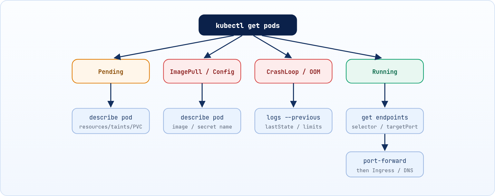

<small>المرحلة 6 · التشغيل الاحترافي</small>

:::note[إضافة]
الفصل ده إضافة: بيجمّع
:::

أهم مهارة في Kubernetes مش إنك تكتب YAML، دي إنك تعرف تعمل إيه لما حاجة متشتغلش. الفصل ده بيديك الأوامر الأساسية للتشخيص، ومعنى كل حالة غريبة هتشوفها في عمود STATUS، وخريطة تمشي عليها خطوة بخطوة.

:::note[بعد الفصل ده هتكون عارف]
- الأوامر الخمسة للتشخيص: get, describe, logs, events, exec
- معنى Pending و ImagePullBackOff و CrashLoopBackOff و OOMKilled
- تشخيص مشاكل الـ Service والـ Endpoints
- الـ port-forward والـ kubectl debug
- خريطة التشخيص خطوة بخطوة
:::

<a id="s21-1"></a>

## 21.1 صندوق العدة: أوامر التشخيص

| الأمر | بيعمل إيه |
|---|---|
| `kubectl get pods -o wide` | نظرة عامة: الحالة، عدد الـ Restarts، والـ Node والـ IP. |
| `kubectl describe pod <name>` | التفاصيل كلها، والأهم جزء **Events** في الآخر. |
| `kubectl logs <name>` | اللي التطبيق طبعه (stdout/stderr). |
| `kubectl get events --sort-by=.lastTimestamp` | كل أحداث الـ Namespace بالترتيب. |
| `kubectl exec -it <name> -- sh` | ادخل جوه الـ Container وجرّب بنفسك. |

### الـ logs بالتفصيل

**تشريح الأمر**

```sh
kubectl logs web-7d4b -c app --previous --tail=50 -f
```

1. `logs web-7d4b`: اعرض الـ logs بتاعة الـ Pod ده.
2. `-c app`: لو الـ Pod فيه أكتر من Container، اختار أنهي واحد بالاسم. (من غيرها هيطلب منك تحدد).
3. `--previous`: الـ logs بتاعة الـ Container **اللي مات قبل كده**، مش الحالي. أهم flag في الـ CrashLoopBackOff لأن الجديد لسه مطبعش حاجة. (اختصارها `-p`).
4. `--tail=50`: آخر 50 سطر بس.
5. `-f`: اختصار `--follow`: فضّل متابع وكل سطر جديد يظهر لايف.. ومع `--previous` ملهاش لازمة لأن الـ Container القديم خلص أصلاً، فاستخدمهم كل واحد لوحده.

:::note[معلومة مهمة]
تقدر كمان تشوف logs كل الـ Pods اللي عليها label: `kubectl logs -l app=web --all-containers`، أو logs Deployment: `kubectl logs deploy/web`.
:::

<a id="s21-2"></a>

## 21.2 قاموس الحالات (STATUS)

**أشهر الحالات الغلط ومعناها وأول خطوة**

| الحالة | معناها | تعمل إيه؟ |
|---|---|---|
| `Pending` | الـ Scheduler ملقاش Node مناسبة، أو مستني PVC | `describe pod`: شوف <em>Insufficient cpu/memory</em> أو taints أو nodeSelector أو PVC Pending |
| `ImagePullBackOff` / `ErrImagePull` | مش قادر يسحب الـ image | اتأكد من الاسم والـ tag، ومن الـ `imagePullSecrets` لو Registry خاص |
| `CrashLoopBackOff` | الـ Container بيقوم ويقع، والـ kubelet بيستنى وقت أطول كل مرة | `logs --previous`، وشوف الـ command والـ env والـ liveness probe |
| `OOMKilled` | عدّى الـ memory limit فاتقتل (exit code 137) | زوّد الـ limit أو صلّح الـ memory leak |
| `CreateContainerConfigError` | ناقص ConfigMap أو Secret أو key متشار عليه | `describe pod` هيقولك أنهي واحد مش موجود |
| `Running` بس `0/1 READY` | الـ readinessProbe فاشلة | راجع الـ probe (path/port) والـ Events |
| `Terminating` لفترة طويلة | فيه finalizer أو الـ Node مش بترد | استنى الـ grace period، واعرف السبب قبل أي force delete |

**تشريح الأمر**

```sh
kubectl get pod web-7d4b -o jsonpath='{.status.containerStatuses[0].lastState}'
```

1. `-o jsonpath=`: اطبع جزء محدد من الـ Object.
2. `.status.containerStatuses`: حالة الـ Containers جوه الـ status.
3. `[0]`: أول Container في القايمة (الترقيم بيبدأ من صفر).
4. `.lastState`: حالة آخر مرة الـ Container مات: فيها السبب (زي `OOMKilled`) والـ exitCode.

<a id="s21-3"></a>

## 21.3 لو المشكلة في الـ Service

الـ Pods شغالة بس مش قادر توصل للتطبيق؟ اتأكد إن الـ Service لاقية Pods أصلاً:

```sh title="Terminal"
$ kubectl get endpoints web
NAME   ENDPOINTS                         AGE
web    10.244.1.5:8080,10.244.2.7:8080   5m
```

- لو الـ ENDPOINTS فاضية `<none>`: الـ `selector` في الـ Service مش مطابق لـ labels الـ Pods، أو الـ Pods مش Ready.
- لو موجودة: اتأكد إن الـ `targetPort` هو البورت اللي التطبيق بيسمع عليه فعلاً.

**تشريح الأمر**

```sh
kubectl port-forward svc/web 8080:80
```

1. `port-forward`: افتح نفق من جهازك لحد جوه الـ Cluster، من غير Ingress ولا NodePort.
2. `svc/web`: النوع/الاسم: الـ Service `web`. وينفع `pod/...` أو `deploy/...`.
3. `8080:80`: البورت على جهازك (شمال) : البورت على الـ Service (يمين). افتح `localhost:8080`.

ولو عايز تختبر من جوه الـ Cluster (DNS مثلاً):

```sh title="Terminal"
kubectl run tmp --rm -it --image=busybox -- nslookup web.default.svc.cluster.local
```

<a id="s21-4"></a>

## 21.4 الـ kubectl debug

فيه images صغيرة جداً (distroless) مفيهاش حتى `sh`، فالـ exec مش هينفع. هنا بنستخدم **Ephemeral Container**: Container مؤقت بيتضاف للـ Pod الشغال وفيه أدوات:

**تشريح الأمر**

```sh
kubectl debug -it web-7d4b --image=busybox --target=app
```

1. `debug -it web-7d4b`: ضيف Container للتشخيص للـ Pod ده وادخل عليه تفاعلي.
2. `--image=busybox`: الـ image اللي فيها الأدوات.
3. `--target=app`: شارك الـ processes بتاعة Container اسمه `app`، فتقدر تشوفها بـ `ps`.

<a id="s21-5"></a>

## 21.5 خريطة التشخيص



*ابدأ دايماً من الـ STATUS، وهو هيقولك تكمّل في أنهي طريق.*

:::tip[عادة المحترفين]
قبل ما تغير أي حاجة، اقرا الـ **Events**. في 80% من المشاكل السبب مكتوب بالحرف في آخر `kubectl describe`.
:::

:::tip[ملخص الفصل]
- الترتيب: get ← describe (Events) ← logs (--previous) ← exec/debug.
- الـ STATUS بيحدد الطريق: Pending = Scheduling، BackOff = image أو تشغيل، OOMKilled = memory.
- مشاكل الـ Service غالباً selector أو targetPort، واكشفها بـ `get endpoints`.
- الـ port-forward بيعزل المشكلة: التطبيق ولا الشبكة؟
:::

### أسئلة مراجعة

1. Pod في CrashLoopBackOff و `kubectl logs` فاضي. تعمل إيه؟
2. إيه معنى exit code 137؟
3. الـ Service شغالة بس الـ ENDPOINTS فاضية، إيه السببين الأشهر؟
4. إمتى تستخدم `kubectl debug` بدل `kubectl exec`؟

### صح ولا غلط؟

1. الحالة Pending معناها غالباً إن الـ image فيها مشكلة.
2. في `port-forward 8080:80` الرقم الأول هو البورت على جهازك.
3. الـ CreateContainerConfigError ممكن يكون سببه Secret مش موجود.
