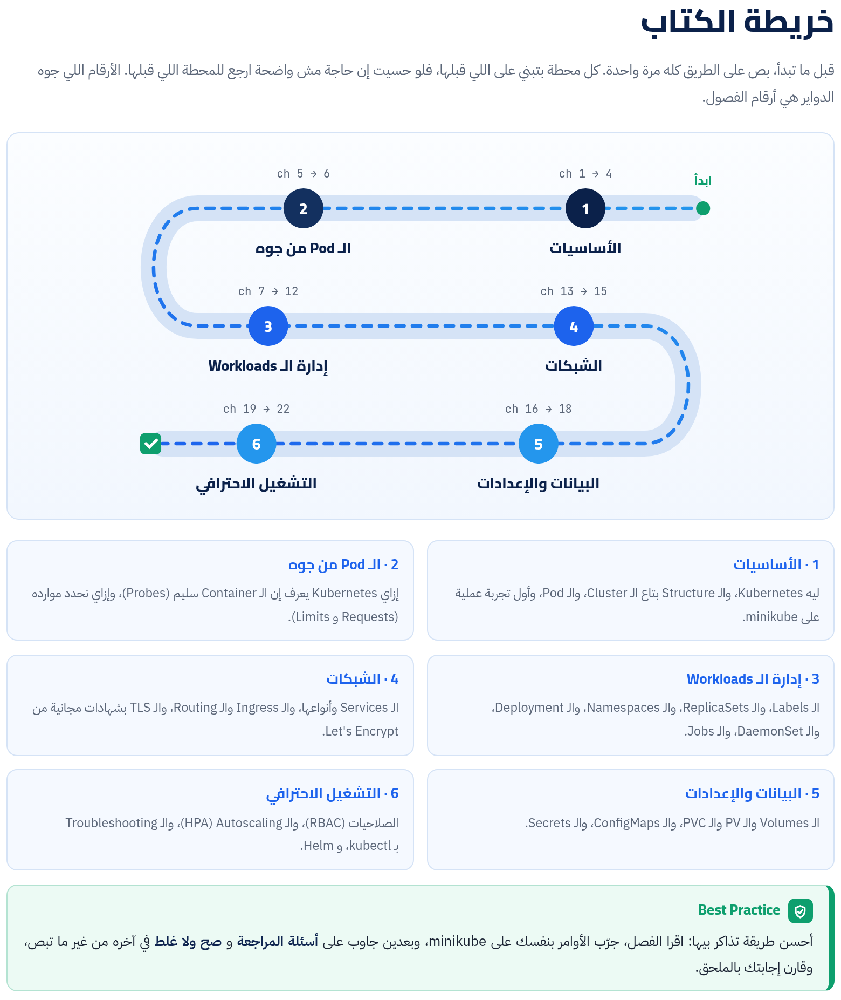

الكتاب ماشي على 6 مراحل بالترتيب اللي هتحتاجه وانت بتتعلم: نفهم المشكلة والـ Structure الأول، وبعدين الـ Pod من جوه، وبعدها إدارة الـ Workloads والشبكات والبيانات، وفي الآخر التشغيل الاحترافي. الفصول والأجزاء اللي عليها علامة إضافة اتضافت علشان الكتاب يبقى كامل.

:::tip[تحميل]
- [الكتاب كامل PDF](/biginner-journey/downloads/08-kubernetes-book.pdf)
- [الـ Cheat Sheet PDF](/biginner-journey/downloads/08-kubernetes-cheatsheet.pdf)
:::

## خريطة الكتاب

- **1 · الأساسيات**: ليه Kubernetes، والـ Structure بتاع الـ Cluster، والـ Pod، وأول تجربة عملية على minikube.
- **2 · الـ Pod من جوه**: إزاي Kubernetes يعرف إن الـ Container سليم (Probes)، وإزاي نحدد موارده (Requests و Limits).
- **3 · إدارة الـ Workloads**: الـ Labels، والـ ReplicaSets، والـ Namespaces، والـ Deployment، والـ DaemonSet، والـ Jobs.
- **4 · الشبكات**: الـ Services وأنواعها، والـ Ingress والـ Routing، والـ TLS بشهادات مجانية من Let's Encrypt.
- **5 · البيانات والإعدادات**: الـ Volumes والـ PV والـ PVC، والـ ConfigMaps، والـ Secrets.
- **6 · التشغيل الاحترافي**: الصلاحيات (RBAC)، والـ Autoscaling (HPA)، والـ Troubleshooting بـ kubectl، و Helm.

## الفصول

**المرحلة 1 · الأساسيات**

- [الفصل 1: المقدمة: ليه Kubernetes؟](./ch01/)
- [الفصل 2: الـ Structure بتاع Kubernetes](./ch02/)
- [الفصل 3: الشغل نفسه: الـ Pods](./ch03/)
- [الفصل 4: تطبيق عملي: minikube وأول Pod](./ch04/)

**المرحلة 2 · الـ Pod من جوه**

- [الفصل 5: الـ Probes: هل الـ Container بخير؟](./ch05/)
- [الفصل 6: الـ Requests والـ Limits: موارد الـ Pod](./ch06/)

**المرحلة 3 · إدارة الـ Workloads**

- [الفصل 7: الـ Labels والـ Selectors](./ch07/)
- [الفصل 8: الـ ReplicaSets: عدد ثابت من النسخ](./ch08/)
- [الفصل 9: الـ Namespaces: تقسيم الـ Cluster](./ch09/)
- [الفصل 10: الـ Deployment: إدارة الـ Pods باحتراف](./ch10/)
- [الفصل 11: الـ DaemonSet: Pod على كل Node](./ch11/)
- [الفصل 12: الـ Jobs والـ CronJobs: شغل يخلص ويقفل](./ch12/)

**المرحلة 4 · الشبكات**

- [الفصل 13: الـ Services: عنوان ثابت للـ Pods](./ch13/)
- [الفصل 14: الـ Ingress: باب واحد لكل الـ Traffic](./ch14/)
- [الفصل 15: الـ TLS و cert-manager: HTTPS ببلاش](./ch15/)

**المرحلة 5 · البيانات والإعدادات**

- [الفصل 16: الـ Volumes والتخزين: البيانات اللي متضيعش](./ch16/)
- [الفصل 17: الـ ConfigMaps: الإعدادات برّه الكود](./ch17/)
- [الفصل 18: الـ Secrets: البيانات الحساسة](./ch18/)

**المرحلة 6 · التشغيل الاحترافي**

- [الفصل 19: الـ RBAC: مين يقدر يعمل إيه؟](./ch19/)
- [الفصل 20: الـ HPA: الـ Scaling الأوتوماتيك](./ch20/)
- [الفصل 21: الـ Troubleshooting: إزاي تحل أي مشكلة](./ch21/)
- [الفصل 22: الـ Helm: مدير الحزم لـ Kubernetes](./ch22/)

**الملاحق**

- [ملحق أ: Cheat Sheet: أوامر kubectl و Helm](./appendix-1/)
- [ملحق ب: قاموس المصطلحات](./appendix-2/)
- [ملحق ج: إجابات أسئلة المراجعة و صح ولا غلط](./appendix-3/)
